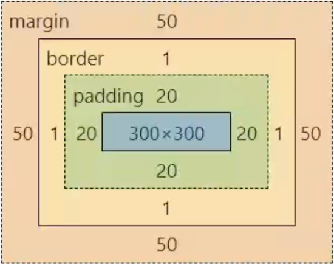

# CSS 盒模型图展示了什么？

图中由内到外依次是内容区、padding（内边距）、border（边框）和 margin（外边距）。中心的 `300 × 300` 是内容区，四边各有 `20` 的 padding、`1` 的 border 和 `50` 的 margin。假设这些数值单位相同，则 padding box 为 `300 + 2 × 20 = 340`，即 `340 × 340`；border box 再加两侧边框，为 `342 × 342`；margin 外缘再加两侧外边距，为 `442 × 442`。图只示意分层，没有按比例绘制；相邻盒子的上下 margin 还可能折叠，所以不能把图中的外缘直接当作实际布局间距。尺寸规则与可复算的例子见[CSS 盒尺寸演算](../../../../frontend/html-css/box-model-and-bfc.md)。
