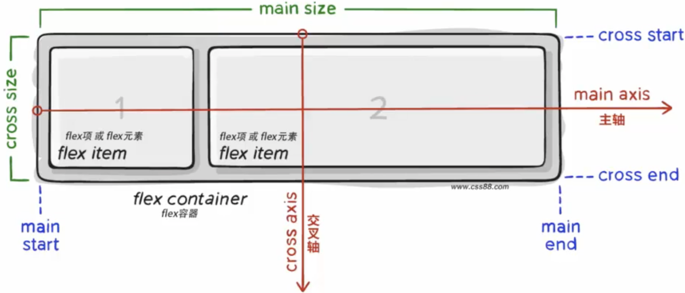

# 如何避免 Flex 导航和文字溢出？

## 导航栏与长文字

以横排的工具栏为例：链接和按钮保持各自需要的宽度，长标题占用剩余空间。容器变窄时，要先让标题所在的 flex item（Flex 项目）能够收缩，再决定超出标题框的文字怎样显示。Flex 项目默认的最小宽度由内容决定（自动最小尺寸），在这个限制解除之前，只加 `text-overflow: ellipsis` 并不会让它变窄。

单行省略号需要四个条件同时满足：宽度受限，再加上 `white-space: nowrap`、`overflow: hidden` 和 `text-overflow: ellipsis`。如果直接在 Flex 项目上设置 `overflow: hidden`，它的自动最小主尺寸会变为零，项目自然能够收缩；如果改在项目内部的 block container（块容器）上裁切，就要在外层的 Flex 项目上设置 `min-inline-size: 0`，让外层先能收缩，内层再负责裁切文字。完整例子见[一行导航怎样给长标题分配剩余空间](../../../../frontend/html-css/flex-and-grid-layout.md#%E7%94%A8%20Flex%20%E6%8E%92%E5%88%97%E6%8A%A5%E8%A1%A8%E5%B7%A5%E5%85%B7%E6%A0%8F%E5%B9%B6%E6%88%AA%E6%96%AD%E9%95%BF%E6%A0%87%E9%A2%98)；单行与多行的具体写法见[受限文本与行数裁切](../../../../frontend/html-css/responsive-units-and-layout.md)。

如果链接、按钮和间距本身已超过工具栏宽度，压缩标题仍不够，应按使用需求让导航换行、局部滚动或改用窄屏布局。省略号只改变可见文字，完整标题仍应可读取。

下方保留的原图只解释 Flex 容器的轴与项目，不是省略号效果图。它画的是主轴水平、交叉轴垂直的例子；实际方向由 `flex-direction` 和书写模式决定。

> [!info]- 来源
> - 自动最小主尺寸与轴方向：[CSS Flexbox Level 1 §4.5、§5.1](https://www.w3.org/TR/2025/CRD-css-flexbox-1-20251014/#min-size-auto)，Candidate Recommendation Draft，2025-10-14；核对于 2026-11-12。
> - 裁切与省略号的作用：[CSS Overflow Level 3 §3.1、§5.1](https://www.w3.org/TR/2025/WD-css-overflow-3-20251007/#text-overflow)，Working Draft，2025-10-07；核对于 2026-11-12。
