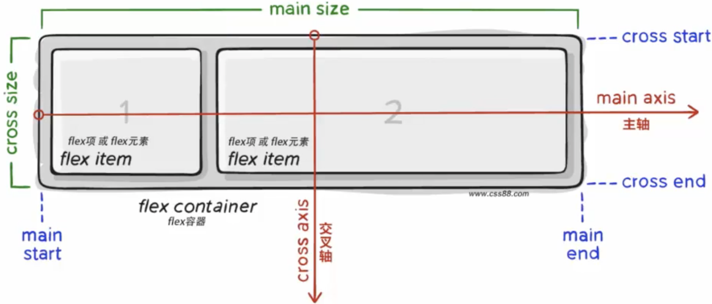

# 如何避免 Flex 导航和文字溢出？

## 导航栏与长文字

以水平书写、横向排列的工具栏为例：链接和按钮保留所需宽度，长标题占剩余空间。缩窄容器时，先让标题所在的 Flex 项目能够收缩，再决定超出标题盒的文字怎样显示。若项目仍受内容相关的自动最小尺寸限制，仅加 `text-overflow: ellipsis` 不会让它变窄。

本例用有限的可用宽度与 `white-space: nowrap`、`overflow: hidden`、`text-overflow: ellipsis` 配合实现单行省略号。在直接 Flex 项目上设置 `overflow: hidden`，也会让其自动最小主尺寸为零；若改在项目内部受宽度限制的 block container（块容器）上裁切，则可在直接项目上设置 `min-inline-size: 0`，允许外层先收缩，再让内层裁切。完整例子见[一行导航怎样给长标题分配剩余空间](../../../../frontend/html-css/flex-and-grid-layout.md#用-flex-排列报表工具栏并截断长标题)；单行与多行的具体写法见[受限文本与行数裁切](../../../../frontend/html-css/responsive-css-units-and-layout.md#受限文本与行数裁切)。

如果链接、按钮和间距本身已超过工具栏宽度，压缩标题仍不够，应按使用需求让导航换行、局部滚动或改用窄屏布局。省略号只改变可见文字，完整标题仍应可读取。

下方保留的原图只解释 Flex 容器的轴与项目，不是省略号效果图。它画的是主轴水平、交叉轴垂直的例子；实际方向由 `flex-direction` 和书写模式决定。

> [!info]- 来源
> - 自动最小主尺寸与轴方向：[CSS Flexbox Level 1 §4.5、§5.1](https://www.w3.org/TR/2025/CRD-css-flexbox-1-20251014/#min-size-auto)，Candidate Recommendation Draft，2025-10-14；核对于 2026-11-12。
> - 裁切与省略号的作用：[CSS Overflow Level 3 §3.1、§5.1](https://www.w3.org/TR/2025/WD-css-overflow-3-20251007/#text-overflow)，Working Draft，2025-10-07；核对于 2026-11-12。
