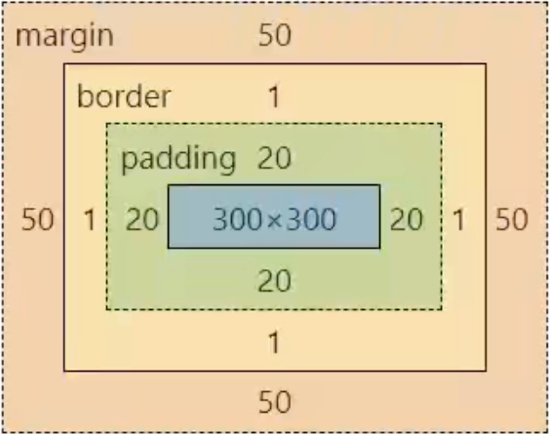
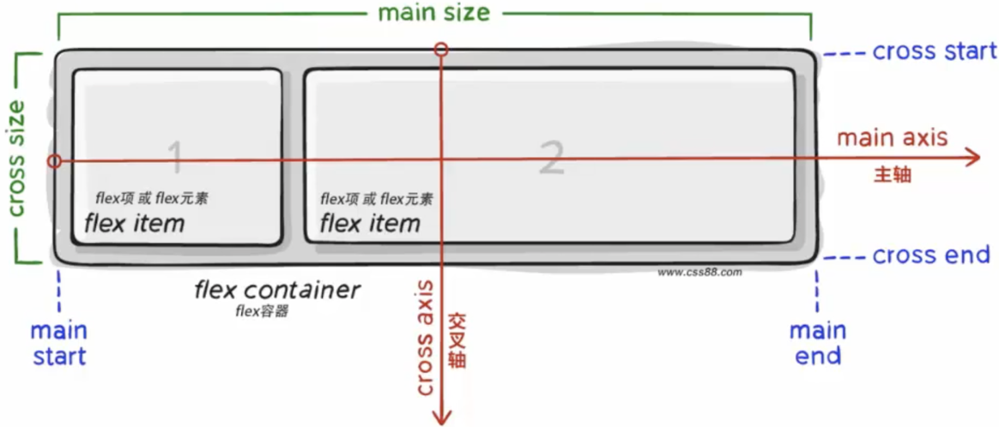
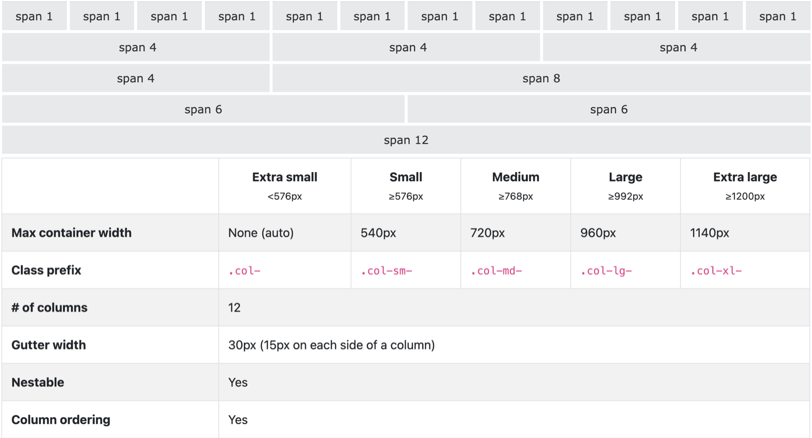

# CSS Basics / CSS 基础

**Key terms / 关键术语:** cascade / 层叠, specificity / 优先级, box model / 盒模型, formatting context / 格式化上下文.

**Core / 核心：** The cascade selects declarations; formatting contexts govern how boxes participate in layout, and box edges plus intrinsic and available sizes shape geometry and space allocation.
层叠决定哪些声明生效；格式化上下文决定盒子如何参与布局，盒边界以及固有尺寸和可用空间共同影响几何尺寸与空间分配。

This archived learning note preserves its original selectors, property catalogs, worked layouts, diagrams, and lesson sequence. For the focused current explanations, see [CSS basics, selectors, and text overflow](../../../../frontend/html-css/html-and-css-basics.md), [box model and BFC](../../../../frontend/html-css/box-model-and-bfc.md), [Flexbox and Grid](../../../../frontend/html-css/flex-and-grid-layout.md), and [position, display, and animations](../../../../frontend/html-css/css-position-display-and-animations.md).

## Commenting in CSS

### Syntax
```css
/* This is a comment */
```
- Comments are used to explain the code and are ignored by the browser.

## Writing CSS

### Syntax
```css
selector {
  property: value;
}
```
- **Selector:** Targets the HTML elements to style.
- **Property:** The aspect of the element you want to change (e.g., `color`, `font-size`).
- **Value:** The specific value for the property (e.g., `red`, `16px`).

**Example**
```css
p {
  color: blue;
  font-size: 16px;
}
```
- This example selects all `<p>` elements and sets their text color to blue and font size to 16px.

## Overwriting Properties

- When two declarations tie on origin, importance, cascade layer, specificity, and (for scoped style rules) scoping proximity, the later declaration in source order wins. The cascade evaluates those criteria before source order; “last declaration wins” is not a general rule.
- Example:
  ```css
  p {
    color: red;
    color: blue; /* This will be applied */
  }
  ```

## Inheritance and Cascading

### Inheritance

- Certain CSS properties are inherited from parent elements to child elements.
- Common inheritable properties include `color`, `font-family`, `font-size`, `line-height`, `text-align`.
- Example:
  ```html
  <div style="color: red;">
    <p>This text will be red because it inherits the color from the parent div.</p>
  </div>
  ```

### Cascading

- CSS rules cascade, meaning multiple rules can apply to an element.
- When conflicting declarations apply, the cascade compares origin and importance, layer, specificity, scoped-rule proximity where applicable, and then source order. Source order matters only after the earlier criteria tie.
- Example:
  ```css
  p {
    color: red;
  }
  .special {
    color: blue; /* This will be applied if the element has class="special" */
  }
  ```

## Specificity and Priority

### Specificity Hierarchy

1. ID selectors (`#id`)
2. Class selectors (`.class`), attribute selectors (`[type="text"]`), and pseudo-classes (`:hover`)
3. Type selectors (`div`, `p`, `h1`) and pseudo-elements (`::before`, `::after`)
4. Universal selector (`*`), combinators (`+`, `>`, `~`), and `:where()` contribute zero specificity.

Declarations in a `style` attribute outrank style-rule declarations of the same importance before selector specificity is compared, but they are still subject to origin and importance. Specificity is conventionally written as `(ID, class/attribute/pseudo-class, type/pseudo-element)` and compared left to right. `:is()`, `:not()`, and `:has()` take the greatest specificity of their argument list; `:where()` contributes zero.

### Specificity Calculation

- Specificity is calculated based on the count of selectors in each category.
- Example:
  ```css
  /* Specificity: (1, 1, 1) */
  #main .content p {
    color: green;
  }

  /* Specificity: (0, 1, 1) */
  .content p {
    color: blue; /* This will be overridden by the previous rule */
  }
  ```

### `!important` Declaration

- Changes the declaration's importance in the cascade; it does not override every origin or an active transition. User-important declarations can override author-important declarations, and user-agent-important declarations outrank both.
- Example:
  ```css
  p {
    color: red !important;
    color: blue; /* This will be ignored */
  }
  ```
- Use `!important` sparingly as it can make debugging difficult.

## Weight Superposition Calculation

- When using composite selectors, the one with the higher specificity takes effect.
- Example:
  ```css
  /* Specificity: (0, 1, 0) */
  .box {
    color: blue;
  }

  /* Specificity: (0, 2, 1) */
  .box:hover::before {
    color: green; /* This will be applied */
  }
  ```

## Pseudo-Elements

- Used to style specific parts of an element.
- Common pseudo-elements: `::before`, `::after`, `::first-letter`, `::first-line`.
- Example:
  ```css
  p::before {
    content: "Note: ";
    font-weight: bold;
  }
  ```

## HTML Height 100%

- This common height chain lets a percentage-height child resolve against the viewport-sized root. Percentage heights require a definite containing-block height chain; for a minimum page height, a viewport unit may fit better.
  ```css
  html, body {
    height: 100%;
    margin: 0;
  }
  ```

## CSS Preprocessors (LESS/Sass)

- CSS preprocessors like LESS and Sass add functionality to CSS such as variables, nesting, and mixins.
- Example of a LESS file structure:
  - `base.less` or `base.css`: Basic styles and resets.
  - `normalize.less` or `normalize.css`: Ensures cross-browser compatibility.
  - `index.less` or `index.css`: Specific styles for the homepage.

# Where to Write CSS

## Internal Style Sheet

To write an internal style sheet, follow these steps:

1. Add a `<style>` tag within the `<head>` section of your HTML document.
2. Define the selectors and their corresponding CSS properties within the `<style>` tag.

Example:

```html
<!DOCTYPE html>
<html lang="en">
<head>
    <meta charset="UTF-8">
    <meta name="viewport" content="width=device-width, initial-scale=1.0">
    <title>Document</title>
    <style>
        p {
            color: red;
        }
    </style>
</head>
<body>
    <p>This is a red sentence.</p>
</body>
</html>
```

In the example above, the selector `p` targets all `<p>` tags within the `<body>` section. The CSS property `color: red;` sets the text color inside the `<p>` tags to red.

## External Style Sheet

To use an external style sheet, follow these steps:

1. Create a separate CSS file with a `.css` extension (e.g., `styles.css`).
2. Define the selectors and their corresponding CSS properties in the external CSS file.
3. Link the external CSS file to your HTML document using the `<link>` tag.

Example CSS file (`styles.css`):

```css
p {
    color: aqua;
}
```

To reference the external CSS file, add the following code within the `<head>` section of your HTML document:

```html
<!DOCTYPE html>
<html lang="en">
<head>
    <meta charset="UTF-8">
    <meta name="viewport" content="width=device-width, initial-scale=1.0">
    <title>Document</title>
    <link rel="stylesheet" href="styles.css">
</head>
<body>
    <p>This is an aqua sentence.</p>
</body>
</html>
```

In the example above, the `<link>` tag with the `rel="stylesheet"` attribute specifies that the referenced file is a CSS file. The `href` attribute specifies the path to the external CSS file (`styles.css` in this case).

## Inline Style

To apply inline styles directly to an HTML element, follow these steps:

1. Add the `style` attribute to the opening tag of the element.
2. Inside the `style` attribute, define the CSS properties and their corresponding values.

Example:

```html
<p style="color: aqua;">This is an aqua sentence.</p>
```

In the example above, the `style` attribute is added to the `<p>` tag, and the CSS property `color: aqua;` sets the text color inside the `<p>` tag to aqua.

# CSS Selectors

## Class Selector

- **Syntax:** `.classname { css_property_name: property_value; }`
- **Example:**
  ```css
  .highlight {
      color: red;
  }
  ```
  ```html
  <p class="highlight">This is a red sentence.</p>
  ```
  - The class selector `.highlight` targets all elements with the class `highlight`.

## ID Selector

- **Syntax:** `#idname { css_property_name: property_value; }`
- **Example:**
  ```css
  #unique {
      color: blue;
  }
  ```
  ```html
  <p id="unique">This is a blue sentence.</p>
  ```
  - The ID selector `#unique` targets the element with the ID `unique`.

## Universal Selector

- **Syntax:** `* { css_property_name: property_value; }`
- **Example:**
  ```css
  * {
      margin: 0;
      padding: 0;
      box-sizing: border-box;
  }
  ```
  - The universal selector `*` targets all elements, commonly used for resetting styles.

## Descendant Combinator

- **Syntax:** `selector1 selector2 { css_property_name: property_value; }`
- **Example:**
  ```css
  div p {
      color: red;
  }
  ```
  ```html
  <div>
      <p>This is a red paragraph inside a div.</p>
  </div>
  ```
  - Targets `<p>` elements that are descendants of `<div>` elements.

## Child Combinator

- **Syntax:** `selector1 > selector2 { css_property_name: property_value; }`
- **Example:**
  ```css
  div > p {
      color: rebeccapurple;
  }
  ```
  ```html
  <div>
      <p>This is a purple paragraph directly inside a div.</p>
  </div>
  ```
  - Targets `<p>` elements that are direct children of `<div>` elements.

## Selector List

- **Syntax:** `selector1, selector2 { css_property_name: property_value; }`
- **Example:**
  ```css
  h1, p, span {
      color: red;
  }
  ```
  ```html
  <h1>This is a red heading.</h1>
  <p>This is a red paragraph.</p>
  <span>This is a red span.</span>
  ```
  - Targets all elements listed (e.g., `h1`, `p`, `span`).

## Attribute Selector

- **Syntax:** `[attribute=value] { css_property_name: property_value; }`
- **Example:**
  ```css
  [type="text"] {
      border: 1px solid #000;
  }
  ```
  ```html
  <input type="text">
  ```
  - Targets elements with a specific attribute value.

## Hover Pseudo-Class Selector

- **Syntax:** `selector:hover { css_property_name: property_value; }`
- **Example:**
  ```css
  a:hover {
      color: red;
  }
  ```
  ```html
  <a href="#">Hover over me</a>
  ```
  - Targets elements when the user hovers over them.

## Structural Pseudo-Class Selectors

- **Syntax and Examples:**
  ```css
  /* First child */
  p:first-child {
      color: blue;
  }

  /* Last child */
  p:last-child {
      color: green;
  }

  /* Nth child */
  p:nth-child(2) {
      color: red;
  }

  /* Nth last child */
  p:nth-last-child(2) {
      color: purple;
  }

  /* Nth of type */
  p:nth-of-type(3) {
      color: orange;
  }

  /* Nth last of type */
  p:nth-last-of-type(3) {
      color: pink;
  }
  ```
  ```html
  <div>
      <p>First paragraph (blue)</p>
      <p>Second paragraph (red)</p>
      <p>Third paragraph (orange)</p>
      <p>Fourth paragraph (default)</p>
      <p>Fifth paragraph (default)</p>
      <p>Sixth paragraph (pink)</p>
  </div>
  ```

## Pseudo-Elements

- **Syntax and Examples:**
  ```css
  /* Before pseudo-element */
  p::before {
      content: "Prefix ";
      color: red;
  }

  /* After pseudo-element */
  p::after {
      content: " Suffix";
      color: blue;
  }
  ```
  ```html
  <p>This is a paragraph.</p>
  ```
  - The `::before` and `::after` pseudo-elements insert content before and after the element's actual content.

# Font Properties

## Font Size

### Property: `font-size`
- **Value:** `<number>px`, `<number>em`, `<number>rem`
- **Example:**
  ```css
  p {
      font-size: 30px;
  }
  ```
- **Default Value:** Many user-agent defaults are 16 CSS px, but the user's settings and browser defaults can differ; `1rem` follows the root element's computed size.
- **Best Practices:**
  - Use relative units like `em` or `rem` for responsive design.
  - **Example:**
    ```css
    p {
        font-size: 1.5rem;
    }
    ```
  - `em` is relative to the font-size of the parent element.
  - `rem` is relative to the font-size of the root element (`<html>`).

## Font Weight

### Property: `font-weight`
- **Value:** 
  - Keywords: `normal`, `bold`
  - Numeric: `1` to `1000`; many common font faces expose weights in 100-step increments.
- **Examples:**
  ```css
  p {
      font-weight: normal; /* equivalent to 400 */
      font-weight: bold;   /* equivalent to 700 */
      font-weight: 700;
  }
  ```
- **Best Practices:**
  - Use numeric values for more precise control over font weight.

## Font Style

### Property: `font-style`
- **Value:** `normal`, `italic`, `oblique`
- **Example:**
  ```css
  p {
      font-style: italic;
  }
  ```

## Font Family

### Property: `font-family`
- **Value:** A list of font family names
- **Example:**
  ```css
  div {
      font-family: Arial, Helvetica, sans-serif;
  }
  ```
- **Best Practices:**
  - Provide a fallback system font.
  - Always end with a generic family name like `serif`, `sans-serif`, `monospace`.

## Font Shorthand Property

### Property: `font`
- **Value:** `font: <style> <weight> <size>/<line-height> <family>;`
- **Example:**
  ```css
  p {
      font: italic 700 16px/1.5 Arial, sans-serif;
  }
  ```
- **Best Practices:**
  - Use shorthand for concise and readable CSS.
  - Ensure all necessary values are included to avoid unexpected inheritance.

## Text Indentation

### Property: `text-indent`
- **Value:** `<number>px`, `<number>em`
- **Example:**
  ```css
  p {
      text-indent: 1em;
  }
  ```
- **Best Practices:**
  - Use `em` for responsive indentation relative to the font size.

## Text Alignment

### Property: `text-align`
- **Value:** `left`, `right`, `center`, `justify`
- **Example:**
  ```css
  div {
      text-align: center;
  }
  ```
- **Best Practices:**
  - Center text within parent containers.
  - Use `justify` for a clean, aligned appearance in blocks of text.

## Text Decoration

### Property: `text-decoration`
- **Value:** `underline`, `line-through`, `overline`, `none`
- **Example:**
  ```css
  a {
      text-decoration: none;
  }
  ```
- **Best Practices:**
  - Use for adding or removing text decorations, especially links.

## Line Height

### Property: `line-height`
- **Value:** `<number>px`, `<multiple>`
- **Example:**
  ```css
  p {
      line-height: 1.5;
  }
  ```
- **Best Practices:**
  - Use relative values (`1.5`, `2`) for better scaling across different font sizes.
  - Use the shorthand `font` property for combined settings:
    ```css
    p {
        font: italic 700 16px/2 Arial, sans-serif;
    }
    ```

## Color and Background Color

### Properties: `color`, `background-color`
- **Value:** `<color name>`, `rgb(x, y, z)`, `rgba(x, y, z, o)`, `#hex`
- **Examples:**
  ```css
  p {
      color: red;
      background-color: rgba(255, 255, 255, 0.5);
  }
  ```
- **Best Practices:**
  - Use `rgba` for adding transparency.
  - Use `hex` for consistency and compactness.

# Background Properties

## Background Image

### Property: `background-image`
- **Value:** `url('<path>')`
- **Example:**
  ```css
  div {
      background-image: url('image/car.jpg');
  }
  ```
- **Best Practices:**
  - Use images for decorative purposes, ensuring accessibility is not hindered.

## Background Gradient

### Property: `background-image`
- **Value:** `linear-gradient(color1, color2, ...)`
- **Example:**
  ```css
  div {
      background-image: linear-gradient(pink, skyblue, pink);
  }
  ```
- **Best Practices:**
  - Use gradients for smooth color transitions.
  - Implement with pseudo-elements for hover effects:
    ```css
    .box::after {
        content: '';
        position: absolute;
        left: 0;
        top: 0;
        width: 100%;
        height: 100%;
        background-image: linear-gradient(transparent, rgba(0,0,0,.6));
        opacity: 0;
        transition: opacity 1s;
    }
    .box:hover::after {
        opacity: 1;
    }
    ```

## Background Repeat

### Property: `background-repeat`
- **Value:** `repeat`, `no-repeat`, `repeat-x`, `repeat-y`
- **Examples:**
  ```css
  div {
      background-repeat: no-repeat;
  }
  ```

## Background Position

### Property: `background-position`
- **Value:** `left top`, `center center`, `50px 100px`
- **Examples:**
  ```css
  div {
      background-position: center;
  }
  ```

## Background Size

### Property: `background-size`
- **Value:** `cover`, `contain`, `number+px`, `percentage`
- **Examples:**
  ```css
  div {
      background-size: cover;
  }
  ```

## Background Shorthand Property

### Property: `background`
- **Syntax:** `background: <color> <image> <repeat> <position> <size>;`
- **Example:**
  ```css
  div {
      background: pink url('image1.jpg') no-repeat 50px 100px;
  }
  ```

# Other important styles

## List-style

Remove the dot at the beginning of the `li` tag:
```css
ul {
  list-style: none;
}
```
Note that CSS is added to `ul` instead of `li`.

## Attribute name: display
Attribute values: `block` (converted to block-level elements), `inline-block` (converted to inline-block elements), `inline` (converted to inline elements)
Converting to inline elements is rarely used, but the other two are commonly used.
e.g.
```css
div {
  width: 400px;
  height: 400px;
  display: inline-block;
}
```

## `input::placeholder{ }`

Control the placeholder style of the input:

## `vertical-align`

Baseline: There is a baseline for it in the layout of browser text type elements
Text Alignment Scenario: Solve the problem of vertical alignment of inline/inline-block elements
When the image and text are displayed in one line, the bottom is actually not aligned
Attribute name: `vertical-align`
Property value: `baseline` (default, baseline alignment), `top` (top alignment), `middle` (middle alignment), `bottom` (bottom alignment)
Inline block and inline-block alignment, inline-block and inline element alignment use this property

## `cursor`

Sets the style displayed when the mouse cursor is over an element
Property value: `default` (default small arrow), `pointer` (small hand, prompting the user to click), `text` (I-shaped, prompting that text can be selected), `move` (four arrows, prompting that you can move)

## `border-radius`

Scene: Make the border rounded, increase page details, and improve user experience
Property values: lengths or percentages; each corner can specify separate horizontal and vertical radii with a slash.
One value: All four corners use the same radius. e.g. `border-radius: 20px;`
Two values: top-left and bottom-right use the first value; top-right and bottom-left use the second.
Three values: top-left uses the first value; top-right and bottom-left use the second; bottom-right uses the third.
Four values: top-left, top-right, bottom-right, bottom-left. e.g. `border-radius: 10px 20px 40px 80px;`
Common scenes: draw a circle with a border and rounded corners
1. Create a square box
2. Set `border-radius: 50%;`
Common scene: draw a capsule
Create a rectangular box
2. Set `border-radius` to half the height of the box

## `overflow`

Content overflow part display effect
Overflow part: refers to the area where the content of the box exceeds the scope of the box

Property values:
- `visible` (default value, the overflow part is visible)
- `hidden` (the overflow part is invisible)
- `scroll` (creates a scroll container whether or not content currently overflows; visible scrollbar behavior varies by platform)
- `auto` (creates a scroll container and allows scrolling when needed)
- `clip` (clips overflow without creating a scroll container)

For a block box, `hidden`, `auto`, and `scroll` establish a new block formatting context; `clip` does not. `hidden` can clip shadows and menus, and `auto`/`scroll` can create scrolling, so use `display: flow-root` when the specific goal is float containment without clipping or scrolling.

## Visibility and display

Scenario: Make an element itself invisible. For example, the element is hidden after the mouse hover

Common properties:
- `visibility: hidden;` (placeholder hiding effect, not commonly used)
- `display: none;` (no placeholder hidden, commonly used)
`visibility: hidden` keeps the box's layout space; `display: none` removes the box from layout. With hidden content, also consider whether it should remain available to assistive technology and whether it can receive focus.
E.g. Mouse over to display the image
```css
img {display:none}
a:hover img {display:block}
```

## `opacity`

Element transparency; the element and its children are composited with that opacity. A value of `0` does not remove the box or automatically disable its pointer or keyboard interaction.
Scenario: Make an element transparent as a whole  
Attribute value: a number between 0 and 1, 1 means fully opaque, 0 means fully transparent  
`opacity` will make the element transparent as a whole, including its content and child elements

## `transition`

Transition - let the style of the element change slowly, often used with hover to enhance the interactive experience of the web page
Property values:
- Transition property: `all` (all transitionable properties) or a named property such as `width` (only that property).
- The duration of the transition: a time value such as `250ms` or `0.5s`.

Be careful:
- If multiple properties transition together, they can be separated by commas, e.g. `transition: width 1s, background-color 2s;`
- The transition needs to have different styles between the default state and the hover state in order to have a transition effect
- The transition property adds to the element itself that needs to be transitioned
- Put a shared transition on the base state when it should animate both on entry and on exit.
- If the transition is declared only in the hover state, it applies while entering that state; leaving it may snap back because the non-hover state has no transition declaration.

# Box Model

The box model in CSS describes the rectangular boxes that are generated for elements in the document tree and lays out the fundamental aspects of sizing, padding, borders, and margins.

## Components of the Box Model

1. **Content Area:** The area where the content is displayed, defined by the `width` and `height` properties.
2. **Padding Area:** The space between the content and the border. It is transparent and expands the area inside the border.
3. **Border Area:** The border surrounding the padding (if any) and content.
4. **Margin Area:** The outermost space, outside the border, which separates the element from other elements.

### Visualization


## Example CSS Code

```css
div {
    width: 300px;
    height: 300px;
    background-color: pink;
    border: 1px solid black;
    padding: 20px;
    margin: 50px;
}
```

In this example:
- `width` and `height` define the content area.
- `padding` adds space inside the border.
- `border` defines the border around the content and padding.
- `margin` creates space outside the border.

## Detailed Breakdown

### Content Area

Defines the main area where the content is placed.

- **width:** Sets the width of the content area.
  ```css
  width: 400px;
  ```

- **height:** Sets the height of the content area.
  ```css
  height: 400px;
  ```

### Padding

Adds space inside the border, around the content area.

- **Syntax:**
  ```css
  padding: 20px; /* Applies to all sides */
  padding: 10px 20px; /* Vertical | Horizontal */
  padding: 10px 15px 20px; /* Top | Horizontal | Bottom */
  padding: 10px 15px 20px 25px; /* Top | Right | Bottom | Left */
  ```

### Border

Defines the border around the padding and content area.

- **Syntax:**
  ```css
  border: 10px solid red;
  ```

- **Single Side Border:**
  ```css
  border-right: 1px solid black;
  ```

- **Detailed Border Properties:**
  ```css
  border-width: 10px;
  border-style: solid;
  border-color: red;
  ```

### Margin

Creates space outside the border, separating the element from other elements.

- **Syntax:**
  ```css
  margin: 20px; /* Applies to all sides */
  margin: 10px 20px; /* Vertical | Horizontal */
  margin: 10px 15px 20px; /* Top | Horizontal | Bottom */
  margin: 10px 15px 20px 25px; /* Top | Right | Bottom | Left */
  ```

### Box-Sizing

By default, the `width` and `height` of an element only include the content box. To include padding and border in the element's total width and height, use `box-sizing: border-box;`.

- **Example:**
  ```css
  div {
      width: 300px;
      height: 300px;
      padding: 20px;
      border: 10px solid black;
      box-sizing: border-box;
  }
  ```

## Centering a Box

To center a block element horizontally within its container, use `margin: 0 auto;`.

- **Example:**
  ```css
  .centered-box {
      width: 300px;
      margin: 0 auto;
  }
  ```

## Clear Default Margins and Padding

Browsers apply default margins and padding to some elements. It's a common practice to reset these values at the start of your CSS.

- **Example:**
  ```css
  * {
      margin: 0;
      padding: 0;
      box-sizing: border-box;
  }
  ```

## Box Tips

When creating a box, follow these steps:
1. Define `width`, `height`, and `background-color`.
2. Add content and adjust its position.
3. Fine-tune the appearance with padding, borders, and margins.

## Box Shadow

The `box-shadow` property adds shadows to elements, enhancing their visual appeal.

- **Syntax:**
  ```css
  box-shadow: h-shadow v-shadow blur spread color inset;
  ```

- **Example:**
  ```css
  div {
      box-shadow: 5px 10px 15px 0px rgba(0, 0, 0, 0.2);
  }
  ```

## Margin Collapsing Phenomenon

In block layout, adjoining vertical margins can collapse when the boxes meet in the same block formatting context and no separating border, padding, content, clearance, or other rule prevents it. Two positive margins collapse to the larger one; negative margins participate in the calculation, so the result is not always the larger value. A BFC boundary prevents child margins from collapsing through its parent, but the BFC root's own margins can still collapse with siblings in its outer context.

### Solution to Margin Collapsing

1. **Add Border or Padding:**
   ```css
   .parent {
       border-top: 1px solid transparent; /* or padding-top: 1px; */
   }
   ```

2. **Create a BFC:**
   ```css
   .parent {
       display: flow-root;
   }
   ```
   `overflow: hidden` also establishes a BFC, but clips overflow; `overflow: auto` may create a scroll container. `overflow: clip` does not establish a BFC.

3. **Convert to Inline-Block:**
   ```css
   .parent {
       display: inline-block;
   }
   ```

4. **Use Float Property:**
   ```css
   .parent {
       float: left;
   }
   ```

# Pseudo-elements

Pseudo-elements in CSS allow you to style specific parts of an element's content.

## ::before

Adds content before the element's actual content.

- **Example:**
  ```css
  .box::before {
      content: 'Prefix ';
      color: blue;
  }
  ```

## ::after

Adds content after the element's actual content.

- **Example:**
  ```css
  .box::after {
      content: ' Suffix';
      color: red;
  }
  ```

### Notes

- Both `::before` and `::after` require the `content` property.
- By default, pseudo-elements are `inline`, but you can change their display:
  ```css
  .box::before, .box::after {
      display: block;
  }
  ```

# Float

The `float` property takes a box out of normal block flow and places it to a side; line boxes wrap around it. Floats remain useful for text wrapping and legacy columns, while Flexbox and Grid are generally clearer for application layout.

## Floating Features

- **Standard Flow Impact:** Floating elements are removed from the standard document flow, allowing other elements to wrap around them.
- **Stacking Context:** A float does not create a stacking context by itself; stacking order follows the applicable painting rules.
- **Alignment:** Floating elements align to the top of their containing element.
- **Display Characteristics:** A float is blockified and can be sized, while inline content and line boxes wrap around it. It is not an inline-block.

## Example

```html
<!DOCTYPE html>
<html lang="en">
<head>
    <meta charset="UTF-8">
    <meta name="viewport" content="width=device-width, initial-scale=1.0">
    <style>
        .box {
            width: 100px;
            height: 100px;
            margin: 10px;
        }
        .left {
            float: left;
            background-color: skyblue;
        }
        .right {
            float: right;
            background-color: pink;
        }
    </style>
    <title>Float Example</title>
</head>
<body>
    <div class="box left"></div>
    <div class="box left"></div>
    <div class="box right"></div>
</body>
</html>
```

## Clearing Floats

When elements are floated, their parent element may collapse if the parent does not have a specified height. Several methods can be used to clear the effect of floating:

1. **Extra Tag Method:**
   Add an extra block-level element at the end of the parent element with `clear: both;`.
   ```html
   <div class="clearfix"></div>
   <style>
       .clearfix {
           clear: both;
       }
   </style>
   ```

2. **Single Pseudo-Element Clearing:**
   Use pseudo-elements to clear floats.
   ```css
   .clearfix::after {
       content: '';
       display: block;
       clear: both;
   }
   ```

3. **Double Pseudo-Element Clearing (Recommended):**
   This method ensures better compatibility and prevents collapsing issues.
   ```css
   .clearfix::before,
   .clearfix::after {
       content: '';
       display: table;
   }
   .clearfix::after {
       clear: both;
   }
   ```

4. **Overflow Method (Legacy):**
   Set `overflow: hidden;` on the parent element when clipping overflow is acceptable.
   ```css
   .parent {
       overflow: hidden;
   }
   ```
   Prefer `display: flow-root` for containment without clipping; `overflow: auto` can add scrolling.

## Modern Alternatives

- **Flexbox:**
  A more modern and flexible way to create layouts. Flexbox makes it easier to design responsive layouts.
  ```css
  .container {
      display: flex;
  }
  .item {
      flex: 1;
  }
  ```

- **CSS Grid:**
  A powerful layout system that allows for complex layouts with precise control.
  ```css
  .grid-container {
      display: grid;
      grid-template-columns: repeat(3, 1fr);
  }
  .grid-item {
      background-color: skyblue;
  }
  ```

Grid tracks also have intrinsic minimum sizing. A bare `1fr` track can be kept wide by an item's min-content size; use `minmax(0, 1fr)` when the track should shrink below that minimum, and handle the item's overflow deliberately.

# Positioning

CSS positioning allows elements to be positioned in a specific place on the page. There are several types of positioning:

## Types of Positioning

1. **Static Positioning (default):**
   ```css
   position: static;
   ```
   - Elements are positioned according to the normal document flow.

2. **Relative Positioning:**
   ```css
   position: relative;
   ```
   - Elements are positioned relative to their original position in the document flow.
   - They maintain their original space in the document.
   - Example:
     ```css
     .relative {
         position: relative;
         left: 10px;
         top: 20px;
     }
     ```

3. **Absolute Positioning:**
   ```css
   position: absolute;
   ```
   - Elements use the nearest ancestor that establishes an absolute-positioning containing block. A positioned ancestor is common, but transforms and containment can also establish one.
   - If no such ancestor exists, the initial containing block is used.
   - They are removed from the normal document flow.
   - Example:
     ```css
     .absolute {
         position: absolute;
         left: 50px;
         top: 100px;
     }
     ```

4. **Fixed Positioning:**
   ```css
   position: fixed;
   ```
   - Elements use the nearest fixed-positioning containing block, usually the viewport. An ancestor such as one with a non-`none` transform can establish a different containing block.
   - Relative to that containing block, they remain fixed during scrolling.
   - Example:
     ```css
     .fixed {
         position: fixed;
         bottom: 10px;
         right: 10px;
     }
     ```

5. **Sticky Positioning:**
   ```css
   position: sticky;
   ```
   - Elements remain in normal flow and are offset relative to the nearest scrollport when they reach the inset threshold, within the limits of their containing block.
   - Set a non-`auto` inset such as `top: 0` on the axis where the element should stick. An ancestor scroll container can change which scrollport it follows.
   - Example:
     ```css
     .sticky {
         position: sticky;
         top: 0;
     }
     ```

## Offset Properties

- **left, right, top, bottom:**
  These properties specify the offset from the respective edge.
  ```css
  .example {
      position: absolute;
      top: 20px;
      left: 30px;
  }
  ```

## z-index

- The `z-index` property specifies the stack order of elements.
- Higher values are displayed in front of lower values.
- Applies to positioned boxes and also flex/grid items; it orders boxes only within their stacking context. A large `z-index` cannot escape an ancestor stacking context.
  ```css
  .example {
      position: relative;
      z-index: 10;
  }
  ```

## Application Scenarios

- **Relative Positioning:**
  - Used for slight adjustments and when combined with absolute positioning for creating complex layouts.
- **Absolute Positioning:**
  - Used for elements that need to be precisely placed without affecting other elements.
- **Fixed Positioning:**
  - Ideal for elements that should remain in a fixed position on the screen, such as navigation bars and back-to-top buttons.
- **Sticky Positioning:**
  - Useful for headers or other elements that should stick to the top of the viewport when scrolling.

# Icon Fonts

Icon fonts are font files that contain vector-based icons instead of letters and numbers. They offer flexibility and efficiency in web design.

## Advantages of Icon Fonts vs. Images/Background Images

### Flexibility
- **Scalability:** Icon fonts can be scaled to any size without losing quality.
- **Styling:** Easily modify styles such as size, color, and shadow using CSS.
  
### Lightweight
- **Performance:** Small file sizes lead to faster loading times and reduced server requests.
- **Consistency:** Consistent appearance across different devices and resolutions.

### Compatibility
- **Cross-Browser Support:** Compatible with almost all major browsers, ensuring a consistent user experience.

## How to Use Icon Fonts

### Downloading Icon Fonts

1. Go to [Iconfont](https://www.iconfont.cn/) and log in.
2. Navigate to 素材库 (Material Library) → 官方图标库 (Official Icon Library).
3. Add the desired icons to the cart.
4. Click 添加至项目 (Add to Project).
5. Create a new project by clicking the folder icon with a plus sign.
6. Download the project from the project page.

### Invoking Icon Fonts

1. **Include the Font Icon Stylesheet:**
   ```html
   <link rel="stylesheet" href="./iconfont.css">
   ```

2. **Use the Icon in HTML:**
   ```html
   <span class="iconfont icon-favourites-fill"></span>
   ```
   - `iconfont`: Basic styles for using the font.
   - `icon-xxx`: Class name corresponding to the specific icon.

3. **Customizing Icons with CSS:**
   ```css
   .icon-favourites-fill {
       color: red;
       font-size: 24px;
   }
   ```

### Uploading Custom Icons

If the icons in the design draft are not available in Iconfont, you can upload your own.

1. Request vector illustrations in SVG format from the designer.
2. Upload the SVG icons to Iconfont:
   - Click 上传SVG图标 (Upload SVG Icons).
   - Browse local icons and remove colors before submission.
3. Add the icons to the cart and download them for use.

# CSS Transforms

CSS transforms modify the visual coordinate space without changing the surrounding normal-flow layout. A non-`none` transform creates a stacking context and a containing block for absolutely and fixed-positioned descendants; it can also affect overflow. Transform lists compose into a matrix, so changing function order can change the result.

## Displacement (Translate)

- **Syntax:**
  ```css
  transform: translate(x, y);
  ```
- **Example:**
  ```css
  transform: translate(50px, 100px); /* Moves right by 50px and down by 100px */
  transform: translate(-50%, -100%); /* Moves by percentages of the transform reference box */
  ```
- **Single Axis:**
  ```css
  transform: translateX(50px); /* Moves right by 50px */
  transform: translateY(100px); /* Moves down by 100px */
  ```

## Rotation (Rotate)

- **Syntax:**
  ```css
  transform: rotate(angle);
  ```
- **Example:**
  ```css
  transform: rotate(45deg); /* Rotates 45 degrees clockwise */
  transform: rotate(-45deg); /* Rotates 45 degrees counter-clockwise */
  ```
- **Changing Transform Origin:**
  ```css
  transform-origin: center center; /* Default origin is the center */
  transform-origin: left top; /* Origin is the top-left corner */
  ```

## Scaling (Scale)

- **Syntax:**
  ```css
  transform: scale(x, y);
  ```
- **Example:**
  ```css
  transform: scale(1.5); /* Scales uniformly by 1.5 */
  transform: scale(1.5, 2); /* Scales x-axis by 1.5 and y-axis by 2 */
  ```
- **Single Axis:**
  ```css
  transform: scaleX(1.5); /* Scales x-axis by 1.5 */
  transform: scaleY(2); /* Scales y-axis by 2 */
  ```

## 3D Transformations

### Space Transformation

- **Syntax:**
  ```css
  transform: translate3d(x, y, z);
  ```
- **Example:**
  ```css
  transform: translate3d(50px, 100px, 200px); /* Moves in 3D space */
  ```

### Perspective Effect

- **Syntax:**
  ```css
  perspective: 1000px;
  ```
- **Use:** Applied to the parent element to create a perspective effect for its child elements.

### Space Rotation

- **Syntax:**
  ```css
  transform: rotateX(angle); /* Rotates around the x-axis */
  transform: rotateY(angle); /* Rotates around the y-axis */
  transform: rotateZ(angle); /* Rotates around the z-axis (same as rotate) */
  ```

### rotate3d

- **Syntax:**
  ```css
  transform: rotate3d(x, y, z, angle);
  ```
- **Example:**
  ```css
  transform: rotate3d(1, 1, 0, 45deg); /* Custom rotation axis */
  ```

## Stereoscopic Presentation (3D)

The following original example positions only front and back faces, so it is a two-sided flip-card demonstration rather than a complete six-face cube. A usable interactive version also needs keyboard-accessible controls and should not rely on hover alone.

- **Syntax:**
  ```css
  transform-style: preserve-3d;
  ```
- **Example:**
  ```html
  <style>
      .cube {
          position: relative;
          width: 200px;
          height: 200px;
          margin: 100px auto;
          transform-style: preserve-3d;
          transition: transform 2s;
      }
      .cube div {
          position: absolute;
          width: 200px;
          height: 200px;
          backface-visibility: hidden;
      }
      .cube .front {
          background-color: skyblue;
          transform: translateZ(100px);
      }
      .cube .back {
          background-color: green;
          transform: rotateY(180deg) translateZ(100px);
      }
      .cube:hover {
          transform: rotateY(180deg);
      }
  </style>

  <div class="cube">
      <div class="front"></div>
      <div class="back"></div>
  </div>
  ```

### Steps to Create a 3D Cube

1. Create a container and set `transform-style: preserve-3d;`.
2. Position child elements to form the faces of the cube.
3. Apply 3D transforms to position and rotate the faces as needed.
4. Use CSS transitions for smooth animations.

Animating `transform` or `opacity` can avoid repeated layout in suitable cases, but neither property guarantees a GPU-only path or a performance win. Rendering cost depends on the animated content, surface size, browser, and device; profile before adding transforms as an optimization.

# Animation

## When to Use Animation vs. Transition

### Transition
- **Use Case:** For simple changes with only start and end points.
- **Example:** Changing the background color of a button on hover.
- **Syntax:**
  ```css
  .button {
      transition: background-color 0.3s ease;
  }

  .button:hover {
      background-color: blue;
  }
  ```

### Animation
- **Use Case:** For more complex sequences involving multiple steps, intermediate states, and controllable animations.
- **Example:** Creating a loading spinner or a slideshow.
- **Syntax:**
  ```css
  @keyframes animationName {
      0% { /* initial state */ }
      50% { /* intermediate state */ }
      100% { /* final state */ }
  }

  .element {
      animation: animationName 2s infinite;
  }
  ```

## Defining Animation

### Keyframes
- **Syntax:**
  ```css
  @keyframes animationName {
      0% { /* from */ }
      100% { /* to */ }
      /* intermediate steps */
  }
  ```
- **Example:**
  ```css
  @keyframes changeWidth {
      0% {
          width: 200px;
      }
      30% {
          width: 300px;
      }
      100% {
          width: 800px;
      }
  }

  .box {
      width: 200px;
      height: 100px;
      background-color: pink;
      animation: changeWidth 1s;
  }
  ```

## Using Animation

### Animation Property Syntax
- **Comprehensive Syntax:**
  ```css
  animation: name duration timing-function delay iteration-count direction fill-mode play-state;
  ```
- **Order:** The properties can be swapped, and some can be ignored.

### Animation Timing Function
- **Values:**
  - `linear`: Uniform speed.
  - `ease`, `ease-in`, `ease-out`, `ease-in-out`: Various easing functions for smooth transitions.
  - `steps(number)`: Divides the animation into a set number of steps (useful for sprite animations).

### Animation Duration and Delay
- **Two Time-Values:**
  - First value: Duration of the animation.
  - Second value: Delay before the animation starts.

### Animation Iteration Count
- **Values:**
  - `number`: Specific number of repetitions.
  - `infinite`: Loops indefinitely.

### Animation Direction
- **Values:**
  - `normal`: Default, animation runs forward.
  - `reverse`: Runs animation backward.
  - `alternate`: Alternates between running forward and backward.
  - `alternate-reverse`: Alternates, starting backward.

### Animation Fill Mode
- **Values:**
  - `none`: Default, animation does not apply styles after finishing.
  - `forwards`: Retains the end state after completion.
  - `backwards`: Applies the starting state before the animation starts.
  - `both`: Applies both `forwards` and `backwards`.

### Animation Play State
- **Values:**
  - `running`: Default, the animation is playing.
  - `paused`: The animation is paused.

### Combining Multiple Animations
- **Syntax:**
  ```css
  animation: animation1, animation2, animation3;
  ```

## Comprehensive Example

### Continuous Scrolling Images

A box holding two identical three-image groups that scroll from right to left. The animation must move exactly one group's width so the second group takes the first group's place at the loop boundary.

#### HTML Structure
```html
<div class="carousel" role="group" aria-label="Featured images">
    <ul class="carousel-list">
        <li></li>
        <li></li>
        <li></li>
        <!-- Duplicate group is visual only; do not announce it twice. -->
        <li aria-hidden="true"></li>
        <li aria-hidden="true"></li>
        <li aria-hidden="true"></li>
    </ul>
</div>
```

#### CSS Styling
```css
.carousel {
    width: 100%;
    overflow: hidden;
}

.carousel-list {
    display: flex;
    width: 600%; /* Two groups of three slides; adjust for a different group size. */
    margin: 0;
    padding: 0;
    list-style: none;
    animation: scroll 10s linear infinite;
}

.carousel-list li {
    flex: 0 0 calc(100% / 6); /* Each item is one viewport wide in this six-item track. */
}

.carousel-list img {
    display: block;
    width: 100%;
    height: auto;
}

@keyframes scroll {
    0% {
        transform: translateX(0);
    }
    100% {
        transform: translateX(-50%); /* Exactly one of the two equal groups. */
    }
}
```

### Explanation
1. **Container with Overflow Hidden:** 
   ```css
   .carousel {
       width: 100%;
       overflow: hidden;
   }
   ```
   - Ensures that only the visible part of the images is shown.

2. **Flexbox for Image List:**
   ```css
   .carousel-list {
       display: flex;
        width: 600%;
       animation: scroll 10s linear infinite;
   }
   ```
   - Flexbox arranges images in a row.
   - Width set to accommodate all images.

3. **Keyframes for Scrolling:**
   ```css
   @keyframes scroll {
       0% {
           transform: translateX(0);
       }
       100% {
           transform: translateX(-50%);
       }
   }
   ```
   - Animates the list from its original position to the left, creating a scrolling effect.

For users who request reduced motion, stop the animation and hide the duplicate items. A production carousel also needs an explicit pause control and interaction model.

```css
@media (prefers-reduced-motion: reduce) {
    .carousel-list { animation: none; }
    .carousel-list li[aria-hidden="true"] { display: none; }
}
```


# Flex Layout

Flexbox, or the Flexible Box Layout Module, is designed to help developers create complex and responsive web layouts more efficiently. It allows for the alignment and distribution of space among items in a container, even when their size is unknown and/or dynamic. Flexbox is particularly well-suited for one-dimensional layouts.

## Flex Model Composition



### Flex Container and Flex Items

- **Flex Container:** The parent element with `display: flex;`.
- **Flex Items:** The child elements inside the flex container.

### Axes

- **Main Axis:** The primary axis along which flex items are laid out. With the default `flex-direction: row` in the usual horizontal writing mode, it is horizontal; in other writing modes it follows the inline direction.
- **Cross Axis:** The axis perpendicular to the main axis; its physical direction follows the writing mode and `flex-direction`.

### Basic Usage

To create a flex container, apply `display: flex;` to the parent element. The children will automatically become flex items.

```html
<div class="flex-container">
    <div class="flex-item">Item 1</div>
    <div class="flex-item">Item 2</div>
    <div class="flex-item">Item 3</div>
</div>
```

```css
.flex-container {
    display: flex;
}
.flex-item {
    /* Flex item properties */
}
```

## Properties of Flex Container

### `justify-content`

Aligns flex items along the main axis.

- **Values:**
  - `flex-start`: Default. Items are packed toward the start of the main axis.
  - `flex-end`: Items are packed toward the end of the main axis.
  - `center`: Items are centered along the main axis.
  - `space-between`: Items are evenly distributed; the first item is at the start, the last item is at the end.
  - `space-around`: Items are evenly distributed with equal space around them.
  - `space-evenly`: Items are distributed so that the spacing between any two items (and the space to the edges) is equal.

```css
.flex-container {
    justify-content: center;
}
```

### `align-items`

Aligns flex items along the cross axis.

- **Values:**
  - `flex-start`: Items are aligned to the start of the cross axis.
  - `flex-end`: Items are aligned to the end of the cross axis.
  - `center`: Items are centered along the cross axis.
  - `stretch`: Default. Items are stretched to fill the container.
  - `baseline`: Items are aligned such that their baselines align.

```css
.flex-container {
    align-items: center;
}
```

### `flex-direction`

Defines the direction of the main axis.

- **Values:**
  - `row`: Default. Main axis is horizontal.
  - `row-reverse`: Main axis is horizontal, but reversed.
  - `column`: Main axis is vertical.
  - `column-reverse`: Main axis is vertical, but reversed.

```css
.flex-container {
    flex-direction: column;
}
```

### `flex-wrap`

Allows flex items to wrap onto multiple lines.

- **Values:**
  - `nowrap`: Default. All flex items are on one line.
  - `wrap`: Flex items will wrap onto multiple lines.
  - `wrap-reverse`: Flex items will wrap onto multiple lines from bottom to top.

```css
.flex-container {
    flex-wrap: wrap;
}
```

### `align-content`

Aligns lines of flex items along the cross axis when there is extra space.

It aligns flex lines. It has no effect in a single-line flex container (`flex-wrap: nowrap`); a multi-line container (`wrap` or `wrap-reverse`) can align one currently occupied line when cross-axis free space exists.

- **Values:**
  - `flex-start`: Lines are packed toward the start of the cross axis.
  - `flex-end`: Lines are packed toward the end of the cross axis.
  - `center`: Lines are centered along the cross axis.
  - `space-between`: Lines are evenly distributed; the first line is at the start, the last line is at the end.
  - `space-around`: Lines are evenly distributed with equal space around them.
  - `stretch`: Default. Lines stretch to take up the remaining space.

```css
.flex-container {
    align-content: space-between;
}
```

## Properties of Flex Items

### `order`

Controls the order of flex items. By default, all items have an order value of 0. Items with a lower order value will appear first.

This changes visual order only, not DOM, reading, or keyboard order; keep source order meaningful.

```css
.flex-item {
    order: 1;
}
```

### `flex-grow`

Defines the ability for a flex item to grow if necessary. It accepts a unitless value that serves as a proportion. It dictates what amount of the available space inside the flex container the item should take up.

```css
.flex-item {
    flex-grow: 2; /* This item will take up twice as much space as an item with flex-grow: 1 */
}
```

### `flex-shrink`

Defines the ability for a flex item to shrink if necessary. It accepts a unitless value that serves as a proportion. If omitted, it is set to 1.

```css
.flex-item {
    flex-shrink: 1; /* Default value */
}
```

### `flex-basis`

Defines the default size of an element before the remaining space is distributed. It can be a length (e.g., 20%, 5rem) or a keyword (e.g., auto).

```css
.flex-item {
    flex-basis: 200px;
}
```

### `align-self`

Allows the default alignment (or the one specified by `align-items`) to be overridden for individual flex items.

- **Values:**
  - `auto`: Default. Uses the flex container's `align-items` value for this item.
  - `flex-start`: Aligns the item to the start of the cross axis.
  - `flex-end`: Aligns the item to the end of the cross axis.
  - `center`: Centers the item along the cross axis.
  - `baseline`: Aligns the item such that its baseline aligns with that of other items.
  - `stretch`: Stretches the item to fill the container.

```css
.flex-item {
    align-self: flex-end;
}
```

## Examples

### Basic Flexbox Layout

```html
<div class="flex-container">
    <div class="flex-item">Item 1</div>
    <div class="flex-item">Item 2</div>
    <div class="flex-item">Item 3</div>
</div>
```

```css
.flex-container {
    display: flex;
    justify-content: space-around;
    align-items: center;
    height: 100vh;
}
.flex-item {
    background-color: lightcoral;
    padding: 20px;
    margin: 10px;
    color: white;
    font-size: 1.5rem;
}
```

### Flexible Item Sizes

```html
<div class="flex-container">
    <div class="flex-item">Item 1</div>
    <div class="flex-item">Item 2</div>
    <div class="flex-item">Item 3</div>
</div>
```

```css
.flex-container {
    display: flex;
}
.flex-item {
    flex: 1;
    margin: 10px;
    background-color: lightblue;
    padding: 20px;
}
```

### Responsive Navbar with Flexbox

```html
<nav class="navbar">
    <div class="nav-item">Home</div>
    <div class="nav-item">About</div>
    <div class="nav-item">Services</div>
    <div class="nav-item">Contact</div>
</nav>
```

```css
.navbar {
    display: flex;
    justify-content: space-between;
    background-color: #333;
    padding: 10px;
}
.nav-item {
    color: white;
    padding: 10px;
    text-decoration: none;
}
.nav-item:hover {
    background-color: #575757;
}
```

### Automatic Ellipsis with Flexbox

```html
<div class="flex-container">
    <div class="flex-item ellipsis">This is a long text that will be truncated with an ellipsis when it overflows the container.</div>
</div>
```

```css
.flex-container {
    display: flex;
    width: 200px;
}
.flex-item {
    flex: 1;
    white-space: nowrap;
    overflow: hidden;
    text-overflow: ellipsis;
    min-width: 0; /* Override the content-based automatic minimum when shrinking is intended. */
}
```

Flex items often have a content-based automatic minimum size, so long unbreakable text may prevent the expected shrink. Use `min-width: 0` for a row item or `min-height: 0` for a column item when it should shrink, and decide whether its contents wrap, clip, or scroll.

### Multi-line Text Ellipsis

```html
<div class="ellipsis2">
    This is a long text that will be truncated with an ellipsis after two lines when it overflows the container. It is an example of how to handle multi-line text overflow in a flexbox layout.
</div>
```

```css
.ellipsis2 {
    overflow: hidden;
    text-overflow: ellipsis;
    display: -webkit-box;
    -webkit-line-clamp: 2;
    -webkit-box-orient: vertical;
    white-space: normal;
}
```

# Responsive Website Development

## Media Queries

Media queries allow us to apply different CSS styles based on the characteristics of the user's device, such as its screen width, height, orientation, and resolution. This enables us to create responsive designs that adapt to different screen sizes and devices.

**Syntax**

The basic syntax for a media query is as follows:

```css
@media (media-feature) {
    selector {
        property: value;
    }
}
```

**Example**

```css
@media (width: 320px) {
    html {
        font-size: 32px;
    }
}
```

In this example, when the viewport width is exactly 320px, the font size of the `html` element is set to 32px.

### Common Media Features

1. **Width and Height:**
   ```css
   @media (max-width: 768px) {
       body {
           background-color: pink;
       }
   }

   @media (min-width: 1200px) {
       body {
           background-color: skyblue;
       }
   }
   ```
   - `max-width`: Applied when the viewport width is less than or equal to the specified value.
   - `min-width`: Applied when the viewport width is greater than or equal to the specified value.

2. **Orientation:**
   ```css
   @media (orientation: portrait) {
       body {
           font-size: 18px;
       }
   }

   @media (orientation: landscape) {
       body {
           font-size: 16px;
       }
   }
   ```
   - `orientation`: Determines whether the device is in portrait or landscape mode.

3. **Resolution:**
   ```css
   @media (min-resolution: 2dppx) {
       .icon {
           background-image: url("icon@2x.png");
       }
   }
   ```
   - `min-resolution`: Applied for devices with a minimum resolution.

### Responsive Font Size

This media-query example sets one size at and above a threshold; it does not scale proportionally with viewport width. For bounded fluid scaling, use a relative expression such as `clamp()` and test text zoom and narrow screens.

```css
@media (min-width: 375px) {
    html {
        font-size: 37.5px;
    }
}
```

At 375px and wider, this rule sets the root size to 37.5px. A fixed value at a minimum-width breakpoint is a step change, not continuous viewport scaling.

## Example of a Responsive Website

Using media queries to apply different background colors based on the viewport width:

```css
@media (min-width: 768px) {
    body {
        background-color: pink;
    }
}

@media (min-width: 992px) {
    body {
        background-color: green;
    }
}

@media (min-width: 1200px) {
    body {
        background-color: skyblue;
    }
}
```

**Explanation:**

- **Below 768px:** The `body` element has a default background color (e.g., white).
- **768px to 991px:** The `body` element has a pink background color.
- **992px to 1199px:** The `body` element has a green background color.
- **1200px and above:** The `body` element has a sky blue background color.

## Full Media Query Structure

A full media query consists of the `@media` keyword, media type, and media feature:

```css
@media media-type and (media-feature) {
    css-code
}
```

### Media Types

- `screen`: Used for computer screens, tablets, smartphones, etc.
- `print`: Used for printers.
- `speech`: Speech output media; it does not mean “screen reader.” Screen readers are assistive technology, not a media type.
- `all`: Suitable for all devices.

### Media Features

- `width`, `height`, `max-width`, `min-width`, `max-height`, `min-height`
- `orientation` (portrait or landscape)
- `resolution`, `aspect-ratio`, `color`, `color-index`, `monochrome`

## Linking Different CSS Files Based on Screen Width

You can link different CSS files for different screen widths using the `media` attribute in the `link` element:

```html
<link rel="stylesheet" href="styles-768.css" media="(min-width: 768px)">
<link rel="stylesheet" href="styles-992.css" media="(min-width: 992px)">
<link rel="stylesheet" href="styles-1200.css" media="(min-width: 1200px)">
```

**Explanation:**

- `styles-768.css` is applied when the viewport width is 768px or wider.
- `styles-992.css` is applied when the viewport width is 992px or wider.
- `styles-1200.css` is applied when the viewport width is 1200px or wider.

**Notes:**

- Media features should be written directly within parentheses.
- Quote attribute values that contain spaces; the shown media value can also be written with single quotes or, where valid HTML syntax permits, without quotes.

## Best Practices

1. **Mobile-First Approach:**
   - Write base styles for small screens first, and use media queries to add styles for larger screens.
   - Example:
     ```css
     body {
         font-size: 16px;
     }

     @media (min-width: 768px) {
         body {
             font-size: 18px;
         }
     }

     @media (min-width: 1200px) {
         body {
             font-size: 20px;
         }
     }
     ```

2. **Use Relative Units:**
   - Use relative units like `em`, `rem`, `%`, and `vh`/`vw` for more flexible and scalable designs.
   - Example:
     ```css
     .container {
         width: 80%;
         padding: 2rem;
     }
     ```

3. **Test Across Devices:**
   - Test your website on different devices and screen sizes to ensure it looks good and functions well on all of them.

4. **Performance Optimization:**
   - Minimize CSS file size and avoid using too many media queries.
   - Use CSS preprocessors like SASS or LESS to manage complex responsive designs more effectively.


# CSS Units and Responsive Design

## REM - Relative Unit

- **REM (Root EM):** A scalable unit in CSS used for type and spacing.
  - 1rem = Computed value of `font-size` of the root element (`<html>`).
  - Allows for scalable and consistent sizing across elements.

### Setting the Root Font Size
- Example:
  ```css
  html {
      font-size: 20px;
  }
  ```
  - All rem units will be relative to this computed root size. For instance, `2rem` is 40 CSS px here. A fixed pixel root size can limit user text-size preferences, so many sites leave the root size at its browser default.

### Usage in CSS
- Example:
  ```css
  .box {
      width: 5rem;  /* Equivalent to 100px if root font-size is 20px */
      height: 5rem; /* Equivalent to 100px if root font-size is 20px */
  }
  ```

**Advantages:**
- **Scalability:** Changing the root font size scales all rem-based elements proportionally.
- **Consistency:** Ensures a consistent design across different devices and resolutions.

## VW/VH - Viewport Units

### Definition and Usage
- **Viewport Width (vw) and Viewport Height (vh):**
  - `1vw` = 1% of the viewport width.
  - `1vh` = 1% of the large viewport height in current viewport-unit definitions. On mobile, browser UI can change the visible area; `svh`, `lvh`, or `dvh` can express the intended viewport size more directly.
  
**Example:**
  ```css
  .box {
      width: 50vw;  /* 50% of the viewport width */
      height: 30vh; /* 30% of the viewport height */
  }
  ```

**Advantages:**
- **Direct Responsiveness:** Automatically adjusts to the size of the viewport without additional media queries.
- **Flexibility:** Ideal for full-screen layouts and elements that need to scale directly with the viewport.

## PX to VW Conversion in Design

1. **Determine VW Size:**
   - If the design width is 1000px, 1vw would be 10px.
2. **Calculate VW Value:**
   - Formula: `(Value in px) / (Viewport width / 100)`
   - Example: For a 200px element in a 1000px viewport:
     ```css
     .element {
         width: 20vw;  /* 200px / (1000px / 100) = 20vw */
     }
     ```

## Bootstrap

- **Official Website:** [Bootstrap 3.4 CSS documentation](https://getbootstrap.com/docs/3.4/css/)
- **Version:** 3.4.1, a legacy version useful when maintaining existing projects; choose a supported current release for new work.

### Grid System
- **Concept:**
  - The layout is based on a 12-column grid system.
  - Classes define the number of columns an element spans.

**Example**
```html
<div class="container">
    <div class="row">
        <div class="col-lg-3">Column 1</div>
        <div class="col-lg-3">Column 2</div>
        <div class="col-lg-3">Column 3</div>
        <div class="col-lg-3">Column 4</div>
    </div>
</div>
```
- **Classes:**
  - `.container` and `.container-fluid`: Define the fixed or fluid container.
  - `.row`: Defines a row in the grid.
  - `.col-xs-*`, `.col-sm-*`, `.col-md-*`, and `.col-lg-*`: Define column spans at Bootstrap 3's extra-small, small (≥768px), medium (≥992px), and large (≥1200px) breakpoints. For example, `.col-lg-3` spans 3 out of 12 columns from the large breakpoint upward.

### Responsive Design
- **Containers:**
  - `.container`: Fixed width with responsive behavior.
  - `.container-fluid`: Full-width container spanning the entire viewport.

The `grid.png` illustration below depicts Bootstrap 4's grid tiers (`.col-`, `.col-sm-`, `.col-md-`, `.col-lg-`, and `.col-xl-`, with 576/768/992/1200px breakpoints), not the Bootstrap 3 class names and breakpoints used in the example above.


  
### Components and Utilities
- **Components:**
  - Pre-styled UI elements (buttons, modals, navigation bars, etc.).
  - Example:
    ```html
    <button class="btn btn-primary">Primary Button</button>
    ```
- **Utilities:**
  - Helper classes for margin, padding, text alignment, etc.
  - Example:
    ```html
    <div class="text-center">Centered Text</div>
    ```

## Introducing JavaScript in Bootstrap
- **Dependencies:**
  - Bootstrap 3's JavaScript plugins require jQuery, which must load first. Its CSS and grid system do not require jQuery.
  - Example:
    ```html
    <script src="https://code.jquery.com/jquery-3.6.0.min.js"></script>
    <script src="path/to/bootstrap.min.js"></script>
    ```

## References

- [CSS Cascading and Inheritance Level 5](https://www.w3.org/TR/css-cascade-5/)
- [CSS Cascading and Inheritance Level 6 (Editor’s Draft)](https://drafts.csswg.org/css-cascade-6/)
- [Selectors Level 4](https://www.w3.org/TR/selectors-4/)
- [CSS Display Level 3](https://www.w3.org/TR/css-display-3/)
- [CSS Overflow Level 3](https://www.w3.org/TR/css-overflow-3/)
- [CSS Positioned Layout Level 3](https://www.w3.org/TR/css-position-3/)
- [CSS Transforms Level 1](https://www.w3.org/TR/css-transforms-1/)
- [CSS Flexible Box Layout Level 1](https://www.w3.org/TR/css-flexbox-1/)
- [CSS Grid Layout Level 2](https://www.w3.org/TR/css-grid-2/)
- [CSS Values and Units Level 4](https://www.w3.org/TR/css-values-4/)
- [Chrome: Avoid large, complex layouts and layout thrashing](https://developer.chrome.com/docs/performance/insights/forced-reflow)
- [Chrome: Avoid non-composited animations](https://developer.chrome.com/docs/lighthouse/performance/non-composited-animations)
- [Bootstrap 3.4 documentation](https://getbootstrap.com/docs/3.4/)
- [Bootstrap 4.6 grid documentation](https://getbootstrap.com/docs/4.6/layout/grid/)
