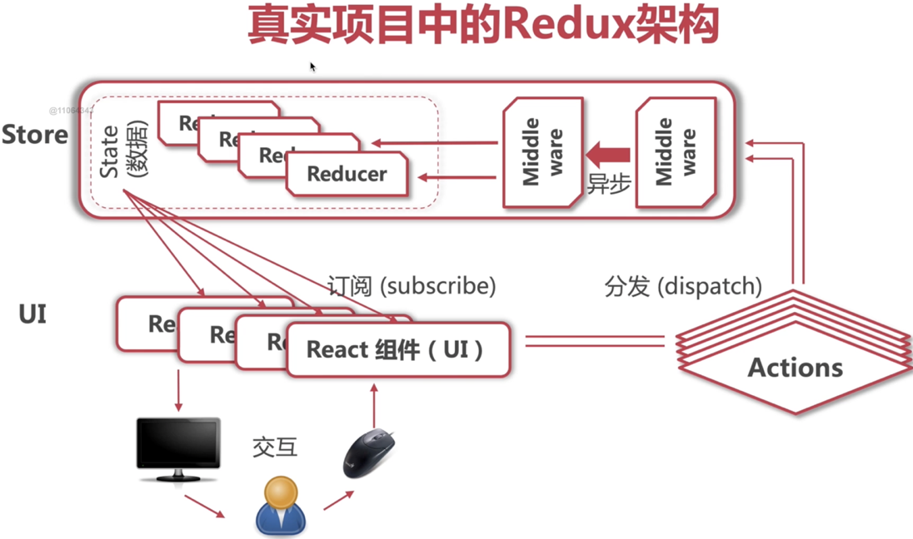

# React with TypeScript / React 与 TypeScript

This long-form course moves from typed components and class state through event handling, Hooks, Context, React Router v6, Redux, Redux Toolkit, internationalization, and HTTP clients. Keep each example tied to the package and router version it uses; the snippets are lesson-sized examples rather than one installable application. / 本课程从带类型的组件和类组件状态开始，依次介绍事件处理、Hooks、Context、React Router v6、Redux、Redux Toolkit、国际化和 HTTP 客户端。每个示例都应对应其使用的包与路由版本；这些代码是分节教学示例，并非一个可直接安装的完整应用。

**Core model / 核心模型：** TypeScript checks component and data relationships during type checking, while React state belongs to a component's identity in the rendered tree. A type annotation does not validate a network response at runtime. / TypeScript 在类型检查期间检查组件和数据之间的关系；React state 则属于渲染树中组件的身份。类型标注不会在运行时验证网络响应。

**Key terms / 关键词：** props 属性 · state 状态 · updater 更新函数 · Effect 外部同步 · Context 上下文 · route 路由 · reducer 归约器 · thunk 异步 action

**See also / 另见：** [React Basics / React基础](../../../../frontend/frameworks/react-basics.md) and [Advanced React / React进阶](../../../../frontend/frameworks/advanced-react.md) for current React semantics; [Advanced TypeScript / TypeScript进阶](../../../../frontend/typescript/advanced-typescript.md) for type erasure and runtime validation.

## Create React App with TypeScript Template / 使用TypeScript模板创建CRA应用

This command records the legacy Create React App (CRA) workflow used by the course. CRA is deprecated for new projects; keep this setup for understanding older repositories rather than treating it as the current React starter:

```bash
npx create-react-app react-ts --template typescript
```

## TypeScript Configuration / TypeScript配置

`noImplicitAny` controls whether TypeScript reports values that would otherwise receive an inferred `any`; it does not prohibit explicit `any`. Setting it to `true`, as below, catches missing annotations. See the TypeScript [`noImplicitAny` option](https://www.typescriptlang.org/tsconfig/#noImplicitAny).

```json
{
  "compilerOptions": {
    "noImplicitAny": true
  }
}
```

Prefer a specific type or `unknown` over `any`; narrow `unknown` before using its value.

## Creating a Component in TypeScript / 使用TypeScript定义组件

Here's an example of a React component written in TypeScript:

```tsx
import React from "react";

interface RobotProps {
  id: number;
  name: string;
  email: string;
}

const Robot: React.FC<RobotProps> = ({ id, name, email }) => {
  return (
    <li>
      
      <h2>{name}</h2>
      <p>{email}</p>
    </li>
  );
};

export default Robot;
```

### Key Points:

- `React.FC` is a component type that checks the declared props. With current React type definitions, it does not add a `children` prop implicitly; declare children explicitly when part of the component API ([React types](https://github.com/DefinitelyTyped/DefinitelyTyped/blob/master/types/react/index.d.ts)).
- Defining the props type (e.g., `RobotProps`) lets TypeScript check component calls.

## Using the Component in App.tsx

Here's how to use the `Robot` component in your main `App` component:

```tsx
import React from "react";
import robots from "./mockData/robots.json";
import Robot from "./components/Robot";

export default function App() {
  return (
    <ul>
      {robots.map((r) => (
        <Robot key={r.id} id={r.id} email={r.email} name={r.name} />
      ))}
    </ul>
  );
}
```

### Key Points:

- Use the `.map()` function to render a list of components.
- Always provide a `key` prop when rendering lists in React to ensure efficient updates.

## CSS in TypeScript / TypeScript中的CSS

When using CSS modules with TypeScript, follow this approach:

1. **File Naming Convention:**

   Name your CSS files as `<component>.module.css`, ensuring that styles are scoped to the component.

2. **Importing CSS Modules:**

   Instead of importing CSS directly, import it as a module to avoid global style conflicts:

   ```tsx
   import styles from "./<component>.module.css";
   ```

3. **Declaring CSS Modules for TypeScript:**

   Create a file called `custom.d.ts` to declare CSS modules for TypeScript:

   ```tsx
   declare module "*.module.css" {
     const styles: { [className: string]: string };
     export default styles;
   }
   ```

4. **Using CSS Modules:**

   Apply CSS classes in JSX as follows:

   ```tsx
   <div className={styles.app}>
   ```

   For class names with hyphens, use:

   ```tsx
   <div className={styles['app-style']}>
   ```

## Project Structure and Media Import

### Recommended Project Structure:

- **assets/**: Directory for media files.
  - **images/**: Directory for images.
  - **fonts/**: Directory for fonts.
  - **icons/**: Directory for icons.

### Importing Media:

#### Importing Images:

To import an image:

```tsx
import logo from "./assets/images/logo.svg";
```

React does not load image files. Whether an image import works depends on the bundler and its TypeScript declarations; public assets can instead be referenced by URL.

#### Importing Fonts:

1. **Add Font Files:**

   Place the font file in the `assets/fonts` directory.

2. **Declare Fonts in CSS:**

   Add the font in your global `index.css` or any global stylesheet:

   ```css
   @font-face {
     font-family: "Slidefu";
     src: local("Slidefu"), url("./assets/fonts/Slidefu-Regular-2.ttf") format("truetype");
   }
   ```

3. **Use Fonts in Components:**

   Apply the font in your component-specific CSS file:

   ```css
   h1 {
     font-family: "Slidefu";
     font-size: 72px;
   }
   ```

## Class in TypeScript / TypeScript中的类组件

In TypeScript, `React.Component` is a generic type that can take up to three parameters: `Props`, `State`, and an optional `Snapshot`. Using TypeScript with React ensures type safety, which helps catch errors during development.

### Example:

```tsx
import React from "react";
import styles from "./ShoppingCart.module.css";

interface Props {}

interface State {
  isHidden: boolean; // This is an attribute we defined, true when the cart is hidden
}

export default class ShoppingCart extends React.Component<Props, State> {
  constructor(props: Props) {
    super(props);
    this.state = {
      isHidden: false,
    };
  }

  render() {
    return (
      <div className={styles.cartContainer}>
        <button
          className={styles.button}
          onClick={() => {
            this.setState({ isHidden: !this.state.isHidden });
          }}
        >
          Cart (2)
        </button>
        <div
          className={styles.cartDropDown}
          style={{ display: this.state.isHidden ? "none" : "block" }}
        >
          <ul>
            <li>robot 1</li>
            <li>robot 2</li>
          </ul>
        </div>
      </div>
    );
  }
}
```

To use this component in `app.tsx`:

```tsx
import React from "react";
import ShoppingCart from "./ShoppingCart";

const App = () => (
  <div>
    <h1>Welcome to the Robot Store</h1>
    <ShoppingCart />
  </div>
);

export default App;
```

## State vs. Props in a Class Component / 类组件中的State与Props

### Props
- **Definition**: Props (short for properties) are read-only attributes that are passed to components by their parent component.
- **Usage**: Used for passing data and event handlers down the component tree.
- **Read-only input**: A child should not mutate its props; the parent supplies new values through the next render.

### State
- **Definition**: State is a built-in object that holds data that may change over the component's lifecycle.
- **Usage**: Used for managing internal component data that can change over time.
- **Updates**: Treat state as read-only and use `setState()` to provide a replacement or an updater function.
- **Initialization**: State is typically initialized in the constructor.

### Key Differences
- **Source**: Props are passed from parent to child, whereas state is managed within the component.
- **Update path**: A child treats props as read-only; state changes go through `setState()` rather than direct mutation.

### Example:

```tsx
interface ParentProps {
  initialCount: number;
}

interface ParentState {
  count: number;
}

class ParentComponent extends React.Component<ParentProps, ParentState> {
  constructor(props: ParentProps) {
    super(props);
    this.state = {
      count: props.initialCount,
    };
  }

  render() {
    return (
      <div>
        <ChildComponent count={this.state.count} />
        <button
          onClick={() => this.setState({ count: this.state.count + 1 })}
        >
          Increment
        </button>
      </div>
    );
  }
}

interface ChildProps {
  count: number;
}

const ChildComponent: React.FC<ChildProps> = ({ count }) => (
  <div>Count: {count}</div>
);
```

## Updates Based on Previous Class State / 基于前一次类组件State更新

`setState()` queues an update; do not read `this.state` immediately after calling it and expect the new value. When the next value depends on the previous one, use the updater form, which receives the previous state and props.

### Syntax:

```tsx
this.setState(
  (prevState, prevProps) => {
    // Return the new state object
    return { ... };
  },
  () => {
    // Callback function executed after state update
    console.log(`State updated: ${this.state.someValue}`);
  }
);
```

### Example:

```tsx
interface State {
  count: number;
}

class Counter extends React.Component<{}, State> {
  constructor(props: {}) {
    super(props);
    this.state = {
      count: 0,
    };
  }

  increment = () => {
    this.setState(
      (prevState) => ({ count: prevState.count + 1 }),
      () => {
        console.log(`Count is now: ${this.state.count}`);
      }
    );
  };

  render() {
    return (
      <div>
        <p>Count: {this.state.count}</p>
        <button onClick={this.increment}>Increment</button>
      </div>
    );
  }
}
```

### Explanation:
- **Updater Function**: The first argument to `setState()` is a function that receives `prevState` and `prevProps`.
- **Callback**: The second argument runs after the update has been committed.

Using this pattern ensures that state updates are based on the most recent state, avoiding potential synchronization issues.
## Event Handling / 事件处理

## The "this" Pointing Problem

In a class component, an unbound instance method loses its receiver when React calls it as an event handler. In strict mode, `this` is `undefined`; it does not refer to the class instance.

### Incorrect Usage

The following method is not bound, so `this.setState` fails when the button calls it:

```tsx
class MyComponent extends React.Component {
  constructor(props) {
    super(props);
    this.state = { ishidden: false };
  }

  handleClick(e: React.MouseEvent<HTMLButtonElement, MouseEvent>) {
    // Error: 'this' is undefined
    this.setState({ ishidden: !this.state.ishidden });
  }

  render() {
    return <button onClick={this.handleClick}>Click me</button>;
  }
}
```

### Correct Usage

To avoid this issue, we can use an arrow function, which binds `this` lexically, meaning `this` inside the arrow function will refer to the class instance:

```tsx
class MyComponent extends React.Component {
  constructor(props) {
    super(props);
    this.state = { ishidden: false };
  }

  handleClick = (e: React.MouseEvent<HTMLButtonElement, MouseEvent>) => {
    this.setState({ ishidden: !this.state.ishidden });
  }

  render() {
    return <button onClick={this.handleClick}>Click me</button>;
  }
}
```

In modern React development, it's recommended to use functional components with hooks whenever possible, as they provide a more concise and readable way to handle state and side effects.

### Using Functional Components with Hooks

```tsx
import React, { useState } from 'react';

const MyComponent = () => {
  const [isHidden, setIsHidden] = useState(false);

  const handleClick = () => {
    setIsHidden(previous => !previous);
  };

  return <button onClick={handleClick}>Click me</button>;
};
```

## `e.target` and `e.currentTarget` / 事件目标与监听元素

When handling events, it's important to distinguish between `e.target` and `e.currentTarget`:

- `e.target` refers to the element on which the event originally occurred. This is the deepest element that triggered the event.
- `e.currentTarget` refers to the element that has the event listener attached. This is useful when you have nested elements and you want to ensure that the handler is reacting to the correct element.

### Example

Consider a button element that contains a span element with text:

```tsx
const MyComponent = () => {
  const handleClick = (e: React.MouseEvent<HTMLButtonElement, MouseEvent>) => {
    console.log("e.target:", e.target);
    console.log("e.currentTarget:", e.currentTarget);
    
    if ((e.target as HTMLElement).nodeName === "SPAN") {
      // Do something if the span was clicked
      console.log("Span was clicked");
    }
  };

  return (
    <button onClick={handleClick}>
      <span>Click me</span>
    </button>
  );
};
```

When the span is clicked:

- `e.target` will be the `span` element.
- `e.currentTarget` will be the `button` element.

This allows you to differentiate the element that triggered the event from the element that is handling the event.

## Request Data in Lifecycle Methods / 在生命周期中请求数据

In class components, `componentDidMount()` is a lifecycle method that is invoked immediately after a component is mounted (inserted into the tree). It's a common place to initiate network requests to fetch data. Root StrictMode can exercise a development-only mount, unmount, and mount sequence, so each mount below creates its own request controller; see the [React Component lifecycle reference](https://react.dev/reference/react/Component#componentdidmount).

### Example

```tsx
interface State {
  data: unknown;
  error: string | null;
}

class MyComponent extends React.Component<{}, State> {
  private controller: AbortController | null = null;

  state: State = { data: null, error: null };

  componentDidMount() {
    const controller = new AbortController();
    this.controller = controller;

    fetch("https://api.example.com/data", { signal: controller.signal })
      .then(response => {
        if (!response.ok) throw new Error(`HTTP ${response.status}`);
        return response.json();
      })
      .then(data => {
        if (!controller.signal.aborted) this.setState({ data, error: null });
      })
      .catch(cause => {
        if (!controller.signal.aborted) {
          this.setState({ error: cause instanceof Error ? cause.message : String(cause) });
        }
      });
  }

  componentWillUnmount() {
    this.controller?.abort();
    this.controller = null;
  }

  render() {
    const { data, error } = this.state;
    if (error) return <p role="alert">{error}</p>;
    return data === null ? <p>Loading...</p> : <pre>{JSON.stringify(data, null, 2)}</pre>;
  }
}
```

In function components, an Effect can synchronize with a request. This example checks the HTTP status and ignores stale results during cleanup; it leaves response validation to application code because `response.json()` does not validate a TypeScript shape at runtime:

### Example with Hooks

```tsx
import React, { useState, useEffect } from 'react';

const MyComponent = () => {
  const [data, setData] = useState<unknown>(null);
  const [error, setError] = useState<string | null>(null);

  useEffect(() => {
    let ignore = false;

    async function load() {
      try {
        const response = await fetch("https://api.example.com/data");
        if (!response.ok) throw new Error(`HTTP ${response.status}`);
        const result: unknown = await response.json();
        if (!ignore) {
          setData(result);
          setError(null);
        }
      } catch (cause) {
        if (!ignore) setError(cause instanceof Error ? cause.message : String(cause));
      }
    }

    load();
    return () => {
      ignore = true;
    };
  }, []);

  if (error) return <p role="alert">{error}</p>;
  return data === null ? <div>Loading...</div> : <pre>{JSON.stringify(data, null, 2)}</pre>;
};
```

## Hooks / Hooks

Hooks let function components use React state, context, refs, and synchronization with external systems. They are an alternative component API, not a requirement to replace every class component. Common Hooks include:

- `useState`: Manages state in a functional component.
- `useEffect`: Performs side effects in a functional component.
- `useReducer`: Manages state with complex logic.
- `useContext`: Accesses context in a functional component.

Custom Hooks must start with `use`; they may call other Hooks at the top level. React 19's `use(usable)` API is the exception: it may appear in a condition or loop, while other Hooks must preserve call order. See [Rules of Hooks](https://react.dev/reference/rules/rules-of-hooks) and [`use`](https://react.dev/reference/react/use).

## `useState` / `useState`

The `useState` hook allows you to add state to functional components. It returns an array with two elements: the current state and a function to update it.

### Example

```tsx
import React, { useState } from 'react';

const Counter: React.FC = () => {
  const [count, setCount] = useState(0);

  return (
    <div>
      <p>You clicked {count} times</p>
      <button onClick={() => setCount(count + 1)}>
        Click me
      </button>
    </div>
  );
};

export default Counter;
```

### Explanation

In the example above:
- `useState(0)` initializes the state variable `count` to 0.
- `setCount` is the function to update the state.

## `useEffect` / `useEffect`

`useEffect` synchronizes with an external system after a commit. With no dependency list it runs after each commit; with a dependency list it runs after the initial commit and again when a listed value changes. React runs the previous cleanup before the next setup and when the component unmounts.

### Example

```tsx
import React, { useState, useEffect } from 'react';

const EffectDemo: React.FC = () => {
  const [count, setCount] = useState(0);

  useEffect(() => {
    document.title = `You clicked ${count} times`;
  }, [count]);

  return (
    <div>
      <p>You clicked {count} times</p>
      <button onClick={() => setCount(count + 1)}>
        Click me
      </button>
    </div>
  );
};

export default EffectDemo;
```

### Explanation

In the example above:
- The function inside `useEffect` runs after every render where `count` changes.
- The dependency array `[count]` ensures the effect only runs when `count` changes.

## `useReducer` / `useReducer`

The `useReducer` hook is used for managing state with complex logic. It is an alternative to `useState` and is usually preferable when you have multiple state variables that rely on complex logic.

### Example

```tsx
import React, { useReducer } from 'react';

type Action = { type: 'increment' } | { type: 'decrement' };

const reducer = (state: number, action: Action): number => {
  switch (action.type) {
    case 'increment':
      return state + 1;
    case 'decrement':
      return state - 1;
    default:
      return state;
  }
};

const Counter: React.FC = () => {
  const [count, dispatch] = useReducer(reducer, 0);

  return (
    <div>
      <p>{count}</p>
      <button onClick={() => dispatch({ type: 'increment' })}>+</button>
      <button onClick={() => dispatch({ type: 'decrement' })}>-</button>
    </div>
  );
};

export default Counter;
```

### Explanation

In the example above:
- `useReducer(reducer, 0)` initializes the state to 0 and provides a `dispatch` function to update the state.
- The `reducer` function defines how the state changes in response to actions.

## `useContext` / `useContext`

The `useContext` hook allows you to access the context in a functional component. It makes it easy to pass data through the component tree without passing props down manually at every level.

### Example

```tsx
import React, { useContext, createContext } from 'react';

const CountContext = createContext(0);

const DisplayCount: React.FC = () => {
  const count = useContext(CountContext);
  return <div>{count}</div>;
};

const App: React.FC = () => {
  return (
    <CountContext.Provider value={10}>
      <DisplayCount />
    </CountContext.Provider>
  );
};

export default App;
```

### Explanation

In the example above:
- `createContext(0)` creates a context with a default value of 0.
- `useContext(CountContext)` retrieves the context value.

## Best Practices for Using Hooks

1. **Keep Hooks at the Top Level**: Call Hooks at the top level of a component or custom Hook so their order is stable. The React 19 `use(usable)` API is the exception and may be called conditionally or in loops; see the Rules of Hooks link above.

2. **Use Multiple State Variables if Needed**: Instead of combining state variables, use multiple `useState` or `useReducer` calls.

3. **Optimize useEffect Dependencies**: Make sure the dependency array in `useEffect` is accurate to avoid unnecessary re-renders.

4. **Custom Hooks**: Create custom hooks to extract and reuse stateful logic across multiple components.

### Custom Hook Example

```tsx
import { useState, useEffect } from 'react';

const useFetch = (url: string) => {
  const [data, setData] = useState<unknown>(null);
  const [loading, setLoading] = useState<boolean>(true);
  const [error, setError] = useState<string | null>(null);

  useEffect(() => {
    let ignore = false;
    setLoading(true);
    setError(null);

    const fetchData = async () => {
      try {
        const response = await fetch(url);
        if (!response.ok) throw new Error(`HTTP ${response.status}`);
        const result = await response.json();
        if (!ignore) setData(result);
      } catch (e) {
        if (!ignore) setError(e instanceof Error ? e.message : String(e));
      } finally {
        if (!ignore) setLoading(false);
      }
    };

    fetchData();
    return () => {
      ignore = true;
    };
  }, [url]);

  return { data, loading, error };
};

export default useFetch;
```

### Explanation

In the custom hook example above:
- `useFetch` encapsulates the logic for fetching data.
- It returns the fetched data, loading state, and any error encountered.

The cleanup ignores stale results when `url` changes or the component unmounts; it does not cancel the network request. Pass an `AbortSignal` when the underlying request must also be stopped. In React 18+ and 19, root StrictMode runs an additional Effect setup-and-cleanup cycle in development to expose incomplete cleanup; that development check is absent in production.

## Context and `useContext` / Context与`useContext`

### Introduction
Context provides a value to a subtree without passing it through every intermediate component. It can distribute shared state, but it does not itself define how that state is stored or updated; the provider owns that behavior.

### Creating Context

To create a context, you use the `createContext` function. This function takes an initial value and returns a context object.

```typescript
import { createContext } from "react";

const defaultContextValue = {
  username: "reader",
};

export const appContext = createContext(defaultContextValue);
```

Here, `defaultContextValue` is used only when a component has no matching provider above it in the tree.

### Providing Context

To use the context in child components, wrap the part of your component tree that needs access to the context with the `Provider` component of the context.

```tsx
import React from "react";
import { createRoot } from "react-dom/client";
import { appContext } from "./context";

const defaultContextValue = {
  username: "reader",
};

const root = createRoot(document.getElementById("root") as HTMLElement);

root.render(
  <React.StrictMode>
    <appContext.Provider value={defaultContextValue}>
      <App />
    </appContext.Provider>
  </React.StrictMode>
);
```

### Consuming Context in Functional Components

In functional components, you can use the `useContext` hook to access the context value.

```tsx
import React, { useContext } from "react";
import { appContext } from "../context";

interface RobotProps {
  id: number;
  name: string;
  email: string;
}

const Robot: React.FC<RobotProps> = ({ id, name, email }) => {
  const value = useContext(appContext);

  return (
    <div className="card-container">
      
      <h2>{name}</h2>
      <p>{email}</p>
      <p>username: {value.username}</p>
    </div>
  );
};

export default Robot;
```

### Consuming Context in Class Components

For class components, you can use the `Consumer` component of the context.

```tsx
import React, { Component } from "react";
import { appContext } from "../context";

class Robot extends Component {
  render() {
    return (
      <appContext.Consumer>
        {value => (
          <div className="card-container">
            
            <h2>{this.props.name}</h2>
            <p>{this.props.email}</p>
            <p>username: {value.username}</p>
          </div>
        )}
      </appContext.Consumer>
    );
  }
}

export default Robot;
```

### Managing Global State with Context

To manage global state, you can create a context that holds both the state and the state updater function.

**Example: AppState.tsx**

```tsx
import React, { createContext, useState, PropsWithChildren } from "react";

interface AppStateValue {
  username: string;
  shoppingCart: { items: { id: number; name: string }[] };
}

const defaultContextValue: AppStateValue = {
  username: "reader",
  shoppingCart: { items: [] },
};

export const appContext = createContext(defaultContextValue);
export const setStateContext = createContext<React.Dispatch<React.SetStateAction<AppStateValue>> | undefined>(undefined);

export const AppStateProvider: React.FC<PropsWithChildren<{}>> = (props) => {
  const [state, setState] = useState(defaultContextValue);

  return (
    <appContext.Provider value={state}>
      <setStateContext.Provider value={setState}>
        {props.children}
      </setStateContext.Provider>
    </appContext.Provider>
  );
};
```

### Using the Global State

Wrap your app in the `AppStateProvider` component to provide the global state to the entire application.

**index.tsx:**

```tsx
import React from "react";
import { createRoot } from "react-dom/client";
import { AppStateProvider } from "./AppState";
import App from "./App";

const root = createRoot(document.getElementById("root") as HTMLElement);

root.render(
  <React.StrictMode>
    <AppStateProvider>
      <App />
    </AppStateProvider>
  </React.StrictMode>
);
```

**robot.tsx:**

Add items to the shopping cart by using the `setStateContext`.

```tsx
import React, { useContext } from "react";
import { appContext, setStateContext } from "./AppState";

const Robot: React.FC<RobotProps> = ({ id, name, email }) => {
  const state = useContext(appContext);
  const setState = useContext(setStateContext);

  const addToCart = () => {
    if (setState) {
      setState((prevState) => {
        return {
          ...prevState,
          shoppingCart: {
            items: [...prevState.shoppingCart.items, { id, name }],
          },
        };
      });
    }
  };

  return (
    <div className="card-container">
      
      <h2>{name}</h2>
      <p>{email}</p>
      <p>username: {state.username}</p>
      <button onClick={addToCart}>Add to Cart</button>
    </div>
  );
};

export default Robot;
```

**shoppingCart.tsx:**

Display the items in the shopping cart using the `appContext.Consumer`.

```tsx
import React, { useContext } from "react";
import { appContext } from "./AppState";
import { FiShoppingCart } from "react-icons/fi";

const ShoppingCart: React.FC = () => {
  const value = useContext(appContext);

  return (
    <div className="cart-container">
      <button className="button">
        <FiShoppingCart />
        <span>Cart ({value.shoppingCart.items.length})</span>
      </button>
      <div className="cart-drop-down">
        <ul>
          {value.shoppingCart.items.map((i) => (
            <li key={i.id}>{i.name}</li>
          ))}
        </ul>
      </div>
    </div>
  );
};

export default ShoppingCart;
```

### Higher-Order Components (HOC)

A Higher-Order Component (HOC) is a function that takes a component and returns a new component with additional props or behavior. HOCs are used for:

- **Code Reuse and Logic Abstraction**: Extracting and reusing logic across multiple components.
- **Conditional Rendering**: Encapsulating rendering logic that depends on specific conditions.
- **Props Manipulation**: Adding, modifying, or removing props passed to a component.
- **Lifecycle Management**: Adding side effects or lifecycle methods to a component.

#### Best Practices
- **Naming Convention**: Prefix HOCs with `with` to indicate their purpose, e.g., `withAuth`, `withLogging`.
- **Do Not Mutate Original Component**: Avoid modifying the original component. Instead, create and return a new one.
- **Pass All Props**: Ensure that all props are passed down to the wrapped component to maintain the original component's functionality.
- **Static Methods Copying**: Copy non-React static methods from the original component to the new one.

#### Example
Below is an example of a HOC that adds a function to handle adding items to a shopping cart:

```tsx
// withAddToCart.tsx
import React, { useContext } from 'react';

const withAddToCart = (WrappedComponent) => {
  return (props) => {
    const setState = useContext(setStateContext);

    const addToCart = (id, name) => {
      if (setState) {
        setState((prevState) => ({
          ...prevState,
          shoppingCart: {
            items: [...prevState.shoppingCart.items, { id, name }],
          },
        }));
      }
    };

    return <WrappedComponent {...props} addToCart={addToCart} />;
  };
};

export default withAddToCart;

// Robot.tsx
import React, { useContext } from 'react';
import withAddToCart from './withAddToCart';
import styles from './Robot.module.css';

export interface RobotProps {
  id: number;
  name: string;
  email: string;
  addToCart: (id: number, name: string) => void;
}

const Robot: React.FC<RobotProps> = ({ id, name, email, addToCart }) => {
  const value = useContext(appContext);

  return (
    <div className={styles.cardContainer}>
      
      <h2>{name}</h2>
      <p>{email}</p>
      <p>username: {value.username}</p>
      <button onClick={() => addToCart(id, name)}>Add to cart</button>
    </div>
  );
};

export default withAddToCart(Robot);
```

### Custom Hooks

#### Definition and Purpose
Custom hooks are functions that start with `use` and allow you to encapsulate and reuse stateful logic across different components. They enable sharing logic that involves React's state or lifecycle features without using HOCs or render props.

#### Best Practices
- **Naming Convention**: Always start the custom hook's name with `use`, e.g., `useFetchData`, `useFormValidation`.
- **Single Responsibility**: Each custom hook should do one thing well and be as focused as possible.
- **Return Values**: Return an array or object containing values and functions that the component needs.
- **Avoid Side Effects in Return**: Do not include side effects (e.g., setting state) in the returned functions or values.

#### Example
Here’s an example of a custom hook to handle adding items to a shopping cart:

```tsx
// useAddToCart.tsx
import React, { useContext } from 'react';

export const useAddToCart = () => {
  const setState = useContext(setStateContext);

  const addToCart = (id, name) => {
    if (setState) {
      setState((prevState) => ({
        ...prevState,
        shoppingCart: {
          items: [...prevState.shoppingCart.items, { id, name }],
        },
      }));
    }
  };

  return addToCart;
};

// Robot.tsx
import React, { useContext } from 'react';
import { useAddToCart } from './useAddToCart';
import styles from './Robot.module.css';

export interface RobotProps {
  id: number;
  name: string;
  email: string;
}

const Robot: React.FC<RobotProps> = ({ id, name, email }) => {
  const value = useContext(appContext);
  const addToCart = useAddToCart();

  return (
    <div className={styles.cardContainer}>
      
      <h2>{name}</h2>
      <p>{email}</p>
      <p>username: {value.username}</p>
      <button onClick={() => addToCart(id, name)}>Add to cart</button>
    </div>
  );
};

export default Robot;
```

## Simplified Imports Using `index.tsx`

Simplifying imports using `index.tsx` (or `index.ts`) files is a common practice in modern front-end development. This approach helps to clean up import statements, making the codebase more readable and maintainable. It centralizes exports in a single file, allowing for more concise and manageable import statements.

### Implementation

#### Directory Structure
Assuming you have a directory structure like this:
```
src/
├── components/
│   ├── header/
│   │   ├── Header.tsx
│   │   ├── index.ts
│   ├── footer/
│   │   ├── Footer.tsx
│   │   ├── index.ts
│   ├── index.ts
│   ├── App.tsx
```

#### `index.ts` in Subdirectories
In the `/header` directory, create an `index.ts` file to re-export the `Header` component:
```typescript
// src/components/header/index.ts
export * from './Header';
```

Similarly, in the `/footer` directory, create an `index.ts` file to re-export the `Footer` component:
```typescript
// src/components/footer/index.ts
export * from './Footer';
```

#### Centralized `index.ts` in Components Directory
In the `/components` directory, create an `index.ts` file to re-export all components:
```typescript
// src/components/index.ts
export * from './header';
export * from './footer';
```

#### Using Simplified Imports
In your `App.tsx` file, you can now import the `Header` and `Footer` components using a single import statement:
```tsx
// src/components/App.tsx
import { Header, Footer } from './components';

const App = () => (
  <div>
    <Header />
    <Footer />
  </div>
);

export default App;
```

### Benefits
- **Cleaner Imports:** Reduces the clutter in import statements.
- **Centralized Exports:** Easier to manage and update exports from a single file.
- **Improved Readability:** Makes the codebase more intuitive and easier to navigate.

### Example Project Structure
```plaintext
src/
├── components/
│   ├── header/
│   │   ├── Header.tsx
│   │   ├── index.ts
│   ├── footer/
│   │   ├── Footer.tsx
│   │   ├── index.ts
│   ├── index.ts
│   ├── App.tsx
```

## Using Ant Design

### Overview
Ant Design is a React component library. The examples below use its Layout, Menu, Typography, and icon components; component APIs can differ between Ant Design versions, so pin the package version used by the application.

### Installation
To use Ant Design, you need to install the core library along with the icons package. Run the following command to install both:
```bash
npm install antd @ant-design/icons
```

### Using Components
After installation, you can start using Ant Design components in your project. Here is a basic example demonstrating the use of the `Layout`, `Typography`, `Input`, `Menu`, `Button`, and `Dropdown` components.

#### Example
```tsx
// src/components/Header.tsx
import React from 'react';
import { Layout, Menu } from 'antd';
import { GlobalOutlined } from '@ant-design/icons';

const { Header } = Layout;

const AppHeader: React.FC = () => (
  <Header>
    <div className="logo" />
    <Menu theme="dark" mode="horizontal" defaultSelectedKeys={['1']}>
      <Menu.Item key="1" icon={<GlobalOutlined />}>Home</Menu.Item>
      <Menu.Item key="2">About</Menu.Item>
      <Menu.Item key="3">Contact</Menu.Item>
    </Menu>
  </Header>
);

export default AppHeader;
```

#### Integrating Ant Design in `App.tsx`
```tsx
// src/components/App.tsx
import React from 'react';
import { Layout, Typography } from 'antd';
import AppHeader from './header/Header';
import AppFooter from './footer/Footer';

const { Content } = Layout;
const { Title } = Typography;

const App: React.FC = () => (
  <Layout>
    <AppHeader />
    <Content style={{ padding: '0 50px' }}>
      <Title level={2}>Welcome to My App</Title>
      <p>This is a simple example of using Ant Design with React.</p>
    </Content>
    <AppFooter />
  </Layout>
);

export default App;
```

### Exploring Ant Design Components
For more examples and detailed documentation on how to use different Ant Design components, visit the [Ant Design Components Overview](https://ant.design/components/overview).

### Best Practices
- **Consistent Use of Ant Design Components:** Ensure consistency in design by leveraging Ant Design components across the application.
- **Theming and Customization:** Use Ant Design's theming capabilities to customize the appearance to match your brand.
- **Responsive Design:** Utilize the responsive grid system and other responsive components to ensure your application works well on different screen sizes.

## Routing in React with React Router v6 / 使用React Router v6进行路由

## Overview

Routing maps URL changes to React UI. With client-side routing, matching navigation can update the view without a full document reload; a server-rendered or hybrid framework has different routing and rendering boundaries. These examples use the [React Router v6.3 API](https://github.com/remix-run/react-router/blob/v6.3.0/docs/api.md).

The examples use React Router v6.3's declarative API (`BrowserRouter`, `Routes`, `Route` with `element`, and navigation Hooks). Pin the version for this lesson; React Router v7 adds other modes and package guidance.

## Installation

To install `react-router`, use the following command:

```bash
npm install react-router-dom@6.3.0
```

## Key Components and Hooks

### `<BrowserRouter>`

- Uses the HTML5 History API to keep the UI in sync with the URL.
- Should be used at the root of your application.

### `<HashRouter>`

- Uses the URL hash (e.g., `example.com/#/path`) to keep the UI in sync with the URL.
- Useful when the hosting environment cannot serve the application entry point for arbitrary paths.

### `<Routes>` and `<Route>`

- `<Routes>` is a container for all your route definitions.
- `<Route>` defines a mapping between a URL path and a component.

### `<Link>`

- Used to create navigational links. It renders an `<a>` element that allows navigation without reloading the page.

### `useParams`

- A hook to access the dynamic parameters in the URL.

### `useNavigate`

- A hook to programmatically navigate to different routes.

### `useLocation`

- A hook to access the current location object, which contains information about the URL.

## Defining Routes

Example: Display the `HomePage` component when the URL path is `/`, `LoginPage` when it is `/login`, and so on. Show a "page not found" message if the URL does not match any defined routes.

```tsx
import { BrowserRouter, Routes, Route } from 'react-router-dom';
import HomePage from './HomePage';
import LoginPage from './LoginPage';
import RegisterPage from './RegisterPage';
import DetailPage from './DetailPage';
import styles from './App.module.css';

function App() {
  return (
    <div className={styles.App}>
      <BrowserRouter>
        <Routes>
          <Route path="/" element={<HomePage />} />
          <Route path="/login" element={<LoginPage />} />
          <Route path="/register" element={<RegisterPage />} />
          <Route path="/detail/:touristRouteId/:other" element={<DetailPage />} />
          <Route path="*" element={<h1>404 page not found, catch all</h1>} />
        </Routes>
      </BrowserRouter>
    </div>
  );
}

export default App;
```

## Passing Parameters from URL

### Single Parameter

Example: Passing an ID as a parameter to the detail page.

In `App.tsx`:

```tsx
<Route path="/detail/:touristRouteId" element={<DetailPage />} />
```

In `DetailPage.tsx`:

```tsx
import { useParams } from 'react-router-dom';

export const DetailPage: React.FC = () => {
  const { touristRouteId } = useParams<"touristRouteId">();
  if (!touristRouteId) return <p>Route parameter is missing.</p>;
  return <h1>Detail page, id: {touristRouteId}</h1>;
};
```

### Multiple Parameters

Example: Passing multiple parameters.

In `App.tsx`:

```tsx
<Route path="/detail/:touristRouteId/:other" element={<DetailPage />} />
```

In `DetailPage.tsx`:

```tsx
import { useParams } from 'react-router-dom';

type MatchParams = "touristRouteId" | "other";

export const DetailPage: React.FC = () => {
  const params = useParams<MatchParams>();
  if (!params.touristRouteId || !params.other) {
    return <p>Route parameters are missing.</p>;
  }
  return (
    <h1>
      Detail page, id: {params.touristRouteId}, other: {params.other}
    </h1>
  );
};
```

## Navigation

### Using `useNavigate`

Example:

```tsx
import { useNavigate } from 'react-router-dom';

const MyComponent: React.FC = () => {
  const navigate = useNavigate();

  const handleRegister = () => {
    navigate('/register');
  };

  return <button onClick={handleRegister}>Register</button>;
};
```

### Using `<Link>`

An alternative way is to use `<Link>` from `'react-router-dom'`:

```tsx
import { Link } from 'react-router-dom';

const MyComponent: React.FC = () => {
  return <Link to="/register">Register</Link>;
};
```

### Best Practices

1. **Use `<Link>` for Navigation:** It is preferred over `useNavigate` for simple navigational links because it creates a semantic `<a>` element and avoids the need for an additional event handler.
2. **Define Routes Clearly:** Group related routes together and define a clear structure to make the routing configuration easy to read and maintain.
3. **Handle 404s Gracefully:** Add a catch-all route (`path="*"`) when the app should render its own not-found UI for unknown paths.
4. **Use Hooks for Parameters and Navigation:** Utilize `useParams`, `useNavigate`, and `useLocation` hooks to access URL parameters and navigate programmatically within your components.

## Redux / Redux

Redux is a state management library often used with React to manage and centralize application state. It follows the principles of a unidirectional data flow and provides a predictable state container for JavaScript apps.

## Goal

The primary goal of Redux is to manage and centralize the state of an application, making the state more predictable and easier to manage.

## When to Use Redux

Redux is particularly useful in scenarios where:

- Multiple components need to share data.
- The state of the application can be accessed and updated from various parts of the application.
- There are complex state interactions that are difficult to manage with local component state.

Examples include:

- Global language switch
- Dark mode switch
- User authentication and global user data

## Redux Architecture



## Core Concepts

### Actions

Actions are plain JavaScript objects that represent an intention to change the state. They are the only source of information for the store. Actions must have a `type` property that indicates the type of action being performed.

Example:

```tsx
export const CHANGE_LANGUAGE = "CHANGE_LANGUAGE";

export const changeLanguage = (language: string) => ({
  type: CHANGE_LANGUAGE,
  payload: language,
});
```

### Reducers

Reducers are pure functions that take the current state and an action as arguments and return a new state. They specify how the application's state changes in response to an action.

Example:

```tsx
import { CHANGE_LANGUAGE } from "./languageActions";

interface LanguageState {
  language: "en" | "zh";
  languageList: { name: string; code: string }[];
}

const initialState: LanguageState = {
  language: "zh",
  languageList: [
    { name: "中文", code: "zh" },
    { name: "English", code: "en" },
  ],
};

const languageReducer = (state = initialState, action): LanguageState => {
  switch (action.type) {
    case CHANGE_LANGUAGE:
      return { ...state, language: action.payload };
    default:
      return state;
  }
};

export default languageReducer;
```

### Store

The store is the object that brings actions and reducers together. It holds the application state and provides methods to access the state, dispatch actions, and register listeners.

Creating a store with Redux Toolkit:

```tsx
// store.ts
import { configureStore } from "@reduxjs/toolkit";
import languageReducer from "./language/languageReducer";

const store = configureStore({
  reducer: {
    language: languageReducer,
  },
});

export default store;
```

### Middleware

Middleware provides a third-party extension point between dispatching an action and the moment it reaches the reducer. It can be used for logging, crash reporting, or handling asynchronous actions.

Redux Toolkit's default middleware already includes thunk. Configure additional middleware by extending that list; do not replace the defaults just to add one middleware:

```tsx
// store.ts
import { configureStore } from "@reduxjs/toolkit";
import languageReducer from "./language/languageReducer";

const store = configureStore({
  reducer: {
    language: languageReducer,
  },
  middleware: (getDefaultMiddleware) => getDefaultMiddleware(),
});

export default store;
```

### Using Redux with React

#### Connecting a Component

To connect a React component to the Redux store, use the `useSelector` and `useDispatch` hooks from `react-redux`.

Install `react-redux`:

```bash
npm install react-redux
```

Example:

```tsx
// LanguageSwitcher.tsx
import React from "react";
import { useSelector, useDispatch } from "react-redux";
import { changeLanguage } from "./language/languageActions";

const LanguageSwitcher = () => {
  const language = useSelector((state) => state.language.language);
  const dispatch = useDispatch();

  const handleLanguageChange = (e) => {
    dispatch(changeLanguage(e.target.value));
  };

  return (
    <div>
      <select value={language} onChange={handleLanguageChange}>
        <option value="en">English</option>
        <option value="zh">中文</option>
      </select>
    </div>
  );
};

export default LanguageSwitcher;
```

### Combining Reducers

For larger applications, it is common to split the state and reducers into smaller, more manageable parts. These can be combined using `combineReducers`.

Example:

```tsx
import { combineReducers } from "redux";
import languageReducer from "./language/languageReducer";
import themeReducer from "./theme/themeReducer";

const rootReducer = combineReducers({
  language: languageReducer,
  theme: themeReducer,
});

export default rootReducer;
```

### Using Redux DevTools

`configureStore` enables Redux DevTools integration by default (`devTools` defaults to `true`). The explicit option below disables it in production; the separate `redux-devtools-extension` package is not needed for this setup. See the [Redux Toolkit 2.11.0 implementation](https://raw.githubusercontent.com/reduxjs/redux-toolkit/v2.11.0/packages/toolkit/src/configureStore.ts).

```tsx
// store.ts
import { configureStore } from "@reduxjs/toolkit";
import rootReducer from "./rootReducer";

const store = configureStore({
  reducer: rootReducer,
  devTools: process.env.NODE_ENV !== "production",
});

export default store;
```

## Internationalization with i18next / 使用i18next实现国际化

This guide shows a basic i18next configuration and its React bindings from `react-i18next`.

## Installation

To install i18Next and its React integration, run the following command in your terminal:

```bash
npm install react-i18next i18next --save
```

## Configuration

### Step 1: Create a Configuration File

1. Create a `configs.ts` (or `configs.js` for JavaScript) file in your project directory.

2. Import the necessary modules:

```tsx
import i18n from "i18next";
import { initReactI18next } from "react-i18next";
```

### Step 2: Create Language JSON Files

1. Create language JSON files (e.g., `en.json` for English, `zh.json` for Chinese) in your project directory. These files will contain your translations.

### Step 3: Import Language JSON Files

1. Import the language JSON files into `configs.ts`:

```tsx
import translation_en from "./locales/en.json";
import translation_zh from "./locales/zh.json";
```

### Step 4: Set Up i18Next Configuration

1. Set up your i18Next configuration:

```tsx
const resources = {
  en: {
    translation: translation_en,
  },
  zh: {
    translation: translation_zh,
  },
};

i18n
  .use(initReactI18next)
  .init({
    resources,
    lng: "en",
    fallbackLng: "en", // Fallback language if the current language translation is not available
    interpolation: {
        escapeValue: false, // React escapes text output; this does not make HTML injection safe.
    },
  });

export default i18n;
```

## Usage in React Components

### Class Components

1. Import the `withTranslation` higher-order component (HOC) and `WithTranslation` type from `react-i18next`:

```tsx
import { withTranslation, WithTranslation } from "react-i18next";
```

2. Add `WithTranslation` to your component's props type:

```tsx
class HeaderComponent extends React.Component<RouteComponentProps & WithTranslation, State> {
  ...
}
```

3. In your component's render function, extract the `t` function from the props. This function is used to translate your text:

```tsx
render() {
  const { t } = this.props;
  return (
    <div>
      <Typography.Text>{t("header.slogan")}</Typography.Text>
      <Dropdown.Button>
        {this.state.language === "en" ? "English" : "中文"}
      </Dropdown.Button>
    </div>
  );
}
```

4. Wrap your component with the `withTranslation` HOC when exporting:

```tsx
export const Header = withTranslation()(withRouter(HeaderComponent));
```

### Functional Components

1. In functional components, you can use the `useTranslation` hook instead of the `withTranslation` HOC:

```tsx
import { useTranslation } from "react-i18next";

export const Footer: React.FC = () => {
  const { t } = useTranslation();
  return (
    <Layout.Footer>
      <Typography.Title level={3} style={{ textAlign: "center" }}>
        {t("footer.detail")}
      </Typography.Title>
    </Layout.Footer>
  );
};
```

## Redux Integration

To ensure strong typing for your Redux actions, you can use action creators. Here's an example of how to do this for language-related actions:

### Action Creators

1. Define action types and creators:

```tsx
export const CHANGE_LANGUAGE = "change_language";

interface ChangeLanguageAction {
  type: typeof CHANGE_LANGUAGE;
  payload: "zh" | "en";
}

export type LanguageActionTypes = ChangeLanguageAction;

export const changeLanguageActionCreator = (
  languageCode: "zh" | "en"
): ChangeLanguageAction => ({
  type: CHANGE_LANGUAGE,
  payload: languageCode,
});
```

### Reducers

1. In your reducer, handle different actions by setting the action type to `LanguageActionTypes`:

```tsx
import i18n from "i18next";
import { CHANGE_LANGUAGE, LanguageActionTypes } from "./languageActions";

export interface LanguageState {
  language: "en" | "zh";
  languageList: { name: string; code: string }[];
}

const defaultState: LanguageState = {
  language: "en",
  languageList: [
    { name: "中文", code: "zh" },
    { name: "English", code: "en" },
  ],
};

export default (state = defaultState, action: LanguageActionTypes): LanguageState => {
  switch (action.type) {
    case CHANGE_LANGUAGE:
      i18n.changeLanguage(action.payload);
      return { ...state, language: action.payload };
    default:
      return state;
  }
};
```

### Usage in Components

1. Use `changeLanguageActionCreator` to create a strongly-typed action in your components:

```typescript
const menuClickHandler = (e: any) => {
  store.dispatch(changeLanguageActionCreator(e.key));
};
```

### Example Component

1. Here is how you might integrate everything in a sample component:

```tsx
import React from "react";
import { useDispatch, useSelector } from "react-redux";
import { Menu } from "antd";
import { changeLanguageActionCreator } from "./languageActions";

const LanguageSwitcher: React.FC = () => {
  const dispatch = useDispatch();
  const language = useSelector((state: any) => state.language);

  const handleMenuClick = (e: any) => {
    dispatch(changeLanguageActionCreator(e.key));
  };

  return (
    <Menu onClick={handleMenuClick} selectedKeys={[language]}>
      <Menu.Item key="en">English</Menu.Item>
      <Menu.Item key="zh">中文</Menu.Item>
    </Menu>
  );
};

export default LanguageSwitcher;
```

## React-Redux Integration: Class and Function Components / 类组件与函数组件中的React-Redux

This section preserves both the older `connect`/higher-order-component integration and the Hooks-based integration. The class example uses React Router v5 APIs; keep that version boundary explicit when maintaining an existing application.

## Prerequisites

Before you start, make sure you have the React-Redux library installed. If not, you can install it using npm:

```bash
npm install react-redux
```

Older React-Redux releases relied on a separate DefinitelyTyped package. Current React-Redux releases include their own types, so check the installed major before adding this legacy package:

```bash
npm install @types/react-redux --save-dev
```

The class example below also uses React Router v5's `withRouter` API; it is kept as a legacy integration example, separate from the v6 declarative routing section above.

## React-Redux with Class Components

### Setting up the Provider

The `<Provider />` component makes the Redux store available to the rest of your app. Here’s how you set it up:

```tsx
import React from "react";
import { createRoot } from "react-dom/client";
import { Provider } from "react-redux";
import store from "./redux/store";
import App from "./App";

const root = createRoot(
  document.getElementById("root") as HTMLElement
);
root.render(
  <React.StrictMode>
    <Provider store={store}>
      <App />
    </Provider>
  </React.StrictMode>
);
```

### Connecting the Component

Use the `connect` function to connect your component to the Redux store. This involves defining `mapStateToProps` and `mapDispatchToProps` functions:

```tsx
import { connect } from "react-redux";
import { Dispatch } from "redux";
import { changeLanguageActionCreator } from "./redux/language/languageActions";
import { RootState } from "./redux/store";

const mapStateToProps = (state: RootState) => ({
  language: state.language,
  languageList: state.languageList,
});

const mapDispatchToProps = (dispatch: Dispatch) => ({
  changeLanguage: (code: "zh" | "en") => {
    const action = changeLanguageActionCreator(code);
    dispatch(action);
  },
});
```

### Modifying the Component

Modify the class component to receive props injected by `connect` and handle type definitions accordingly:

```tsx
import React from "react";
import { RouteComponentProps, withRouter } from "react-router-dom";
import { withTranslation, WithTranslation } from "react-i18next";

class HeaderComponent extends React.Component<
  RouteComponentProps &
    WithTranslation &
    ReturnType<typeof mapStateToProps> &
    ReturnType<typeof mapDispatchToProps>
> {
  menuClickHandler = (e: any) => {
    this.props.changeLanguage(e.key);
  };

  render() {
    return (
      <div>
        <h1>{this.props.language}</h1>
        <button onClick={() => this.menuClickHandler({ key: 'en' })}>English</button>
        <button onClick={() => this.menuClickHandler({ key: 'zh' })}>中文</button>
      </div>
    );
  }
}

export const Header = connect(
  mapStateToProps,
  mapDispatchToProps
)(withTranslation()(withRouter(HeaderComponent)));
```

### Modifying the Store Type

Ensure your store is correctly typed to provide robust type checking and intellisense support:

```typescript
import { createStore } from "redux";
import languageReducer from "./redux/language/languageReducer";

const store = createStore(languageReducer);

export type RootState = ReturnType<typeof store.getState>;
export type AppDispatch = typeof store.dispatch;

export default store;
```

## React-Redux with Function Components

### Creating a hooks.ts File

Create a `hooks.ts` file to define custom hooks for accessing the Redux store:

```typescript
import { useSelector as useReduxSelector, TypedUseSelectorHook } from "react-redux";
import { RootState } from "./store";

export const useSelector: TypedUseSelectorHook<RootState> = useReduxSelector;
```

### Using useSelector and useDispatch

In functional components, use `useSelector` to access the state and `useDispatch` to dispatch actions:

```typescript
import React from "react";
import { useSelector } from "../../redux/hooks";
import { useDispatch } from "react-redux";
import { changeLanguageActionCreator } from "../../redux/language/languageActions";

export const Header: React.FC = () => {
  const language = useSelector((state) => state.language);
  const languageList = useSelector((state) => state.languageList);
  const dispatch = useDispatch();

  const menuClickHandler = (e: any) => {
    dispatch(changeLanguageActionCreator(e.key));
  };

  return (
    <div>
      <h1>{language}</h1>
      <button onClick={() => menuClickHandler({ key: 'en' })}>English</button>
      <button onClick={() => menuClickHandler({ key: 'zh' })}>中文</button>
    </div>
  );
};
```

In this setup, `useSelector` hooks access the Redux store state, and `useDispatch` dispatches actions. This approach simplifies state management in function components.

## Conclusion

This guide covers the integration of React-Redux with both class and function components using modern best practices. By following these steps, you can ensure a robust, type-safe, and scalable integration of Redux into your React application.

For more information and advanced usage, refer to the official [React-Redux documentation](https://react-redux.js.org/introduction/getting-started).

## Fetching Data with Axios / 使用Axios获取数据

Axios is a promise-based HTTP client for JavaScript and TypeScript. Browser support depends on the Axios version and its adapter; this course makes no compatibility claim for obsolete browsers. The examples show basic requests, loading/error state, defaults, and interceptors.

## Installation

To install Axios, use the following command:

```bash
npm install axios
```

Alternatively, if you are using Yarn:

```bash
yarn add axios
```

## Basic Usage

### Performing GET Requests

Axios simplifies making HTTP GET requests. Here's a basic example:

```typescript
import axios from 'axios';

axios.get('https://api.example.com/data')
  .then(response => {
    console.log(response.data);
  })
  .catch(error => {
    console.error('Error fetching data:', error);
  });
```

### Performing POST Requests

Similarly, making a POST request is straightforward:

```typescript
import axios from 'axios';

const data = {
  key1: 'value1',
  key2: 'value2'
};

axios.post('https://api.example.com/data', data)
  .then(response => {
    console.log('Data posted successfully:', response.data);
  })
  .catch(error => {
    console.error('Error posting data:', error);
  });
```

## Example Usage in a React Component

Here is a comprehensive example of using Axios within a React component. This example demonstrates how to handle loading states, errors, and rendering fetched data.

```typescript
import React, { Component } from 'react';
import axios from 'axios';
import { Spin, Typography, Row } from 'antd';
import { withTranslation, WithTranslation } from 'react-i18next';
import ProductCollection from './ProductCollection';

interface State {
  loading: boolean;
  error: string | null;
  productList: any[];
}

class HomePageComponent extends Component<WithTranslation, State> {
  constructor(props: WithTranslation) {
    super(props);
    this.state = {
      loading: true,
      error: null,
      productList: []
    };
  }

  async componentDidMount() {
    try {
      const response = await axios.get('https://api.example.com/product-collections');
      this.setState({
        loading: false,
        productList: response.data
      });
    } catch (error) {
      if (axios.isAxiosError(error)) {
        this.setState({
          loading: false,
          error: error.message
        });
      } else {
        this.setState({ loading: false, error: 'Unexpected request error' });
      }
    }
  }

  render() {
    const { t } = this.props;
    const { productList, loading, error } = this.state;

    if (loading) {
      return <Spin size="large" style={{ marginTop: 200, marginBottom: 200, marginLeft: 'auto', marginRight: 'auto', width: '100%' }} />;
    }

    if (error) {
      return <div>Error: {error}</div>;
    }

    return (
      <>
        <Row>
          <ProductCollection
            title={<Typography.Title level={3} type="warning">{t('products.featured')}</Typography.Title>}
            sideImage="/images/featured-products.jpg"
            products={productList[0]?.touristRoutes || []}
          />
          <ProductCollection
            title={<Typography.Title level={3} type="danger">{t('products.new')}</Typography.Title>}
            sideImage="/images/new-products.jpg"
            products={productList[1]?.touristRoutes || []}
          />
          <ProductCollection
            title={<Typography.Title level={3} type="success">{t('products.popular')}</Typography.Title>}
            sideImage="/images/popular-products.jpg"
            products={productList[2]?.touristRoutes || []}
          />
        </Row>
      </>
    );
  }
}

export const HomePage = withTranslation()(HomePageComponent);
```

### Setting Default Headers

For headers that should be included in every request, you can set them globally in your `index.ts` or `index.js` file:

```typescript
import axios from 'axios';

axios.defaults.headers.common['Accept'] = 'application/json';
axios.defaults.baseURL = 'https://api.example.com/api';
axios.defaults.timeout = 10000; // 10 seconds
```

### Handling Interceptors

Interceptors allow you to run your code or modify the request/response before they are handled by `then` or `catch`. This is useful for adding authorization tokens or logging responses.

```typescript
import axios from 'axios';

// Request Interceptor
axios.interceptors.request.use(
  config => {
    // Modify config before request is sent
    config.headers.Authorization = 'Bearer YOUR_TOKEN';
    return config;
  },
  error => {
    return Promise.reject(error);
  }
);

// Response Interceptor
axios.interceptors.response.use(
  response => {
    // With Axios's default validateStatus setting, 2xx responses resolve here.
    return response;
  },
  error => {
    // With the default validateStatus setting, other HTTP statuses reject here.
    if (error.response?.status === 401) {
      // Handle unauthorized error
    }
    return Promise.reject(error);
  }
);
```

## Error Handling

Handling errors properly ensures a better user experience. Here’s an example of how to handle errors with Axios:

```typescript
import axios from 'axios';

axios.get('https://api.example.com/data')
  .then(response => {
    console.log(response.data);
  })
  .catch(error => {
    if (axios.isAxiosError(error)) {
      console.error('Axios error:', error.message);
    } else {
      console.error('Unexpected error:', error);
    }
  });
```

## Redux vs. MVC / Redux与MVC

## Introduction

### MVC (Model-View-Controller)

MVC is a design pattern commonly used for developing user interfaces. It divides an application into three interconnected components:

- **Model**: Manages the data and business logic.
- **View**: Handles the display of data.
- **Controller**: Manages the communication between the Model and the View.

### Redux

Redux is a predictable state container for JavaScript apps, commonly used with libraries like React for managing application state. It follows a unidirectional data flow architecture.

### Comparison

MVC describes roles for organizing an application's model, view, and controller. Redux describes a shared state container and unidirectional update flow. They are not competing versions of the same pattern; Redux can be used inside an MVC-style application, and simpler state may not need a store.

## When Redux Helps / Redux适用场景

1. **Shared State**: A store centralizes state that several parts of the application must read or update; local UI state can remain in a component.
2. **Explicit Transitions**: Actions and reducers make state changes inspectable and testable.
3. **Debugging**: Redux DevTools can inspect actions and state transitions when configured.
4. **Middleware**: Middleware can coordinate asynchronous work or other dispatch-time concerns.

## Best Practices

1. **Organize by Feature**: Instead of separating files by type (actions, reducers, etc.), organize them by feature for better maintainability.
2. **Immutable State**: Always return new objects from reducers to keep the state immutable.
3. **Normalized State Shape**: Avoid deeply nested state to simplify data manipulation and improve performance.
4. **Use Redux Toolkit**: Simplifies store setup and provides good defaults.

## Redux Store with Multiple Reducers / 使用多个Reducer拆分Store

In a large application, it's common to split the reducer logic into multiple smaller reducers. These smaller reducers manage specific parts of the state and are combined into a single root reducer.

## Example: Redux Store with Multiple Reducers

```typescript
import { configureStore } from "@reduxjs/toolkit";
import { combineReducers } from "redux";
import languageReducer from "./language/languageReducer";
import recommendProductsReducer from "./recommendProducts/recommendProductsReducer";

const rootReducer = combineReducers({
  language: languageReducer,
  recommendProducts: recommendProductsReducer,
});

// Configure the store with the combined reducer
const store = configureStore({
  reducer: rootReducer,
});

export type RootState = ReturnType<typeof store.getState>;
export type AppDispatch = typeof store.dispatch;

export default store;
```

## Using Selectors in React Components

Selectors are functions that extract specific pieces of state from the Redux store.

### Example: Using Selectors in a Component

```typescript
import { useSelector } from "react-redux";
import { RootState } from "./store";

const Header: React.FC = () => {
  const language = useSelector((state: RootState) => state.language.language);
  const languageList = useSelector((state: RootState) => state.language.languageList);

  return (
    <div>
      <h1>Current Language: {language}</h1>
      <ul>
        {languageList.map((lang) => (
          <li key={lang}>{lang}</li>
        ))}
      </ul>
    </div>
  );
};
```

## Thunks with Redux / Redux中的Thunk

Redux Thunk lets dispatched functions perform asynchronous work and dispatch plain actions as results. Redux Toolkit includes thunk in `configureStore` by default; install and add it manually only when using a bare Redux store. The typed examples below use the `RootState` and `AppDispatch` from their matching thunk-enabled stores, following the [Redux TypeScript thunk guidance](https://redux.js.org/usage/usage-with-typescript#type-checking-redux-thunks).

## Installation

For a bare Redux store, install redux-thunk:

```bash
npm install redux-thunk
```

## Configuration

With Redux Toolkit, redux-thunk is included by default in the middleware pipeline. If you are using an older setup, you need to manually apply the middleware.

### Redux Toolkit Setup

```typescript
import { configureStore } from "@reduxjs/toolkit";
import rootReducer from "./reducers";

const store = configureStore({
  reducer: rootReducer,
});

// This store includes the default thunk middleware.
export type RootState = ReturnType<typeof store.getState>;
export type AppDispatch = typeof store.dispatch;
export default store;
```

### Manual Setup (Without Redux Toolkit)

```typescript
import { createStore, applyMiddleware } from "redux";
import { thunk } from "redux-thunk";
import rootReducer from "./reducers";

const manualStore = createStore(rootReducer, applyMiddleware(thunk));

export type ManualRootState = ReturnType<typeof manualStore.getState>;
export type ManualAppDispatch = typeof manualStore.dispatch;
export default manualStore;
```

## Usage

To use Redux-Thunk, create action creators that return functions instead of action objects.

### Example: Thunk Action Creator

```typescript
import axios from "axios";
import type { ThunkAction } from "redux-thunk";
import type { UnknownAction } from "redux";
import type { RootState } from "../store";
import {
  fetchRecommendProductsStart,
  fetchRecommendProductsSuccess,
  fetchRecommendProductsFail,
} from "./actions";

export const fetchRecommendProducts = (): ThunkAction<Promise<void>, RootState, unknown, UnknownAction> => async (dispatch) => {
  dispatch(fetchRecommendProductsStart());
  try {
    const { data } = await axios.get("http://example.com/api/products");
    dispatch(fetchRecommendProductsSuccess(data));
  } catch (error) {
    dispatch(fetchRecommendProductsFail(error));
  }
};
```

### Connecting Thunk Actions to Components

Dispatch the thunk action from your React component.

```typescript
import { useDispatch } from "react-redux";
import type { AppDispatch } from "./store";
import { useEffect } from "react";
import { fetchRecommendProducts } from "./actions";

const ProductList: React.FC = () => {
  const dispatch = useDispatch<AppDispatch>();

  useEffect(() => {
    dispatch(fetchRecommendProducts());
  }, [dispatch]);

  // Render component
};
```

## Redux Middleware / Redux中间件

In Redux, middleware is a higher-order function that wraps the dispatch function, allowing you to execute code in between the action being dispatched and the action reaching the reducer. Middleware is commonly used for handling asynchronous actions, logging, error reporting, and more.

## Defining Middleware in Redux

Middleware in Redux can be defined using the following formula:

```typescript
const middleware = (store) => (next) => (action) => {
  // Middleware logic here
};
```

In this formula:

- `store` is the Redux store instance.
- `next` is the next middleware in the chain or the original `dispatch` function if the current middleware is the last one in the chain.
- `action` is the action being dispatched.

## Middleware Invocation

When an action is dispatched, the middleware will be invoked in the following manner:

```typescript
middleware(store)(next)(action);
```

This allows the middleware to interact with the `store`, perform operations before and after the action is dispatched, and then pass control to the next middleware or reducer.

## Example Middleware: Logging

Here's an example of a Redux middleware that logs the current state, the action being dispatched, and the state after the action has been dispatched:

```typescript
import { Middleware } from "redux";

export const actionLog: Middleware = (store) => (next) => (action) => {
  console.log("Current state:", store.getState());
  console.log("Dispatching action:", action);
  next(action);
  console.log("Next state:", store.getState());
};
```

In this example:

- Before the action is dispatched, the current state is logged.
- The action is then dispatched using `next(action)`.
- After the action is dispatched, the next state is logged.

## Using Middleware with Redux Toolkit

The `configureStore` function from Redux Toolkit simplifies the process of setting up middleware. Here is how you can add the `actionLog` middleware to your store:

```typescript
import { configureStore } from "@reduxjs/toolkit";
import rootReducer from "./reducers";
import { actionLog } from "./middlewares";

const store = configureStore({
  reducer: rootReducer,
  middleware: (getDefaultMiddleware) =>
    getDefaultMiddleware().concat(actionLog),
});
```

In this code:

- `getDefaultMiddleware` is a function provided by Redux Toolkit that returns the default list of middleware (like `redux-thunk`).
- The `concat` method is used to add the `actionLog` middleware to the list of default middleware.

## Asynchronous Actions with Middleware

Middleware is particularly useful for handling asynchronous actions. For example, the popular `redux-thunk` middleware allows you to write action creators that return a function instead of an action:

```typescript
import type { ThunkAction } from "redux-thunk";
import type { ManualRootState } from "./store";

// An example of an asynchronous action using redux-thunk
type FetchUserAction =
  | { type: "FETCH_USER_REQUEST" }
  | { type: "FETCH_USER_SUCCESS"; payload: unknown }
  | { type: "FETCH_USER_FAILURE"; error: unknown };

export const fetchUserData = (): ThunkAction<Promise<void>, ManualRootState, unknown, FetchUserAction> => async (dispatch) => {
  dispatch({ type: "FETCH_USER_REQUEST" });
  try {
    const response = await fetch("/api/user");
    const data = await response.json();
    dispatch({ type: "FETCH_USER_SUCCESS", payload: data });
  } catch (error) {
    dispatch({ type: "FETCH_USER_FAILURE", error });
  }
};
```

In this example:

- The `fetchUserData` action creator returns a function that performs an asynchronous fetch request.
- It dispatches different actions based on the success or failure of the request.

## Common Middleware Patterns

### Logging

Logging middleware can help you debug your Redux store by logging every action and state change:

```typescript
const logger: Middleware = (store) => (next) => (action) => {
  console.log('Dispatching:', action);
  let result = next(action);
  console.log('Next state:', store.getState());
  return result;
};
```

### Error Reporting

Error reporting middleware can catch errors in the dispatched actions and report them to an error tracking service:

```typescript
const errorReporter: Middleware = (store) => (next) => (action) => {
  try {
    return next(action);
  } catch (err) {
    console.error('Caught an exception!', err);
    // Report the error to an external service
    throw err;
  }
};
```

### Async Operations

Handling async operations, such as data fetching, is another common use case for middleware:

```typescript
const asyncMiddleware: Middleware = (store) => (next) => async (action) => {
  if (typeof action === 'function') {
    return action(store.dispatch, store.getState);
  }
  return next(action);
};
```

## HATEOAS: Hypermedia as the Engine of Application State / 超媒体作为应用状态引擎

HATEOAS (Hypertext As The Engine Of Application State) is the REST interface constraint by which a client discovers application-state transitions through hypermedia in server representations. It is one of REST's interface constraints, alongside resource identification, manipulation through representations, and self-descriptive messages ([Fielding, REST dissertation, §5](https://ics.uci.edu/~fielding/pubs/dissertation/rest_arch_style.htm)).

## Key Concepts

### Hypermedia Driven

HATEOAS lets a client discover available transitions through links or action affordances in the server's representations. The client still understands the media type and link relations, but need not hard-code every target URL.

### Example Scenario

Consider an e-commerce application where a client makes a POST request to buy a product. The server can return the order representation and advertise available navigation or actions, such as:

- View the order details through a `self` or details link.
- A cancellation action when cancellation is currently allowed.
- An update action when editing is currently allowed.

The response can expose the transitions currently available for the order. A client follows a relation when present; it does not infer every target from the resource's identifier. The action's HTTP method and request shape must come from the API's advertised affordance or contract.

### Implementation in React

For example, a JSON representation can carry link relations that a component renders as ordinary links:

```tsx
type ApiLink = { rel: string; href: string };
type Order = { status: string; links: ApiLink[] };

function OrderDetailsLink({ order }: { order: Order }) {
  const self = order.links.find(link => link.rel === "self");
  return self ? <a href={self.href}>View order details</a> : null;
}
```

An ordinary `<a>` follows a `GET` link and is appropriate for safe navigation such as viewing details. Do not make it perform cancellation or another state change: expose that as an API-defined operation and send its declared method, for example from a button or form. [HTTP defines GET as a safe method](https://www.rfc-editor.org/rfc/rfc9110.html#section-9.2.1). HATEOAS is a representation and navigation convention; it does not require returning HTML. Do not inject untrusted HTML with `dangerouslySetInnerHTML`; see [Web Security and Authentication / Web安全与身份验证](../../../../engineering-foundations/security/web-security-and-authentication.md) for the separate XSS boundary.

## Redux Toolkit / Redux Toolkit

Redux Toolkit is the official, recommended way to write Redux logic. It simplifies store setup, reducers, and immutable updates; the API examples below were checked against [Redux Toolkit 2.11.0](https://github.com/reduxjs/redux-toolkit/blob/v2.11.0/docs/usage/usage-with-typescript.md).

## Creating an App with RTK

These commands preserve the course's legacy CRA template setup; CRA is deprecated for new projects:

```sh
# Redux + Plain JS template
npx create-react-app my-app --template redux

# Redux + TypeScript template
npx create-react-app my-app --template redux-typescript
```

To install Redux Toolkit in an existing project, run:

```sh
npm install @reduxjs/toolkit
```

## createSlice

The `createSlice` function is the standard approach for writing Redux logic. It accepts an initial state, an object of reducer functions, and a "slice name", and automatically generates action creators and action types.

### Example Usage

Here's an example of how to use `createSlice`:

```typescript
import { createSlice, createAction, configureStore } from "@reduxjs/toolkit";
import { combineReducers } from "redux";

// Define actions using createAction
const incrementBy = createAction<number>("incrementBy");
const decrementBy = createAction<number>("decrementBy");

// Create a counter slice
const counterSlice = createSlice({
  name: "counter",
  initialState: 0,
  reducers: {
    increment: (state) => state + 1,
    decrement: (state) => state - 1,
    multiply: {
      reducer: (state, action) => state * action.payload,
      prepare: (value = 2) => ({ payload: value }), // default value is 2
    },
  },
  extraReducers: (builder) => {
    builder.addCase(incrementBy, (state, action) => state + action.payload);
    builder.addCase(decrementBy, (state, action) => state - action.payload);
  },
});

// Create a user slice
const userSlice = createSlice({
  name: "user",
  initialState: { name: "", age: 20 },
  reducers: {
    setUserName: (state, action) => {
      state.name = action.payload; // Using Immer to handle state mutations
    },
  },
  extraReducers: (builder) => {
    builder.addCase(counterSlice.actions.increment, (state) => {
      state.age += 1;
    });
  },
});

// Combine reducers
const rootReducer = combineReducers({
  counter: counterSlice.reducer,
  user: userSlice.reducer,
});

// Configure store
const store = configureStore({
  reducer: rootReducer,
  devTools: process.env.NODE_ENV !== 'production', // Enable Redux DevTools only in development
});

store.dispatch(counterSlice.actions.increment());
store.dispatch(counterSlice.actions.multiply(3));
store.dispatch(userSlice.actions.setUserName("Alice"));

console.log(store.getState());
```

## configureStore

The `configureStore` function simplifies the setup process for the Redux store. It is strongly recommended over the traditional `createStore` method.

### Options

The `configureStore` function accepts an options object with the following properties:

- **reducer**: A single reducer function or an object of slice reducers.
- **middleware**: An array of middleware functions or a function that returns the middleware array.
- **devTools**: A boolean or configuration object for Redux DevTools.
- **preloadedState**: The initial state.
- **enhancers**: Additional store enhancers.

### Example Usage

Here's an example of how to configure a Redux store:

```typescript
import { configureStore } from "@reduxjs/toolkit";
import { combineReducers } from "redux";
import logger from 'redux-logger';

const rootReducer = combineReducers({
  counter: counterSlice.reducer,
  user: userSlice.reducer,
});

const store = configureStore({
  reducer: rootReducer,
  middleware: (getDefaultMiddleware) => getDefaultMiddleware().concat(logger),
  devTools: process.env.NODE_ENV !== 'production', // Enable Redux DevTools only in development
});

export type RootState = ReturnType<typeof store.getState>;
export type AppDispatch = typeof store.dispatch;
export default store;
```

## createAsyncThunk

The `createAsyncThunk` function simplifies handling asynchronous logic. It accepts a Redux action type string and a callback function that returns a promise. It generates promise lifecycle action types based on the provided action type prefix.

### Example Usage

Here's an example of how to use `createAsyncThunk`:

```typescript
import { createSlice, createAsyncThunk } from "@reduxjs/toolkit";
import axios from "axios";

interface ProductDetailsState {
  loading: boolean;
  error: string | null;
  data: { name: string } | null;
}

const initialState: ProductDetailsState = {
  loading: false,
  error: null,
  data: null,
};

export const fetchProductDetails = createAsyncThunk(
  "productDetails/fetchProductDetails",
  async (productId: string) => {
    const response = await axios.get<{ name: string }>(`/api/products/${productId}`);
    // The generic describes the expected payload; it does not validate the JSON at runtime.
    return response.data;
  }
);

const productDetailsSlice = createSlice({
  name: "productDetails",
  initialState,
  reducers: {},
  extraReducers: (builder) => {
    builder
      .addCase(fetchProductDetails.pending, (state) => {
        state.loading = true;
      })
      .addCase(fetchProductDetails.fulfilled, (state, action) => {
        state.loading = false;
        state.data = action.payload;
        state.error = null;
      })
      .addCase(fetchProductDetails.rejected, (state, action) => {
        state.loading = false;
        state.error = action.error.message ?? "Request failed";
      });
  },
});

export const { reducer: productDetailsReducer } = productDetailsSlice;
```

### Using in a Component

To use the `fetchProductDetails` thunk in a React component:

This example assumes the store registers `productDetailsSlice.reducer` under the `productDetails` key; derive `RootState` and `AppDispatch` from that configured store.

```typescript
import React, { useEffect } from "react";
import { useSelector, useDispatch } from "react-redux";
import { fetchProductDetails } from "./productDetailsSlice";
import type { RootState, AppDispatch } from "./store";

const ProductDetails = ({ productId }: { productId: string }) => {
  const dispatch = useDispatch<AppDispatch>();
  const { data, loading, error } = useSelector(
    (state: RootState) => state.productDetails
  );

  useEffect(() => {
    if (productId) {
      dispatch(fetchProductDetails(productId));
    }
  }, [productId, dispatch]);

  if (loading) return <p>Loading...</p>;
  if (error) return <p>Error: {error}</p>;

  return <div>{data && <p>{data.name}</p>}</div>;
};

export default ProductDetails;
```

### Custom useDispatch Hook

To handle type conflicts between `ReduxAsyncThunk` and `any` type at `const dispatch = useDispatch();`, define a custom hook for `useDispatch`:

```typescript
import { useDispatch as useReduxDispatch } from "react-redux";
import { AppDispatch } from "./store";

export const useDispatch = () => useReduxDispatch<AppDispatch>();
```

Then, import `useDispatch` from this custom hook file instead of directly from `react-redux`.

**Sources checked 2026-10-15:** React 19.2 [Rules of Hooks](https://react.dev/reference/rules/rules-of-hooks), [`use`](https://react.dev/reference/react/use), [Effects](https://react.dev/learn/synchronizing-with-effects), [StrictMode](https://react.dev/reference/react/StrictMode), and [React type definitions](https://github.com/DefinitelyTyped/DefinitelyTyped/blob/master/types/react/index.d.ts); TypeScript 5.9.3 [`noImplicitAny`](https://www.typescriptlang.org/tsconfig/#noImplicitAny) and [erased types](https://www.typescriptlang.org/docs/handbook/2/basic-types.html#erased-types); [React Router v6.3.0 API](https://github.com/remix-run/react-router/blob/v6.3.0/docs/api.md); [Redux Toolkit 2.11.0 TypeScript usage](https://github.com/reduxjs/redux-toolkit/blob/v2.11.0/docs/usage/usage-with-typescript.md); [React-Redux TypeScript usage](https://react-redux.js.org/using-react-redux/usage-with-typescript); [Axios error handling](https://axios-http.com/docs/handling_errors); [i18next interpolation](https://www.i18next.com/translation-function/interpolation); [Fielding's REST dissertation](https://ics.uci.edu/~fielding/pubs/dissertation/rest_arch_style.htm).
