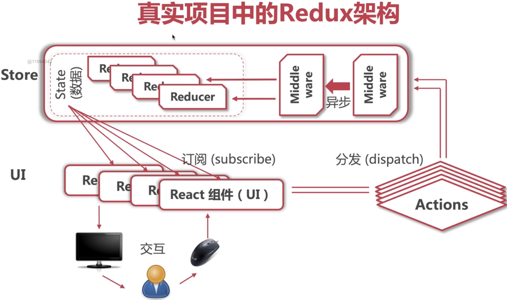

# How do Redux actions and reducers update shared application state? / Redux action 与 reducer 如何更新共享应用状态？

Redux centralizes state behind a store: components dispatch actions, reducers return the next state, and middleware can observe or extend dispatch. The archived diagram and examples show the classic flow; prefer the separately documented Redux Toolkit setup for new Redux code. / Redux 通过 store 集中管理状态：组件 dispatch action，reducer 返回下一状态，middleware 可观察或扩展 dispatch。归档图示和示例展示经典流程；新 Redux 代码优先参考单独的 Redux Toolkit 配置页。

## Redux / Redux

Redux is a state management library often used with React to manage and centralize application state. It follows the principles of a unidirectional data flow and provides a predictable state container for JavaScript apps.

## Goal

The primary goal of Redux is to manage and centralize the state of an application, making the state more predictable and easier to manage.

## When to Use Redux

Redux is particularly useful in scenarios where:

- Multiple components need to share data.
- The state of the application can be accessed and updated from various parts of the application.
- There are complex state interactions that are difficult to manage with local component state.

Examples include:

- Global language switch
- Dark mode switch
- User authentication and global user data

## Redux Architecture



## Core Concepts

### Actions

Actions are plain JavaScript objects that represent an intention to change the state. They are the only source of information for the store. Actions must have a `type` property that indicates the type of action being performed.

Example:

```tsx
export const CHANGE_LANGUAGE = "CHANGE_LANGUAGE";

export const changeLanguage = (language: string) => ({
  type: CHANGE_LANGUAGE,
  payload: language,
});
```

### Reducers

Reducers are pure functions that take the current state and an action as arguments and return a new state. They specify how the application's state changes in response to an action.

Example:

```tsx
import { CHANGE_LANGUAGE } from "./languageActions";

interface LanguageState {
  language: "en" | "zh";
  languageList: { name: string; code: string }[];
}

const initialState: LanguageState = {
  language: "zh",
  languageList: [
    { name: "中文", code: "zh" },
    { name: "English", code: "en" },
  ],
};

const languageReducer = (state = initialState, action): LanguageState => {
  switch (action.type) {
    case CHANGE_LANGUAGE:
      return { ...state, language: action.payload };
    default:
      return state;
  }
};

export default languageReducer;
```

### Store

The store is the object that brings actions and reducers together. It holds the application state and provides methods to access the state, dispatch actions, and register listeners.

Creating a store with Redux Toolkit:

```tsx
// store.ts
import { configureStore } from "@reduxjs/toolkit";
import languageReducer from "./language/languageReducer";

const store = configureStore({
  reducer: {
    language: languageReducer,
  },
});

export default store;
```

### Middleware

Middleware provides a third-party extension point between dispatching an action and the moment it reaches the reducer. It can be used for logging, crash reporting, or handling asynchronous actions.

Redux Toolkit's default middleware already includes thunk. Configure additional middleware by extending that list; do not replace the defaults just to add one middleware:

```tsx
// store.ts
import { configureStore } from "@reduxjs/toolkit";
import languageReducer from "./language/languageReducer";

const store = configureStore({
  reducer: {
    language: languageReducer,
  },
  middleware: (getDefaultMiddleware) => getDefaultMiddleware(),
});

export default store;
```

### Using Redux with React

#### Connecting a Component

To connect a React component to the Redux store, use the `useSelector` and `useDispatch` hooks from `react-redux`.

Install `react-redux`:

```bash
npm install react-redux
```

Example:

```tsx
// LanguageSwitcher.tsx
import React from "react";
import { useSelector, useDispatch } from "react-redux";
import { changeLanguage } from "./language/languageActions";

const LanguageSwitcher = () => {
  const language = useSelector((state) => state.language.language);
  const dispatch = useDispatch();

  const handleLanguageChange = (e) => {
    dispatch(changeLanguage(e.target.value));
  };

  return (
    <div>
      <select value={language} onChange={handleLanguageChange}>
        <option value="en">English</option>
        <option value="zh">中文</option>
      </select>
    </div>
  );
};

export default LanguageSwitcher;
```

### Combining Reducers

For larger applications, it is common to split the state and reducers into smaller, more manageable parts. These can be combined using `combineReducers`.

Example:

```tsx
import { combineReducers } from "redux";
import languageReducer from "./language/languageReducer";
import themeReducer from "./theme/themeReducer";

const rootReducer = combineReducers({
  language: languageReducer,
  theme: themeReducer,
});

export default rootReducer;
```

### Using Redux DevTools

`configureStore` enables Redux DevTools integration by default (`devTools` defaults to `true`). The explicit option below disables it in production; the separate `redux-devtools-extension` package is not needed for this setup. See the [Redux Toolkit 2.11.0 implementation](https://raw.githubusercontent.com/reduxjs/redux-toolkit/v2.11.0/packages/toolkit/src/configureStore.ts).

```tsx
// store.ts
import { configureStore } from "@reduxjs/toolkit";
import rootReducer from "./rootReducer";

const store = configureStore({
  reducer: rootReducer,
  devTools: process.env.NODE_ENV !== "production",
});

export default store;
```

**See also / 另见：** [Redux Toolkit reference / Redux Toolkit 参考](redux-toolkit-reference.md) for the newer store and slice APIs.
