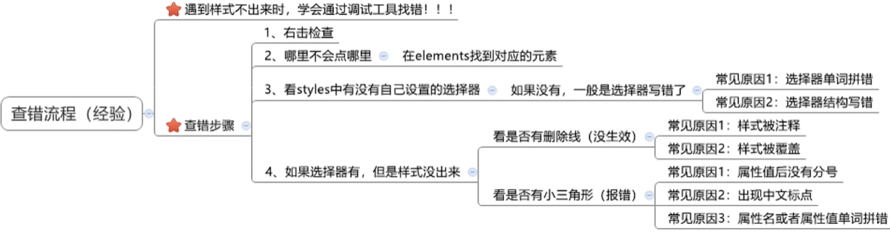

# Frontend Tools and Editor Workflow / 前端工具与编辑器工作流

This is a compact reference for browser inspection, Less, design handoff, and common editor shortcuts. The examples describe reusable workflows; extension settings and keyboard shortcuts can vary by tool version and operating system.

**Core answer / 核心回答：** Use browser tools to inspect the rendered page, Less to express reusable CSS rules, and editor abbreviations to reduce repetitive typing. Confirm the compiled CSS and rendered result instead of treating a shortcut or preprocessor output as proof of correctness. / 用浏览器工具检查实际渲染结果，用 Less 表达可复用的 CSS 规则，用编辑器缩写减少重复输入。仍要检查编译后的 CSS 和页面效果，不能把快捷键或预处理器输出当作正确性的证明。

## Chrome DevTools / Chrome 开发者工具

Open DevTools with F12 or the browser menu, then use **Elements** to inspect an element and edit its live styles. These edits are temporary until copied into source code. Console icons distinguish errors, warnings, and informational messages; a warning marker does not always mean that a CSS declaration is invalid.

Useful workflow:

1. Select the affected element in **Elements** and inspect the matched rules and computed styles.
2. Toggle declarations or adjust values to test a hypothesis.
3. Check **Console** for runtime errors and warnings.
4. Use **Network** for request status, timing, and transferred size; use **Performance** to record scripting, rendering, and layout work.

## Less / Less 预处理器

Less is a CSS preprocessor. Nesting, variables, and arithmetic are compiled to ordinary CSS before the browser uses the stylesheet.

~~~less
@brand-color: #c35;
@design-root: 37.5; // A 375px-wide design whose root font size is 37.5px.

.card {
  color: @brand-color;
  width: (68 / @design-root) * 1rem;

  .title {
    font-weight: bold;
  }

  &:hover {
    color: #99334d;
  }
}
~~~

A Less compiler emits selectors and calculated values such as:

~~~css
.card {
  color: #c35;
  width: 1.813333rem;
}
.card .title {
  font-weight: bold;
}
.card:hover {
  color: #99334d;
}
~~~

The pixel-to-rem calculation assumes that the document root font size follows the design scale. For example, 37.5 CSS pixels per rem at a 375px design width makes a 68px design measurement equal to about 1.813rem. The application still needs to set the root font size consistently.

- Nested selectors use a space to form descendants; the ampersand refers to the parent selector, as in &:hover, &::before, or &.active.
- Variables use @name: value;. Reuse them for repeated colors, spacing, and other design tokens.
- Less supports arithmetic. Parentheses make division explicit, and unit behavior should be checked in the generated CSS.
- // is a Less-only line comment and is omitted from the CSS output. Block comments are emitted.
- @import "tokens.less"; includes another Less file. The import path and build configuration determine which source is compiled.
- Easy LESS can compile on save and configure output through its `less.compile` VS Code setting. In the project `.vscode/settings.json`, for example, `"less.compile": { "out": "${workspaceFolder}/dist/css/" }` sends each file's CSS to that folder; keep the trailing slash. A specific path such as `"out": "${workspaceFolder}/dist/app.css"` names one output file. Paths are relative to the Less source unless expanded from `${workspaceFolder}`.
- For an imported Easy LESS partial that should not emit its own CSS file, put `// out: false` on the first line of that `.less` file. This is extension configuration, not Less language syntax; a build pipeline can instead compile Less as part of the application build.

For a design that scales with the viewport width, a ratio can be written directly in Less:

~~~less
@design-width: 375;
.box {
  width: (68 / @design-width) * 100vw;
}
~~~

This yields approximately 18.133vw for a 68px measurement in a 375px-wide design. Document the design viewport and formula near the conversion; avoid applying a fixed ratio when the project uses a different scaling rule.

## Design inspection / 设计稿检查

In PxCook or a similar design-inspection tool, use the ruler to read a measurement and the color picker to inspect a color value. Confirm whether the design value is expressed in CSS pixels, device pixels, or a scaled viewport before copying it into the page.

## VS Code and Emmet / VS Code 与 Emmet

VS Code enables Emmet abbreviations in HTML and CSS by default for common file types. In an HTML file, ! can expand to a starter document. For example:

| Abbreviation | Typical HTML expansion |
|---|---|
| **div** | Empty div element |
| **.red** | Div with class red |
| **#one** | Div with id one |
| **p.red#one** | Paragraph with class red and id one |
| **ul>li*3** | A list with three list items |
| **ul>li{item $}*3** | Three list items containing item 1, item 2, and item 3 |

Common CSS abbreviations include these default snippets and shorter forms that Emmet may resolve through fuzzy search; inspect the editor preview:

| Abbreviation | Typical CSS expansion |
|---|---|
| **bgc** | `background-color: #fff;` |
| **bgi** | `background-image: url(...);` |
| **bgr** | `background-repeat: no-repeat;` with other repeat values available in the snippet choices |
| **bgp** | `background-position: 0 0;` |
| **bg** | `background: #000;` |
| **ta** | `text-align: left;` with center, right, and justify choices |
| **pos** | `position: relative;` with other position choices |
| **bd** | `border: 1px solid #000;` |
| **tac** *(fuzzy-search candidate)* | May resolve to `text-align: center;`; confirm the editor suggestion. |
| **por** *(fuzzy-search candidate)* | May resolve to `position: relative;`; confirm the editor suggestion. |

The checked default snippets provide `ta` and `pos` with the listed value choices. Emmet fuzzy search can match unknown abbreviations against predefined snippet names; inspect the editor preview before relying on a shorter form.

On the default macOS keymap, common editing actions include:

- **⌘+/** toggles a line comment.
- **Option+Z** toggles word wrap.
- **Option+Shift+Down** duplicates the current line or selection.
- **Option+Click** adds another cursor.

Keymaps can be changed. Check **Keyboard Shortcuts** if a binding differs. In a CSS file, **w100+h100** expands to `width: 100px; height: 100px;`; **w100p** expands to `width: 100%;`, and **m10-20** to `margin: 10px 20px;`. Emmet also accepts explicit units and multi-value shorthands. Inspect the suggestion preview when a project has custom snippets or editor settings.

A favicon can be declared in the document head:

~~~html
<link rel="icon" href="/favicon.ico">
~~~

Split the editor into panes when comparing related HTML and CSS files; the layout is an editor convenience, not a build requirement.

## References / 参考资料

- [Chrome DevTools overview](https://developer.chrome.com/docs/devtools/overview/)
- [Less documentation](https://lesscss.org/)
- [Easy LESS extension settings](https://github.com/mrcrowl/vscode-easy-less#readme)
- [VS Code Emmet](https://code.visualstudio.com/docs/languages/emmet)
- [Emmet CSS abbreviations](https://docs.emmet.io/css-abbreviations/)
- [Emmet CSS fuzzy search](https://docs.emmet.io/css-abbreviations/fuzzy-search/)
- [Emmet default CSS snippets](https://github.com/emmetio/snippets/blob/master/css.json)
- [WHATWG HTML: `rel="icon"`](https://html.spec.whatwg.org/multipage/links.html#rel-icon)
- [VS Code keyboard shortcuts](https://code.visualstudio.com/docs/getstarted/keybindings)

For a broader build-pipeline explanation, see [Build Tools / 构建工具](../../../../frontend/tooling/build-tools.md).
