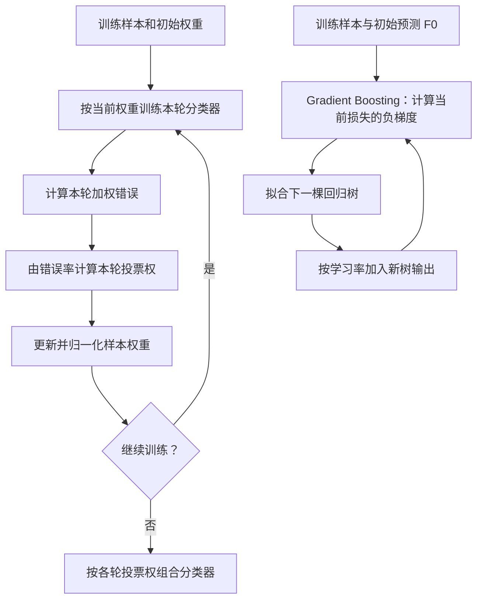

# AdaBoost 与 Gradient Boosting（梯度提升）怎样逐轮改变预测？

若一个模型把三条记录分对、一条分错，下一轮应怎样利用这次错误？若预测房价比真实值少了 50,000 美元，下一棵树又该学什么？AdaBoost 和梯度提升都逐轮加入学习器，但它们构造下一个训练信号的方式不同。

第一条路线调整训练样本的相对权重；第二条路线拟合当前预测还需改变的方向。下面用一个二分类轮次和一个回归轮次分别走完计算。

## AdaBoost：错分样本如何变重？

AdaBoost（Adaptive Boosting，自适应提升）让多个 weak learner（弱学习器）按顺序训练；用于分类时，具体模型称弱分类器。当前分类器的加权错误决定它的投票权，同时被分错的样本会在下一轮得到更大的相对权重。单层决策树桩可以充当弱分类器；这种逐轮重加权的集成不同于独立训练后再投票的随机森林。

经典二分类形式把标签和分类器输出编码为 $y_i,h_t(x_i)\in\{-1,+1\}$。设 $w_i$ 是总和为 1 的样本权重，$\epsilon_t$ 是当前分类器的加权错误率。当 $0<\epsilon_t<0.5$ 时：

$$
\alpha_t=\frac12\ln\frac{1-\epsilon_t}{\epsilon_t},
\qquad
w_i\leftarrow w_i\exp[-\alpha_t y_i h_t(x_i)]
$$

更新后再把所有权重除以总和，使它们重新加总为 1。若样本分对，乘数是 $e^{-\alpha_t}$；若分错，乘数是 $e^{\alpha_t}$。最终二分类器作加权投票：

$$
H(x)=\operatorname{sign}\left(\sum_t\alpha_t h_t(x)\right)
$$

> [!info] 为什么要取对数和指数？
> $\alpha_t$ 把错误率转换为该分类器在最终投票中的分量；指数更新则让错分样本的相对权重上升。对数的输入是正确权重与错分权重之比 $ (1-\epsilon_t)/\epsilon_t $，错误率越低，这轮分类器的投票权越大。以上公式是经典二分类版本；多分类变体使用不同的目标编码或更新规则。

> [!example] 四个等权样本中错一个
> 假设四个样本的初始权重都是 $1/4$，当前弱分类器错分 1 个，所以 $\epsilon=1/4$：
>
> $\alpha=\frac12\ln 3\approx0.5493$
>
> 因为 $e^{-\alpha}=1/\sqrt3\approx0.5774$、$e^{\alpha}=\sqrt3\approx1.7321$，先算未归一化权重：
>
> | 样本 | 本轮分类 | 初始权重 | 更新乘数 | 未归一化权重 | 归一化后 |
> | --- | --- | ---: | ---: | ---: | ---: |
> | 1 | 正确 | 0.25 | 0.5774 | 0.1443 | 1/6 |
> | 2 | 正确 | 0.25 | 0.5774 | 0.1443 | 1/6 |
> | 3 | 正确 | 0.25 | 0.5774 | 0.1443 | 1/6 |
> | 4 | 错误 | 0.25 | 1.7321 | 0.4330 | 1/2 |
>
> 未归一化总和约为 $0.8660$。归一化后，错分样本独自占下一轮权重的一半；其他每个样本各占六分之一。后续分类器因此更受当前错分样本影响。若分类器完美正确，公式会令 $\alpha$ 趋于无穷；真实实现需要停止或限制该轮。若错误率不低于一半，它不满足经典弱学习条件，不能照搬这个正权重更新。

## Gradient Boosting：下一棵树该拟合什么？

Gradient boosting（梯度提升）通过加法逐步修正预测。首先选一个常数初始预测 $F_0$；对平方误差回归，它是训练目标的均值。每轮根据当前预测计算损失对预测值的导数，再用新树近似其负方向：

$$
r_{im}
=
-\left.
\frac{\partial\ell(y_i,F(x_i))}{\partial F(x_i)}
\right|_{F=F_{m-1}},
\qquad
h_m\text{ 拟合 }(x_i,r_{im})
$$

可以再用 line search（线搜索）沿着树的输出方向找一个损失下降的步长 $\rho_m$，并用 learning rate（学习率）$\eta$ 缩小这次更新：

$$
F_m(x)=F_{m-1}(x)+\eta\rho_m h_m(x)
$$

这里的 $\rho_m$ 是便于推导的全树步长写法；树提升实现也常在各叶节点内分别求终端增量，再乘 $\eta$ 更新该叶中的预测。这个负梯度也称 pseudo-residual（伪残差），它就是下一棵回归树拟合的目标。只有称它为普通残差 $y-F$ 时才需要平方损失：对 $\ell=\frac12(y-F)^2$，负梯度正好是 $y-F$；换成绝对误差、分类对数损失等，负梯度通常不是原始残差。

> [!example] 从 300,000 美元更新到 305,000 美元
> 本例演示平方损失的第一轮：初始常数 $F_0=300{,}000$ 美元（训练集目标均值），当前记录的真实价格为 350,000 美元。平方损失的负梯度即残差：
>
> $350{,}000-300{,}000=50{,}000\text{ 美元}$
>
> 假定这一轮拟合出的回归树在该区域输出 $h_m(x)=50{,}000$，线搜索步长取 $\rho_m=1$，学习率取 $\eta=0.1$：
>
> $300{,}000+0.1\times1\times50{,}000=305{,}000\text{ 美元}$
>
> 量纲也要对上：学习率和步长在此例中无量纲，树输出和预测都以美元计。下一轮须根据更新后的预测重新计算梯度，并不继续照搬这一次的 50,000。

两种方法都能用浅树，但它们的训练信号不同：AdaBoost 重分配样本权重并集成分类投票；梯度提升直接沿选定损失的下降方向修正当前输出。轮数、树的深度、学习率以及随机采样会共同影响拟合能力；更小的学习率通常需要更多轮次，不代表验证集表现一定改善。使用训练内验证或提前停止后，还应保留独立数据作最终评估。

> [!info]- 来源
> - AdaBoost 的二分类样本重加权和加权投票：Freund 与 Schapire，*A Decision-Theoretic Generalization of On-Line Learning and an Application to Boosting*（1997），[原文 DOI](https://doi.org/10.1006/jcss.1997.1504)，§4.1 使用 0/1 编码与 beta 更新；转换为对称的 ±1 编码后可写成本页 alpha 形式。
> - 逐轮拟合损失负梯度、平方损失初始化和学习率：scikit-learn 1.9.1 [Ensembles 用户指南](https://scikit-learn.org/1.9/modules/ensemble.html#gradient-boosting)，2026-11-06 核对 §§1.11.1–1.11.2；基础论述见 Friedman，*Greedy Function Approximation: A Gradient Boosting Machine*（2001），[原文 DOI](https://doi.org/10.1214/aos/1013203451)。
> - 四样本权重、房价梯度与更新均由公式独立复算；未运行任何集成器，因此示例不是某个库的训练日志。
