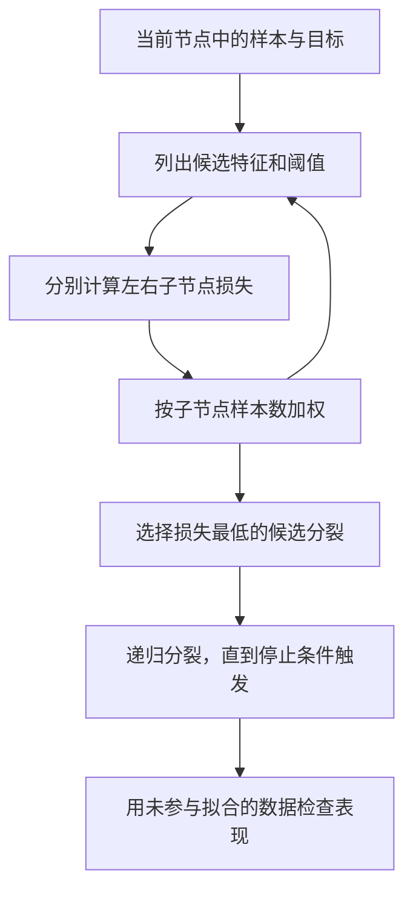

# Decision tree（决策树）如何在分类与回归中选分裂？

一支树从一个尚未分组的样本节点开始，逐个比较“按哪个特征、在哪个阈值切开”能让子节点更纯。分类树衡量标签混杂程度；回归树衡量节点里数值目标的误差。真正要比较的是子节点误差按样本数加权后的总和。

本节用四条合成记录说明分类分裂，再用四个数值目标说明回归分裂。数字只用于手算机制，不是某个模型库的拟合输出。

图中每层都在当前节点内重新选分裂；这个过程是逐步贪心的，未穷举所有可能的整棵树。

## 分类任务：比较加权不纯度

分类树用特征条件把样本送到叶节点，叶节点输出类别或类别概率。内部节点提出条件，叶节点保存最后的预测。decision stump（决策树桩，只有一次分裂的浅树）也是常见的弱学习器。

Gini impurity（基尼不纯度）从一个节点中观察到的类别比例出发计算：

$$
G = 1 - \sum_k p_k^2
$$

这里 $p_k$ 是类别 $k$ 在该节点中的比例。也可把它理解为：按这些比例独立抽取两个标签，两者不同的概率。纯节点的值为 0；二分类各占一半时值为 0.5。候选分裂的好坏看左右子节点不纯度的加权平均，不能只挑“看起来更纯”的那一边。

> [!info] 手算时先算比例，再平方
> 本例各记录的样本权重相等。某节点有 3 个红标签、1 个蓝标签时，比例为 $3/4$ 和 $1/4$，所以 $G=1-(3/4)^2-(1/4)^2=3/8=0.375$。子节点的权重是子节点样本数除以父节点样本数；若传入不等的样本权重，类别比例和子节点权重都应按样本权重总量计算，而不能直接用行数。

> [!example] 四条分类记录中，哪个问题分得更好？
> 假设当前节点恰有 3 个红标签、1 个蓝标签。现在只比较两个候选特征产生的两种切法：
>
> | 候选切法 | 左、右节点的红/蓝计数 | 子节点加权不纯度 | 相对父节点的下降 |
> | --- | --- | ---: | ---: |
> | A | 1/0 与 2/1 | $\frac14(0)+\frac34(\frac49)=\frac13\approx0.3333$ | $\frac38-\frac13=\frac1{24}\approx0.0417$ |
> | B | 2/0 与 1/1 | $\frac24(0)+\frac24(\frac12)=\frac14=0.25$ | $\frac38-\frac14=\frac18=0.125$ |
>
> A 的第二个子节点有 2 个红、1 个蓝，Gini 为 $1-(2/3)^2-(1/3)^2=4/9$；B 的混合子节点各有 1 个样本，Gini 为 $1/2$。因此，在这两个候选方案之间，B 的加权不纯度更低，优先被选中。这个比较只说明当前节点的局部选择，不能推出整棵树在新数据上一定更好。

以 scikit-learn 的默认 splitter=best 为例，每个节点会贪心检查各个可用特征及排序后相邻取值之间的候选阈值，并选加权损失最低者。随机 splitter 会为考虑的特征抽取一个随机候选阈值，而不是穷举所有阈值；这可能减少搜索量，但不保证找到同一个分裂。

## 回归任务：比较节点内数值误差

回归树在 mean squared error（均方误差，MSE）准则下，把叶节点目标值设为节点内均值。节点的不纯度是每个目标值到均值的平方误差平均：

$$
\bar y = \frac1n\sum_i y_i,
\qquad
\operatorname{MSE}=\frac1n\sum_i (y_i-\bar y)^2
$$

> [!example] 把四个数值目标分成两组
> 合成目标为 10、12、20、22。父节点均值是 16，平方偏差为 36、16、16、36，因此父节点 MSE 为 $104/4=26$。
>
> 若候选分裂把前两个数放在左侧、后两个数放在右侧，两边均值分别是 11 和 21。每边的平方偏差平均都是 1，因此加权子节点 MSE 为 $\frac24(1)+\frac24(1)=1$，损失下降为 $26-1=25$。
>
> 这里所有目标值都用同一单位；平方误差的单位是原目标单位的平方。若业务目标是绝对误差或非负计数，不应只因为 MSE 算得方便就默认它最合适。

平方误差不是唯一选择。常见回归树准则还包括绝对误差和 Poisson deviance（泊松偏差）；绝对误差对应节点中位数，scikit-learn 的 `criterion="poisson"` 要求目标非负且节点目标总和为正（使用 `sample_weight` 时按样本权重求和），适用于计数或单位时间频数等问题。

## 如何控制树的复杂度？

每选出一个节点的分裂，树就把原有输入空间再切成更小的区域。更深的树可能记住训练样本中的偶然细节。常见限制包括最大深度、一个节点继续分裂所需的最小样本数、每个叶节点的最小样本数，以及最小不纯度下降。代价复杂度剪枝还会比较叶节点误差与叶节点数量：

$$
R_\alpha(T)=R(T)+\alpha\,|\widetilde T|
$$

其中 $R(T)$ 是整棵树叶节点的样本加权不纯度，$|\widetilde T|$ 是叶节点数；增大 $\alpha$ 会更偏好叶节点较少的子树。深度、叶大小和剪枝强度都应通过训练数据内的验证流程选择，再用未参与选择的留出数据检查。小样本上的局部不纯度下降可能不稳定，需观察不同切分下的结果。

> [!info]- 来源
> - 分类和回归的节点准则、样本加权候选分裂、贪心搜索与停止条件：scikit-learn 1.9.1 [Decision Trees 用户指南](https://scikit-learn.org/1.9/modules/tree.html)，2026-11-06 核对 §§1.10.7、1.10.8。Poisson 准则的正节点目标和限制见其 [1.9.1 实现](https://github.com/scikit-learn/scikit-learn/blob/1.9.1/sklearn/tree/_criterion.pyx#L1395-L1456)。
> - 代价复杂度剪枝：同一用户指南 §1.10.9；其基础资料为 Breiman、Friedman、Olshen、Stone，*Classification and Regression Trees*（1984）。
> - 这两组计数和均方误差由标准算术独立复算；未运行 scikit-learn 拟合，因此未把算例描述成库输出。
