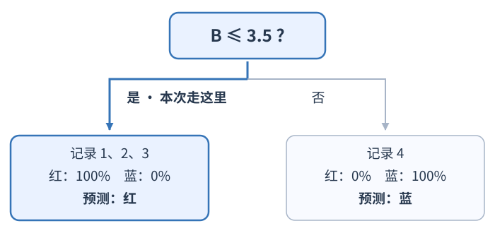
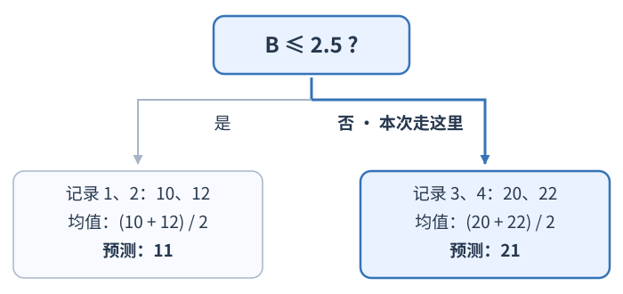

# Decision tree（决策树）如何在分类与回归中选分裂？

四条合成记录可以回答两种不同任务：判断记录属于哪类，或预测一个数值结果。decision tree 在每个待分裂的 node（节点）尝试用一项特征和一个 threshold（阈值）把当前样本分成左右两组，再比较两组目标值的混杂程度或误差。本章用同一组记录分别演示 classification（分类）和 regression（回归）：每个节点只选当前节点上评分最好的候选；随后对两个子节点递归重复，直到停止条件触发，leaf node（叶节点）再给出最终预测。

| 记录 | 合成特征 A | 合成特征 B | 分类标签 | 数值目标 $y$ |
| --- | ---: | ---: | --- | ---: |
| 1 | 1 | 1 | 红 | 10 |
| 2 | 3 | 2 | 红 | 12 |
| 3 | 4 | 3 | 红 | 20 |
| 4 | 2 | 4 | 蓝 | 22 |

A 和 B 是为手算而设的合成数值特征，每列的不同取值都是 1、2、3、4。分类与回归共用这四条输入记录，只把目标列分别设为红/蓝标签和数值 $10,12,20,22$；因此同一个候选阈值会送相同记录到左右两边，但两种任务对分裂的评价可能不同。

在每个节点 $m$，树比较候选条件 $\theta=(j,t)$：第 $i$ 条样本的第 $j$ 个特征值记为 $x_{ij}$。对该特征值非缺失的样本，若 $x_{ij}\le t$ 就进入左子节点，若 $x_{ij}>t$ 就进入右子节点；缺失值另按实现支持的缺失值规则分配。对数值特征，候选阈值通常取该节点内相邻不同取值的中点；本例每列都有取值 $1,2,3,4$，所以完整候选是每列的 $1.5,2.5,3.5$，共六个。下面先用 A $\le1.5$ 与 B $\le2.5$ 两个演算候选逐步拆解公式；它们不是完整搜索后的两个唯一候选，后文会比较全部六个根分裂。树按左右子节点各自的准则值乘该侧样本占当前节点的比例，再相加，选择总值最低的分裂。本页讨论非负 sample weight（样本权重），且参与计算的节点总权重为正。传入样本权重后，用各侧权重和占当前节点总权重的比例作加权，节点准则也按样本权重计算。这个过程逐节点贪心：当前节点选出的分裂最好，不等于整棵树已达到全局最优结构。

## 分类任务：比较加权不纯度

分类树在叶节点按类别概率最大的类给出预测；概率是该叶中各类训练样本所占比例。若传入权重，这些概率改用各类样本的权重占比。候选分裂要让左右两组的标签更集中。scikit-learn 1.9.1 默认用 Gini；也支持以 Shannon entropy（香农熵）为准则的 `"entropy"` 与 `"log_loss"`。令 $p_{mk}$ 表示节点 $m$ 中类别 $k$ 的比例。以 Gini impurity（基尼不纯度）为例：

$$
G(Q_m)=1-\sum_k p_{mk}^2
$$

$Q_m$ 表示当前节点里的样本集合；等权样本时 $p_{mk}$ 就是该节点类别计数除以节点样本数。Gini 也等于从该节点类别比例中独立抽取两个标签、二者不同的概率：纯节点 $G=0$；两类各占一半时 $G=0.5$。另一可选量是香农熵 $-\sum_k p_{mk}\log p_{mk}$，约定 $p_{mk}=0$ 时该项为 0。两种准则都将左右子节点不纯度按样本数加权比较；传入权重后，比例和子节点权重都要按样本权重之和计算，而不是直接数行数。

当前节点有 3 个红标签和 1 个蓝标签，父节点 $G=1-(3/4)^2-(1/4)^2=3/8=0.375$。只比较上方数据中的两个条件：

| 候选条件 | 左、右节点的红/蓝计数（依次为红数、蓝数） | 左右加权 Gini | 相对父节点的下降 |
| --- | --- | ---: | ---: |
| A $\le1.5$ | $(1,0)$ 与 $(2,1)$ | $\frac14(0)+\frac34(\frac49)=\frac13\approx0.3333$ | $\frac38-\frac13=\frac1{24}\approx0.0417$ |
| B $\le2.5$ | $(2,0)$ 与 $(1,1)$ | $\frac24(0)+\frac24(\frac12)=\frac14=0.25$ | $\frac38-\frac14=\frac18=0.125$ |

A 的混合子节点有 2 红、1 蓝，故 Gini 为 $1-(2/3)^2-(1/3)^2=4/9$；B 的混合子节点各有 1 个样本，故 Gini 为 $1/2$。虽然 B 的右侧比 A 的右侧更混杂，但 B 的两边各占父节点一半，左右加权后的总不纯度更低，因此在这两个演算候选中选择 B。评分针对整对左右子节点，不只看其中一边；完整搜索的实际根分裂另见下文。

scikit-learn 1.9.1 的数值特征树以 Classification and Regression Trees（CART，分类与回归树）为实现基础。`DecisionTreeClassifier` 默认 `splitter="best"`：对允许考察的特征及相邻不同值的中点作贪心穷举搜索，选择局部加权准则最低者。`max_features` 控制节点起始考虑的特征数；若这些特征找不到有效切分，实现还可能继续检查其它特征。`splitter="random"` 则为考察的特征取随机候选阈值，再选随机候选中表现最好的一个。即使使用 `"best"`，实现也会随机排列特征；若多个分裂的准则改善完全相同，选中哪一个可能受 `random_state` 影响。

## 回归任务：比较节点内数值误差

回归树需要让同一叶里的数值目标彼此接近。用 mean squared error（均方误差，MSE）作为准则时，叶节点预测是该节点目标值的均值；下式假设样本等权，传入 sample weight 后则改用加权均值和加权平方误差。若节点目标值为 $y_1,\ldots,y_n$，则：

$$
\bar y=\frac1n\sum_{i=1}^n y_i,
\qquad
\operatorname{MSE}(Q_m)=\frac1n\sum_{i=1}^n(y_i-\bar y)^2
$$

$\bar y$ 是当前节点的平均目标；MSE 先逐个计算目标值与该均值的平方偏差，再取平均，因此它的量纲是目标单位的平方。本例样本等权，比较候选分裂时按子节点样本数加权。

对同一组记录，父节点目标为 $10,12,20,22$，均值 $\bar y=(10+12+20+22)/4=16$。相对均值的平方偏差为 $36,16,16,36$，所以父节点 MSE 为 $104/4=26$。继续比较前面相同的两个演算候选：

| 候选条件 | 左、右目标值 | 左右加权 MSE | 相对父节点的下降 |
| --- | --- | ---: | ---: |
| A $\le1.5$ | $10$ 与 $12,20,22$ | $\frac14(0)+\frac34(\frac{56}{3})=14$ | $26-14=12$ |
| B $\le2.5$ | $10,12$ 与 $20,22$ | $\frac24(1)+\frac24(1)=1$ | $26-1=25$ |

A 的右侧均值为 18，平方偏差 $(12-18)^2+(20-18)^2+(22-18)^2=36+4+16=56$，所以右侧 MSE 为 $56/3$；左侧只有一个值，MSE 为 0。B 两侧的均值分别为 11 和 21；左侧 MSE $=((10-11)^2+(12-11)^2)/2=1$，右侧同理为 1。因而 B 的加权子节点 MSE 为 1，比 A 的 14 低，也比父节点的 26 低；这组样本上 B 的局部误差下降为 25。

### 用全部候选从根分裂走到叶预测

完整根节点搜索按 A、B 两列各自的三个中点计算，得到下表。表中列出各候选左右两侧的记录编号，以及按前面公式逐候选算出的加权 Gini 和 MSE：

| 根候选 | 左 / 右记录编号 | 加权 Gini | 加权 MSE |
| --- | --- | ---: | ---: |
| A $\le1.5$ | 1 / 2、3、4 | $1/3$ | 14 |
| A $\le2.5$ | 1、4 / 2、3 | $1/4$ | 26 |
| A $\le3.5$ | 1、2、4 / 3 | $1/3$ | $62/3$ |
| B $\le1.5$ | 1 / 2、3、4 | $1/3$ | 14 |
| B $\le2.5$ | 1、2 / 3、4 | $1/4$ | 1 |
| B $\le3.5$ | 1、2、3 / 4 | 0 | 14 |

因此，完整分类搜索选择 B $\le3.5$：左叶记录 1、2、3 都是红色，预测红；右叶只有记录 4，预测蓝。完整回归搜索则选择 B $\le2.5$。设 `max_depth=1`，树只分裂一次，这种树叫 decision stump（决策树桩），常作弱学习器；左叶记录 1、2 的均值为 $(10+12)/2=11$，右叶记录 3、4 的均值为 $(20+22)/2=21$，所以两叶预测分别为 11 与 21。对任意 A 值而 B=3 的新记录，分类树走左侧并预测红，回归树走右侧并预测 21；同一输入的落点不同，是因为两个目标下的最优根阈值不同。

**看一条新记录怎样走到叶节点。** 设它的 B=3，A 任意。下图用加粗蓝线和“本次走这里”同时标出路径；叶框里的记录编号是训练时落在该叶的旧记录，用来形成预测，并不是把新记录加入训练。

分类树检验 $3\le3.5$，走向纯红叶：

回归树检验 $3\le2.5$，结果为假，走向均值为 21 的右叶。分类和回归各自使用自己的根条件：

MSE 不是唯一准则。scikit-learn 1.9.1 的 `DecisionTreeRegressor` 默认使用 `criterion="squared_error"`，还支持 mean absolute error（平均绝对误差，MAE）和 Poisson deviance（泊松偏差）：MAE 在等权时用节点目标值的中位数作叶预测，传入样本权重时用加权中位数；Poisson 准则使用按样本权重计算的节点均值，适合计数或单位时间频数。拟合 Poisson 树时，目标值必须非负且全体目标之和须为正；另外，候选分裂若使任一子节点的加权目标值之和小于或等于浮点容差，就会被排除，以免叶均值非正。若业务目标是计数且会出现全零子组，应先确认这项限制与自己的分裂和叶片大小设置相容。平方误差、绝对误差和泊松偏差强调不同的误差形状，需依据目标含义选择，而不是只比较手算是否方便。

## 如何控制树的复杂度？

递归分裂会继续把输入空间切成更小区域。若任由树一直长，训练误差可以很低，却可能把样本中的偶然波动也当作规则。预先限制每条路径的最大深度 `max_depth`、允许继续分裂所需的最少样本数 `min_samples_split`、每个叶节点的最少样本数 `min_samples_leaf`，或设定 `min_impurity_decrease`，都能在生长时限制分裂；也可以限制 `max_leaf_nodes`。若某一节点没有通过限制，或找不到有足够改善的分裂，它就成为叶节点，输出其训练样本的类别比例或数值预测。

记 $Q_m$ 为当前节点样本集合，$Q_L,Q_R$ 为切分后的左右样本集合；$H(Q)$ 表示该任务采用的节点准则值（如 Gini 或 MSE）。$W$ 是根节点总样本权重，$W_m,W_L,W_R$ 是当前节点及左右子节点的权重和；不传 `sample_weight` 时，它们分别等于样本数。对 scikit-learn 1.9.1 的 `min_impurity_decrease`，分裂得分按整个训练集的权重缩放：

$$
\frac{W_m}{W}\left[H(Q_m)-\frac{W_L}{W_m}H(Q_L)-\frac{W_R}{W_m}H(Q_R)\right]
$$

节点只在该分数不小于 `min_impurity_decrease` 时继续分裂（源码比较包含浮点容差）。根节点的权重占比为 1；深层节点还要乘本节点占根权重的比例，所以同样大小的局部改善在较小节点上的全局得分更低。小样本节点的局部改善容易被个别记录左右；比较不同训练折所选的切分及留出误差，有助于判断该改善是否稳定。

树长成后，还可用 cost-complexity pruning（代价复杂度剪枝）比较整棵子树的拟合误差与叶节点数：

$$
R_\alpha(T)=R(T)+\alpha\lvert\widetilde T\rvert
$$

$R(T)$ 是将各叶节点不纯度按该叶权重占根节点总权重的比例加权求和：$R(T)=\sum_{\ell\in\widetilde T}(W_\ell/W)H(Q_\ell)$；无权重时 $W_\ell/W$ 就是该叶样本比例。$|\widetilde T|$ 是叶节点数，$\alpha\ge0$ 是复杂度惩罚，单位与 $R(T)$ 相同。以刚才的回归树为例，两叶时 $R(T)=1$，剪成单个根叶时 $R(T)=26$；两叶树代价为 $1+2\alpha$，根叶代价为 $26+\alpha$，二者在 $\alpha=25$ 相等。对这两种子树的比较，`ccp_alpha` 达到 25 时剪掉该分裂；更大的树通常有其它有效阈值，达到有效阈值才发生剪枝，并非每次把 $\alpha$ 调大都必然改变树。$\alpha$ 要和所用准则共同理解：例如回归 MSE 的量纲是目标单位平方，改变目标的计量单位会改变不纯度与合适门槛的尺度。实际应在训练数据内部用 cross-validation（交叉验证）比较深度、叶片大小、最小改善和 `ccp_alpha`，最后用独立留出数据检查；不能根据训练误差最低就断定树最好。

> [!info]- 来源
>
> - scikit-learn 1.9.1 [Decision Trees 用户指南](https://scikit-learn.org/1.9/modules/tree.html)：§1.10.7 的候选特征/阈值、左右加权准则和递归停止；§1.10.7.1 的分类概率、Gini 与熵；§1.10.7.2 的 MSE、MAE、Poisson 与叶预测；§1.10.8 的缺失值支持范围；§1.10.9 的代价复杂度剪枝及 $R(T)$ 定义。分类与回归准则列表和默认参数见 [`DecisionTreeClassifier` API](https://scikit-learn.org/1.9/modules/generated/sklearn.tree.DecisionTreeClassifier.html) 与 [`DecisionTreeRegressor` API](https://scikit-learn.org/1.9/modules/generated/sklearn.tree.DecisionTreeRegressor.html)，2026-11-12 核对版本。MAE 的加权中位数见 1.9.1 [固定实现](https://github.com/scikit-learn/scikit-learn/blob/866c0f51e7560ef0303cbcc5f159df5382ea9e3f/sklearn/tree/_criterion.pyx#L1187-L1190)。
>
> - 样本权重下的全局加权不纯度下降和 `min_impurity_decrease`：同一版本 [`DecisionTreeRegressor` API](https://scikit-learn.org/1.9/modules/generated/sklearn.tree.DecisionTreeRegressor.html) “min_impurity_decrease” 参数说明。
>
> - Poisson 输入限制：scikit-learn 1.9.1 [`_classes.py`](https://github.com/scikit-learn/scikit-learn/blob/866c0f51e7560ef0303cbcc5f159df5382ea9e3f/sklearn/tree/_classes.py#L262-L272) 的拟合检查要求目标非负且总和为正；加权分裂候选限制见同一版本 [`_criterion.pyx`](https://github.com/scikit-learn/scikit-learn/blob/866c0f51e7560ef0303cbcc5f159df5382ea9e3f/sklearn/tree/_criterion.pyx#L1585-L1596)：任一子节点的加权目标总和不大于 `EPSILON` 就排除该候选。
>
> - CART 的分类分裂见 Breiman、Friedman、Olshen、Stone，*Classification and Regression Trees*（1984）§2.3；回归树见第 8 章，特别是 §8.4 “Tree Structured Regression”；代价复杂度剪枝见 §3.3。[出版社电子书预览](https://api.pageplace.de/preview/DT0400.9781351460491_A31471984/preview-9781351460491_A31471984.pdf) 的目录及 §2.3 正文可核对上述位置。scikit-learn 1.9.1 用户指南 §1.10.6 也注明其树基于优化版 CART。
>
> - 原两候选的 Gini/MSE 计算及全部六个根候选的加权 Gini、MSE、最终两种根分裂和叶预测均由四条合成记录手算并用精确分数复核；没有运行 scikit-learn 拟合，也未把手算结果写成库输出。熵准则只保留公式，没有声称复算了熵分数。
