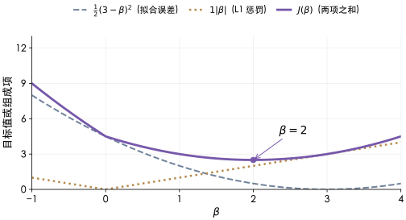
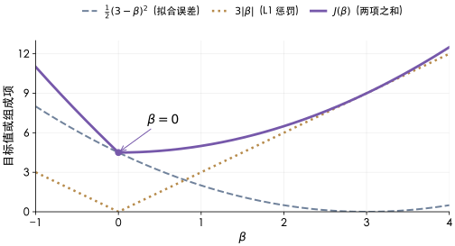

# Ridge regression（岭回归）、Lasso（套索回归）与 Elastic Net（弹性网络）怎样改变线性模型？

**案例背景。** 要预测多栋建筑下一周的能耗。数据每行对应“一栋楼在一个预测截止周的记录”：面积、房间数和建筑体积描述楼宇间差异，最近一周的用量、天气等输入会随周变化，目标是该楼下一周的能耗。面积、房间数和体积往往彼此相关；ordinary least squares（普通最小二乘法）可能给出不同的系数组合，却产生相近的训练预测。Ridge、Lasso 和 Elastic Net 在同一个拟合误差外约束系数，本章从目标函数推导三者的差别，再把尺度、库参数和按周验证接回这个预测问题。

## 从一个目标函数看三种惩罚

令训练数据矩阵 $X\in\mathbb{R}^{n\times p}$，其中 $n$ 是样本数、$p$ 是特征数；$y\in\mathbb{R}^n$ 是能耗目标，$\beta\in\mathbb{R}^p$ 是系数，$\beta_0$ 是截距。把第 $i$ 行的特征写成列向量 $x_i\in\mathbb{R}^p$，每条记录的预测是 $\beta_0+x_i^\top\beta$，误差是 $y_i-\beta_0-x_i^\top\beta$。

> [!info] 这里的向量相乘得到什么？
> $x_i^\top\beta$ 是 dot product（点积）：对应特征与系数相乘，再加起来，得到一个预测贡献值。只看两个标准化特征，若 $x_i=(2,1)^\top$、$\beta=(0.5,2)^\top$，则贡献为 $2\times0.5+1\times2=3$；再加截距得到预测。矩阵 $X$ 把所有样本的行叠在一起，$X\beta$ 就一次得到所有样本的贡献向量。这里不是对两个向量逐元素相乘后仍保留向量。

一种常见的平方误差归一化写法是：

$$
J(\beta_0,\beta)=
\frac{1}{2n}\sum_{i=1}^n(y_i-\beta_0-x_i^\top\beta)^2
+\lambda_1\lVert\beta\rVert_1
+\frac{\lambda_2}{2}\lVert\beta\rVert_2^2
$$

其中 $\lVert\beta\rVert_1=\sum_{j=1}^p|\beta_j|$，$\lVert\beta\rVert_2^2=\sum_{j=1}^p\beta_j^2$；$1/(2n)$ 是平方误差的归一化约定，会影响惩罚参数的数值对应关系。截距不受惩罚。第一项让预测贴近训练目标，L1 penalty（L1 惩罚）让系数绝对值总和变小，L2 penalty（L2 惩罚）让系数平方和变小。惩罚作用于系数向量，不直接作用于预测误差；它限制模型用多大的系数解释训练样本。令 $\lambda_1,\lambda_2\ge0$。

| 方法与惩罚 | 对系数的影响与条件 |
| --- | --- |
| Ridge：$\lambda_1=0$，$\lambda_2>0$ | 惩罚系数向量的整体 L2 大小，通常不把坐标精确压到零；相关特征间的重新分配可能让单个系数增大。 |
| Lasso：$\lambda_1>0$，$\lambda_2=0$ | 可能把部分系数压到精确的零；强相关特征中选中谁可能随样本变化。 |
| Elastic Net：$\lambda_1>0$，$\lambda_2>0$ | 同时整体收缩并允许稀疏系数；L2 部分可促进相关特征成组进入或退出，效果仍须验证。 |

为什么两个相关特征会分摊系数？先造一个容易手算的极端例子：令训练矩阵的两列 $a,b$ 完全相同，即 $a=b=x$。当 $\beta_a+\beta_b=2$ 且两系数非负时，整组训练预测中的贡献都是向量 $2x$，所以 $(\beta_a,\beta_b)=(2,0)$ 与 $(1,1)$ 给出相同预测，L1 范数也都是 2；平方 L2 范数却分别为 $2^2+0^2=4$ 与 $1^2+1^2=2$。因此给定同样预测时，Ridge 和 Elastic Net 的 L2 项偏好均分；Elastic Net 的 L1 项不改变这两个候选之间的差。只要两列仍完全相同且 $\lambda_2>0$，Ridge 和 Elastic Net 的最优解都会把这两列系数设为相等；响应噪声可能改变系数和，但不改变均分结论。若两列不完全相同，固定系数和并把 $\delta$ 从 $b$ 的系数移到 $a$，预测贡献会改变 $\delta(a-b)$；列越相近，这种移动对拟合误差的影响越小，但均分就不再必然是联合目标的最优分配。

> [!info]- 成组效应的严格条件
> Elastic Net 的 grouping effect（成组效应）也有严格适用条件。Zou 与 Hastie 原论文 §2.3 的 Theorem 1 讨论 naïve Elastic Net：响应已居中，每个预测变量已居中并缩放到单位 L2 长度，$\lambda_2>0$，且所比较的两个相关特征已取得同号的非零系数；定理在这些前提下界定系数差，而不保证所有相关特征都会一起被选中。这里的目标函数按 $1/(2n)$ 归一化；对非恒定列，`StandardScaler` 默认令总体方差为 1（平方和为 $n$），而常数列的 `scale_` 为 1、无法满足单位方差条件。这两种尺度下的系数和惩罚参数不能直接套用同一个定理数值。对工程选择，应把成组效应当作有条件的倾向，检查各时间折中是否重现。

惩罚直接作用在系数上，因此训练线性模型前通常做 standardization（标准化）：每个特征减去该训练折的均值 $\mu_j$。对该折中不是常数的特征列，标准差是：

$$
s_j=\sqrt{\frac{1}{n_{\mathrm{train}}}\sum_{i=1}^{n_{\mathrm{train}}}(x_{ij}-\mu_j)^2}
$$

非恒定列减去均值后，再除以该折的 $s_j$，即 $z_{ij}=(x_{ij}-\mu_j)/s_j$。标准差公式中的分母是该训练折样本数 $n_{\mathrm{train}}$（`ddof=0`），不是 $n_{\mathrm{train}}-1$。常数列无法缩放到单位方差；默认先减去均值成为零列，再以 `scale_=1` 避免除以零。直接使用原始量纲时，面积用平方米还是平方英尺，会改变系数大小和惩罚力度之间的关系。预测时用训练时保存的 `mean_`、`scale_` 变换新数据；不能用验证数据重新估计它们。

## 用两条合成观测手算系数

再把能耗问题缩小为一列合成输入，以便只观察惩罚本身：已居中的标准化特征取 $x=(-1,+1)$，对应已居中的合成能耗目标为 $y=(-3,+3)$（单位任意，不是实测数据）。这里 $n=2$、只有一个系数 $\beta$，截距为 0；$x_i$ 和 $y_i$ 都是标量，$\beta$ 表示特征每增加一个标准差，预测目标改变多少。两条记录的平方误差相同，因此开头的目标化为：

$$
J(\beta)=\frac12(3-\beta)^2+\lambda_1|\beta|+\frac{\lambda_2}{2}\beta^2
$$

未惩罚时最小值在 $\beta=3$。保持同一组数据，只改变惩罚。目标由严格凸的平方项加凸惩罚组成，所以任一光滑区间内的导数零点是唯一的全局最小值：

| 方法与本例参数 | 正半轴导数为零 | 最优系数 |
| --- | --- | ---: |
| Ridge $\lambda_1=0,\ \lambda_2=1$ | $\beta-3+\beta=0$ | $1.5$ |
| Lasso $\lambda_1=1,\ \lambda_2=0$ | $\beta-3+1=0$ | $2$ |
| Elastic Net $\lambda_1=1,\ \lambda_2=1$ | $\beta-3+1+\beta=0$ | $1$ |

表中平方误差 $\frac12(3-\beta)^2$ 的导数是 $\beta-3$。L1 在 $\beta=0$ 有尖点，所以用左右单侧导数判断是否停在零：左导数为 $-3-\lambda_1$，右导数为 $-3+\lambda_1$；L2 项在零点的导数为 0。对于凸函数，零点成为最小值需左导数不大于 0、右导数不小于 0。本例左侧条件总成立，右侧在 $\lambda_1\ge3$ 时成立，因此零点条件是 $\lambda_1\ge3$，与 $\lambda_2$ 无关。这解释了 Lasso 为何会产生精确零系数，也说明本例 $\lambda_1=1$ 时解仍是 $2$。

**把 Lasso 的目标画出来，为什么最优点会落到零？** 两张图沿用上面的同一组合成数据，横轴是系数 $\beta$，纵轴是目标值及其组成项。灰色虚线是拟合误差，橙色点线是 L1 惩罚，紫色实线是两者相加；形状和线型也标识各项。

先取 $\lambda_1=1$、$\lambda_2=0$。单看误差时最低点在 3，加上惩罚后，紫色曲线最低点移到 2，仍没有变成零。

再把 $\lambda_1$ 提到 3，数据和拟合误差都不变。此时从零点向右移动，拟合误差减少与惩罚增加的一阶变化恰好抵消；向左移动则两项都增大。紫色曲线恰在 $\beta=0$ 最低。它对应刚才的左右导数条件，并非把任意小系数手动截成零。

这组小数据只隔离了目标函数的作用，手算值不是库的拟合输出，也不构成模型选择建议。回到多楼周能耗数据，特征相关结构、噪声和惩罚强度都影响系数分配；选择时应看按周隔离的样本外误差与系数稳定性。

## 把惩罚强度与 scikit-learn 参数对应

scikit-learn 1.9.1 三个回归估计器的 application programming interface（API，应用程序接口）使用的目标函数归一化不完全相同。把 API 的惩罚项改写为本章开头的归一化目标，再比较参数：

- Ridge API 写为 $\lVert y-Xw\rVert_2^2+\text{alpha}\lVert w\rVert_2^2$。整体除以 $2n$ 后，$\lambda_2=\text{alpha}/n$。
- Lasso API 写为 $\frac{1}{2n}\lVert y-Xw\rVert_2^2+\text{alpha}\lVert w\rVert_1$，所以 $\lambda_1=\text{alpha}$。
- Elastic Net API 的目标为：

  $$
  \frac{1}{2n}\lVert y-Xw\rVert_2^2+\alpha r\lVert w\rVert_1+\frac{\alpha(1-r)}{2}\lVert w\rVert_2^2
  $$

  其中 $\alpha$ 对应 API 的 `alpha`，$r$ 对应 `l1_ratio`；因此 $\lambda_1=\alpha r$，$\lambda_2=\alpha(1-r)$。

这些换算比较的是惩罚系数，不是相同的训练运行。API 默认估计截距，且不惩罚截距。若设 `fit_intercept=False`，模型会强制截距为 0，也就是通过原点；它不会替用户检查是否已居中。若要拟合同一截距模型的等价问题，必须只用每折训练数据的均值把 $X$ 与 $y$ 都居中；验证和预测输入继续减去该训练均值，模型输出则加回该折训练目标均值。例如训练目标均值是 10、居中后的模型输出是 6，还原到原目标单位就是 $6+10=16$。Elastic Net 文档明确提示：`l1_ratio <= 0.01` 时，除非为正则化路径或搜索提供自己的 `alpha` 候选序列，否则这一设置不可靠；路径搜索接口（例如 `ElasticNetCV(alphas=...)`）可接收一组候选值，`ElasticNet(alpha=...)` 的单次拟合仍接收一个标量 `alpha`。若目标是纯 L2，直接使用 Ridge。参数数字相同并不代表惩罚相同，先核对目标函数再读 `alpha`。

## 按数据结构选择验证方式

按真实预测时点评估。此处每条输入是“楼宇×预测截止周”，多栋楼的预测目标可能落在同一个未来周。若先把所有楼宇周记录排成行，再直接对行使用 `TimeSeriesSplit`，一次切分可能把同一预测周的部分楼宇放进训练集、其余楼宇放进验证集；但在该周开始前，任何楼宇的该周实际能耗都还不可用。应按目标周分组（若预测时点不一致，则按实际可用信息的截止时点分组）：每次划分时，落入所选训练或验证窗口的预测周，其所有楼宇样本都随该周一起进入对应集合；间隔周和保留周可以不纳入该折。训练集只含验证时点之前已知目标的周，验证集则是后续完整时间窗。验证边界必须沿时间切开整组周记录，而不是按行号切开楼宇记录。

`TimeSeriesSplit` 的用户指南行为适用于按时间排列、每个等长时间点恰有一条观测的序列：默认每折累积扩大历史训练段，再验证紧接着的一段；可用 `max_train_size` 限定历史长度，也可用 `gap` 在训练与验证之间留出间隔。样本必须等间隔，才能让各折验证集覆盖相同时间长度。多楼宇每周多行时，需要先用周作为分组边界构造折，或使用专门的按周分组切分器；不能把原始多行数据直接交给按索引位置切分的默认方案。若观测间隔不规则，用实际日历时间定义训练和验证窗口；相同行数可能覆盖不同时间长度。

标准化器也属于训练过程：每个折只在该折训练段估计均值和 `scale_`，再用相同参数变换验证段。可把标准化器与回归器放进同一个 pipeline（流水线），例如 scikit-learn 的 `Pipeline`，确保交叉验证每次都只用该折训练数据拟合预处理。如果要比较不同时间折中非常数特征的斜率，标准化系数 $\beta_j$ 表示“目标单位/该折特征标准差”；`StandardScaler` 保存的 `scale_[j]` 就是该折尺度 $s_j$，所以原始单位下的斜率为 $\beta_j/s_j$。常数列的 `scale_` 为 1，但特征在该折没有变化，不能据此作斜率稳定性判断。

| 能耗预测中的观察 | 优先比较 | 验证时检查 |
| --- | --- | --- |
| 多个相关特征可能都携带信号 | Ridge 与 Elastic Net | 多折样本外误差；各特征斜率换回共同单位后是否稳定 |
| 需要紧凑的变量集合 | Lasso 与 Elastic Net | 非零特征能否在不同周窗口中重现 |
| 预测多栋楼的未来周能耗 | 三种都可比较 | 所选时间窗内，同周所有楼宇样本整组进入对应集合；最后保留完全未参与选择的未来周作检查 |

Lasso 的非零系数只是对训练样本的一种稀疏表示，不说明被选中特征是因果因素；强相关变量也可能互相替代。最终应根据按周隔离的样本外误差、选择稳定性和能耗预测的使用方式作决定。

> [!info]- 来源
>
> - Ridge、Lasso、Elastic Net 的目标函数、截距和参数定义：scikit-learn 1.9.1 [`Ridge` API](https://scikit-learn.org/1.9/modules/generated/sklearn.linear_model.Ridge.html)、[`Lasso` API](https://scikit-learn.org/1.9/modules/generated/sklearn.linear_model.Lasso.html)、[`ElasticNet` API](https://scikit-learn.org/1.9/modules/generated/sklearn.linear_model.ElasticNet.html)，2026-11-12 核对目标函数与 `fit_intercept`；本页使用单目标回归，`ElasticNet(alpha=...)` 的 `alpha` 为单个标量。`ElasticNet` 对 `l1_ratio <= 0.01` 且未提供自定义 `alpha` 序列的限定亦见 API。路径搜索的序列参数见 [`ElasticNetCV` API](https://scikit-learn.org/1.9/modules/generated/sklearn.linear_model.ElasticNetCV.html) `alphas`。
>
> - 标准差公式、分母 $n_{\mathrm{train}}$（`ddof=0`）、零方差列的 `scale_=1` 与训练折复用 `mean_`/`scale_`：scikit-learn 1.9.1 [`StandardScaler` API](https://scikit-learn.org/1.9/modules/generated/sklearn.preprocessing.StandardScaler.html)。交叉验证中只在训练子集 `fit`、验证子集只 `transform`，并用 Pipeline 防数据泄漏：同版 [Common pitfalls §12.2](https://scikit-learn.org/1.9/common_pitfalls.html#data-leakage)，2026-11-12 核对。
>
> - 时间顺序验证、等间隔条件、默认逐折扩展历史及 `max_train_size`、`gap`：scikit-learn 1.9.1 [`TimeSeriesSplit` API](https://scikit-learn.org/1.9/modules/generated/sklearn.model_selection.TimeSeriesSplit.html)，2026-11-12 核对。API 按输入样本索引分割；“多楼宇同周多行不能直接按行切”的结论是将这一分割行为应用于本页定义的数据结构所得。
>
> - Ridge 对非正交预测变量的估计动机：Hoerl 与 Kennard，*Ridge Regression: Biased Estimation for Nonorthogonal Problems*（1970），Technometrics 12(1), 55–67，[DOI](https://doi.org/10.1080/00401706.1970.10488634)；L1 收缩与稀疏系数：Tibshirani，*Regression Shrinkage and Selection via the Lasso*（1996），JRSS B 58(1), 267–288, Eq. (1) and Summary，[DOI](https://doi.org/10.1111/j.2517-6161.1996.tb02080.x)；成组效应的有条件上界：Zou 与 Hastie，*Regularization and Variable Selection via the Elastic Net*（2005），JRSS B 67(2), 301–320, §2.3 Theorem 1，[DOI](https://doi.org/10.1111/j.1467-9868.2005.00503.x)。该原论文定理的预测变量列按单位 L2 长度归一化，响应居中，$\lambda_2>0$，并且所比系数非零同号；其原目标参数尺度不等同于本章的 $1/(2n)$ 目标。
>
> - 两观测例的未惩罚系数为 3；Ridge、Lasso、Elastic Net 系数分别由对应导数解得 1.5、2、1。Lasso 在零点左右导数为 $-3-\lambda_1$ 与 $-3+\lambda_1$，故 $\lambda_1\ge3$ 时零是唯一最小值。相同列例中 $(2,0)$ 和 $(1,1)$ 预测相同、L1 范数都是 2、平方 L2 范数分别为 4 和 2；两列完全相同使这个结论不依赖响应是否有噪声。中心化目标均值为 10、模型输出 6 时，还原预测为 16。上述数值均按文内目标独立复算，未运行库拟合。
