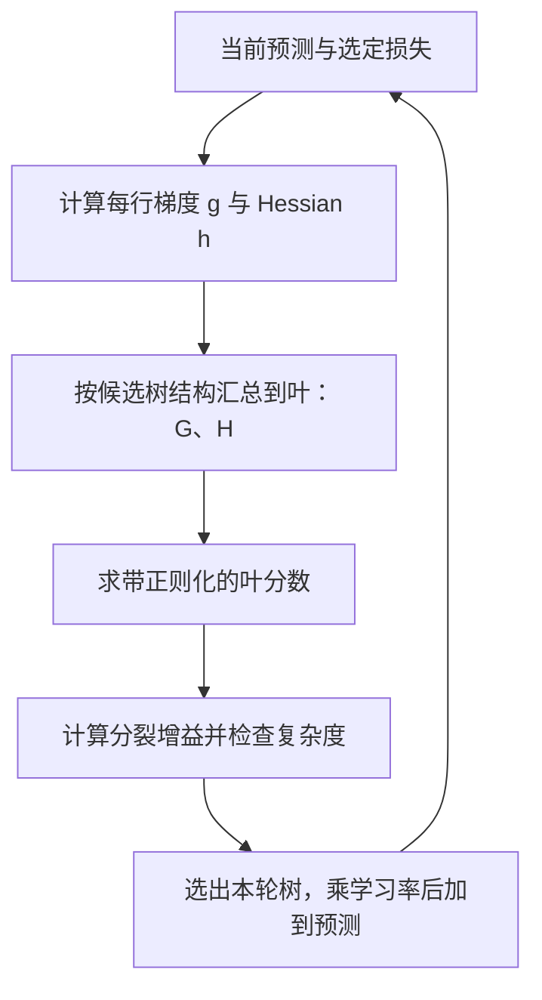

# XGBoost 每轮怎样用正则化目标选择树结构？

表格任务中的一轮提升要回答两个问题：新树把哪些样本分到一起，以及各叶节点应给当前预测增加多少？XGBoost（Extreme Gradient Boosting，极端梯度提升）对当前损失在预测点附近做二阶近似，再用 gradient（梯度）、Hessian（海森量；本例针对标量预测是二阶导数）、叶数和叶分数惩罚来比较候选树结构。

这里 $g$ 和 $h$ 是当前模型对损失的一阶、二阶信息；它们不是两个新特征。下文先逐项复算一个三样本回归轮次，再把公式对应到常用参数。

## 从当前损失到叶节点分数

设当前模型对样本 $i$ 的预测为 $\hat y_i^{(t-1)}$，新树为 $f_t$。在当前预测处对损失作二阶 Taylor expansion（泰勒展开）：

> [!info] 二阶近似在这一步做什么？
> 对一个小改变量 $\delta$，有 $\ell(z+\delta)\approx\ell(z)+\ell'(z)\delta+\frac12\ell''(z)\delta^2$。XGBoost 用一阶导数 $g_i$ 描述损失的局部斜率，用二阶导数 $h_i$ 描述曲率；这把许多损失统一成每行两项统计量。它是当前预测附近的近似，不表示所有轮次的完整损失恰好是二次函数。

忽略与新树无关的常数后，本轮的近似损失加 tree regularization（树正则化）目标为：

$$
\widetilde{\mathcal L}^{(t)}
\approx
\sum_i\left[g_i f_t(x_i)+\frac12h_i f_t(x_i)^2\right]
+\gamma T
+\frac{\lambda}{2}\sum_{j=1}^{T}w_j^2
+\alpha\sum_{j=1}^{T}|w_j|
$$

树把样本分配到 $T$ 个叶；叶 $j$ 输出预测增量 $w_j$，$I_j$ 表示落入该叶的样本集合。叶上的梯度和 Hessian 分别记作 $G_j=\sum_{i\in I_j}g_i$、$H_j=\sum_{i\in I_j}h_i$。若先取 $\alpha=0$，该叶的目标为：

$$
G_jw_j+\frac12(H_j+\lambda)w_j^2
$$

当 $H_j+\lambda>0$ 时，对这个一元二次式求导并令导数为零，得到：

$$
w_j^*=-\frac{G_j}{H_j+\lambda}
$$

分数的分母含叶 Hessian 总量和 L2 惩罚；增大 $\lambda$ 会缩小叶分数。复杂度项 $\gamma T$ 则每增加一个叶就增加代价，因此一个新分裂必须带来足够的损失下降。

## 三个样本逐步算出一个分裂

假设这是一个合成平方损失回归轮次：三条记录当前预测都为 2，目标依次是 4、3、1。令单样本损失为 $\ell=\frac12(y-\hat y)^2$，于是 $g=\hat y-y$、$h=1$。候选树把前两行分到左叶、第三行分到右叶。为便于手算，设 $\lambda=1,\gamma=0.2,\alpha=0$。

> [!example] 从样本梯度到更新后的预测
> | 样本 | 当前预测 | 目标 | $g=\hat y-y$ | $h$ | 候选叶 |
> | --- | ---: | ---: | ---: | ---: | --- |
> | 1 | 2 | 4 | -2 | 1 | 左 |
> | 2 | 2 | 3 | -1 | 1 | 左 |
> | 3 | 2 | 1 | +1 | 1 | 右 |
>
> 汇总后，左叶 $G_L=-3,H_L=2$，右叶 $G_R=1,H_R=1$，父叶 $G=-2,H=3$。各候选叶分数为：
>
> $$
> w_L^*=-\frac{-3}{2+1}=1,\qquad
> w_R^*=-\frac{1}{1+1}=-0.5,\qquad
> w_{parent}^*=-\frac{-2}{3+1}=0.5
> $$
>
> 分裂增益是两个子叶带来的最优目标函数下降量之和，减去父叶的最优目标函数下降量，再扣掉新增一个叶的 $\gamma$ 代价：
>
> $$
> \operatorname{Gain}
> =\frac12\left[
> \frac{G_L^2}{H_L+\lambda}
> +\frac{G_R^2}{H_R+\lambda}
> -\frac{(G_L+G_R)^2}{H_L+H_R+\lambda}
> \right]-\gamma
> $$
>
> $\operatorname{Gain}=\frac12\left(\frac93+\frac12-\frac44\right)-0.2=1.05$
>
> 因为净增益为正，这个候选分裂在本例参数下值得保留。若学习率 $\eta=0.1$，本轮叶分数随后缩小再加入预测：前两行变为 $2+0.1(1)=2.1$，第三行变为 $2+0.1(-0.5)=1.95$。增益是在选树结构时计算的局部目标改善；它不是验证集精度，也不保证该树在新数据上有帮助。

这次纸面计算遵循原论文的目标式，二阶项含 $1/2$，所以分裂增益是 1.05。XGBoost 3.4.2 的树实现 `CalcGain` 在 `max_delta_step=0` 且 `reg_alpha=0` 时按 $G^2/(H+\lambda)$ 返回叶收益，不含这个 $1/2$，并按该实现尺度应用 `gamma`。因此 1.05 用于理解推导与方向，不应直接与该版本模型 dump 的 gain 或 `gamma` 阈值作数值比较。

当 $H_j+\lambda>0$ 且打开 L1 惩罚时，叶的最优分数会对梯度和作 soft-thresholding（软阈值处理）。令 $S(G,\alpha)=\operatorname{sign}(G)\max(|G|-\alpha,0)$，则：

$$
w_j^*=-\frac{S(G_j,\alpha)}{H_j+\lambda}
$$

阈值可以把某些叶分数直接压到零；分裂增益中的父叶和子叶项也都要用阈值后的梯度和重新计算。

## 目标函数如何连到参数？

| 参数 | 作用位置 | 调参时应观察 |
| --- | --- | --- |
| **objective** | 选择任务损失，因此也决定每轮计算的梯度与 Hessian | 损失是否与目标类型和输出语义匹配 |
| **learning_rate / eta** | 每轮把新树分数乘以较小系数再加入预测 | 小步长通常要更多轮；用验证数据比较 |
| **n_estimators** | scikit-learn 包装器中 XGBRegressor / XGBClassifier 的提升轮数上限 | 它计 boosting rounds（提升轮数），early stopping（提前停止）可能使训练先结束 |
| **max_depth、max_leaves** | 限制单棵树可表达的分区复杂度 | 深树更能拟合交互，也更容易过拟合 |
| **min_child_weight** | 限制子节点所需的 Hessian 总量 | 大值会阻止低统计量的细分 |
| **gamma / min_split_loss** | 新分裂所需的最小损失下降 | 值越大，分裂越保守 |
| **reg_lambda / lambda** | 叶分数的 L2 惩罚 $\lambda$ | 增大后叶分数更收缩 |
| **reg_alpha / alpha** | 叶分数的 L1 惩罚 $\alpha$ | 可把部分叶分数压到零 |
| **subsample、colsample_bytree** | 每轮样本行、建树特征的抽样比例 | 降低计算和相关性，但也引入随机性 |
| **tree_method、max_bin** | 选择精确或近似的切分候选搜索；max_bin 作用于直方图/近似方法 | 速度、内存和切分近似精度的取舍 |

在常规 XGBRegressor 或 XGBClassifier 中，n_estimators 表示提升轮数，不应笼统理解为最终树的总数：一个轮次可能为多分类各建一棵树，也可能因 num_parallel_tree 每轮并行构造多棵树。具体语义要看所用估计器和输出策略。

## 稀疏特征、缺失值和搜索成本

XGBoost 的原论文把目标函数和可扩展树训练系统一起设计：sparsity-aware split finding（稀疏感知切分搜索）算法只扫描非缺失值，并从缺失值走左或走右的候选中选择更好的默认方向；近似搜索用 weighted quantile sketch（加权分位数草图）生成候选切点；系统设计还使用列块、缓存访问优化和分片来支持并行及外存训练。这些是算法和系统设计，不是任何数据集上精度提升的保证。

树提升器为缺失值学习节点默认方向；输入的缺失标记默认是 NaN，也可由 missing 指定。这不是填补缺失值，也不保证缺失机制本身合理。稀疏矩阵中的未存储项按缺失处理；当默认 missing=NaN 时，稠密矩阵中的数值 0 是有效特征值。XGBoost 线性提升器将缺失值视为零，不能套用树提升器规则。

当前 XGBoost 文档提供 exact、approx 和 hist 等树构造方法；精确枚举候选切点计算量较高，直方图把连续值分桶以减少搜索成本。参数选择应从简单基线起步，在符合数据时间和分组结构的验证集上比较损失、稳定性与资源用量；feature importance（特征重要性）只描述模型在既定统计方式下的使用情况，不是因果效应。

> [!info]- 来源
> - 二阶目标、叶分数闭式解和候选分裂增益：Chen 与 Guestrin，*XGBoost: A Scalable Tree Boosting System*（KDD 2016，arXiv v3 于 2016-06-10 修订），[原文 PDF](https://arxiv.org/pdf/1603.02754)，§2、§3.1–3.4；L1 叶惩罚及 reg_alpha 的当前定义见 XGBoost 3.4.2 [参数说明](https://xgboost.readthedocs.io/en/stable/parameter.html)。本文的软阈值式由显示的目标函数直接求解。
> - 当前参数含义、tree_method、gamma、reg_lambda、reg_alpha、num_parallel_tree 和 max_bin：XGBoost 3.4.2 [参数说明](https://xgboost.readthedocs.io/en/stable/parameter.html)，2026-11-06 核对；n_estimators 轮数定义见 [XGBRegressor API](https://xgboost.readthedocs.io/en/stable/python/python_api.html#xgboost.XGBRegressor)。树实现的叶收益见同版本 [param.h 的 CalcGain](https://github.com/dmlc/xgboost/blob/v3.4.2/src/tree/param.h#L248-L263)，gamma 剪枝判断见 [NeedPrune](https://github.com/dmlc/xgboost/blob/v3.4.2/src/tree/param.h#L177-L180)。
> - 缺失值分支规则、默认 NaN 标记和稀疏/稠密零的区别：XGBoost 3.4.2 [常见问题](https://xgboost.readthedocs.io/en/stable/faq.html#how-to-deal-with-missing-values)，同日核对。
> - 展开式、左右叶增益解释及 gamma 含义可对照 [Introduction to Boosted Trees](https://xgboost.readthedocs.io/en/stable/tutorials/model.html)，XGBoost 3.4.2，§§Additive Training、Model Complexity、Learn the tree structure。
> - 梯度、叶权重、增益与预测更新的算例由标准算术独立复算；未运行 XGBoost 或 GPU/分布式实现，示例不是库输出或性能测试。
