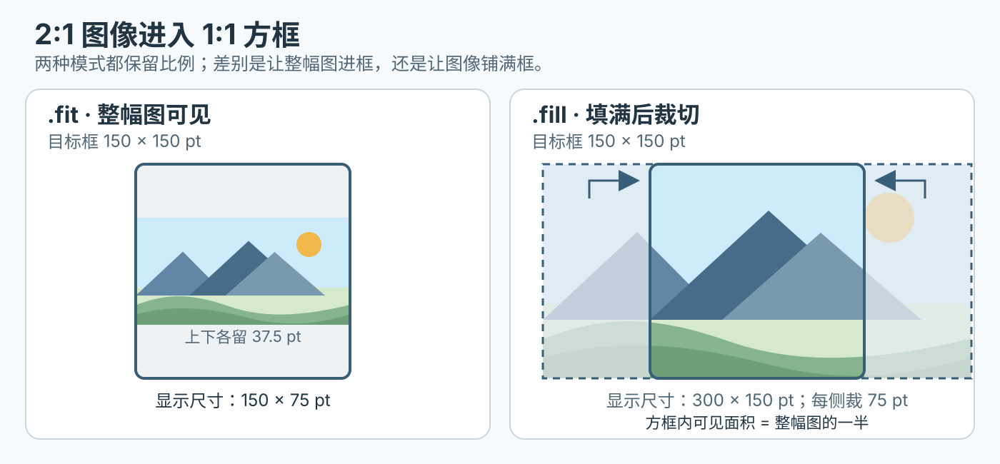

# 图像、字体和系统符号怎样进入 SwiftUI 界面？

你正在做一个联系人卡片：头像要裁成圆形，背景颜色要延伸到屏幕边缘，文字使用随系统设置放大的品牌字体，电话图标要在多个 Apple 平台上可用。先分清资源从哪里来，再判断它如何缩放、裁剪和着色，最后确认字体注册与目标系统的可用性。

## UIKit 图像和 SwiftUI 图像有什么区别？

SwiftUI 的 `Image` 是视图；UIKit 的 `UIImage` 是图像对象。asset catalog（资源目录）中的图像可以用名称创建 SwiftUI 视图：

```swift
import SwiftUI

Image("avatar")
```

旧 Xcode 教学资料常见 `#imageLiteral(resourceName:)`，它生成 UIKit `UIImage`，不是 SwiftUI 视图。这段保留为识别旧代码的例子；实际能否由编辑器补全并编译，要看所用 Xcode 版本和资源配置。SwiftUI 界面通常直接用 `Image("avatar")`。若在 UIKit 中加载运行时资源，可以用 `UIImage(named: "avatar")` 并处理可能为空的结果。无论哪种方式，都确认图片已加入当前应用 target（目标）。

```swift
import UIKit

let image: UIImage = #imageLiteral(resourceName: "your_image_name")
```

> [!info] 名称解析的是资源，不是文件路径
> `Image("avatar")` 会按资源名称查找目标包中的图像或图像集。把图片文件放进仓库并不自动保证它属于 app target。

## 图片怎样按目标框缩放而不变形？

`Image` 默认按图像自身大小显示。要让它适应布局尺寸，先加 `.resizable()`；再选 `.fit` 或 `.fill` 保留原始宽高比。`.fit` 会让整幅图进入目标框，可能留白；`.fill` 会填满目标框，但内容可能超出边界，必要时再用 `.clipped()` 裁掉超出的部分。

> [!example] 头像框比原图更接近正方形时会发生什么？
> 假设原图宽高比为 2:1，目标框为 1:1。以 150 × 150 pt 方框为例，`.fit` 显示为 150 × 75 pt，方框上下各留 37.5 pt；`.fill` 显示为 300 × 150 pt，左右各有 75 pt 超出方框。方框裁切时，左右各裁掉缩放后图宽的四分之一，框内可见面积是整幅图的一半。`Circle` 裁剪则沿圆形轮廓截取可见内容，并可继续叠加圆形描边。

下面图只展示保持 2:1 比例的图像进入方形矩形框；圆形头像是后续再加的遮罩步骤。



_目标框为 150 × 150 pt：fit 图像为 150 × 75 pt、上下各留 37.5 pt；fill 图像为 300 × 150 pt、左右各裁 75 pt。_

```swift
Image("avatar")
    .resizable()
    .aspectRatio(contentMode: .fill)
    .frame(width: 150, height: 150)
    .clipShape(Circle())
    .overlay {
        Circle().stroke(.white, lineWidth: 5)
    }
```

上面的头像代码把 `.fill` 放大后再用 `Circle` 遮罩裁成圆形；遮罩会继续裁掉方框四角。若要完整显示矩形原图，需把 `.fill` 改为 `.fit`，并同时移除 `.clipShape(Circle())` 与叠加的圆形描边；否则遮罩会裁角，描边也可能盖住原图像素。下面的菱形例子用 `.fit` 且没有圆形遮罩或描边：

```swift
Image("diamond")
    .resizable()
    .aspectRatio(contentMode: .fit)
    .frame(width: 200)
```

## 怎样让背景延伸到安全区而不把内容推到屏幕边缘？

safe area（安全区）是屏幕中适合放重要内容、避免被系统栏或设备边缘等遮挡的区域。把 `ignoresSafeArea()` 作用在应该扩展的背景上，可让背景覆盖边缘，同时让前景控件继续遵守安全区：

```swift
ZStack {
    Color.blue.ignoresSafeArea()
    VStack {
        Text("联系人")
        Text("电话信息")
    }
}
```

旧接口 `edgesIgnoringSafeArea(_:)` 已弃用；新代码使用 `ignoresSafeArea(_:edges:)`。修饰整个容器会连同其内容一起影响布局，先确定需要扩展的是背景、图像还是整个界面。

## 自定义字体如何注册并支持动态字体大小？

Dynamic Type（动态字体）允许用户调整文字大小。在支持用户调整 Dynamic Type 的平台上，SwiftUI 可随设置缩放自定义字体；macOS 上用户不能更改 `dynamicTypeSize`，它也不影响文本尺寸。先将有分发授权的字体文件加入目标并确认 target membership（目标成员资格）；然后按平台注册资源。iOS、iPadOS、watchOS、tvOS、visionOS 与 Mac Catalyst 使用 `UIAppFonts` 数组，其元素是包内相对文件路径并包含扩展名，例如 `Fonts/Brand.ttf`；macOS 使用 `ATSApplicationFontsPath`，值相对于 app bundle 的 `Resources` 目录，例如 `Fonts/`。这两个键不能混用。

Xcode 常由 target build settings（目标构建设置）生成最终的应用信息属性列表；项目里没有单独可见的 `Info.plist` 文件并不代表没有应用信息列表。编辑应用信息时，先选中项目和 app target，再查看 Info 页支持的键；若项目手动维护 plist，就在 Build Settings 检查生成开关与实际来源，避免只改了不会进入 app bundle 的文件。

```swift
Text("Sample text")
    .font(.custom("SamplePostScriptName", size: 40, relativeTo: .body))
```

参数应使用字体的 PostScript name（PostScript 名称），可能与字体文件名不同，可在 Font Book 的字体信息中查找。`relativeTo: .body` 会让自定义字体随动态字体大小缩放；只有确实要固定大小时才选不随 Dynamic Type 缩放的 `Font.custom(_:fixedSize:)`。若名称或注册错误，SwiftUI 可能退回系统字体，因此需在实际目标设备上确认呈现。

## 点号开头的值怎样知道属于哪种类型？

Swift 的点号成员简写 implicit member expression（隐式成员表达式）依赖上下文类型推断。在需要 `Color` 的位置，`.white` 可以写作 `Color.white`；在需要 `Font` 的位置，`.largeTitle` 可以写作 `Font.largeTitle`。自定义类型的静态成员也能按同样方式简写，因此它不只是 SwiftUI 的内建颜色或字体语法。

```swift
import SwiftUI

let background: Color = .white
let titleFont: Font = .largeTitle
```

## 形状、文字与系统符号如何着色？

对形状，用 `fill` 填充形状内部；对文字和图标，用 `foregroundStyle` 设置前景样式：

```swift
RoundedRectangle(cornerRadius: 25)
    .fill(.white)
    .overlay {
        HStack {
            Image(systemName: "phone.fill")
                .foregroundStyle(.green)
            Text("电话")
                .foregroundStyle(.black)
        }
    }
```

`foregroundColor(_:)` 已弃用，Apple 建议改用 `foregroundStyle(_:)`。系统符号 SF Symbols（苹果系统符号库）通过 `Image(systemName:)` 加载，不要把它和资产目录里的自定义图片名混淆：

```swift
Image(systemName: "phone.fill")
    .foregroundStyle(.green)
```

使用 SF Symbols app 查找名称并核对部署目标。符号名称和变体会随系统与符号库版本变化；若需要支持较旧系统，检查该符号的最低目标版本并准备合适的替代资源。

> [!info]- 来源
> - **SwiftUI 图像资源、缩放、比例、形状遮罩与覆盖层**：Apple SwiftUI “Image”“Fitting Images into Available Space”及 `clipShape`、`overlay(alignment:content:)` API；[Image](https://developer.apple.com/documentation/swiftui/image)、[适配图像空间](https://developer.apple.com/documentation/swiftui/fitting-images-into-available-space)、[形状遮罩](https://developer.apple.com/documentation/swiftui/view/clipshape%28_%3Astyle%3A%29)及[覆盖层](https://developer.apple.com/documentation/swiftui/view/overlay%28alignment%3Acontent%3A%29)，核对日期 2026-11-13。
> - **UIKit 图像对象与旧 image literal 对照**：Apple UIKit 的 `UIImage(imageLiteralResourceName:)`；[UIImage 初始化器](https://developer.apple.com/documentation/uikit/uiimage/init%28imageliteralresourcename%3A%29)，核对日期 2026-11-13。
> - **安全区背景、前景样式与弃用状态**：Apple SwiftUI “Adding a Background to Your View”“ignoresSafeArea”“foregroundColor(_:)”与弃用修饰符列表；[背景](https://developer.apple.com/documentation/swiftui/adding-a-background-to-your-view)、[安全区](https://developer.apple.com/documentation/swiftui/view/ignoressafearea%28_%3Aedges%3A%29)、[前景颜色](https://developer.apple.com/documentation/swiftui/view/foregroundcolor%28_%3A%29)、[前景样式](https://developer.apple.com/documentation/swiftui/view/foregroundstyle%28_%3A%29)及[弃用修饰符](https://developer.apple.com/documentation/swiftui/view-deprecated)，核对日期 2026-11-13。
> - **字体授权资源、平台 plist 键、PostScript 名称与 Dynamic Type**：Apple SwiftUI “Applying Custom Fonts to Text”、`dynamicTypeSize` API 与 bundle property-list reference；[应用自定义字体](https://developer.apple.com/documentation/swiftui/applying-custom-fonts-to-text)、[Dynamic Type 大小](https://developer.apple.com/documentation/swiftui/environmentvalues/dynamictypesize)、[UIAppFonts](https://developer.apple.com/documentation/bundleresources/information-property-list/uiappfonts)、[ATSApplicationFontsPath](https://developer.apple.com/documentation/bundleresources/information-property-list/atsapplicationfontspath)，核对日期 2026-11-13。
> - **Xcode 生成应用信息属性列表**：[管理应用信息属性列表值](https://developer.apple.com/documentation/bundleresources/managing-your-app-s-information-property-list)，核对日期 2026-11-13。
> - **系统符号名称与版本检查**：Apple “Configuring and Displaying Symbol Images in Your UI”；[配置与显示系统符号](https://developer.apple.com/documentation/uikit/configuring-and-displaying-symbol-images-in-your-ui)，核对日期 2026-11-13。
