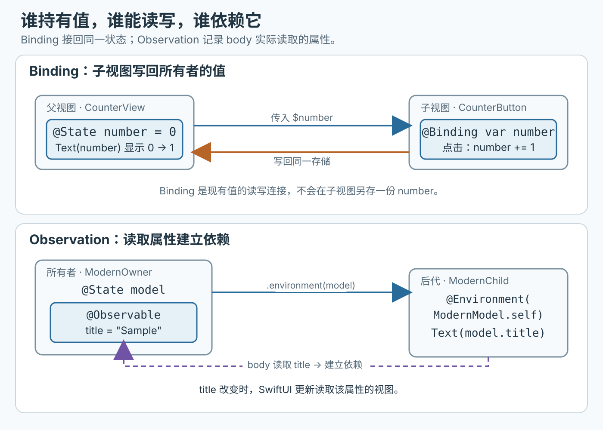

# SwiftUI 状态由谁保存，子视图怎样共享它？

计数器父视图显示数字，子视图提供加一按钮；之后再让多个子视图读取同一个可观察模型。按钮写入后，哪些视图会更新？如果输入值变化，模型是否应被重新创建？沿着“谁保存值—谁能读取—谁能修改”这条线，可以选出 SwiftUI 当前状态系统与兼容旧项目时各自合适的包装器。

## 为什么 View 重算后状态还在？

View（视图）通常是值类型，SwiftUI 会因输入变化而重新计算新的视图值。视图的 identity（身份）决定这份视图状态的存储生命周期；反复创建新的 View 值不一定改变 identity，所以重算 body 不会自动清空状态。若视图从层级中移除，或显式改变身份，状态存储才会重新建立。

source of truth（数据真源）是某个数据项唯一负责保存当前值的位置。视图自己的临时交互状态通常放在私有 `@State` 中；多个视图共享的数据应由实际拥有它的父级、scene（场景）或 app（应用）保存。`@State` 管理 SwiftUI 生命周期中的状态，不是磁盘持久化。

## 子视图只读还是要共同编辑一个值？

给子视图传普通属性时，子视图读取父级提供的值；要让子视图也能写，就传 Binding（绑定）。`@Binding` 不存一份新数据，而是连接到已有的数据源。`$number` 从 `@State` 属性投影出绑定。

> [!example] 一次点击怎样从子视图回到父视图？
> 初始值为 0。父视图通过 `$number` 传出绑定；按钮点击后将同一数据源改成 1，父视图重算后显示 1。若父子分别拥有两个独立的 `@State` 值，子视图只会改自己的那份。

```swift
import SwiftUI

struct CounterView: View {
    @State private var number = 0

    var body: some View {
        VStack {
            Text("Count: \(number)")
            CounterButton(number: $number)
        }
    }
}

struct CounterButton: View {
    @Binding var number: Int

    var body: some View {
        Button("Add one") { number += 1 }
    }
}
```

## 新代码怎样拥有并传播可观察模型？

Observation（观察框架）从 iOS 17、iPadOS 17、macOS 14、tvOS 17 与 watchOS 10 开始受 SwiftUI 支持。把引用模型声明为 `@Observable`，再由所有者视图用 `@State` 保存。SwiftUI 根据各视图 body 实际读取的可观察属性建立依赖；模型属性改变时，只需更新依赖该属性的视图。

下面给模型输入值的初始化方式按 Xcode 27 起的 `@State` 宏语法书写；Observation 在 SwiftUI 中的系统支持版本仍以上述系统边界为准。

```swift
import Observation
import SwiftUI

@Observable
final class ModernModel {
    var title: String

    init(title: String) {
        self.title = title
    }
}

struct ModernOwner: View {
    @State private var model: ModernModel

    init(initialTitle: String) {
        self.model = ModernModel(title: initialTitle)
    }

    var body: some View {
        VStack {
            ModernChild()
            ModernEditor(model: model)
        }
        .environment(model)
    }
}

struct ModernChild: View {
    @Environment(ModernModel.self) private var model

    var body: some View {
        Text(model.title)
    }
}

struct ModernEditor: View {
    @Bindable var model: ModernModel

    var body: some View {
        TextField("Title", text: $model.title)
    }
}
```

这里所有者保存模型；`.environment(model)` 将它提供给容器及其后代；此例中负责显示标题的子视图用类型化的 `@Environment(ModernModel.self)` 读取。这个引用在其他需要编辑的子视图中仍可修改；`@Bindable` 的作用是为控件创建属性绑定。一次具体写回是：`ModernOwner(initialTitle: "Sample")` 建立标题为 `Sample` 的模型；`ModernEditor` 的 `TextField` 通过 `$model.title` 把输入 `Edited` 写回同一模型，`ModernChild` 读取 `model.title` 后显示 `Edited`。

`initialTitle` 只用来创建该身份第一次拥有的模型，不是持续同步规则。同一身份下，调用者后来把输入改成 `New seed`，`@State` 仍保存已经编辑为 `Edited` 的模型。若新输入代表不同联系人、且应重置其局部状态，就在所有者边界用稳定的联系人 ID 改变身份，例如 `.id(contact.id)`；若仍是同一联系人而标题要跟随外部数据，则显式定义输入变化时如何更新 `model.title`，不要依赖 `@State` 再跑初始值。

非可选的 `@Environment(ModernModel.self)` 假设祖先已经用 `.environment(model)` 注入该模型。缺少注入时，SwiftUI 会在运行时抛出异常。检查 app、scene 或父视图边界，确保注入与读取的类型一致。



_Binding 是现有数据源的读写连接；Observation 视图依赖来自 body 实际读取的属性。_

> [!warning] `@State` 默认值不要承载副作用
> 把编译器和运行系统版本一起看：Xcode 26 及更早工具链使用 `@State` 属性包装器，类模型的声明初始值可能在每次重建 `View` 值时重新计算；即使同一 identity 的状态存储继续保留原模型，昂贵对象仍可能被重复构造。Xcode 27 起改用 `@State` 宏，使这类初始值惰性创建；Apple 说明该优化回移到 iOS 17、macOS 14 与同代系统。运行在更早系统时，不要依赖这项惰性优化；不据此推断其内部实现。网络请求、磁盘访问等 I/O 仍应放在 `.task` 等生命周期任务中。identity 改变或状态存储重建时，新的初始状态会再次建立。

## 既有 `ObservableObject` 项目怎样维护？

> [!info]- 兼容较早部署目标或旧模型
> 旧的 `ObservableObject` 与 `@Published` 模型仍适用于既有项目，以及需要兼容 Observation 最低系统版本之前的项目。所有者视图用 `@StateObject` 创建并持有模型；将对象作为输入传给子视图时，用 `@ObservedObject` 接收并观察它。
>
> ```swift
> import SwiftUI
>
> final class LegacyModel: ObservableObject {
>     @Published var title = "Sample"
> }
>
> struct LegacyOwner: View {
>     @StateObject private var model = LegacyModel()
>
>     var body: some View {
>         LegacyChild(model: model)
>     }
> }
>
> struct LegacyChild: View {
>     @ObservedObject var model: LegacyModel
>
>     var body: some View {
>         Text(model.title)
>     }
> }
> ```
>
> `@StateObject` 按声明它的容器身份创建一次对象；单纯改变该视图的其他输入，不会重建该对象。子视图的 `@ObservedObject` 属性是外部传入的对象，不应自己提供默认实例。许多后代都要访问同一对象时，祖先也可调用 `.environmentObject(model)`，后代用 `@EnvironmentObject` 读取；若没有任何祖先注入，必需的环境对象查找会在运行时失败。
>
> 新旧观察系统可以在同一个应用中渐进混用，但模型应一次选定一种观察机制，并让持有、注入、读取的包装器与之对应。不要把 `@ObservedObject` 用来包装只符合新 `Observable` 协议的模型。

## 什么时候选哪种状态传递方式？

只在父视图内变化的临时值用私有 `@State`；子视图只需显示当前值时传普通属性；子视图需要修改父级的值时传 `@Binding`。新可观察引用模型由边界视图以 `@State` 保存，通过 `@Environment` 提供给深层后代，传给可编辑子视图时用 `@Bindable`。

仍需支持较早系统或维护现有 `ObservableObject` 模型时，沿用 `@StateObject` 所有、`@ObservedObject` 传入，或由祖先调用 `.environmentObject(_:)` 注入并用 `@EnvironmentObject` 读取的方案。选择取决于部署目标、模型采用的观察机制，以及视图是否拥有或只接收数据。

> [!info]- 来源
> - **视图 identity 与状态生命周期**：Apple WWDC21 “Demystify SwiftUI”，说明 View 值可重建而状态存储跟随 identity；[WWDC21 10022](https://developer.apple.com/videos/play/wwdc2021/10022/)，核对日期 2026-11-13。
> - **`@State`、`@Binding` 的数据所有权和双向连接，以及 Xcode 27 的 `@State` 宏变化与回移系统**：Apple SwiftUI “Managing User Interface State”、WWDC26 “What’s new in SwiftUI”、iOS & iPadOS 27 Release Notes 与 Technote “Resolving SwiftUI source incompatibilities for State and ContentBuilder”；[状态管理](https://developer.apple.com/documentation/swiftui/managing-user-interface-state)、[State](https://developer.apple.com/documentation/swiftui/state)、[State(wrappedValue:) 宏](https://developer.apple.com/documentation/swiftui/state%28wrappedvalue%3A%29)、[Binding](https://developer.apple.com/documentation/swiftui/binding)、[WWDC26](https://developer.apple.com/videos/play/wwdc2026/269/)、[iOS & iPadOS 27 发布说明](https://developer.apple.com/documentation/ios-ipados-release-notes/ios-ipados-27-release-notes)及[State 与 ContentBuilder 兼容性说明](https://developer.apple.com/documentation/technotes/tn3211-resolving-swiftui-source-incompatibilities-for-state-and-contentbuilder)，核对日期 2026-11-13。
> - **Observation 的系统版本边界、属性依赖追踪与环境读取**：Apple SwiftUI “Migrating from the Observable Object protocol to the Observable macro”“Managing Model Data in Your App”，列明 iOS 17/iPadOS 17/macOS 14/tvOS 17/watchOS 10 起支持；[迁移指南](https://developer.apple.com/documentation/swiftui/migrating-from-the-observable-object-protocol-to-the-observable-macro)及[模型数据](https://developer.apple.com/documentation/swiftui/managing-model-data-in-your-app)，核对日期 2026-11-13。
> - **新 Observation 对象的 `@State`、`@Bindable` 与环境注入**：Apple SwiftUI `State`、`Binding`、`Environment` API；[State](https://developer.apple.com/documentation/swiftui/state)、[Binding](https://developer.apple.com/documentation/swiftui/binding)、[Environment](https://developer.apple.com/documentation/swiftui/environment)及[环境对象注入](https://developer.apple.com/documentation/swiftui/view/environment%28_%3A%29)，核对日期 2026-11-13。
> - **既有 `ObservableObject` 的所有者、输入模型与环境对象**：Apple SwiftUI `StateObject`、`ObservedObject` 与 `EnvironmentObject` API；[StateObject](https://developer.apple.com/documentation/swiftui/stateobject)、[ObservedObject](https://developer.apple.com/documentation/swiftui/observedobject)及[EnvironmentObject](https://developer.apple.com/documentation/swiftui/environmentobject)，核对日期 2026-11-13。
