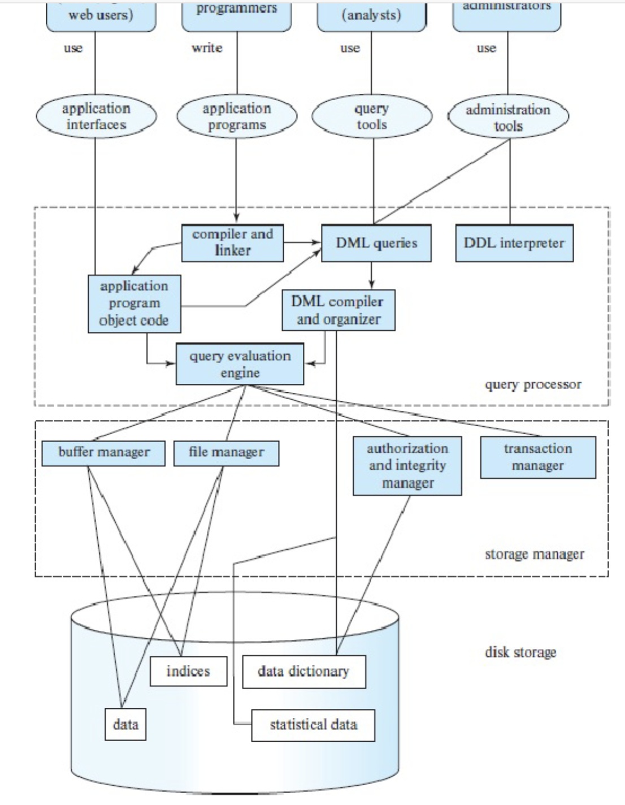

# 本课程比较哪些数据库类型与体系结构？

开学选课系统要保存课程、学生和选课记录，并面对按学生查课、并发选课和故障恢复等需求。读者需要比较：不同存储系统怎样表示和查询这些记录？数据与计算又由哪些节点和管理方承载？

## 数据模型决定应用如何表达与查找记录

下面沿用课程的系统分类。它不是当代产品的穷尽列表；例如 not only SQL (NoSQL，不只 SQL 的数据库系统) 包含多种设计，键值只是其中一种。

| 模型 | 课程情境中的表示方式 | 选课应用中的适用处与成本 |
| --- | --- | --- |
| flat file（简单文件） | 每行存一条记录，字段以逗号或制表符等分隔 | 单进程、小规模数据容易创建和搬运；需要按学生找选课、并发修改或保证数据约束时，应用必须自行实现解析、索引、并发、恢复和校验。 |
| relational database management system (RDBMS，关系数据库管理系统) | 以关系（通常呈现为表）保存数据，用关系运算和 structured query language (SQL，结构化查询语言) 查询 | 可将学生、课程、选课分表，并用键和约束表达部分规则；database management system (DBMS，数据库管理系统) 能提供索引、查询计划、事务和约束机制，具体能力取决于产品与配置。关系表不要求彼此都以外键连接。 |
| object-oriented database (OODB，面向对象数据库) | 以对象及其关联组织持久数据 | 复杂对象结构可以直接映射到持久化对象模型；是否减少转换成本取决于应用与产品。不能笼统保证它更可靠、更慢或更适合所有复杂数据。 |
| key-value store（键值存储） | 用键定位一个值；值可以是简单字段或应用自定义的复合内容 | 例如用 `student:101` 查学生资料，按键读取直接；跨学生、课程、选课表的组合查询、事务范围和约束能力要看产品。键唯一性和原子操作也由具体产品定义。 |
| deductive database（演绎数据库） | 将事实与规则结合，推导查询所需的关系 | 适合需要规则推导的知识或依赖场景；规则语言、递归语义与执行性能由实现决定。 |

图示把查询执行引擎、文件管理器、缓冲管理器和索引放在存储数据周围，提醒我们：数据模型并不能单独解释查询速度。访问成本还取决于索引、页面是否已缓存、查询计划和工作负载；事务与恢复则由别的机制保证。

> [!info] MapReduce 与数据库类型不是同一层概念
> MapReduce (映射归约) 是一种分布式数据处理模型，Hadoop 是包含 MapReduce 等组件的生态系统；它们都不是“键值数据库”的定义。一个系统可以用 MapReduce 处理由多种存储系统保存的数据。

## 节点放在哪里、跨越哪些管理边界？

| 部署或拓扑类别 | 数据与计算如何分布 | 设计时需要继续问什么 |
| --- | --- | --- |
| 中心式 client–server（客户端—服务器）部署例 | 数据和主要处理放在一个中心服务，客户端通过网络发出请求 | 这是一个“中心位置 + 客户端/服务端角色”的组合例；client–server 只描述请求角色，本身不能说明服务只有一台机器还是跨多节点。 |
| distributed database（分布式数据库） | 数据或执行工作跨多个节点，节点经网络协调；仍可由同一团队管理，并通过统一 client–server 入口提供服务 | 例如单团队管理的多节点集群仍是分布式数据库；它会引入网络延迟、协调、复制、恢复和部分失联问题。要具体说明一致性、复制和事务协议。 |
| World Wide Web (WWW，万维网) 多所有者数据协作（课程分类） | 数据分布在不同位置，并由多个独立所有者维护 | 授权、可用性、字段语义和查询方式跨越管理边界；“WWW 数据库架构”在此是课程分类，不是所有 Web 系统共享的一种标准引擎架构。 |
| grid computing（网格计算） | 不同地点、可能属于不同管理域的计算资源协同处理数据 | 适合共享计算与存储资源；网络、凭据、调度和资源故障由参与系统及协作协议决定。网格计算并不必然表示数据库采用某种统一架构。 |
| peer-to-peer (P2P，对等网络) | 多个节点彼此协作，成员可能动态加入或离开 | 适用于成员事先难以固定的场景；成员变化会增加发现节点、复制和协调的工作，信任边界也要单独设计。P2P 不只用于文件分享。 |
| cloud-hosted service（云托管服务） | 计算和存储由云服务商提供，资源可按服务接口配置 | 按需扩缩和外包基础设施可能减轻运维；仍需检查身份权限、数据位置、可用性合同、成本和供应商依赖。云是服务与责任边界，不是与集中式或分布式互斥的拓扑。 |

因此，在设计中应分别回答：数据模型能否自然表达应用的查询与约束？数据和计算分布在几个节点、跨越哪些所有者？读写性能、事务、容灾和安全又由哪个具体产品或协议保证？同一个关系数据库可以集中部署或跨节点部署；同一个云服务也可以托管不同数据模型。

进一步分析网络中副本的一致性，可以看[分布式一致性与 NoSQL](./condensed-note-w4-distributed-consistency-and-nosql.md)；这里的分类只负责说明边界，不替代协议分析。

> [!info]- 来源
> - `关系模型、数据模型与集中式/分布式部署概念`：[Database System Concepts, 7e, ch. 1: Introduction](https://www.db-book.com/slides-dir/PDF-dir/ch1.pdf)；[ch. 20: Database System Architectures](https://www.db-book.com/slides-dir/PDF-dir/ch20.pdf)，2019 年教材幻灯片。本文将旧课程分类整理为“数据模型/部署边界”两个维度；WWW、网格、P2P、云标签沿用课程语境，不声称是互斥或完整的当代数据库类型。
