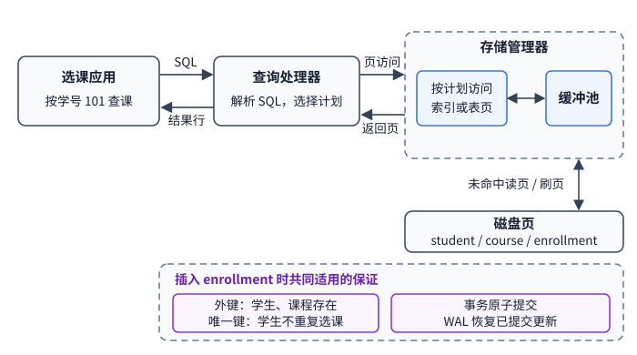

# 本课程比较哪些数据库类型与体系结构？

**案例：** 选课系统的设计者要保存课程、学生和选课记录，支持按学生查课，并在并发选课和故障后保持业务规则。需要分别判断数据模型是否适合这些查询、数据和计算部署在哪里，以及哪些机制真正提供约束与恢复。

## 数据模型决定应用如何表达与查找记录

下面沿用课程中的数据模型分类，作为比较表达和查询方式的起点，不是当代产品的穷尽列表。not only SQL (NoSQL，不只 SQL) 包含多种设计，键值只是其中一种。

| 数据组织方式 | 课程情境中的表示方式 | 选课应用中的适用处与成本 |
| --- | --- | --- |
| flat file（简单文件） | 每行存一条记录，字段以逗号或制表符等分隔 | 单进程、小规模数据容易创建和搬运；若还要按学生查找、并发更新、崩溃恢复或约束检查，应用或其他工具必须补上所需的解析、索引、协调与恢复机制。 |
| relational model（关系模型） | 以关系（通常呈现为表）、元组（行）和属性（列）组织数据；SQL 是常见查询接口 | relational database management system (关系数据库管理系统，RDBMS) 是实现关系模型和查询操作的一类 database management system (数据库管理系统，DBMS)；可将学生、课程、选课分表，并由具体产品与配置提供索引、查询计划、事务和约束机制。关系表不要求彼此都以外键连接。 |
| object-oriented database (OODB，面向对象数据库) | 以对象身份、对象结构及关联组织持久数据 | 应用的对象模型可以映射到持久模型；是否减少转换工作、如何查询和并发访问，都取决于具体语言绑定与产品。不能笼统保证它更可靠、更慢或更适合所有复杂数据。 |
| key-value store（键值存储） | 用键定位一个值；值可以是简单字段或应用自定义的复合内容 | `student:101` 可直接取学生资料；要列出其选课，应用需另维护如 `enrollments:101 → [C101, C202]` 的列表并逐一取课程，或使用产品提供的查询索引。列表与课程记录如何一致、多个键是否能一起事务提交，要看产品及应用设计。 |
| deductive database（演绎数据库） | 将已存事实与规则结合，推导查询所需的关系 | 例如事实为 `passed(101, A)`、`prerequisite(B, A)`，通用规则“通过某课程且该课程是目标课的先修课，则可选目标课”可推出 `eligible(101, B)`。规则语言、递归语义与执行性能由实现决定；它是课程保留的逻辑数据库类别，不表示主流产品都提供同一种演绎引擎。 |

## 从同一条选课记录走一遍查询路径

用关系模型实现时，可将数据放在 `student(student_id, name)`、`course(course_id, title, remaining)` 和 `enrollment(student_id, course_id)` 三张表中。以下查询列出学号 101 已选的课程：

```sql
SELECT c.course_id, c.title
FROM enrollment AS e
JOIN course AS c USING (course_id)
WHERE e.student_id = 101;
```

查询处理器解析 SQL 并选择计划；计划可能利用 `enrollment(student_id, course_id)` 索引，也可能扫描表，取决于数据量、统计信息与实现。存储管理器按计划访问索引页或表页，再从缓冲池取页面；页面若已在缓冲池可直接读取，未命中时才需从磁盘取页。实际系统可并行或交错这些工作，图示是概念路径，不表示每次查询都执行完全相同的串行步骤。



若还要可靠地新增一条选课记录，RDBMS 可以配置外键约束确保学生和课程存在，并以唯一键 `(student_id, course_id)` 阻止重复选课。若最后一个名额被多人同时申请，应在同一事务内对 `remaining > 0` 做原子条件扣减；仅扣减成功的一方插入选课记录，条件更新影响 0 行或发生隔离冲突的一方不插入，并按数据库规则重试或报告名额已满。并发控制让两个事务不能都取得同一最后名额，不能只靠先读余量再写入；名额扣减与选课插入同事务，也让崩溃恢复时二者一起提交或一起回滚。write-ahead logging (预写日志，WAL) 要求修改日志先于相应数据页持久化，是一种常见的恢复机制，其提交边界见[双写、WAL 与 CRC](./condensed-note-w1-durable-writes-and-crc.md)和[事务、隔离与恢复基础](../../../engineering-foundations/databases/database-transactions-isolation-and-recovery.md)。约束或事务机制不是查询计划的下一个串行模块，而是按写入操作共同适用的保证。

图示把查询处理器与存储管理器的简化配合放进一个代表性 DBMS：按计划访问索引页或表页，经过缓冲池，并在需要时读写磁盘页。它不是每个现代 DBMS 的固定模块图；要比较性能，还得知道索引、缓存命中、查询计划和工作负载。事务原子性与崩溃恢复也需要额外机制，不能从“使用数据库”或数据模型名称本身推出。

> [!info] MapReduce 与数据库类型不是同一层概念
> MapReduce (映射归约) 是处理大规模数据集的编程模型与运行时，不是“键值数据库”的定义。Hadoop 是包含 MapReduce、分布式文件系统等组件的生态系统；MapReduce 作业可以读取和写出文件系统中的数据，因此处理模型与持久存储模型要分开选。

## 节点放在哪里、跨越哪些管理边界？

| 部署或拓扑类别 | 数据与计算如何分布 | 设计时需要继续问什么 |
| --- | --- | --- |
| 中心式 client–server（客户端—服务器）部署例 | 数据和主要处理放在一个中心服务，客户端通过网络发出请求 | 这是“中心位置 + 客户端/服务端角色”的组合例；client–server 只描述请求角色，本身不能说明服务只运行在一台机器上还是跨多个节点。 |
| distributed database（分布式数据库） | 数据库的数据存储或查询/事务执行由多个数据库节点协作，节点经网络通信；仍可由同一团队管理，并通过统一 client–server 入口提供服务 | 例如单团队管理的多节点数据库集群仍是分布式数据库；它会引入节点间网络延迟、协调、复制、恢复和部分失联问题。应用服务器本身有多台不等于数据库分布式。要具体说明一致性、复制和事务协议。 |
| World Wide Web (WWW，万维网) 多所有者数据协作（课程分类） | 数据分布在不同位置，并由多个独立所有者维护 | 授权、可用性、字段语义和查询方式跨越管理边界；“WWW 数据库架构”在此是课程分类，不是所有 Web 系统共享的一种标准引擎架构。 |
| grid computing（网格计算） | 不同地点、可能属于不同管理域的计算资源协同处理数据 | 适合共享计算与存储资源；网络、凭据、调度和资源故障由参与系统及协作协议决定。网格计算并不必然表示数据库采用某种统一架构。 |
| peer-to-peer (P2P，对等网络) | 多个节点彼此协作，成员可以动态加入或离开 | 在成员难以预先固定时，需解决节点发现、成员变化、复制和协调；信任边界也要单独设计。P2P 不只用于文件分享。 |
| cloud-hosted service（云托管服务） | 计算和存储由云服务商提供，资源可按服务接口配置 | 按需扩缩和外包基础设施可能减轻运维；仍需检查身份权限、数据位置、可用性合同、成本和供应商依赖。云是服务与责任边界，不是与集中式或分布式互斥的拓扑。 |

因此，在设计中应分别回答：数据模型能否自然表达应用的查询与约束？数据和计算分布在几个节点、跨越哪些所有者？读写性能、事务、容灾和安全又由哪个具体产品或协议保证？同一个关系数据库可以集中部署或跨节点部署；同一个云服务也可以托管不同数据模型。

**跨节点不等于有副本。** 分片会把不同数据范围放到不同节点；复制会把同一逻辑数据保存到多个节点，也可与分片并用。复制能提供什么，取决于写入如何传播、确认条件、故障检测和恢复；多份数据本身不保证它们一致、独立或能选出正确值。网络副本的一致性与切换需要另看[分布式一致性与 NoSQL](./condensed-note-w4-distributed-consistency-and-nosql.md)。

> [!info]- 来源
> - `数据模型与 DBMS 组件`：[Database System Concepts, 7e, ch. 1: Introduction](https://www.db-book.com/slides-dir/PDF-dir/ch1.pdf)，2019 年教材幻灯片；这里只用来支持模型与数据库系统组件的区分。
> - `中心式、客户端—服务器、并行与分布式数据库系统`：[Database System Concepts, 7e, ch. 20: Database System Architectures](https://www.db-book.com/slides-dir/PDF-dir/ch20.pdf)，2019 年教材幻灯片。本文把部署位置、请求角色和管理所有者分开说明；WWW、网格、P2P、云的标签沿用课程语境，不声称互斥或完整。
> - `MapReduce 是数据处理模型；Hadoop 同时提供 MapReduce 与文件系统组件`：Dean and Ghemawat, [MapReduce: Simplified Data Processing on Large Clusters](https://research.google/pubs/mapreduce-simplified-data-processing-on-large-clusters/)，OSDI 2004；[Apache Hadoop MapReduce Tutorial](https://hadoop.apache.org/docs/current/hadoop-mapreduce-client/hadoop-mapreduce-client-core/MapReduceTutorial.html)，核对于 2026-11-12。这里用来说明处理模型与数据存储并非同一分类轴。
