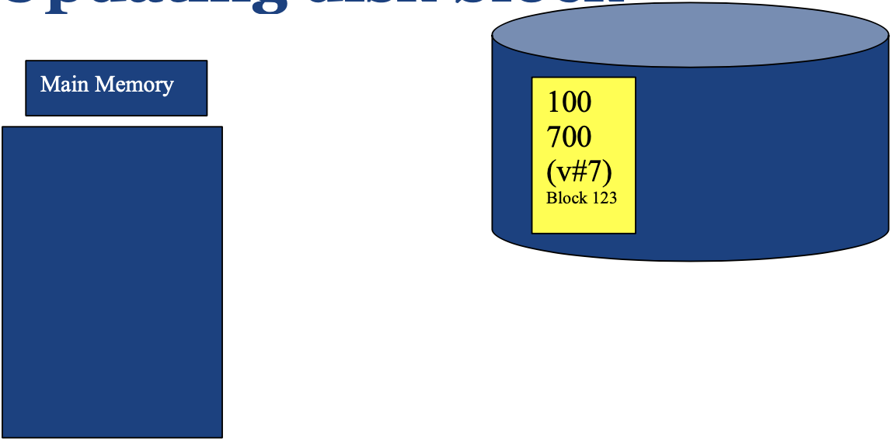
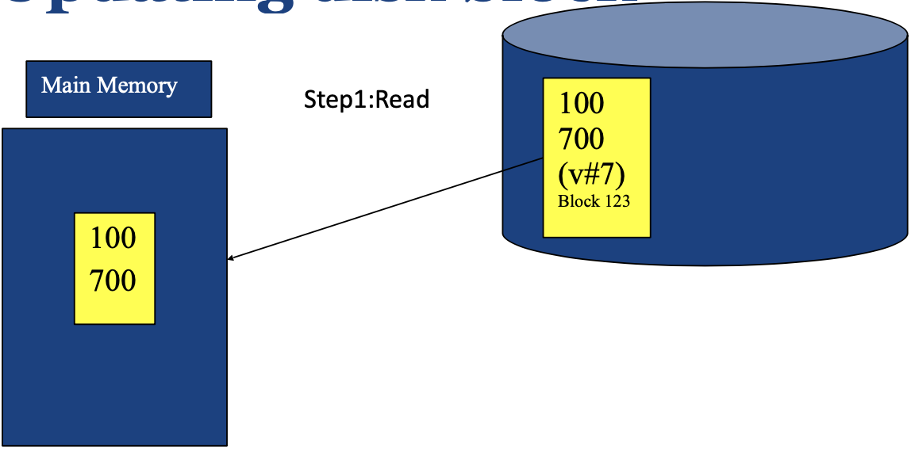
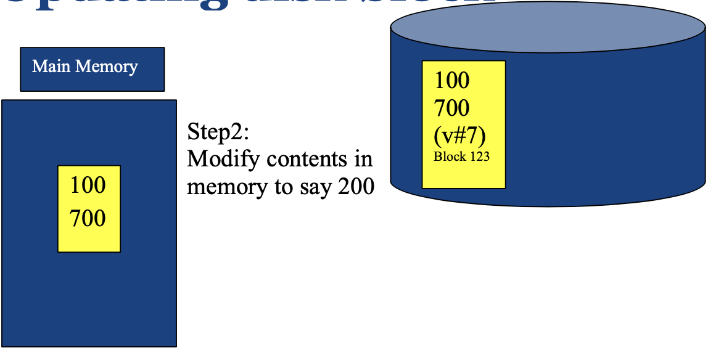
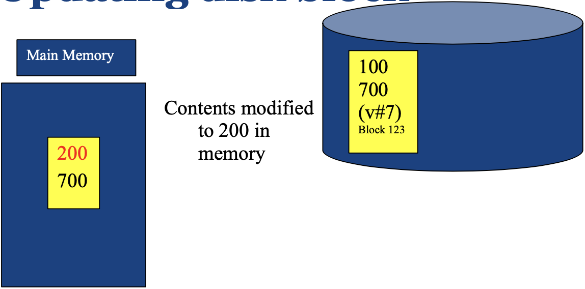
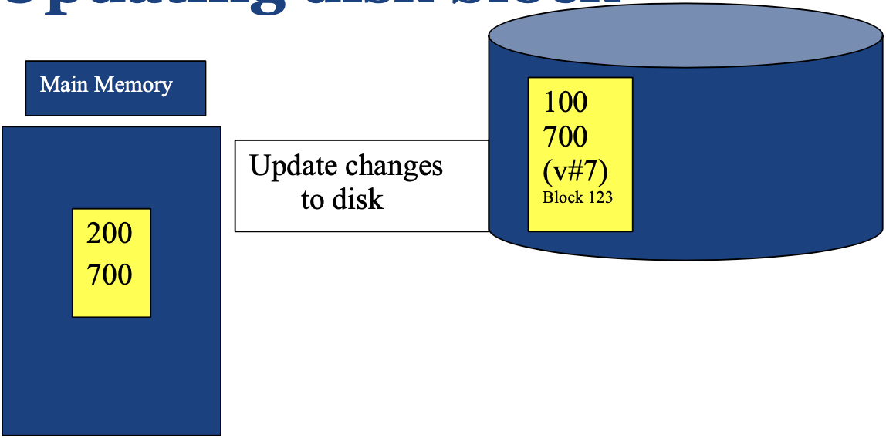
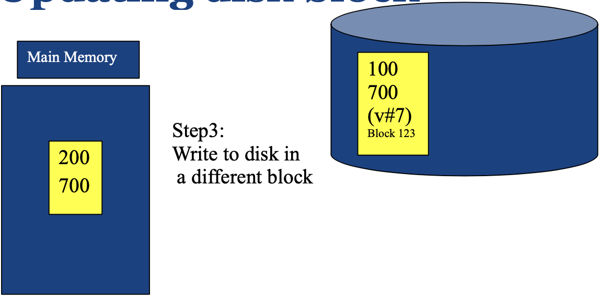
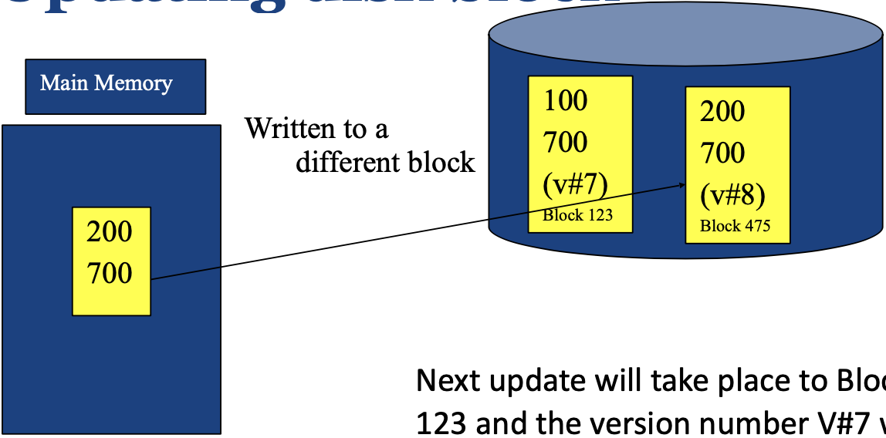
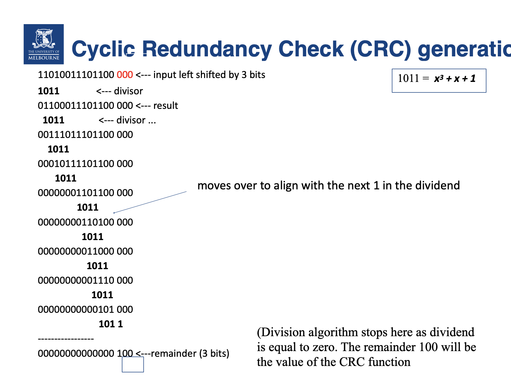

# 双写与日志能保证什么，循环冗余校验又能证明什么？

一个页面正在改写时突然掉电，重启后的数据库发现旧值仍在一个块、新值可能写进另一个块。读者需要判断可以据此恢复什么；如果读到的 bit (位) 也可能损坏，又该怎样检查？

## “原子写”和事务原子性不是一回事

transaction atomicity (事务原子性) 要求一组相关修改全部提交或全部回滚。例如从账户 A 向账户 B 转账 100，要把扣款、入账和提交记录作为一个逻辑事务处理；只更新其中一边会违反业务不变量。

磁盘设备是否保证单个扇区或页面原子写，取决于设备和写入协议。即便一个块写是原子的，它也不会自动让多块写成为一个事务。反过来，若页面可能被撕裂，恢复协议必须能检测并修复半新半旧的内容。

## 双写示例怎样用版本选择保留一个可读副本？

课程图中的 duplex-write scheme (双写方案) 用两个物理块交替保存同一逻辑块：旧副本保持可读，更新写到另一块，并附带递增版本号。图中显示的 `v#7`、`v#8`、块 123 和块 475 是示意标记；安全恢复还要求系统能检测写入完成与校验状态，并能可靠判定哪个版本完整。

1. 初始盘块 123 保存 `100 700 (v#7)`；内存为空。
   
2. 读盘后，内存获得 `100 700`。
   
   
3. 内存把第一个字段从 100 改为 200，旧盘块仍是 v7。
   
   
4. 新值先写到另一块 475，形成 `200 700 (v#8)`；图中的箭头指向当前写入的块 475。下一轮更新才轮到块 123，并沿同一递增序列写 v9，而不是把 v7 当作新版本。
   
   

如果在第 4 步写入过程中崩溃，旧版本仍留在另一块；恢复程序可校验候选副本并选择最新的完整版本。这个课程示例说明的是一种写入模式，不足以证明任意双写都安全：版本号、校验值、更新元数据、缓存刷新顺序和两块是否共享故障域都必须正确处理。它也只处理示意块，不能替代账户转账等多块事务的提交协议。

## logged write (日志写入) 何时能帮助恢复？

日志先记录足以 redo (重做) 或 undo (撤销) 更新的信息，再按协议将日志持久化，之后才可把对应数据页刷回。在 WAL 模型里，已提交事务的 commit record (提交记录) 持久化后，即使其数据页还未刷盘，恢复也能重做已提交更新；某个更新日志记录落盘本身并不表示事务已提交，未提交事务的可见影响须按恢复协议撤销或排除。若提交 ACK 早于提交记录持久化，断电后就可能丢失已经确认的更新。日志格式、写入顺序、flush (刷新)/fsync (文件同步调用) 和存储设备的缓存行为构成完整保证的一部分。

这种先日志、后数据页的顺序允许数据库先持久化更新和提交记录，再批量刷新数据页，不必每提交一笔事务就同步刷完它改动的所有页面。

数据库管理系统常用 write-ahead logging (WAL，预写日志) 和恢复算法实现事务持久性与崩溃恢复。若要看 WAL 的 redo、undo 与 checkpoint (检查点)，以及 Algorithms for Recovery and Isolation Exploiting Semantics (ARIES，利用语义实现恢复与隔离的算法) 怎样协作，继续读[WAL 与 ARIES 恢复](./condensed-note-w4-wal-and-aries-recovery.md)。单独保存一份“日志文件”并不会自动得到这些保证。

## 循环冗余校验如何用二元域除法产生校验位？

cyclic redundancy check (CRC，循环冗余校验) 将消息位串看成 Galois field GF(2) (二元有限域) 上多项式的系数。域内加法等价于 exclusive OR (XOR，异或)：$0\oplus0=0$、$0\oplus1=1$、$1\oplus1=0$。若生成多项式次数为 $n$，先把消息右侧补 $n$ 个零，再用生成多项式做模 2 长除；余数就是 $n$ 个 CRC 位。这里的运算不发生借位或进位。

> [!example] 复算图中的 3 位 CRC
> 图中输入为 `11010011101100`，生成多项式为 $x^3+x+1$，对应二进制 `1011`。次数 $n=3$，所以先附加 `000`：
> $$11010011101100\;000\div1011.$$
> 长除时，每次把生成多项式对齐到当前最左有效 1 并异或。第一步为 `1101 XOR 1011 = 0110`。当剩余有效位少于除数的 4 位时停止，取末尾 3 位作为余数 `100`；这与图中示意结果一致。发送端把它附在消息后得到 `11010011101100100`；接收端用 `1011` 检查完整码字，余数 `000` 才表示通过此项检查。原图把被除数等于零写作生成阶段的停止条件不准确；零余数是接收端对完整码字的检查结果。

CRC 能检测许多偶然传输或存储错误，但不能修复错误数据、证明数据来源，也不能保证检测所有错误。检测能力依赖生成多项式、码字长度和错误模式；需要恢复时还要有其他副本或重传机制。

> [!info]- 来源
> - `操作系统/控制器/设备缓存可能使已返回的写入仍未到非易失介质`：[PostgreSQL 18, WAL Reliability](https://www.postgresql.org/docs/18/wal-reliability.html)，2026-11-06 核验，第 28.1 节；[PostgreSQL 18, WAL Configuration](https://www.postgresql.org/docs/18/runtime-config-wal.html)，2026-11-06 核验，第 19.5 节。用作当前持久化边界示例，不表示其他 DBMS 使用相同实现。
> - `CRC 是错误检测码、未检出概率依赖多项式与错误模式`：[RFC 3385, iSCSI CRC/Checksum Considerations](https://www.rfc-editor.org/rfc/rfc3385)，2002-09，§1–3。本文对消息 `11010011101100` 右补 `000` 后，以 `1011` 做 GF(2) 长除，复算得余数 `100`；教材图仍作为原始过程示意。
