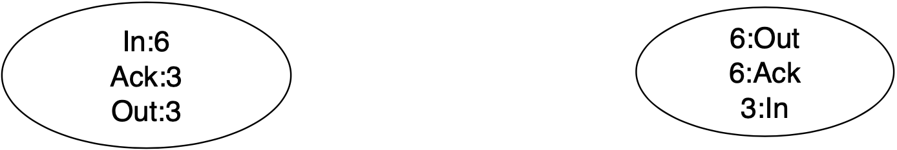
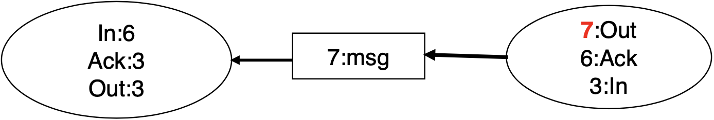
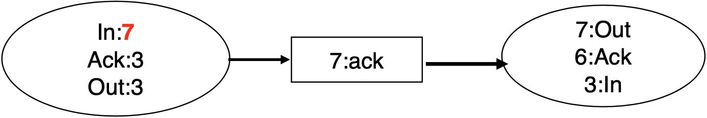
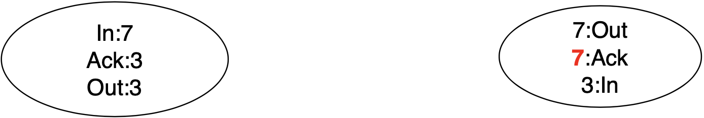
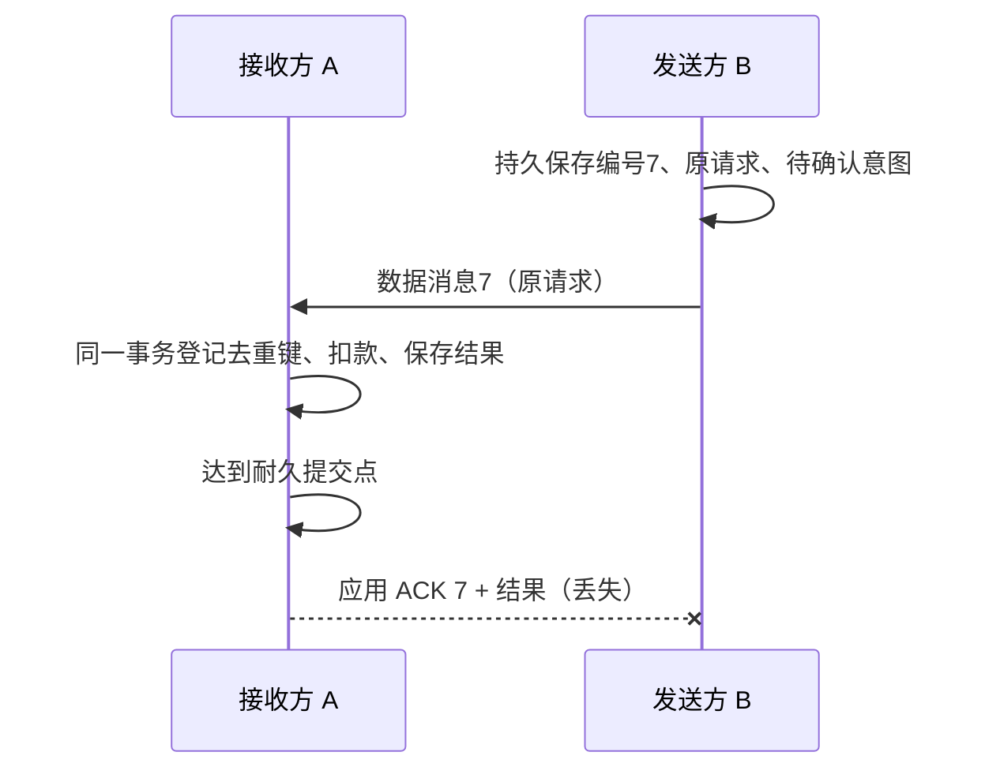
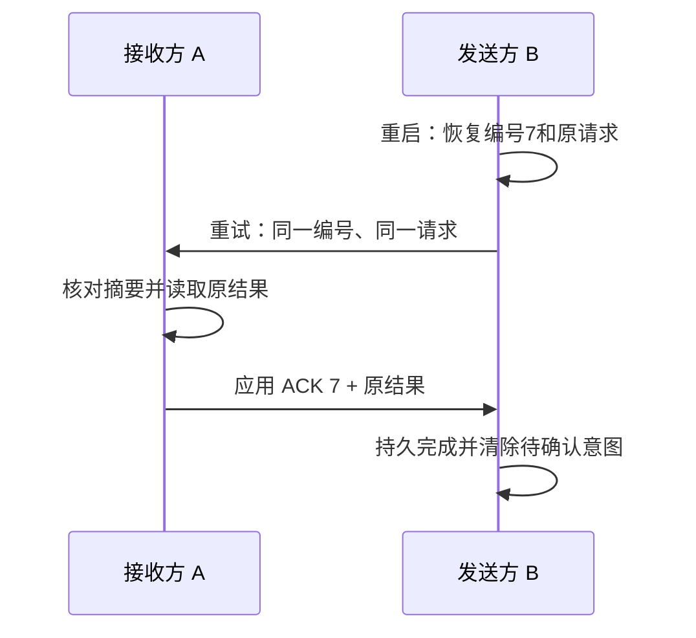

# 为什么消息确认仍可能导致重复处理？

支付服务 B 发出扣款请求后，服务 A 已更新账户余额，却在返回确认时遇到断网。B 重启后从持久记录读到原请求仍待确认；它不能仅凭超时判断 A 是否已扣款，因此要决定是否用原请求重试，而 A 必须识别这次重试。

## 确认丢失时，发送方无法知道哪一步完成

旧图左侧是接收方 A，右侧是发送方 B。acknowledgement（确认，ACK）是接收方发回的协议消息；这组图中的 `Out` 和 `In` 只计带应用编号的数据消息，不计 ACK 控制消息。`Out` 是本节点最后发出的数据消息序号，`In` 是最后收到的数据消息序号，`Ack` 是最后收到确认的本节点出站数据消息序号。它们是各节点自己的状态，不是累计消息计数，也不是共同的全局时钟。

这里的 `7` 是应用协议里的稳定消息编号，因此 `ACK 7` 是应用层对消息编号 7 的确认。主例让应用回复同时携带 ACK 和处理结果；这仍是 ACK 控制消息，不另占一个 `Out/In` 数据消息编号。它不是 TCP ACK：TCP ACK 确认传输流中的字节序号（下一个期望字节），不表示应用已执行扣款或数据库已提交。它也不是消息代理的 publisher confirm（发布者确认）或 consumer ACK（消费者确认）；这些分别确认各自 broker（消息代理）边界上的状态。只有协议明确把应用 ACK 定义在业务事务提交之后，它才表示该本地效果已经提交；数据库提交、broker 确认和 TCP 字节确认是不同的状态。

按课程图继续追踪消息 7：

1. B 先把发送方身份、消息编号 7、原请求内容（或可恢复原内容的不可变持久引用）和待确认状态写入稳定存储，之后才发送；右侧 `Out` 随数据消息发送从 6 变为 7。重启后 B 可以恢复原参数及同一编号，而不是只知道“有一条待确认消息”。
   
2. A 收到消息 7，左侧 `In` 从 6 变为 7。A 在同一事务中按 `(发送方身份, 消息编号)` 检查或登记去重键、核对请求摘要、更新账户并保存可重放的处理结果；若 ACK 承诺“扣款已耐久提交”，就等到该数据库配置承诺的提交日志持久化后再发应用 ACK 7。A 的 `Out` 和 `Ack` 仍为 3：ACK 不计作数据消息，`Ack` 记录的是 A 已收到的对方确认。
   
3. B 收到 ACK 7 和对应结果后，右侧 `Ack` 从 6 变为 7；它先持久记录完成状态，再清除待确认意图。B 的 `In` 仍为 3，因为收到的是 ACK 控制消息，不是新编号的数据消息。若清除待确认意图前崩溃，B 重启后先检查持久状态：完成标记已落盘就不重发，只清理残留待确认项；完成标记未落盘则仍有待处理请求，重试同一请求，由 A 返回已保存结果。
   

若 B 重启后看到完成标记尚未持久化、待确认意图仍在，它无法仅凭超时判断消息 7 是丢失、A 尚未处理，还是 A 已处理但 ACK 丢失。为了避免永久丢失，B 从稳定存储恢复并重试原请求；于是 A 可能再次收到同一个逻辑请求。

**首次处理后确认丢失：**

**B 重启后恢复原请求并安全重试：**

若 A 查不到已提交的去重记录（原消息未到，或先前事务已回滚），这次重试仍可成为首次处理；若相同去重键对应不同请求摘要，则返回冲突，不扣款。

若发送端持久保留意图、持续重试，且两端最终恢复通信，这种策略可以追求至少一次投递；它仍可能让 A 收到重复输入。因此，加 ACK 不等于一次处理。

## 如何把一次业务效果与消息编号绑定？

发送端 B 必须在首次发送前把 message identifier（稳定消息编号，message ID）、发送方身份、原请求内容或可恢复原内容的持久引用，以及待确认状态写入 stable storage（稳定存储）；超时重试复用原编号和原请求。单发送方 B 的例子可简称为编号 7；一般接收端应使用全局唯一 ID，或以 `(sender_id, message_id)` 组成唯一键，不能把多个发送方各自的 `7` 混为一条。接收端 A 还保存请求摘要，用它区分相同请求的重试和同编号的不同请求。对首次处理，A 在同一个 database transaction（数据库事务）中完成去重键登记、业务更新和可重放结果保存，并为去重键设置唯一约束或等价的串行化机制，避免并发消费者同时通过“未见过”的检查：

- 若去重键未见过，登记去重键，执行扣款并保存本次响应结果，然后一起提交；
- 若同一去重键已提交且请求摘要相同，读取已保存结果并重放，不重复扣款；同编号但摘要不同应报冲突，不能复用旧结果。两个事务竞争时，唯一约束使其中一个等待或失败。若唯一冲突已使当前事务失败，先按数据库规则回滚，再开新事务读取该键、核对摘要并返回原结果或冲突；若事务仍有效但固定快照看不到获胜提交，也要回滚并重开或按该数据库的隔离规则刷新可见状态，不能在失败事务或旧快照里假设能读到赢家。若竞争者回滚，当前事务或之后的重试仍可首次处理；
- 若事务失败，业务更新与编号登记一起回滚，之后重试仍可重新处理。

这让同一逻辑请求的本地数据库效果最多提交一次；若所有尝试都失败，效果也可能为零。为让仍在有效重试窗口内的请求得到原结果，去重记录还须保留原结果或可重放引用，并至少覆盖发送端重试、队列重投和可能的迟到消息窗口。只保留去重墓碑（已处理键）可以拦住重复业务更新，却无法重放原结果；若到期后只留墓碑，协议就必须拒绝迟到重试，而不能假装成功。若延迟没有已知上界，就保留墓碑及结果/引用，或采用接收端在删除去重记录后仍能识别并拒绝过期请求的协议；只要旧请求仍可能到达，就不得复用该 ID。若本地提交还要通知另一个系统，可在同一数据库事务中原子提交业务更新和 outbox（事务性发件箱）事件，由转发器稍后重试发送；发件箱保证本地意图不会与本地提交分离，但转发器仍可能重复发送。下游仍须用稳定事件编号去重或实现幂等。跨系统副作用若要采用其他语义，则需显式设计分布式事务或补偿流程；单有 outbox 不能保证外部效果只发生一次。

稳定存储使发送端能在重启后恢复待确认消息及原请求编号，接收端能恢复去重记录。本例约定应用 ACK 在本地业务事务达到其耐久提交条件后发送；具体条件取决于数据库同步/异步提交配置和底层存储是否兑现刷新语义。异步提交可能先返回成功、后持久化日志，因此单看事务 API 返回不足以证明断电后可恢复。若 ACK 只承诺“消息已收到”，就不能据此断定扣款已经提交。若由 broker 负责消费确认，也要按其具体协议在业务状态已持久后再 ACK；broker 确认到达不等于另一个服务的数据库已提交。

> [!info] 产品保证要看边界
> 例如，Amazon Simple Queue Service (SQS，Amazon 简单队列服务) Standard 队列的语义是 at-least-once delivery（至少一次投递），应用应能幂等处理重复消息。SQS 的 first-in, first-out（先进先出，FIFO）队列会在五分钟去重窗口内对相同 message deduplication ID（消息去重编号）的重复发送去重；它不能替接收方保证“消息被消费后，另一个数据库或支付服务的副作用只发生一次”。服务的具体保证与去重窗口应以其版本化文档为准。

当问题从消息投递延伸到数据库更新的原子提交，可看[事务、隔离与恢复](../../../engineering-foundations/databases/database-transactions-isolation-and-recovery.md)；此处保留消息编号、确认和重试的边界。

> [!info]- 来源
> - `至少一次投递可能重复，接收方要幂等`：[Amazon SQS Developer Guide, Standard queues](https://docs.aws.amazon.com/AWSSimpleQueueService/latest/SQSDeveloperGuide/standard-queues.html)，2026-11-12 核验；[Amazon SQS FIFO queues](https://docs.aws.amazon.com/AWSSimpleQueueService/latest/SQSDeveloperGuide/sqs-fifo-queues.html)，2026-11-12 核验。文中只把 SQS 作为产品例子，不外推到所有消息系统。
> - `去重窗口与 FIFO 行为`：[Amazon SQS FIFO queue key terms](https://docs.aws.amazon.com/AWSSimpleQueueService/latest/SQSDeveloperGuide/FIFO-key-terms.html)，2026-11-12 核验；重复发送去重有服务边界与窗口条件。
> - `本地业务更新和待发送事件在同一事务提交；转发可重复，消费者需幂等`：[AWS Prescriptive Guidance, Transactional outbox pattern](https://docs.aws.amazon.com/prescriptive-guidance/latest/cloud-design-patterns/transactional-outbox.html)，2026-11-12 核验；这里只借用其本地原子提交与下游重复处理边界，不把 AWS 示例外推成跨产品保证。
> - `并发消费者可用唯一约束处理相同编号的竞争`：[PostgreSQL 18, INSERT](https://www.postgresql.org/docs/18/sql-insert.html)，2026-11-12 核验；这是一个具体实现示例，文中概括的事务边界不能替代各数据库产品的隔离级别说明。
> - `固定快照看不到并发事务后续提交时需按隔离规则处理`：[PostgreSQL 18, Transaction Isolation](https://www.postgresql.org/docs/18/transaction-iso.html)，2026-11-12 核验，作为快照可见性的产品例，不外推所有数据库隔离实现。
> - `TCP ACK 的编号属于字节流；ACK 表示下一个期望的字节序号`：[RFC 9293, Transmission Control Protocol](https://www.rfc-editor.org/rfc/rfc9293.html)，§3.1、§3.4，2022-08；它定义的是传输层接收状态，不是应用处理或数据库提交结果。
> - `同步提交等待事务 WAL 持久化；异步提交可能先成功返回`：[PostgreSQL 18, WAL Introduction](https://www.postgresql.org/docs/18/wal-intro.html)，§28.3；[Asynchronous Commit](https://www.postgresql.org/docs/18/wal-async-commit.html)，§28.4，2026-11-12 核验。该例说明应用 ACK 若承诺耐久效果，必须等到对应数据库提交达到持久条件。
> - `publisher confirm 与 consumer ACK 分别覆盖发布者—broker、broker—消费者，彼此正交`：[RabbitMQ 4.4, Consumer Acknowledgements and Publisher Confirms](https://www.rabbitmq.com/docs/confirms)，2026-11-12 核验。该产品语义不外推到其他 broker；本地边界见[消息发布与消费者确认](../../../engineering-foundations/reliability/queue-delivery-and-acknowledgement.md)。
