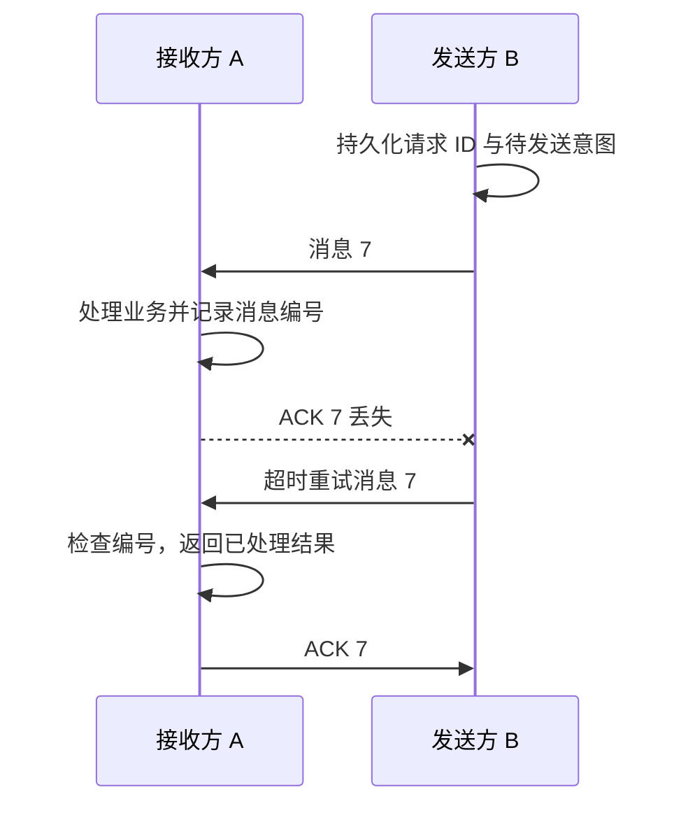

# 为什么消息确认仍可能导致重复处理？

支付服务 B 发出扣款请求后，服务 A 已更新账户余额，却在返回确认时遇到断网。B 重启后只看到请求超时；它需要决定是否重试，而 A 需要判断再次到来的请求是否已经生效。

## 确认丢失时，发送方无法知道哪一步完成

旧图左侧是接收方 A，右侧是发送方 B。acknowledgement (ACK，确认) 是接收方发回的协议消息；这组图中的 `Out` 是本节点最后发出的消息序号，`In` 是最后收到的序号，`Ack` 是最后收到确认的本节点出站消息序号。它们不是累计消息计数，也不是共同的全局时钟。

按课程图继续追踪消息 7：

1. B 先把消息 7 的请求编号和待确认意图写入自己的持久存储，之后才发送；右侧 `Out` 随发送从 6 变为 7。重启后 B 从这条意图恢复，并用同一编号重试。
   
2. A 收到消息 7，左侧 `In` 从 6 变为 7。A 处理业务后向 B 发送 ACK 7；A 自己的 `Ack` 仍为 3，因为该字段记录的是已收到的对方确认。
   
3. B 收到 ACK 7，右侧 `Ack` 从 6 变为 7，之后才可清除这条待确认状态。
   

如果第 3 步没有发生，B 只知道“没有收到 ACK”。它无法仅凭超时判断是消息 7 丢失、A 尚未处理，还是 A 已处理但 ACK 丢失。为了避免永久丢失，B 通常重试；于是 A 可能再次收到同一个逻辑请求。

图中要点不是“加 ACK 就能一次处理”，而是重试语义会把“至少一次送达”变成应用必须面对的重复输入。

## 如何把一次业务效果与消息编号绑定？

发送端 B 必须在首次发送前把请求编号和待确认状态写入 stable storage (稳定存储)；每次超时重试都复用同一个编号，不能为相同逻辑扣款生成新编号。接收端 A 为每个逻辑消息保存该稳定唯一编号，即 message identifier (message ID，消息编号)，并记录处理结果。处理请求时，在同一个 database transaction (数据库事务) 中完成“检查/登记该编号”和“业务更新”，并对消息编号设置唯一约束或用等价的串行化机制，避免两个并发消费者同时通过“未见过”的检查：

- 若编号未见过，登记编号并提交业务更新；
- 若编号已提交，返回已记录的结果，不重复应用副作用；若两个事务竞争同一编号，唯一约束使其中一个事务失败或等待，败方在能看到获胜提交的读取中返回已记录的结果。若事务已失败，或固定快照看不到获胜提交，应按数据库隔离规则回滚后重开事务再读，而不是假设旧快照能看到新提交；
- 若事务失败，业务更新与编号登记一起回滚，之后重试仍可重新处理。

这样，重复消息可以多次送达，但同一个编号对应的本地数据库效果只提交一次。若本地提交还要通知另一个系统，可在同一数据库事务中原子提交业务更新和 outbox (事务性发件箱) 事件，由转发器稍后重试发送；发件箱保证本地意图不会与本地提交分离，但转发器仍可能重复发送。下游仍须用稳定事件编号去重或实现幂等。跨系统副作用若要采用其他语义，则需显式设计分布式事务或补偿流程；单有 outbox 不能保证外部效果只发生一次。

稳定存储使发送端能在重启后恢复待确认消息及原请求编号，接收端能恢复去重记录。ACK 只能确认某个协议阶段完成，必须定义它是在接收后、业务提交后还是持久保存后发送；否则“收到 ACK”也可能没有所需的耐久含义。

> [!info] 产品保证要看边界
> 例如，Amazon Simple Queue Service (SQS，Amazon 简单队列服务) Standard queue 的语义是 at-least-once delivery (至少一次投递)，应用应能幂等处理重复消息。SQS 的 first-in, first-out (FIFO，先进先出) queue 可在五分钟窗口内合并相同 message deduplication ID (消息去重编号) 的重复发送；它不能替接收方保证“消息被消费后，另一个数据库或支付服务的副作用只发生一次”。服务的具体保证与去重窗口应以其版本化文档为准。

当问题从消息投递延伸到数据库更新的原子提交，可看[事务、隔离与恢复](../../../engineering-foundations/databases/database-transactions-isolation-and-recovery.md)；此处保留消息编号、确认和重试的边界。

> [!info]- 来源
> - `至少一次投递可能重复，接收方要幂等`：[Amazon SQS Developer Guide, Standard queues](https://docs.aws.amazon.com/AWSSimpleQueueService/latest/SQSDeveloperGuide/standard-queues.html)，2026-11-06 核验；[Amazon SQS FIFO queues](https://docs.aws.amazon.com/AWSSimpleQueueService/latest/SQSDeveloperGuide/sqs-fifo-queues.html)，2026-11-06 核验。文中只把 SQS 作为产品例子，不外推到所有消息系统。
> - `去重窗口与 FIFO 行为`：[Amazon SQS FIFO queue key terms](https://docs.aws.amazon.com/AWSSimpleQueueService/latest/SQSDeveloperGuide/FIFO-key-terms.html)，2026-11-06 核验；重复发送去重有服务边界与窗口条件。
> - `本地业务更新和待发送事件在同一事务提交；转发可重复，消费者需幂等`：[AWS Prescriptive Guidance, Transactional outbox pattern](https://docs.aws.amazon.com/prescriptive-guidance/latest/cloud-design-patterns/transactional-outbox.html)，2026-11-06 核验；这里只借用其本地原子提交与下游重复处理边界，不把 AWS 示例外推成跨产品保证。
> - `并发消费者可用唯一约束处理相同编号的竞争`：[PostgreSQL 18, INSERT](https://www.postgresql.org/docs/18/sql-insert.html)，2026-11-06 核验；这是一个具体实现示例，文中概括的事务边界不能替代各数据库产品的隔离级别说明。
> - `固定快照看不到并发事务后续提交时需按隔离规则处理`：[PostgreSQL 18, Transaction Isolation](https://www.postgresql.org/docs/18/transaction-iso.html)，2026-11-06 核验，作为快照可见性的产品例，不外推所有数据库隔离实现。
