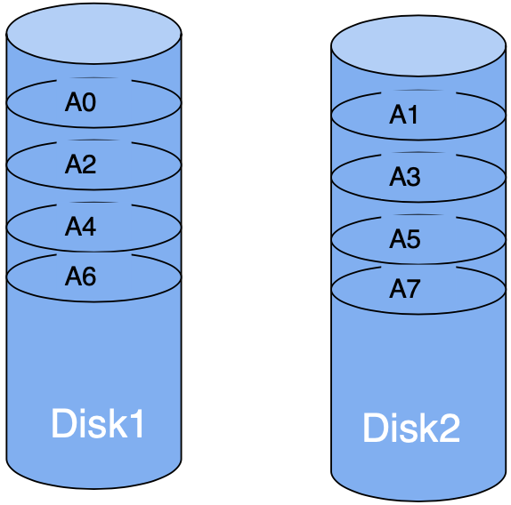
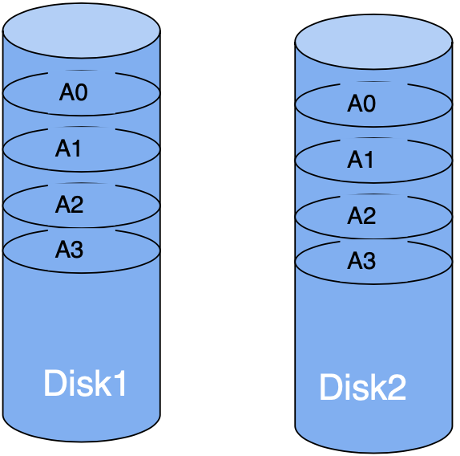
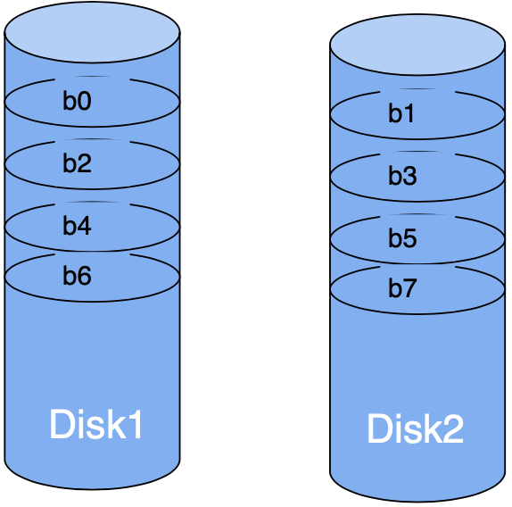
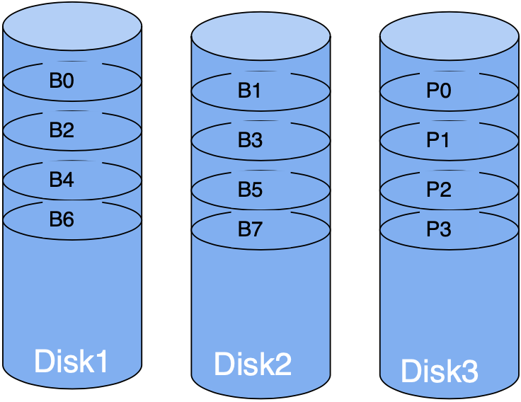
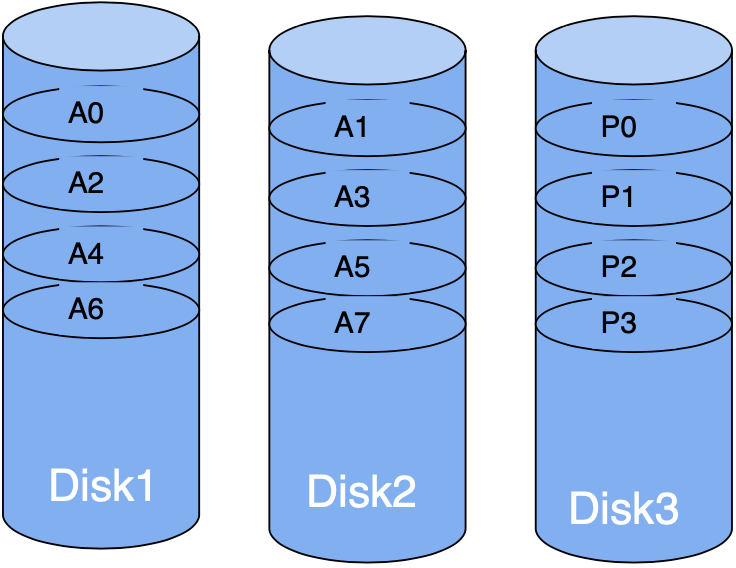
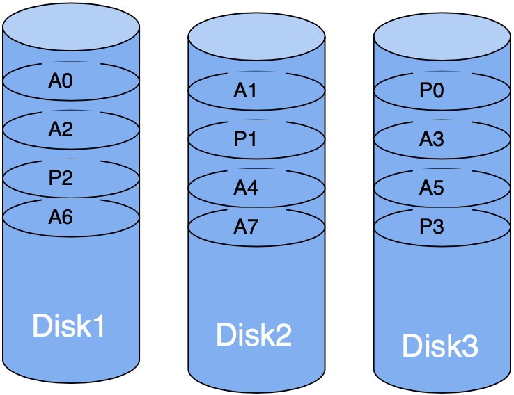
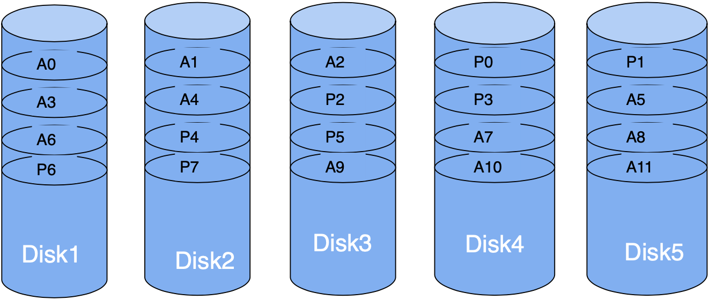

# 阵列可靠性计算如何依赖故障模型？

运维人员正在评估一组冗余磁盘阵列：如果一次检查区间内有两盘失效，数据是否还能恢复？如果故障可以修复，重建的暴露窗口怎样改变预计数据丢失时间？下面以 redundant array of independent disks (RAID，独立磁盘冗余阵列) 为对象，先画清布局，再给每个概率或时间指定失败模型。

## 先区分观察区间概率、故障率与可用性

若 $p$ 表示一个磁盘在**同一固定观察区间**内失效的概率，且磁盘故障相互独立；令 $A$、$B$ 分别表示两盘在该区间内失效的事件，那么：

$$
P(A\cap B)=p_Ap_B,\qquad P(A\cup B)=p_A+p_B-p_Ap_B.
$$

令 $X$ 为 $N$ 个磁盘在区间内失效的数量；若每盘具有相同的 $p$，至少 $k$ 个失效的概率为下式，其中 $\binom Nj$ 表示从 $N$ 盘中选出 $j$ 盘的组合数：

$$
P(X\ge k)=\sum_{j=k}^{N}\binom Nj p^j(1-p)^{N-j}.
$$

当 $p$ 很小时，至少一盘失效的概率 $1-(1-p)^N\approx Np$。这些都是无修复固定区间的任务概率；$1/p$ 不是时间，除非同时给出区间和寿命模型。

若每盘以 constant failure rate (故障率 $\lambda$) 失效，$\lambda$ 的单位为 $\text{h}^{-1}$，并采用 exponential lifetime distribution (指数寿命分布)，单盘 mean time to failure (MTTF，平均失效时间) 的单位是小时，且 $MTTF=1/\lambda$。在长度为 $\Delta t$ 的观察区间，$p=1-e^{-\lambda\Delta t}$；若 $\lambda\Delta t\ll1$，才可近似为 $p\approx\lambda\Delta t$，时间单位相消后得到无单位概率。$N$ 盘中第一盘失效的平均时间为 $1/(N\lambda)$ 小时。

mean time to repair (MTTR，平均修复时间) 也是时间量，单位为小时。对单块磁盘的正常/维修两状态模型，availability (可用率 $A_{disk}$) 是单盘长期处于可服务状态的比例；$q_{disk}$ 是该单盘的长期不可用比例，二者均为无单位的概率：

$$
A_{disk}=\frac{MTTF}{MTTF+MTTR},\qquad q_{disk}=1-A_{disk}=\frac{MTTR}{MTTF+MTTR}.
$$

$A_{disk}$ 和 $q_{disk}$ 只描述单盘，不是冗余阵列的可用率；阵列是否能服务取决于它的副本与校验布局。二者都不等于“永不故障”的概率。mean time to data loss (MTTDL，平均数据丢失时间) 用小时表示，须由“数据不可恢复”的阵列状态模型定义；罕见故障近似中，它约为数据丢失事件率的倒数。

图中每段修复后到下次故障的在线时间对应单盘运行寿命样本（用于 MTTF）；每段非计划停机到修复完成的时间对应维修时间样本（用于 MTTR）。旧图的 “between failures” 箭头只标注样本间的在线段，不定义阵列可用率，也不替代上面的 MTTF/MTTR 术语。

接下来用两种模型分别估算：一是指定时间内、尚未修复前发生几盘故障；二是有修复过程的阵列平均多久丢失数据。不能把两种结果混写成同一个“MTTF”。

## 各 RAID 布局能承受哪些失效？

下列图片保留课程中的位、字节和块布局。计算中假定各盘独立，且 $p$ 是每盘在同一固定区间内失效的概率；这是为了演算的简化模型，不代表实际阵列的现场故障分布。

> [!info] 图中的符号
> $b_i$ 表示 bit（位），$B_i$ 表示数据 byte（字节），$A_i$ 表示数据 block（块），$P_i$ 表示图中的校验块标记。对单校验条带，例如 RAID 3，$P_0=B_0\oplus B_1$，已知 $P_0$ 和 $B_0$ 时可用 $B_1=P_0\oplus B_0$ 恢复。8 个连续 bit 组成 1 byte；课程图示将 4000 或 8000 个连续字节作为一个 block。RAID 6 的两条校验流含彼此独立的信息，不能把同一 XOR 校验复制两份当作两条独立校验。设备格式和块大小会随系统而变。

### RAID 0：并行条带化，不提供副本

striping (条带化) 把数据块交错写到各盘，可让独立请求并行；大块顺序传输也可能合并带宽。两盘中任一盘失效都会破坏阵列：

$$
P(loss)=1-(1-p)^2=2p-p^2\approx2p.
$$

若两盘故障率均为 $\lambda$、没有修复，阵列在第一盘故障时即失效，所以阵列 MTTF 为 $1/(2\lambda)=MTTF/2$。性能提升取决于负载与设备瓶颈。

### RAID 1：镜像可在一盘失效后继续读取

mirroring (镜像) 将同一数据保存为两份副本；在一份副本仍完好且读取路径正常时，一盘失效后可继续服务。两盘镜像的可用容量约为原始总容量的一半，写入要更新两份数据。下式中的 $r$ 是从第一盘失效到镜像重建完成的平均暴露时间，单位为小时。

在无修复的同一固定观察区间内，两盘都失效的概率为 $p^2$；它不表示两盘在同一瞬间坏掉。若每盘故障率为 $\lambda$、失效独立、平均重建时间为 $r$ 且 $\lambda r\ll1$，第一盘故障率约为 $2\lambda$；恢复冗余前另一盘在长度为 $r$ 的暴露窗口中失效的概率约为 $\lambda r$，相乘得到数据丢失事件率近似 $2\lambda\times\lambda r=2\lambda^2r$。因此：

$$
MTTDL\approx\frac{1}{2\lambda^2r}=\frac{MTTF^2}{2r}.
$$

这里 MTTDL 是平均数据丢失时间的近似，不是双盘独立寿命的平方；共同电源故障、相关故障、潜在扇区错误和重建负载均不在模型内。

### RAID 2：按位条带与纠错码

数据按 bit 条带化，并配合类似内存的 error-correcting code (ECC，纠错码)。保留的课程图只画数据盘，未画出纠错盘，所以不能从该图推断盘数或可容错的失效数。RAID 2 主要作为历史和教学分类；其可靠性取决于具体纠错码及布局。

### RAID 3：细粒度条带与专用奇偶校验盘

课程图示为两块数据盘加一块专用奇偶校验盘，连续数据按细粒度条带分布。单盘失效可由其他盘重建；若无修复，同一固定观察区间内两盘都失效就超过单校验能力。固定区间中三盘至少两盘失效的概率是：

$$
3p^2(1-p)+p^3=3p^2-2p^3\approx3p^2.
$$

若每盘故障率为 $\lambda$、重建时间 $r$ 以小时计、故障独立且 $\lambda r\ll1$，则首盘失效率约为 $3\lambda$；重建期间另两盘至少一盘失效的概率约为 $2\lambda r$。两项相乘得数据丢失事件率约 $(3\lambda)(2\lambda r)=6\lambda^2r$，因此 $MTTDL\approx1/(6\lambda^2r)$。这是特定三盘布局的模型结果，不是一般 RAID 3 的现场保证。

### RAID 4：块条带与专用奇偶校验盘

数据按块分布，奇偶校验集中在一盘。独立读取可以并行，任一块数据盘失效时可用剩余数据和校验重建。小型随机写需要读取或计算相关旧数据及校验，再更新校验盘，因而专用校验盘可能形成热点；大块顺序写的表现不同。

### RAID 5：把奇偶校验也分散到各盘

数据块和校验块轮流分布到所有盘，避免 RAID 4 的单一专用校验盘。一个磁盘失效时仍可由其余数据和奇偶校验重建；在冗余恢复前再有一盘失效会超过单校验能力。小型随机写仍要维护奇偶校验，写开销、并行度和重建干扰取决于工作负载与实现。

### RAID 6：双校验增加可重建的失效数

课程图有五盘；每个条带都包含三块数据和两块独立校验，校验块在盘间轮转。原图把全部校验块统一标为 $P_0$–$P_7$，没有分别标出两条流；机制上可把它们称为 $P$ 和 $Q$。两条校验必须包含独立信息，复制同一个 XOR 值不能恢复两个未知块。该布局可重建最多两盘失效，但写入需维护两个校验值。若五盘在固定区间内各自以概率 $p$ 独立失效且没有修复，阵列损失要求至少三盘失效：

$$
\begin{aligned}
P(loss)&=\binom53p^3(1-p)^2+\binom54p^4(1-p)+p^5\\
&=10p^3-15p^4+6p^5\approx10p^3.
\end{aligned}
$$

该式是五盘图例的区间概率，不是 MTTDL。修复阵列还要建模恢复时间、潜在错误、相关故障和设备管理策略。

## 奇偶校验写入遇到崩溃时会怎样？

上面的课程模型只统计成员盘失效，没有统计奇偶校验块与数据块分步写入时的崩溃风险。若一条奇偶校验带的多块更新不是原子的，掉电可能留下彼此不一致的数据与校验；之后降级重建就可能无法可靠还原缺失块。Linux device-mapper RAID 的 4/5/6 实现支持可选 journal device (日志设备) 来关闭这种 write hole (写洞) 窗口；这是特定实现提供的机制，不表示所有阵列都有同样的日志或恢复行为。Linux MD 文档也说明，RAID 5/6 若同时处于脏且降级状态，奇偶校验可能不可信，因此默认拒绝启动，以免把潜在数据损坏当成可恢复状态。

## 何时选镜像、单校验或双校验？

用同一组问题比较布局：要多少可用容量？需要容忍几盘失效？读写负载偏顺序还是随机？重建时允许多长的风险窗口和性能下降？系统如何监控、校验并恢复副本？条带化能增加并行度，但 RAID 0 没有冗余；镜像和奇偶校验消耗容量，校验写入还增加工作量。RAID 等级不能替代备份，也不能自动覆盖共同故障或误删。

> [!info]- 来源
> - `RAID 布局、条带/镜像/奇偶校验与教科书可靠性模型`：[Database System Concepts, 7e, ch. 12: Physical Storage Systems](https://www.db-book.com/Previous-editions/db7/slides-dir/PDF-dir/ch12.pdf)，2019 年课程幻灯片；[Patterson, Gibson & Katz, “A Case for Redundant Arrays of Inexpensive Disks (RAID),” 1988](https://www.cs.cmu.edu/~garth/RAIDpaper/Patterson88.pdf)。
> - `RAID 6 的 P/Q 两校验流和恢复两个未知数据块`：[H. Peter Anvin, The Mathematics of RAID-6](https://www.kernel.org/pub/linux/kernel/people/hpa/raid6.pdf)，2011 年更新；用来说明两条校验必须提供独立信息，不把本文图中统一的 P0–P7 标签误读为一条校验公式。
> - `当前 Linux 实现的 RAID 行为与奇偶校验写洞边界`：[Linux kernel, RAID arrays](https://docs.kernel.org/admin-guide/md.html)，2026-11-06 核验；[Linux kernel, Device-mapper RAID](https://docs.kernel.org/admin-guide/device-mapper/dm-raid.html)，2026-11-06 核验。该实现支持的 journal 与 dirty/degraded 恢复规则不能直接推广为所有硬件或软件阵列的保证。
> - `MTTF、MTTR、修复暴露窗口`：教科书 ch. 12 同上。本文中的 RAID 1/3 近似式明确基于独立、恒定故障率、短修复窗口的简化模型；不要外推为制造商可靠性指标。
