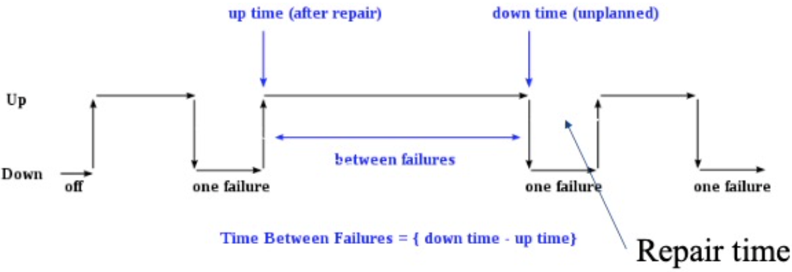

# How do RAID reliability calculations depend on their failure model? / RAID 可靠性计算如何依赖故障模型？

A RAID layout determines which disk-failure combinations can be reconstructed. A numerical claim also needs an observation interval or failure-rate model, independence assumptions, and a repair/rebuild model. Mission-interval loss probability and repairable-array MTTDL are different quantities. / RAID 布局决定哪些磁盘故障组合可以重建。数值结论还需要指定观察区间或故障率模型、独立性假设以及修复/重建模型。固定任务区间丢失概率与可修复阵列 MTTDL 是不同量。

## Fault Tolerance Introduction
### Basic Probability and Mean Time to Event
Let $p_A$ and $p_B$ be independent probabilities that events occur during the same fixed observation interval. Then:

- $P(A \cap B) = p_A p_B$
- $P(A \cup B) = p_A + p_B - p_A p_B$

For small probabilities, $P(A \cup B) \approx p_A+p_B$. A probability over a fixed interval is not itself a time or a failure rate. If a component has a constant failure rate $\lambda$ per unit time (an exponential lifetime model), its MTTF is $1/\lambda$. For rare failures over an interval of length $\Delta t$, $p \approx \lambda \Delta t$.

For $n$ independent modules with the same per-interval failure probability $p$, the exact chance of at least one failure in that interval is $1-(1-p)^n$, approximately $np$ when $p$ is small. Under the constant-rate model, the rate of the first failure is $n\lambda$, so the time to the first failure has mean $1/(n\lambda)$.

### Module Availability
Module availability is the ratio of service accomplishment to elapsed time.

For a repairable module that alternates between up and down periods, long-run availability is:
$$\text{Availability} = \frac{MTTF}{MTTF + MTTR}$$
Here MTTF is the mean up-time and MTTR is the mean time spent repairing. This is a long-run average under the stated up/down model, not a probability of avoiding failure forever.

## Redundant Array of Independent Disks (RAID) / 独立磁盘冗余阵列
RAID is a method of combining multiple disks as a unit for fault tolerance or performance improvement, or both, of a database system ([Patterson, Gibson, and Katz's 1988 paper](https://www.cs.cmu.edu/~garth/RAIDpaper/Patterson88.pdf); [Database System Concepts, 7e, ch. 12](https://www.db-book.com/Previous-editions/db7/slides-dir/PDF-dir/ch12.pdf)).

For graphs below, we use the following conventions:

- We use b for Bit; B for byte; 8 continuous bits = 1 byte
- A for block, 4000/8000 continuous bytes = 1 block
- p for parity, Parity (or check bits) are used for error detection
  - P0 is parity for bytes B0 and B1, $P_i = B_{2i} \oplus B_{2i+1}$, here $\oplus$ is the exclusive-or operator

Please note that the RAID levels are not exhaustive and there are other RAID levels such as RAID 10, RAID 50, etc. that combine the features of the basic RAID levels for additional redundancy or performance.

Reliability model for the calculations below: let $p$ be the probability that one disk fails within one fixed observation interval, and assume independent disk failures. If a disk has constant failure rate $\lambda$ per hour, then $MTTF_{disk}=1/\lambda$; $1/p$ is not a time unless the interval and rate model are specified. For $N$ disks, the probability of at least $k$ failures during an interval with no repair is
$$P(\text{at least }k)=\sum_{j=k}^{N}\binom{N}{j}p^j(1-p)^{N-j}.$$
These mission-interval probabilities are not MTTF estimates for a repaired array.

### RAID 0 (Block Level Striping)
<image alt="RAID0" src="raid0.png" width=300/>

- Data is split into blocks and spread across multiple disks.
- Note the data is stored in a zig-zag way (A0, A2, A4, A6 in Disk 1, A1, A3, A5, A7 in Disk 2)
- Advantages: Independent block requests can run in parallel; a large sequential transfer may use both disks.
- Drawbacks: There is no redundancy, so either disk failing loses the array. With two independent disks and failure probability $p$ per fixed interval, $P(\text{loss})=1-(1-p)^2=2p-p^2\approx2p$. With constant per-disk failure rate $\lambda$ and no repair, array MTTF is $1/(2\lambda)=MTTF_{disk}/2$. Throughput gains depend on workload and bottlenecks.

### RAID 1 (Mirroring)
<image alt="RAID1" src="raid1.png" width=300/>

- Data is duplicated across two or more disks.
- Advantages: Two copies can serve reads, and data remains available after one independent disk failure if the surviving copy is sound.
- Drawbacks: Usable capacity is about half for a two-disk mirror. Both disks must receive writes, so write performance depends on workload and implementation.
- In a no-repair observation interval, both disks failing has probability $p^2$. In a repairable two-disk mirror with independent constant failure rate $\lambda$, rare failures, and mean repair/rebuild time $r$, the approximate mean time to data loss is $1/(2\lambda^2r)=MTTF_{disk}^2/(2r)$. This assumes independent failures and ignores common causes; it is not $MTTF_{disk}^2$ ([Database System Concepts, 7e, ch. 12](https://www.db-book.com/Previous-editions/db7/slides-dir/PDF-dir/ch12.pdf)).

### RAID 2 (Bit Level Striping)
<image alt="RAID2" src="raid2.png" width=300/>

- Data is striped at bit level and protected by a memory-style error-correcting code (ECC); the redundancy disks are not shown in the preserved data-only sketch.
- Protection and failure tolerance depend on the code and array layout. RAID 2 is largely of historical/teaching interest; it is not equivalent to nonredundant RAID 0.

### RAID 3 (Byte Level Striping)
<image alt="RAID3" src="raid3.png" width=300/>

- As drawn, consecutive data units are striped across two data drives with a dedicated parity drive; RAID 3 uses fine-grained (commonly byte-level or bit-interleaved) striping. One failed drive can be reconstructed; two simultaneous failures exceed this layout's single parity.
- In a no-repair observation interval, loss probability is $\binom{3}{2}p^2(1-p)+p^3=3p^2-2p^3\approx3p^2$. For a repairable array under the same independent constant-rate assumptions, the rare-event approximation is $MTTDL\approx1/(6\lambda^2r)=MTTF_{disk}^2/(6r)$, where $r$ is the time to restore redundancy. This is a model, not a field guarantee.

### RAID 4 (Block Level Striping)
<image alt="RAID4" src="raid4.png" width=300/>

- Data is split into blocks and spread across multiple disks, with a dedicated disk for parity blocks.
- Block striping with one dedicated parity disk can serve independent reads in parallel and reconstruct one failed disk.
- Small random writes update parity and can make the dedicated parity disk a bottleneck; large sequential writes behave differently. There is no generic throughput or MTTF value independent of the workload and repair model.

### RAID 5 (Block Level Striping with Parity Striping)
<image alt="RAID5" src="raid5.png" width=300/>

- Data and parity blocks are distributed across the drives, avoiding RAID 4's single dedicated parity drive. One failed drive can be reconstructed from the remaining data and parity.
- A single-parity array loses data after two unrecoverable drive failures before redundancy is restored. Small random writes still incur parity work; the relative performance of RAID 4 and RAID 5 depends on workload and implementation.
- Drawbacks: Complex to implement and manage.

### RAID 6 (Block Level Striping with Double Parity)
<image alt="RAID6" src="raid6.png" width=500/>

- This five-drive illustration has three data drives and two independent parity streams (P and Q). The second parity lets this layout reconstruct up to two failed drives; writes must maintain both parity values.
- With independent per-drive failure probability $p$ in one fixed interval and no repair, loss requires at least three failed drives:
$$P(\text{loss})=\binom{5}{3}p^3(1-p)^2+\binom{5}{4}p^4(1-p)+p^5=10p^3-15p^4+6p^5\approx10p^3.$$
This is an interval probability, not an MTTF. Repaired-array MTTDL also depends on repair/rebuild time, correlated failures, and latent errors.

### Choosing RAID Level
The tradeoff depends on layout and workload: striping can improve parallel reads or writes, while RAID 0 has no redundancy; mirroring and parity consume capacity and add write work to tolerate specified failures. Compare usable capacity, tolerated failures, rebuild exposure, workload, and system support.
When choosing the suitable RAID level, the following factors should be considered:

- **Reliability**: The ability of the system to handle and recover from hardware failure.
- **Performance**: The speed at which data can be read from or written to the disk.
- **Storage Utilization**: The amount of storage space that is effectively used.
- **Price/Number of Disks**: The cost and the number of disks required.
