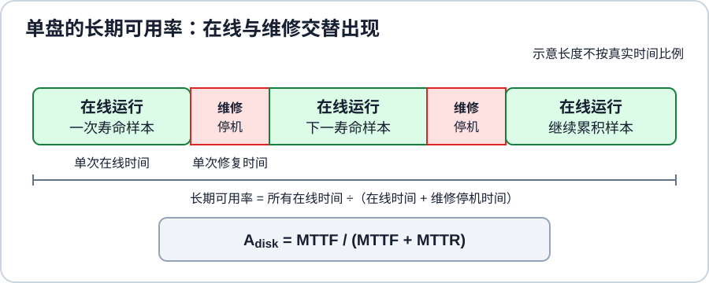
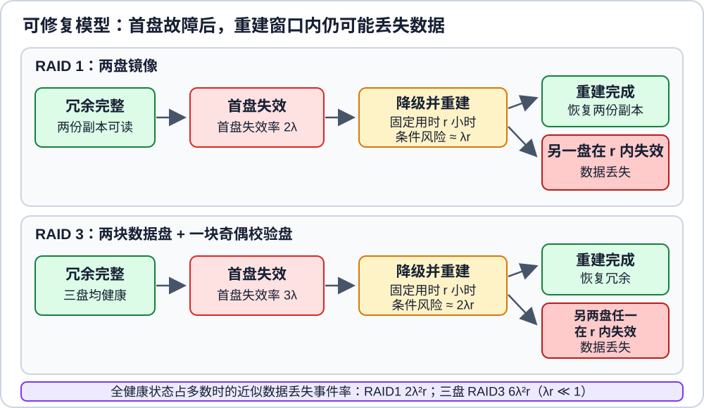

# 阵列可靠性计算如何依赖故障模型？

运维人员正在评估一组冗余磁盘阵列：如果一次检查区间内有两盘失效，数据是否还能恢复？如果故障可以修复，重建的暴露窗口怎样改变预计数据丢失时间？下面以 redundant array of independent disks (RAID，独立磁盘冗余阵列) 为对象，先画清布局，再给每个概率或时间指定失败模型。

## 先区分观察区间概率、故障率与可用性

若 $p$ 表示一个磁盘在**同一固定观察区间**内失效的概率，区间开始时所有成员盘都正常，区间内不做修复，且磁盘故障相互独立；令 $A$、$B$ 分别表示两盘在该区间内失效的事件。记 $p_A=P(A)$、$p_B=P(B)$；交集 $A\cap B$ 表示两盘都失效，并集 $A\cup B$ 表示至少一盘失效：

$$
P(A\cap B)=p_Ap_B,\qquad P(A\cup B)=p_A+p_B-p_Ap_B.
$$

令 $X$ 为 $N$ 个磁盘在区间内失效的数量；若每盘具有相同的 $p$，至少 $k$ 个失效的概率为下式，其中 $\binom Nj$ 表示从 $N$ 盘中选出 $j$ 盘的组合数：

$$
P(X\ge k)=\sum_{j=k}^{N}\binom Nj p^j(1-p)^{N-j}.
$$

当 $Np\ll1$ 时，可用一阶展开将至少一盘失效的概率近似为 $1-(1-p)^N\approx Np$。例如 $N=1000$、$p=0.001$ 时 $Np=1$，精确概率为 $1-(1-0.001)^{1000}\approx0.6323$，不能近似成 $1$。这些都是无修复固定区间的任务概率；$1/p$ 本身无单位，要推算时间还需给出区间长度和寿命模型。

若每盘以 constant failure rate (故障率 $\lambda$) 失效，$\lambda$ 的单位为 $\text{h}^{-1}$，并采用 exponential lifetime distribution (指数寿命分布)，单盘 mean time to failure (MTTF，平均失效时间) 的单位是小时，且 $MTTF=1/\lambda$。在长度为 $\Delta t$ 的观察区间，$p=1-e^{-\lambda\Delta t}$；若 $\lambda\Delta t\ll1$，才可近似为 $p\approx\lambda\Delta t$，时间单位相消后得到无单位概率。若这 $N$ 盘初始均健康、故障相互独立且具有同一 $\lambda$，其中第一盘失效的平均时间为 $1/(N\lambda)$ 小时。

mean time to repair (MTTR，平均修复时间) 也是时间量，单位为小时。对单块磁盘的正常/维修两状态、每次修复后恢复服务的模型，availability (可用率 $A_{disk}$) 是单盘长期处于可服务状态的比例；$q_{disk}$ 是该单盘的长期不可用比例，二者均为无单位的概率：

$$
A_{disk}=\frac{MTTF}{MTTF+MTTR},\qquad q_{disk}=1-A_{disk}=\frac{MTTR}{MTTF+MTTR}.
$$

$A_{disk}$ 和 $q_{disk}$ 只描述单盘，不是冗余阵列的可用率；阵列是否能服务取决于它的副本与校验布局。二者都不等于“永不故障”的概率。mean time to data loss (MTTDL，平均数据丢失时间) 用小时表示，须由“数据不可恢复”的阵列状态模型定义；罕见故障近似中，它约为数据丢失事件率的倒数。

沿用教科书示例的 $MTTF=100{,}000$ h、$MTTR=10$ h，单盘可用率为 $100{,}000/(100{,}000+10)\approx0.99990$，即约 $99.99\%$。高可用率仍允许故障发生；下文的 MTTDL 另问“多盘故障越过冗余能力前，平均要等多久”。

图中每段修复后到下次故障的在线时间是一个运行寿命样本，每段维修停机是一个修复时间样本；MTTF 和 MTTR 是许多周期的平均值，不是图中某一段的长度。

> [!info] 为什么是两个平均时间的比值？
> 观察完整的 $n$ 个运行—维修周期，可用时间比例是“总在线时间 ÷（总在线时间 + 总维修时间）”。把分子、分母同时除以 $n$，就是“平均在线时间 ÷（平均在线时间 + 平均维修时间）”。在这里反复恢复正常、每个周期按同一规律独立重复、平均时长有限的模型中，观察足够多周期，就得到上面的长期可用率式。

接下来用两种模型分别估算：一是指定时间内、尚未修复前发生几盘故障；二是有修复过程的阵列平均多久丢失数据。不能把两种结果混写成同一个“MTTF”。

可修复算例另作一个简化：每次从首盘失效到冗余恢复的重建用时固定为 $r$ 小时。首盘失效后阵列进入降级状态；在这个固定窗口内若额外故障超过布局的容错能力，就会丢失数据。$r$ 在本模型中是固定的单次窗口，不代表一般重建时长的随机分布只需用平均值替代。

图中这两种布局在重建完成后恢复冗余；窗口内再坏一盘就越过它们的容错门槛。下面分别写出固定区间概率与修复窗口近似，不能把它们当成同一概率。

## 各 RAID 布局能承受哪些失效？

下面沿用课程中的位、字节和块粒度，用表格对齐跨盘内容。对条带化布局，一行就是一个 stripe（条带），一列是一块磁盘；某列失效，就检查其余列能否恢复该行的缺失内容。计算中假定各盘独立，且 $p$ 是每盘在同一固定区间内失效的概率；这是演算模型，不代表现场故障分布。

RAID 0–6 按下述教学布局解释；实际控制器或软件阵列可以采用不同排布、块大小和一致性机制。可容错盘数与概率公式只针对对应的成员数和校验方式。下面的 $2p$、$3p^2$ 和 $10p^3$ 近似均在 $p\ll1$ 时保留展开式的最低阶项。

> [!info] 怎样读布局表
> $b_i$ 表示 bit（位），$B_i$ 表示数据 byte（字节），$A_i$ 表示数据 block（块），RAID 3/4/5 中，$P_i$ 表示第 $i$ 条带的单校验；RAID 6 中，$P_i$ 和 $Q_i$ 表示第 $i$ 条带的两种校验。RAID 3 按字节参与校验，RAID 4/5/6 按块参与。$\oplus$ 表示按位异或，同一值异或两次会抵消：$x\oplus x=0$。例如 RAID 3 第一条带的 $P_0=B_0\oplus B_1$；若 $B_1$ 丢失，$P_0\oplus B_0=B_1$，因为其中两份 $B_0$ 抵消。8 个连续 bit 组成 1 byte；原课程算例用 4000 或 8000 个连续字节组成一个 block。RAID 6 的两条校验流含彼此独立的信息，不能把同一 XOR 校验复制两份当作两条独立校验。设备格式和块大小会随系统而变。

### RAID 0：并行条带化，不提供副本

| 条带 | 盘 1 | 盘 2 |
|---|---|---|
| 0 | A₀ | A₁ |
| 1 | A₂ | A₃ |
| 2 | A₄ | A₅ |
| 3 | A₆ | A₇ |

striping (条带化) 把数据块交错写到各盘，可让独立请求并行；大块顺序传输也可能合并带宽。两盘中任一盘失效都会破坏阵列：

$$
P(loss)=1-(1-p)^2=2p-p^2\approx2p.
$$

若两盘故障率均为 $\lambda$、没有修复，阵列在第一盘故障时即失效，所以阵列 MTTF 为 $1/(2\lambda)=MTTF/2$。性能提升取决于负载与设备瓶颈。

### RAID 1：镜像可在一盘失效后继续读取

| 逻辑块 | 盘 1 的副本 | 盘 2 的副本 |
|---|---|---|
| 0 | A₀ | A₀ |
| 1 | A₁ | A₁ |
| 2 | A₂ | A₂ |
| 3 | A₃ | A₃ |

mirroring (镜像) 将同一数据保存为两份副本；在一份副本仍完好且读取路径正常时，一盘失效后可继续服务。两块等容量磁盘做镜像时，可用容量约为原始总容量的一半，写入要更新两份数据。若在掉电时只写完一份副本，镜像也可能留下不一致的两份数据；“有副本”本身不能说明恢复程序应选哪份。沿用上文简化模型，$r$ 是从第一盘失效到镜像重建完成的固定用时，单位为小时。

在无修复的同一固定观察区间内，两盘都失效的概率为 $p^2$；它不表示两盘在同一瞬间坏掉。在两盘都健康时，独立指数故障时钟的首盘失效率**精确为** $2\lambda$。首盘故障后，固定重建窗口 $r$ 内剩余盘失效的条件概率为 $1-e^{-\lambda r}$；当 $\lambda r\ll1$ 时才可近似成 $\lambda r$。此时阵列绝大部分时间处于全健康状态，所以用健康态首盘失效率乘以这次故障后的条件风险，估算数据丢失事件率：$2\lambda(1-e^{-\lambda r})\approx2\lambda^2r$。因此：

$$
MTTDL\approx\frac{1}{2\lambda^2r}=\frac{MTTF^2}{2r}.
$$

沿用教科书示例的 $MTTF=100{,}000$ h 和 $MTTR=10$ h 数值，并额外假设每次重建窗口固定为 $r=10$ h：$\lambda=10^{-5}\text{ h}^{-1}$，$\lambda r=10^{-4}\ll1$，数据丢失事件率约为 $2\times(10^{-5})^2\times10=2\times10^{-9}\text{ h}^{-1}$；因此 $MTTDL\approx5\times10^8$ h，按 $8760$ h/年约为 $57{,}078$ 年，四舍五入约 $57{,}000$ 年。这里仅把教材的修复时间数值作为本算例的固定重建窗口输入，不声称一般的 $MTTR$ 就是 $r$。这是独立恒定故障率和短重建窗口模型的教学结果，不是部署承诺。

这里 MTTDL 是平均数据丢失时间的近似，不是双盘独立寿命的平方；共同电源故障、相关故障、潜在扇区错误和重建负载均不在模型内。

### RAID 2：按位条带与纠错码

数据按 bit 条带化，并配合类似内存的 error-correcting code (ECC，纠错码)。例如两块数据盘分别保存 $b_0,b_2,\ldots$ 和 $b_1,b_3,\ldots$，另有成员盘保存所用纠错码的校验位；没有指定纠错码与冗余位分配，就不能推断校验盘数或可容错的失效数。RAID 2 主要作为历史和教学分类；其可靠性取决于具体纠错码及布局。

### RAID 3：细粒度条带与专用奇偶校验盘

| 条带 | 数据盘 1 | 数据盘 2 | 专用校验盘 |
|---|---|---|---|
| 0 | B₀ | B₁ | P₀ |
| 1 | B₂ | B₃ | P₁ |
| 2 | B₄ | B₅ | P₂ |
| 3 | B₆ | B₇ | P₃ |

上表用两块数据盘加一块专用奇偶校验盘，连续数据按字节分成细粒度条带。第一条带由 $B_0,B_1,P_0$ 组成，且 $P_0=B_0\oplus B_1$。在校验正确且剩余块均可读取时，单盘失效可由其他盘重建；若无修复，同一固定观察区间内任意两盘失效就超过单校验能力。恰好两盘失效有三种配对，每种概率为 $p^2(1-p)$；三盘全失效再加 $p^3$，所以：

$$
3p^2(1-p)+p^3=3p^2-2p^3\approx3p^2.
$$

在三盘全健康时，首盘失效率**精确为** $3\lambda$。首盘故障后，固定重建窗口 $r$ 内其余两盘至少一盘失效的条件概率为 $1-e^{-2\lambda r}$；只有当 $\lambda r\ll1$ 时才近似为 $2\lambda r$。阵列大多数时间处于全健康状态，因此用首盘失效率乘以窗口内条件风险，得到近似数据丢失事件率 $3\lambda(1-e^{-2\lambda r})\approx(3\lambda)(2\lambda r)=6\lambda^2r$，故 $MTTDL\approx1/(6\lambda^2r)$。沿用上面的 $\lambda=10^{-5}\text{ h}^{-1}$，并设固定窗口 $r=10$ h，得近似事件率 $6\times10^{-9}\text{ h}^{-1}$；按未舍入倒数 $1/(6\times10^{-9})=1.666666\ldots\times10^8$ h 换算，约为 $19{,}026$ 年。这是上表恰好三盘布局的模型结果，不是一般 RAID 3 的现场保证。

### RAID 4：块条带与专用奇偶校验盘

| 条带 | 数据盘 1 | 数据盘 2 | 专用校验盘 |
|---|---|---|---|
| 0 | A₀ | A₁ | P₀ |
| 1 | A₂ | A₃ | P₁ |
| 2 | A₄ | A₅ | P₂ |
| 3 | A₆ | A₇ | P₃ |

数据按块分布，奇偶校验集中在一盘。独立读取可以并行；若任一成员盘失效且其余所需数据均可读，可用剩余数据和校验重建。小型随机写需要读取或计算相关旧数据及校验，再更新校验盘，因而专用校验盘可能形成热点；大块顺序写的表现不同。

### RAID 5：把奇偶校验也分散到各盘

| 条带 | 盘 1 | 盘 2 | 盘 3 |
|---|---|---|---|
| 0 | A₀ | A₁ | P₀ |
| 1 | A₂ | P₁ | A₃ |
| 2 | P₂ | A₄ | A₅ |
| 3 | A₆ | A₇ | P₃ |

数据块和校验块轮流分布到所有盘，避免 RAID 4 的单一专用校验盘。在校验正确且其余所需块可读取时，一个磁盘失效仍可重建；在冗余恢复前再有一盘失效会超过单校验能力。小型随机更新常需读取旧数据块和旧校验块，再写入新数据块和校验块；完整条带写可直接由整条新数据重算校验。实际写放大、并行度和重建干扰取决于工作负载与实现。

### RAID 6：双校验增加可重建的失效数

| 条带 | 盘 1 | 盘 2 | 盘 3 | 盘 4 | 盘 5 |
|---|---|---|---|---|---|
| 0 | A₀ | A₁ | A₂ | P₀ | Q₀ |
| 1 | A₃ | A₄ | P₁ | Q₁ | A₅ |
| 2 | A₆ | P₂ | Q₂ | A₇ | A₈ |
| 3 | P₃ | Q₃ | A₉ | A₁₀ | A₁₁ |

上表有五盘；每个条带包含三块数据和两块独立校验，校验块在盘间轮转。第一条带由 $A_0,A_1,A_2,P_0,Q_0$ 组成：前三项是数据块，$P_0$ 与 $Q_0$ 是针对这三块数据生成的两种校验。$P$ 和 $Q$ 表示不同校验流，它们的下标表示所属条带；$A$ 的下标仍是数据块编号。两条校验必须包含独立信息，复制同一个 XOR 值不能恢复两个未知块。校验正确且恢复所需块可读时，该布局最多可重建两盘失效；写入要维护两个校验值。若五盘在固定区间内各自以概率 $p$ 独立失效且没有修复，阵列损失要求至少三盘失效：

$$
\begin{aligned}
P(loss)&=\binom53p^3(1-p)^2+\binom54p^4(1-p)+p^5\\
&=10p^3-15p^4+6p^5\approx10p^3.
\end{aligned}
$$

该式是五盘表例的区间概率，不是 MTTDL。修复阵列还要建模恢复时间、潜在错误、相关故障和设备管理策略。

## 奇偶校验写入遇到崩溃时会怎样？

上面的课程模型只统计成员盘失效，没有统计多块更新被崩溃打断的风险。对 RAID 5/6，若数据块与校验块没有原子更新，掉电可能留下不一致的条带；随后降级重建可能无法可靠还原缺失块，这就是奇偶校验 write hole (写洞)。Linux device-mapper RAID 的 4/5/6 实现支持可选日志设备来关闭这个窗口：默认写穿日志会限制写入速度，若使用回写模式，日志设备本身也必须可靠。Linux MD 文档还说明，RAID 5/6 在启动时若同时处于脏且降级状态，奇偶校验可能不可信，因此通常拒绝启动该阵列。这些都是特定 Linux 实现的行为，不表示所有阵列都以同样方式保护或恢复。

## 何时选镜像、单校验或双校验？

用同一组问题比较布局：要多少可用容量？需要容忍几盘失效？读写负载偏顺序还是随机？重建时允许多长的风险窗口和性能下降？系统如何监控、校验并恢复副本？条带化能增加并行度，但 RAID 0 没有冗余；镜像和奇偶校验消耗容量，校验写入还增加工作量。RAID 等级不能替代备份，也不能自动覆盖共同故障或误删。

> [!info]- 来源
> - `指数寿命模型、恒定故障率与 MTTF=1/λ`：[NIST/SEMATECH e-Handbook, 8.1.6.1 Exponential](https://www.itl.nist.gov/div898/handbook/apr/section1/apr161.htm)，公式与用途段，2026-11-12 核验。单盘可用率由正文中的运行—维修周期模型推导；阵列式另外依赖独立故障与固定重建窗口。
> - `RAID 布局、条带/镜像/奇偶校验、MTTF/MTTR 与课程算例`：[Database System Concepts, 7th ed., ch. 12: Physical Storage Systems](https://db-book.com/slides-dir/PDF-dir/ch12.pdf)，第 12.18–12.31 页，2026-11-12 核验；MTTF=100,000 h、修复时间=10 h 的镜像例见第 12.20 页。本文 RAID 1/3 的修复窗口式由给定独立、恒定故障率和 $\lambda r\ll1$ 条件推导。
> - `原始 RAID 设计动机与布局`：[Patterson, Gibson & Katz, “A Case for Redundant Arrays of Inexpensive Disks (RAID),” 1988](https://www.cs.cmu.edu/~garth/RAIDpaper/Patterson88.pdf)。
> - `RAID 6 的 P/Q 两校验流和恢复两个未知数据块`：[H. Peter Anvin, The Mathematics of RAID-6](https://www.kernel.org/pub/linux/kernel/people/hpa/raid6.pdf)，Linux kernel，2011 年更新；用来说明两条校验必须提供独立信息，本页布局用 P/Q 分开标注两条校验流。
> - `当前 Linux 实现的 RAID 写入一致性策略与脏且降级阵列启动边界`：[Linux kernel, RAID arrays](https://docs.kernel.org/admin-guide/md.html)，2026-11-12 核验，`consistency_policy` 与 `Boot time assembly of degraded/dirty arrays`；[Linux kernel, Device-mapper RAID](https://docs.kernel.org/admin-guide/device-mapper/dm-raid.html)，2026-11-12 核验，`journal_dev` 与 `journal_mode`。这些是特定实现机制，不是所有硬件或软件阵列的保证。
> - `MTTF、MTTR、修复暴露窗口`：教科书 ch. 12 同上。本文中的 RAID 1/3 近似式明确基于独立、恒定故障率、短修复窗口的简化模型；不要外推为制造商可靠性指标。
