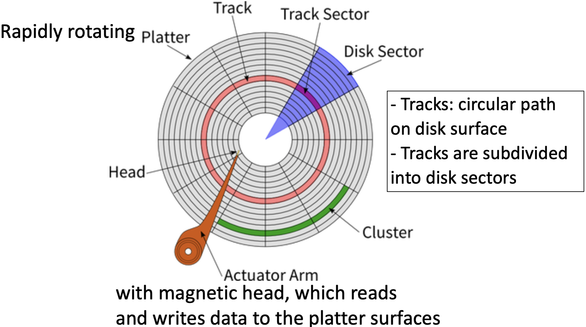
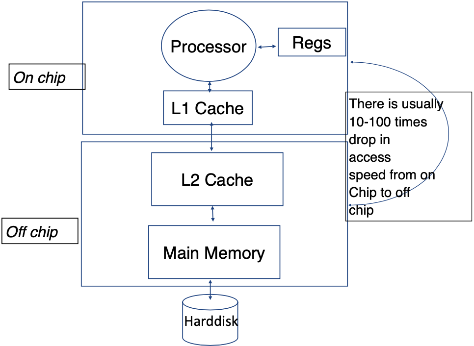

# How do storage hierarchy and buffers shape database access cost? / 存储层级与缓冲如何影响数据库访问成本？

Disk access time combines positioning and transfer costs in the simplified HDD model, while a hit at the relevant cache avoids some lower-level cost. The estimate depends on which layer and miss path are modelled: CPU caches, device caches, and the DBMS buffer pool are separate. / 简化 HDD 模型将访问时间拆成定位与传输成本；命中相应缓存可避免部分下层成本。估算取决于所建模的层与未命中路径：CPU 缓存、设备缓存和 DBMS 缓冲池彼此不同。

## Efficiency
Efficiency of a database system is influenced by both hardware and software aspects:

- **Hardware**
  - Disks and I/O bandwidth
  - Main memory
  - Number of processors
  - Communication network
  - Type of architecture
- **Software/DB Tuning**
  - Types of DB
  - Indexing
  - Query optimisation

## Effectiveness
Effectiveness of a database system is determined by:

- Concurrent users: Users reading and writing over the same data
- Transactions: Required tasks are all done together

## Reliability
Reliability of a database system is ensured by:

- Crash recovery
  - Hardware:
    - Arrangement of multiple disks
    - Voting among multiple disks/modules
    - Disk block write
- Fault tolerance
- Data duplication

## Hard Disk & Memory Hierarchy
### Hard Disk Drive

A **hard disk drive (HDD)** is a crucial component of computing systems that provides data storage. Its structure comprises of several key elements:

- **Platter**: The entire circular disk.
- **Sector**: A device exposes sectors as addressable units; logical and physical sector sizes can differ.
- **Track**: A circular path on a platter. The red highlighted area in the image is one track.
- **Cylinder**: Tracks at the same radial position across platters. A file-system cluster is an allocation unit made of sectors, not a mechanical disk component.
- **Actuator Arm**: The component that moves the head to the required position.
- **Head**: This component is responsible for reading and writing data on the disk.

Note that the disk rotates at high speed, allowing the head to read and write data at different locations.

#### Disk Access Time in HDD
In this simplified model, estimate the transfer delay as:

$$
\text{Disk Access Time} = \text{Seek Time} + \text{Rotational Delay} + \frac{\text{Transfer Length}}{\text{Bandwidth}}
$$

Where:

- **Seek Time**: This is the time taken by the head to move from its current position to the desired track. Also known as seek latency.
- **Rotational Delay**: The time the disk takes to rotate and bring the desired sector under the head. This is also referred to as rotational latency.
- **Transfer Length**: This refers to the amount of data to be transferred. The units for this measure can vary, such as KB, MB, GB, etc.
- **Bandwidth**: This measures the amount of data that can be transferred within a given timeframe. Its unit is Storage/Time (e.g., 4MB/S).

#### Exercise
What is the disk access time for a 4 KB transfer when average seek time is 12 ms, rotational delay is 4 ms, and transfer rate is 4 MB/s?

Using decimal units (1 MB = 1000 KB), transfer time is 4 KB / 4000 KB/s = 0.001 s = 1 ms, so the estimate is 12 + 4 + 1 = 17 ms. This model omits controller and queueing delays and assumes the request is not already cached.

### Solid-State Drives (SSD)
Solid-state drives (SSDs) store data in flash memory and have no moving head or rotating platter. They avoid HDD seek and rotational delay, but still have controller, flash, queueing, and write-management latency. Read and write performance depends on the device, workload, and queue depth; overwrites are not universally slower. Flash pages are erased in larger blocks and the flash translation layer manages remapping and wear leveling ([Database System Concepts, 7e, ch. 12](https://www.db-book.com/Previous-editions/db7/slides-dir/PDF-dir/ch12.pdf)).

#### Disk Access Time in SSDs
A bandwidth-only estimate for a transfer is:

$$
\text{Disk Access Time} = \frac{\text{Transfer Length}}{\text{Bandwidth}}
$$

### Memory Hierarchy

- Reg: Register
- CPU caches (L1/L2 and other levels) reduce the average cost of CPU memory access; they do not directly cache hard-disk blocks. Operating-system file caches, storage-device caches, and a DBMS buffer pool are separate layers with different units and behavior.
- Main Memory: If the system is shut down, data stored in the main memory (but not in the hard disk) will be lost. The unit of measurement for Main Memory is typically in GB.
- Hard Disk: The unit of measurement is usually in TB.
- Speed: Cache > Main Memory > Hard Disk
- Storage Capacity: Cache (in MB) < Main Memory (in GB) < Hard Disk (in TB)
- Simplified CPU path: check the CPU cache hierarchy, then access DRAM on a miss. A page fault or database storage request may involve an OS file cache, DBMS buffer pool, controller cache, and persistent storage; these are not one universal linear path.

#### Effective Memory Access Time
For a single cache level, if $M$ is the full cost of the miss path, including lookup, then:

$$
EA = H \times C + (1 - H) \times M
$$

where:

- $H$ is the hit ratio (the percentage probability of finding data in the cache)
- $C$ is the cache access time
- $M$ is the full miss-path cost. If $M$ means only lower-memory access time, use $EA = H C + (1-H)(C+M)$ instead.

The CPU-cache example concerns L1/L2 memory hierarchy. It is distinct from both a storage-device/controller cache and the DBMS buffer pool, which caches database pages in main memory. The latter is the buffer model used in query-cost calculations.

Why don't we have larger caches?

1. They are expensive.
2. If the processor and the cache are not on the same chip, the access time increases.

#### Effective Disk Buffer Access Time
A device or controller cache is different from the DBMS buffer pool in main memory. In this one-level model, BC is the hit-path cost and D is the full miss-path cost; the estimate excludes other caching levels and queueing:

$$
EA = HB \times BC + (1 - HB) \times D
$$

where:

- $HB$ is the hit ratio of the disk buffer
- $BC$ is the buffer access time
- $D$ is the disk access time

#### Example
e.g., Assume disk access time is S, buffer access time is C, hit ratio is H, and S = 1000C. What is the effective access time, EA, expressed as a multiple of C when H = 30%?

$EA = 30\% \times C + (1 - 30\%) \times S = 0.3C + 0.7 \times 1000C = 700.3C$
