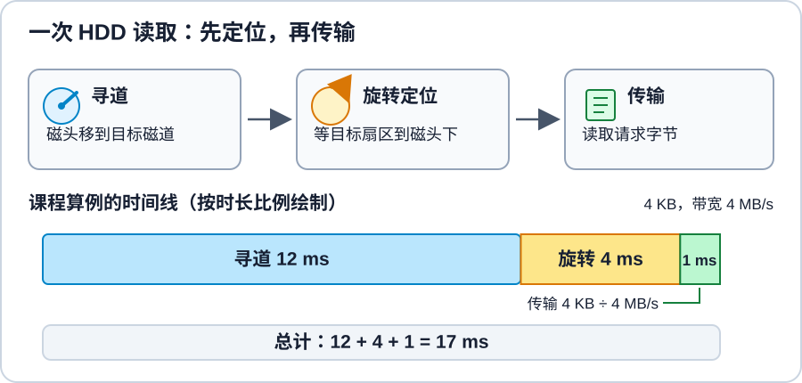
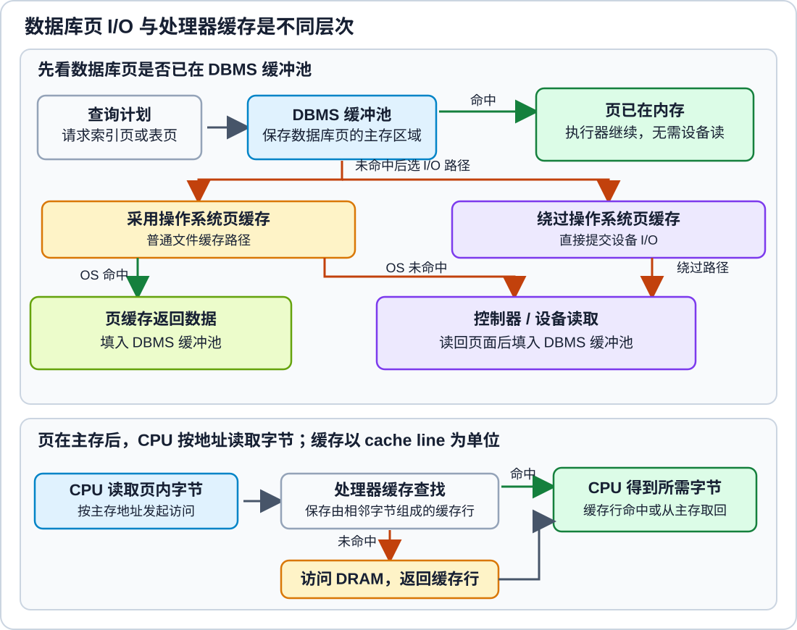

# 存储层级与缓冲如何影响数据库访问成本？

假设一条报表查询按 `customer_id` 请求一页：开发机上很快，线上有时却等盘。差异可能来自缓存命中，也可能来自设备或排队；仅凭总耗时无法判断慢在哪一层。下面先算一次随机机械盘读取，再追踪数据库页读取的缓存分支，最后估算一组逻辑取页的平均成本。

## 先把性能、事务效果与可靠性分开

数据库的性能由硬件与软件共同决定：设备延迟和吞吐量、主存容量、处理器、网络、数据布局、索引、查询计划及缓冲策略都会影响实际结果。并发用户数和事务规则则决定系统必须完成多少工作、允许观察到什么状态；它们不等同于一次页面读取的延迟。

可靠性又是另一类问题：崩溃后能否恢复、已确认的更新是否仍存在、设备故障后能否继续提供服务。这些问题会改变存储设计和写入路径，却不能用一次读请求的平均访问时间回答。下文先算访问成本，再追踪缓存命中和未命中路径。

## 机械硬盘的一次读取要等哪些步骤？

hard disk drive (HDD，机械硬盘) 的盘片旋转，磁头由执行器移动到目标磁道。磁道是盘面上的同心记录轨迹，按扇区组织数据；柱面是多张盘片上相同半径的磁道集合。文件系统的簇由一个或多个扇区组成，是文件系统的分配单位，不是硬盘的机械部件。

在忽略控制器、排队和操作系统开销的课程模型里，一次 HDD 读的时延估为：

$$
T_{HDD}=T_{seek}+T_{rotation}+\frac{L}{B}
$$

其中，$T_{seek}$ 是寻道时间，$T_{rotation}$ 是目标扇区转到磁头下的等待时间，$L$ 是传输字节数，$B$ 是传输带宽。最后一项必须与前两项使用兼容单位；本式把随机定位与传输时间相加，不代表现代设备在任何队列深度下都能达到该值。若连续读取相邻块，寻道可能只发生在第一个块，不能将一次随机读取的定位成本乘到每个块上。

> [!example] 4 KB 请求的课程估算
> 假设平均寻道时间为 12 ms、旋转等待为 4 ms、持续传输带宽为 4 MB/s。采用十进制换算 $1\text{ MB}=1000\text{ KB}$，传输时间为
> $$4\text{ KB}/(4000\text{ KB/s})=0.001\text{ s}=1\text{ ms}.$$
> 因而模型结果是 $12+4+1=17$ ms。这个数是给定前提下的演算，不含控制器与排队时延，也假定请求没有被缓存命中。

## 固态硬盘的带宽估算遗漏了什么？

solid-state drive (SSD，固态硬盘) 没有磁头寻道和盘片旋转，所以不能把 HDD 的两项机械定位时间照搬过去。若只计算数据传输这一项，可以写成 $T\approx L/B$；它不是 SSD 的端到端时延公式，也没有涵盖控制器、闪存访问、队列和垃圾回收等影响。

闪存按页读取和编程、按更大的擦除块擦除。在课程采用的常见 NAND 管理模型里，已编程物理页不能原位覆盖；逻辑页更新时，flash translation layer (FTL，闪存转换层) 通常把新内容写到空闲物理页、更新映射并将旧页标为无效。后续回收必须按块擦除；若块内还有有效页，设备内部的垃圾回收要先搬移它们再擦除，于是产生额外内部写入。write amplification（写入放大）用物理页编程数与逻辑页写入数之比衡量这类额外工作；回收搬移会使比值上升，也可能让设备请求等待。FTL 还负责磨损均衡，因此“覆盖写一定比读取慢”或“SSD 延迟只由带宽决定”都不是一般规律，实测结果取决于设备和工作负载。

## 一次请求经过哪些缓存？

database management system (数据库管理系统，DBMS) 的 buffer pool (缓冲池)是用于在主存中保存数据库页的一块内存。执行器按查询计划请求所需页；页在缓冲池中时可直接使用，否则 DBMS 需沿其 I/O 路径取回。页驻留主存后，central processing unit (中央处理器，CPU)按地址读取页内字节；CPU cache (处理器缓存)以cache line (缓存行)为单位保存相邻的一组字节。下图把数据库页读取与页驻留内存后的 CPU 访问分开。

处理器缓存的层数、容量和缓存行大小会随实现变化，图中只表示查找与返回的关系。

处理器一侧的寄存器、L1/L2 缓存和 dynamic random-access memory (DRAM，动态随机存取存储器) 组成数据访问层次。CPU 缓存保存近期使用的内存缓存行，不直接缓存数据库磁盘页。数据库页的设备读取还可能经过 operating-system page cache（操作系统页缓存）、存储控制器缓存和设备自身缓存；具体实现不一定都存在，也不是一条固定的逐层回退链。

以查询 `WHERE customer_id = 101` 读取一页为例：

1. 查询计划可能访问索引页，也可能访问表页；执行器向 DBMS 缓冲池请求所需的数据库页。若缓冲池中已有该页，DBMS 不必为这次请求读取设备。
2. 若缓冲池未命中，DBMS 按实现采用的 I/O 路径取页。使用普通文件缓存路径时，操作系统页缓存命中可省去设备读取；若操作系统缓存也未命中，请求才继续到控制器和设备。某些路径（如 Linux 的 `O_DIRECT`）尝试尽量减少页缓存影响，因此这不是所有 I/O 路径的必经层；具体语义依实现而异。
3. 页返回后由 DBMS 放入缓冲池，再继续执行查询。页已在主存后，CPU 按内存地址读取其中的数据；访问可在 L1/L2 等处理器缓存的缓存行中命中，或继续访问 DRAM。CPU 缓存不能代替数据库缓冲池，也不能让未缓存的数据库页自动从设备出现。

回到开头的查询：开发机若常命中 DBMS 缓冲池，就能省去设备读取；普通文件缓存路径上，只有 DBMS 缓冲池与操作系统页缓存都未命中，才会继续请求设备。线上变慢本身仍不能说明是哪层未命中，也可能还受排队影响。

PostgreSQL 18 是一个具体实现例子：它有自己的 `shared_buffers`，同时也依赖操作系统缓存；其可靠性文档还列出操作系统、控制器和设备缓存等持久化层。该例用于说明层次可能并存，不代表所有数据库都采用完全相同的 I/O 路径。

因此，应先说清楚“命中”指哪一层，以及未命中时 $M$ 覆盖了哪些步骤，再计算 expected access time (EAT，期望访问时间)。下面只估算 DBMS 缓冲池这一层：计时从执行器请求一个数据库页开始，到所需页在缓冲池中可用为止。单层模型可写为：

$$
EAT=H\cdot C+(1-H)\cdot M
$$

$H$ 是 DBMS 缓冲池的命中率；$C$ 和 $M$ 分别是从上述同一计时起点到所需页可用为止，命中与未命中条件下的完整平均时延。缓冲池未命中的 $M$ 包含后续采用的操作系统页缓存、控制器和设备路径等成本；若路径耗时波动，应对两类实际路径分别取平均。每次缓冲池探测只计一次。这个 EAT 是每次逻辑取页请求的平均时间，不是整条 SQL 查询的响应时间。若需同时建模多层缓存，应按分支路径的概率和时延逐项展开，而不能把不同层的命中率混成一个数。

### 30% 命中率时，平均访问时间为何是命中路径的 700.3 倍？

> [!example] DBMS 缓冲池单层示例
> 假设缓冲命中路径耗时 $C$，未命中完整访问耗时 $M=1000C$，命中率 $H=30\%$。则
> $$EAT=0.3C+0.7\times1000C=0.3C+700C=700.3C.$$
> 平均访问时间是命中路径时间的 700.3 倍；若另设命中路径 $C=1\text{ ms}$，结果为 $700.3\text{ ms}$。这里的命中率、路径比值和 $C$ 都是题设，不是任何具体 DBMS 的测量值；这个 $1\text{ ms}$ 与前面 HDD 算例的传输项数值相同，但属于独立假设。若 $M$ 只是“缓存之后的磁盘时延”，还要把未命中前的缓存探测时间纳入完整路径。

加大 DBMS 缓冲池会占用更多主存，可能挤占操作系统页缓存或其他用途。命中率收益取决于工作集和访问局部性；应结合内存压力与实际工作负载测量，而不能只凭“缓冲池越大越快”决定容量。

与更广的 CPU 缓存、DRAM 和设备局部性问题相接时，可继续看[内存层次与数据局部性](../../../engineering-foundations/operating-systems/memory-hierarchy-and-data-locality.md)。

> [!info]- 来源
> - `HDD 定位/传输、闪存页与擦除块、FTL`：[Database System Concepts, 7th ed., ch. 12: Physical Storage Systems](https://db-book.com/slides-dir/PDF-dir/ch12.pdf)，第 12.9–12.16 页，2026-11-12 核验。本文中的 12 ms、4 ms、4 MB/s 是课程算例，不是当前产品规格。
> - `闪存垃圾回收搬移有效页及其性能代价`：[KIOXIA, Managed Flash Background Operations Series, Part 4: Understanding Garbage Collection in NAND Flash Memory](https://americas.kioxia.com/content/dam/kioxia/en-us/business/memory/mlc-nand/asset/KIOXIA_Managed_Flash_BOS_P4_Understanding_Garbage_Collection_Tech_Brief.pdf)，2023 年 4 月，Rev. 1.1，“Why is Garbage Collection Needed?”, “The Garbage Collection Process” 和 “How to Optimize Garbage Collection?”。
> - `逻辑页更新、有效页搬移与写入放大的定义`：[Jagmohan, Franceschini and Lastras, “Write Amplification Reduction in NAND Flash through Multi-Write Coding,” MSST 2010](https://msstconference.org/MSST-history/2010/Papers/MSST/Jagmohan.pdf)，§I，第 1–2 页。文中用物理页编程数与逻辑页写入数之比定义 write amplification。
> - `直接 I/O 尽量减少操作系统页缓存影响的 Linux 实例`：[Linux man-pages, open(2)](https://man7.org/linux/man-pages/man2/open.2.html)，`O_DIRECT` 描述，2026-11-12 核验；这里只说明一种 Linux 路径，具体语义和约束依系统与文件系统而异。
> - `CPU 缓存层级与缓存行的处理器侧机制`：[Intel 64 and IA-32 Architectures Optimization Reference Manual, vol. 1](https://cdrdv2-public.intel.com/821612/248966-Optimization-Reference-Manual-V1-050.pdf)，第 3.11.5.1 节，第 3-77 页；这里只用作处理器架构实例，缓存层数和组织依处理器实现而变。
> - `操作系统缓存、控制器缓存和设备写入持久性边界`：[PostgreSQL 18, WAL Reliability](https://www.postgresql.org/docs/18/wal-reliability.html)，2026-11-12 核验，第 28.1 节；[PostgreSQL 18, Resource Consumption](https://www.postgresql.org/docs/18/runtime-config-resource.html)，2026-11-12 核验，第 19.4.1 节。这里只用它说明具体产品中的缓存层次，不把 PostgreSQL 行为泛化为所有 DBMS。
