# 索引怎样降低查找成本，又增加哪些维护工作？

学生选课系统要按 `student_id` 查选课记录；一个学号可能对应多条选课行，所以查询 `student_id = 101` 必须返回全部匹配行。系统还要按学号范围输出记录，并持续插入、删除和修改选课行。本页沿这些查询和更新说明索引怎样组织键与记录、何时减少数据页读取，以及新增维护成本。

## 索引项怎样把搜索键带到记录？

index (索引) 是一份辅助结构，用 search key (搜索键) 定位记录。键可以是一个属性，也可以由多个属性组成；index entry (索引项) 保存键值和记录位置。按键找到位置后，若还要读取索引项没有的列，就用 row pointer (行指针) 回表：按该位置读取原数据页。一个键可以关联单个行指针，也可以关联一组指针；具体组织由索引实现决定。英语中 index 的复数可写 indexes 或 indices。

设选课表有 `student_id`、`course_id`、`semester` 等列：

- `student_id = 101` 是等值查询；若有重复学号，要遍历该键的全部行指针或全部复合键项。
- `student_id` 在 100 到 200 之间是范围查询；有序索引可以从下界定位，再顺读相邻搜索键；没有合适索引时，也可以扫描数据后过滤。
- 扫描所有记录时，索引未必比顺序读数据页更省 I/O。
- 插入或删除选课行要维护相关索引；修改被索引的列会把旧键位置移走，再放到新键的位置。

索引是否适合一张表，取决于实际查询、选择率、数据排列、可用内存、写入频率和 database management system (DBMS，数据库管理系统)。索引能定位键，不等于查询只做一次磁盘 input/output (I/O，输入/输出)：索引页、数据页、缓存命中、返回行数和回表都影响访问成本。

## 键的顺序与数据顺序相同有什么好处？

ordered index (有序索引) 按搜索键排序。课程中的 clustering index (聚簇索引) 指键顺序与数据文件的物理顺序相对应；它通常但不一定使用主键。non-clustering index (非聚簇索引) 的键顺序与数据文件顺序不同，可为其他查询列提供访问路径。

接下来切换到课程图使用的 `instructor` 表，字段为教师 `ID`、姓名、系名和工资；图里的 `ID` 是教师 ID，不是选课表的 `student_id`。左侧只显示数据记录按教师 ID 相邻排列，右侧显示 `dept_name = 'Comp. Sci.'` 的索引项怎样通过三个行指针找到教师记录。

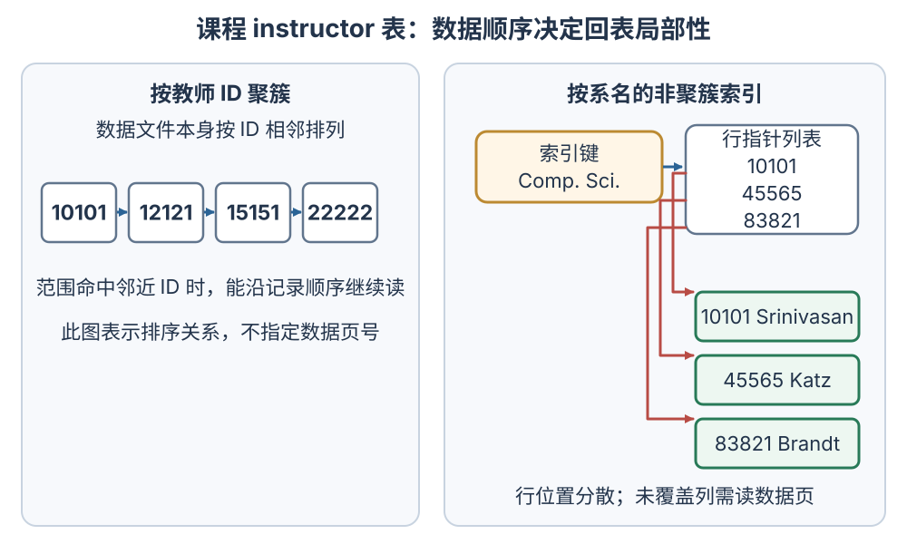

右图的行指针列表命中 `10101`、`45565`、`83821`。如果查询还要读索引项没有的姓名、工资等列，数据库就按每个行位置回表读取原数据页。图不提供数据页号；只有这些行实际落在分散的数据页时，访问才会相应分散。聚簇数据上的范围扫描可能定位起始页后顺读相邻页；非聚簇索引若命中许多分散页，随机访问可能抵消索引收益。具体物理布局和读取策略由产品定义。课程术语 clustering index 也不等同于 SQL schema 中的 `PRIMARY KEY` 约束；SQL Server 的 clustered index 物理组织见[SQL Server 索引语法与边界](./condensed-note-w2-sql-server-index-examples.md)。

## 哈希索引适合什么查询？

hash index (哈希索引) 把搜索键送入 hash function (哈希函数)，再定位 bucket (桶)。散列顺序不保留键的大小顺序，因此它适合按完整键值做等值查找，不适合直接提供有序范围扫描。

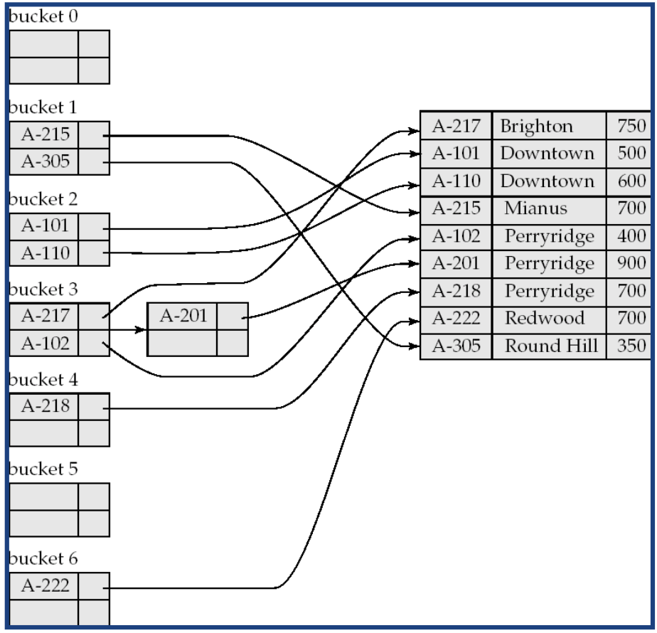

> [!example] 七个桶的课程例子
> 桶编号为 0–6。若 `hash(A-215) = 1`，就去桶 1 查找；图中 `A-215` 与 `A-305` 同在桶 1，必须比较键值才能确认目标。桶 3 的 `A-217`、`A-102` 已占满，`A-201` 放在溢出页。不同键可能散列到同一桶，桶满后还可能继续读溢出页；“平均分布”是对不同键的理想目标，不代表每桶记录数一定相等，也不保证每次只读一个页。重复值本身还会把多条记录关联到同一键。

PostgreSQL 的哈希索引只支持单列等值运算，不支持唯一性检查。其索引项的键值部分保存四字节哈希码，不保存原列值；命中桶后还要按原列值复核候选项，所以哈希碰撞会增加候选读取。这些是 PostgreSQL 的实现边界，不代表所有哈希索引都采用相同布局。

## 低基数列为什么可以用位图？

bitmap index (位图索引) 为每个跟踪取值保存与记录位置对齐的 0/1 串：第 `i` 行的值是 `m`，就在 `m` 的位图第 `i` 位写 1，否则写 0。课程图未压缩，关系有 `N` 行、跟踪 `V` 个值时，直观存储量约为 `N × V` 位；低基数列的 `V` 小，因而位图较少。图示取值域包含 `L1` 到 `L5`，即使 `L5` 当前没有行，仍画出 `L5 = 00000`。真实产品可能压缩或分段存储位图，这张图只说明逻辑位布局。

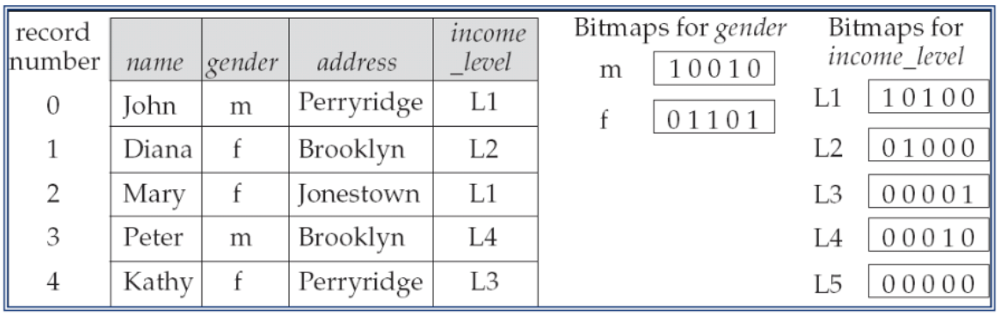

图中记录位置为 0–4。性别 `m` 对应 `10010`，收入等级 `L2` 对应 `01000`，逐位 AND 得到 `00000`，所以没有记录同时满足 `gender = 'm'` 且 `income_level = 'L2'`。如果收入等级换成 `L1 = 10100`，则：

```text
m  = 10010
L1 = 10100
AND= 10000
```

结果唯一的 1 在位置 0，回到关系表就是 John；按位 1 的数量即可得匹配行数 1。位图常用于低基数、多条件的分析筛选；高基数或频繁单行更新是否合适，取决于产品的位图存储和维护方式。

## B+ 树如何同时支持等值查找和范围扫描？

B+ tree (B+ 树) 用多叉平衡树把搜索路径压到少数页访问。内部页保存分隔键与子页指针，叶页按搜索键排序并保存记录位置；所有叶页处在同一层，且按键序链接。fan-out (分支数) 高时，树通常比同规模的二叉树矮；实际读页数仍受树高、缓存和结果量影响。

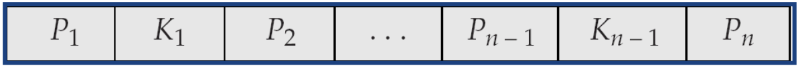

通用节点图按 `P₁, K₁, P₂, …, Kₘ, Pₘ₊₁` 排列。课程不同树图的阶数约定相同，但每张图的 $n$ 值不同：这里以内部页最大子指针数定义阶数 $n$。非根内部页至少有 $\lceil n/2\rceil$ 个子指针；叶页最多有 $n-1$ 个键，非根叶页至少有 $\lceil(n-1)/2\rceil$ 个键。

| 课程图 | $n$ | 非根内部页子指针数 | 非根叶页键数 |
| --- | ---: | ---: | ---: |
| `B+treeStringExample.png`（Perryridge） | 3 | 2–3 | 1–2 |
| `B+RangeSearchExample.png`、插入图和删除图 | 4 | 2–4 | 2–3 |
| `b+treeexample.png`（数字键） | 5 | 3–5 | 2–4 |

因此数字键图的内部页最多有 5 个子指针，叶页最多有 4 个键；不能把它的占用阈值套到最多 3 个键的插入、删除图。非叶根至少有两个子指针；根若同时是唯一叶页，则可以从空树到 $n-1$ 个键。不同教材对 order 的定义可能不同，复算前要看当前图的约定。

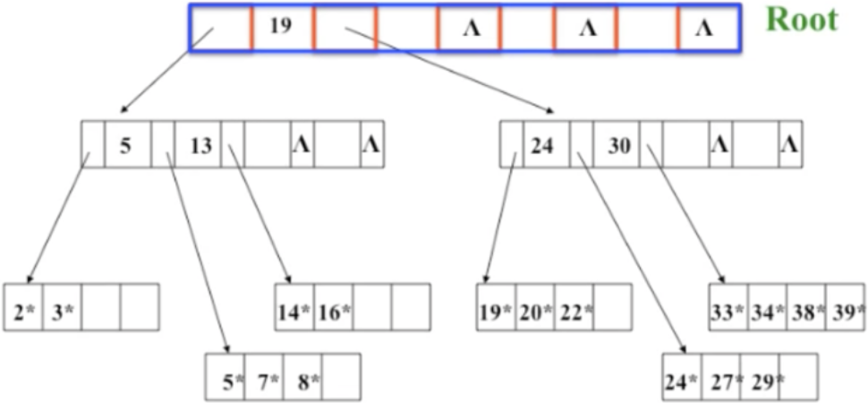

图中根页最多容纳 5 个子指针，但现在只有两个有效指针。查 20 时，根的分隔键 19 让查找走右边实际存在的 `P₂`；下一页的 24 大于 20，于是走它左边的 `P₁`，最后在叶页 `[19, 20, 22]` 找到记录指针。槽位上限不是有效指针数量，未使用的空槽 `P₅` 不参与查找。叶项后的 `*` 表示数据指针；这张图只画树内向下的边，没有画叶链。

内部页的 `Kᵢ` 是分隔键：左子页 `Pᵢ` 中的键小于 `Kᵢ`，右子页 `Pᵢ₊₁` 中的键大于等于 `Kᵢ`。`Kᵢ` 创建时可以复制右子树的最小键，但它的职责是划分区间，不要求永远等于右页当前最小键。例如图中 13 把查找引到只含 `[14, 16]` 的右子页；闭合左端、开放右端的范围 `[13, 19)` 因而返回 14、16。再看分隔值 24：它把 `[19, 20, 22]` 与 `[24, 27, 29]` 分开。删除 24 后，右叶成为 `[27, 29]`，仍有 $n=5$ 非根叶页所需的两项；由于左页键都 `<24`、右页键都 `≥24`，父页的 24 仍是有效区间边界，尽管它不再等于右叶当前最小值。

### 等值查找怎样选子页？

设当前页实际有 $m$ 个分隔键。查找键 $k$ 时，找到第一个大于 $k$ 的分隔键 $Kᵢ$，沿其左侧指针 `Pᵢ` 下行；若没有更大的分隔键，就走最右的有效指针 `Pₘ₊₁`。所以 `k = Kᵢ` 时进入 `Pᵢ₊₁`。课程的数字图中查 20 会进入根的 `P₂`，再进入 `[24, 30]` 内页的 `P₁`，在 `[19, 20, 22]` 叶页命中。

另一张课程图用账户分行名作键。查 `Perryridge` 时它等于根分隔键，先走右侧；它又小于内页的 `Redwood`，所以走左侧并在叶页命中。这次等值查找在命中的叶项及其行指针处结束，不沿叶链继续。

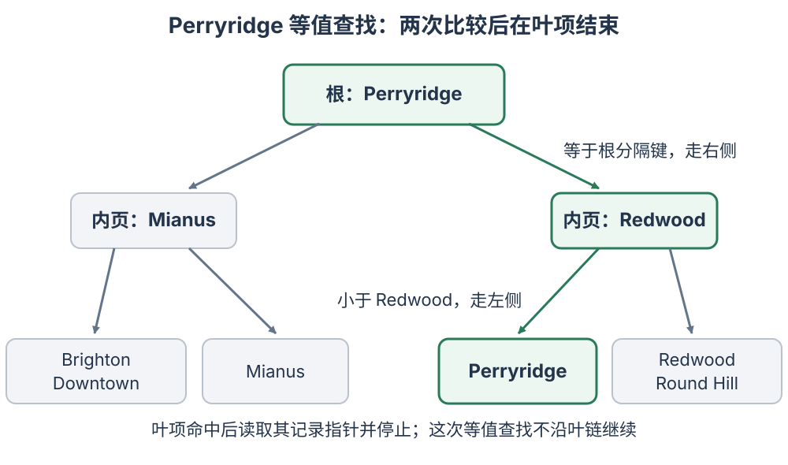

### 重复学号怎样取得全部选课行？

不同索引可用不同方式表示重复搜索键。一种方式是在 `student_id = 101` 的叶项下保存全部行指针，查到该叶项后逐个取回。另一种方式是把行标识并入搜索键，按 `(student_id, row_id)` 排序；假设 `row_id` 能区分该学号的每条选课行，复合键就有确定顺序。

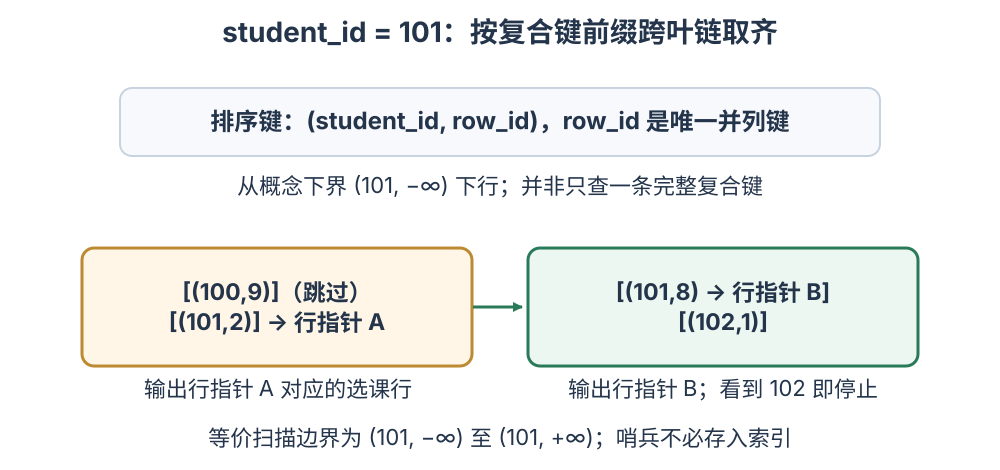

对第二种布局，不能只查完整键 `(101,2)`，因为原查询只约束了 `student_id`。从概念下界 `(101, −∞)` 下行，沿叶链依次读复合键并取每个指针；上图中 `(101,2)` 和 `(101,8)` 跨相邻叶页，必须返回两条选课行。扫描遇到首个 `student_id > 101` 的键（本例为 102）或到达叶链末端时结束；概念上界 `(101, +∞)` 表示这一前缀范围，哨兵值本身无需存进索引。若同一个完整复合键仍关联多条记录，也要取完该项的全部行指针。

### 范围查询怎样找到边界并停下？

闭区间 `[a,b]` 先沿树按下界 `a` 下行到候选叶页，页内跳过小于 `a` 的键，然后沿叶链顺序收集不大于 `b` 的项。若下界不存在且起始叶全小于 `a`，就继续沿叶链，直到找到第一个不小于 `a` 的键；读到首个大于 `b` 的键或叶链到达末端时扫描结束。若完整上界键在当前索引中唯一，则读完该叶项所带的全部行指针后也可提前结束，不必再打开下一叶。

课程范围图按姓名键取闭区间 `[Brandt, Singh]`。这些完整搜索键在图中各占一个叶项：从 `[Adams, Brandt]` 的 Brandt 开始，依次经过 `[Califieri, Crick]`、`[Einstein, El Said]`、`[Gold, Katz, Kim]` 和 `[Mozart, Singh]`，共取 10 个键。通用的顺序扫描会在首个大于 `Singh` 的键或叶链末端停止；但此图的完整上界键唯一，读完 `Singh` 叶项的行指针后即可提前结束，不必打开首键为 `Srinivasan` 的下一页。若某完整键下有行指针列表，要先取完列表再停。复合键的学号前缀扫描不同：见到第一条 `student_id = 101` 不能停，要继续到首个 `student_id > 101` 的键或叶链末端。

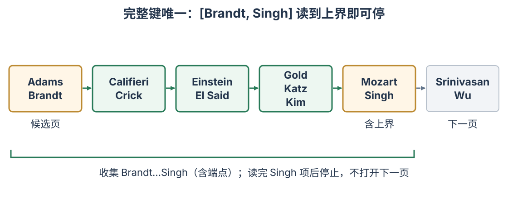

如果把字符串下界改成不存在的 `Byron`，树仍先把查询带到 `[Adams, Brandt]`，但该叶没有合格键；要跟到下一叶 `[Califieri, Crick]`，从 `Califieri` 开始收集。数字树还可复算几个边界：`[9,16]` 从 `[5,7,8]` 的候选区继续读到 `[14,16]`，返回 14、16；`[9,13]` 无结果；`[40,50]` 到最右叶 `[33,34,38,39]` 后无后继，仍无结果；`[16,16]` 只返回 16。数字图没有画叶链，这些范围结果按 B+ 树叶页有序链接的规则推演。

### 插入和删除怎样改变页与父分隔键？

插入先定位所属叶页并按键序加入。叶页溢出时，保留原页作为左叶，并分配一个保持排序的新右叶；新右叶的最小键复制到父页，同时父页要新增 `(分隔键, 新右叶指针)` 这一对。叶链调整为 `保留原页（左叶） → 新右叶 → 原后继`。若父内页溢出，再分裂内页并把中间分隔键上移；只有旧根自身溢出并分裂，才会新建根、增加树高。

课程的 Adams 例子按 $n=4$：满叶 `[Brandt, Califieri, Crick]` 加入 `Adams` 后，分成 `[Adams, Brandt]` 和 `[Califieri, Crick]`。`Califieri` 留在新右叶，也作为分隔键与新右叶指针加入父页；新右叶插在旧后继之前。

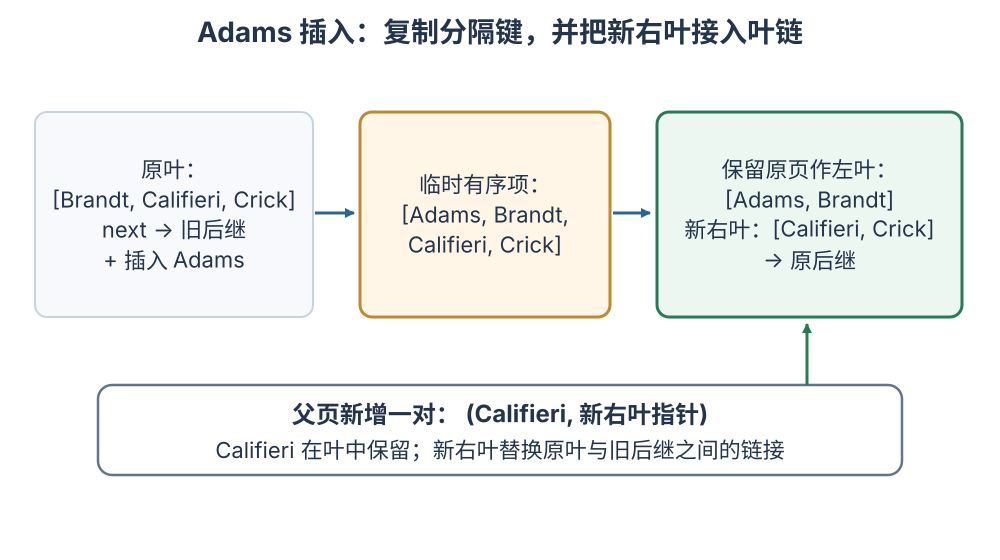

接着看另一幅独立的 $n=4$ 操作图：插入 `Lamport` 时，`[Gold, Katz, Kim]` 分成 `[Gold, Katz]` 和 `[Kim, Lamport]`，把 `Kim` 复制到已满的父内页。该内页暂有 5 个子指针和 4 个分隔键 `[Califieri, Einstein, Gold, Kim]`。课程图选择在 `Gold` 处分裂，左、右页分别保留 3 个和 2 个子指针；`Gold` 插入仍有空位的旧根，根从 `[Mozart]` 变为 `[Gold, Mozart]` 并有 3 个子指针。它没有溢出、没有分裂，也没有新建根，树仍为三层。

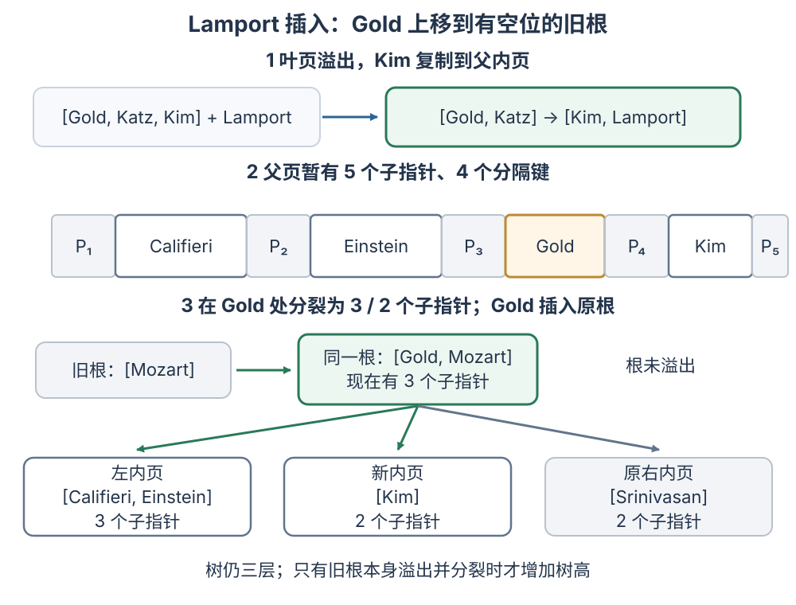

本组课程删除算法在同一父页下找相邻兄弟处理欠占用。先按该图容量核算两页能否合成一页：叶页看键数总和；内部页合并还要把父分隔键移下来，并按合并后的子指针总数判断。能装下才合并；叶页合并后要把保留叶页接到被删叶页的原后继，并从父页删除被移除子页的指针和两页之间的分隔键。装不下就重分配键或子树，让两个页都满足最低占用，再更新父分隔键。欠占用可能继续传到父页；根只剩一个子页时可以收缩。

先看从 Adams 插入后的树分支删除 `Srinivasan`；这条分支没有插入 `Lamport`，树根仍是 `[Mozart]`。$n=4$ 时非根内部页至少 2 个子指针、叶页至少 2 个键。删掉 `[Srinivasan, Wu]` 中的 `Srinivasan` 后，右叶只剩 `[Wu]`；与同父左叶 `[Mozart, Singh]` 合并时 `1 + 2 = 3`，正好装进容量 3，叶链接回该页原后继（此处没有后继）。右内页随之只剩 1 个子指针；与同父左内页的 4 个指针合计 `1 + 4 = 5 > 4`，所以不能合并。把左页最右子树 `[Gold, Katz, Kim]` 移给右页后，内页变为 3/2 个子指针；旧根分隔键 `Mozart` 下移到右内页，`Gold` 成为新的根分隔键。

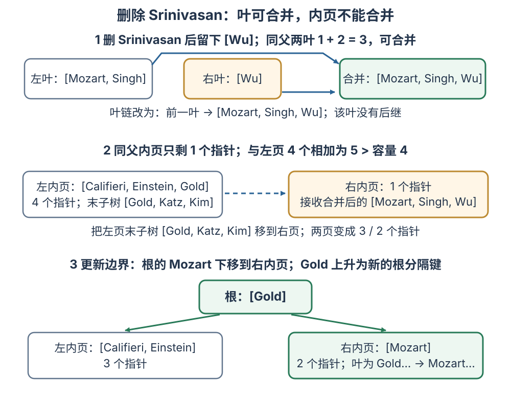

第二幅删除图继续上述状态。再删 `Singh` 和 `Wu` 后，右叶 `[Mozart, Singh, Wu]` 留下 `[Mozart]`；同父左叶 `[Gold, Katz, Kim]` 与它共有 `3 + 1 = 4` 个键，超过叶容量 3，不能合页。把 `Kim` 从左叶移到右叶，得到 `[Gold, Katz]` 与 `[Kim, Mozart]`；叶链仍按此顺序。右内页分隔键随新右叶最小键从 `Mozart` 改成 `Kim`，根的 `Gold` 保持不变。

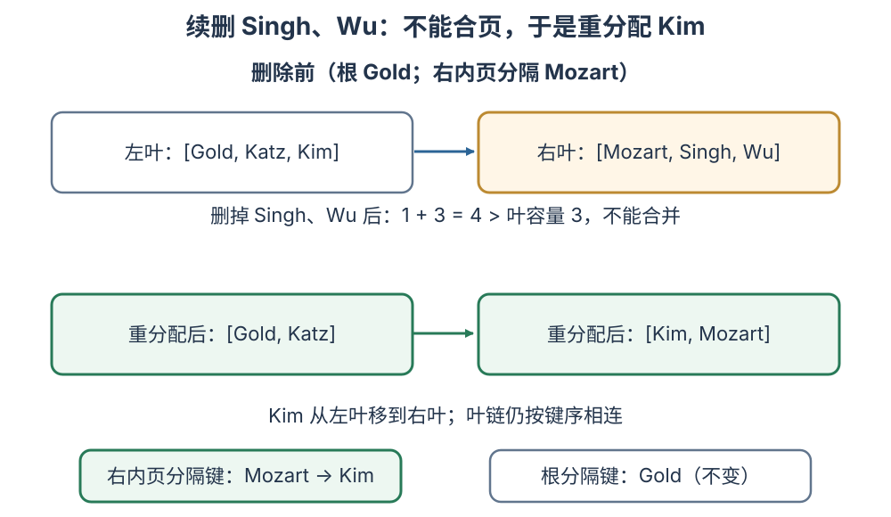

### 更新被索引列时，哪些条目要跟着改？

插入一行时，要给每个相关索引新增对应键和行位置；删除一行时，要从这些索引移除对应项。以一行的 `student_id` 从 101 改为 102 为例：若 B+ 树叶项 `101` 下保存多个行指针，只从该列表移除被改行的指针，并向 `102` 的列表加入它；只有 `101` 的指针列表为空时才删除整个键项。若索引按 `(student_id, row_id)` 组成复合键来区分行，则删除旧完整键 `(101, row_id)`，再把相同行位置插入 `(102, row_id)` 的有序位置。哈希索引要从 `hash(101)` 对应桶移除该行指针，再加到 `hash(102)` 对应桶；若列由位图索引跟踪，则该行在 101 位图的位由 1 清为 0，在 102 位图的位由 0 置为 1。位图中的行位置本身不变。按学号这样的高基数列通常不适合未压缩位图；这里的 101→102 只展示位的逻辑维护方式。页分裂、合并、压缩、日志和写盘时机由具体产品决定。

在 B+ tree file organization (B+ 树文件组织) 中，叶页可以直接保存完整记录，而不只是行指针；普通 B+ 树索引的叶项则指向数据记录或键值对应的记录列表。文件组织与二级索引是两种不同存储安排，选择时要同时考虑主数据范围扫描和其他键的查找。

## 读写负载不同，索引选择为什么也不同？

| 查询模式 | 可先考虑的结构 | 还要计入的代价 |
| --- | --- | --- |
| 等值查找 | 哈希索引或 B+ 树 | 是否有重复键、是否需排序/范围，以及回表页分散程度 |
| 范围查询或按键排序 | B+ 树等有序索引 | 索引顺序与数据顺序的相关性、结果行数量和扫描页数 |
| 多个低基数条件的分析筛选 | 位图索引（若 DBMS 支持） | 位图更新方式、并发写入、列基数和组合条件 |
| 地理或几何查询 | 空间索引 | 包围盒候选数和精确几何判断；见[空间索引如何筛选候选对象](./condensed-note-w2-spatial-indexes.md) |

索引能降低某些查询的读取成本，但会占磁盘和内存、增加写入维护，并可能改变优化器估计。先从实际查询形态挑候选，再查看查询计划和读写指标；不要只因表大就给每一列都建索引。PostgreSQL 与 SQL Server 的索引类型和 DDL 边界见各自官方文档及本目录的产品例子。

> [!info]- 原课程 PNG 附件（原件保留，可单独打开）
> 以下 12 张 PNG 未修改。聚簇/非聚簇、Perryridge、范围、插入和删除图在正文改用可读局部图；哈希、位图、节点格式和数字树原图仍在相应正文处显示。
> - [clustering-index.png](./clustering-index.png)
> - [non-clustering-index.png](./non-clustering-index.png)
> - [hash-indice.png](./hash-indice.png)
> - [bitmap.png](./bitmap.png)
> - [b+typical.png](./b+typical.png)
> - [b+treeexample.png](./b+treeexample.png)
> - [B+treeStringExample.png](./B+treeStringExample.png)
> - [B+RangeSearchExample.png](./B+RangeSearchExample.png)
> - [B+insertion.png](./B+insertion.png)
> - [B+Insertion2.png](./B+Insertion2.png)
> - [B+Deletion1.png](./B+Deletion1.png)
> - [B+TreeDeletion2.png](./B+TreeDeletion2.png)

> [!info]- 来源
> - **索引项、索引评估、聚簇/非聚簇有序索引、B+ 树查找/范围/占用/分裂/合并、哈希与位图索引、B+ 树文件组织：** [Database System Concepts, 7e, ch. 14, §§14.1–14.5、14.9](https://db-book.com/slides-dir/PDF-dir/ch14.pdf)，2019 年第七版课件；聚簇术语按 §14.2；树节点指针和叶链按 slides 14.20–14.21，分隔键子树区间按 14.22，查找与范围查询按 14.25–14.28，复合键见 14.16，通用占用公式按 14.19（示例按 14.23）；Adams、Lamport 操作按 14.30–14.32，课程删除策略按 14.34–14.38，位图机制按 14.71–14.74，文件组织按 §14.4.1。本文按每幅课程图实际画出的节点容量核算，不混用不同例子的阶数。
> - **B+ 树 order 容量约定与 Perryridge 账户名图：** [Database System Concepts, 4e, ch. 12 slides 12.16–12.21](https://www.db-book.com/Previous-editions/db4/slide-dir/ch12.pdf)；Perryridge 等值图见 slide 12.20（$n=3$），slide 12.21 是另一幅 $n=5$ 图，用于核对 order 记法，不作为数字键图的来源声明。五行位图和 AND 见[slides 12.67–12.68](https://www.db-book.com/Previous-editions/db4/slide-dir/ch12-2.pdf)；这里保留历史课程示意，不声称所有系统使用同一种位布局。
> - **索引读取规划、顺序扫描比较及索引维护开销：** [PostgreSQL 18, §11.1 Introduction](https://www.postgresql.org/docs/18/indexes-intro.html)，2026-11-12 核验。
> - **B-tree 支持等值与范围、Hash 只支持等值：** [PostgreSQL 18, §11.2 Index Types](https://www.postgresql.org/docs/18/indexes-types.html)，2026-11-12 核验；这是 PostgreSQL 的索引操作符边界。
> - **PostgreSQL 哈希索引只支持单列/等值、不做唯一性检查、每项存四字节哈希码且扫描可能有损并需复核、溢出页链：** [PostgreSQL 18, §65.6.1 Hash Indexes](https://www.postgresql.org/docs/18/hash-index.html) 与 [§36.16 Interfacing Extensions to Indexes](https://www.postgresql.org/docs/18/xindex.html)，2026-11-12 核验；不将这些实现细节推广到所有哈希索引。
> - **SQL Server 行存储索引（rowstore）实现为 B+ 树、clustered index 按键排序存储数据行、nonclustered index 与数据行分离：** [Microsoft Learn, Clustered and nonclustered indexes](https://learn.microsoft.com/en-us/sql/relational-databases/indexes/clustered-and-nonclustered-indexes-described?view=sql-server-ver17)，SQL Server 17 文档，2026-11-12 核验；不推广到其他 DBMS 或 columnstore/内存优化表。
