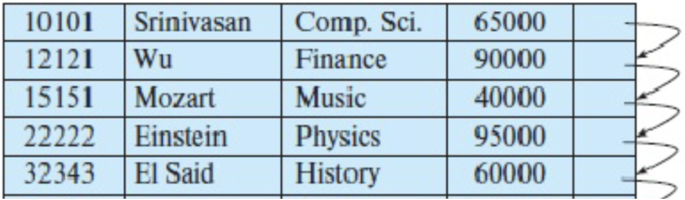
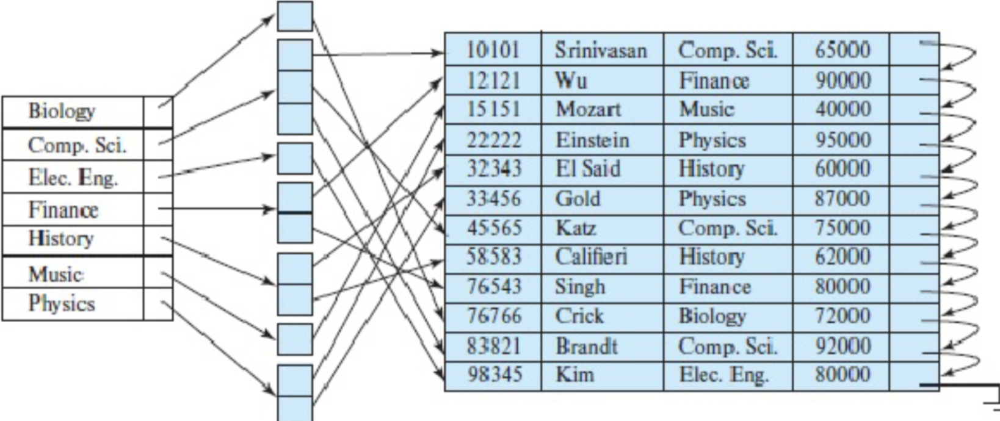
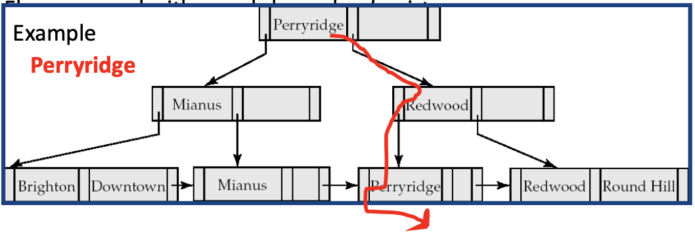
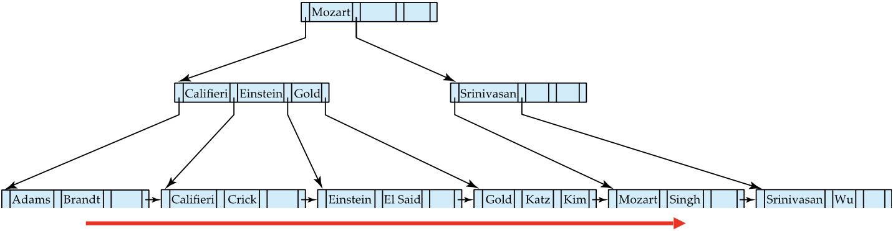
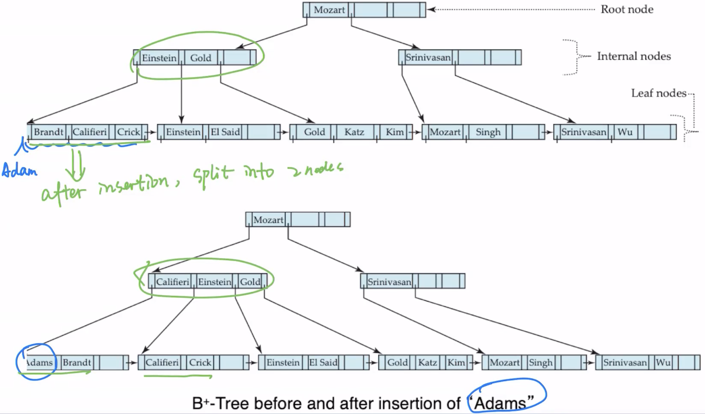
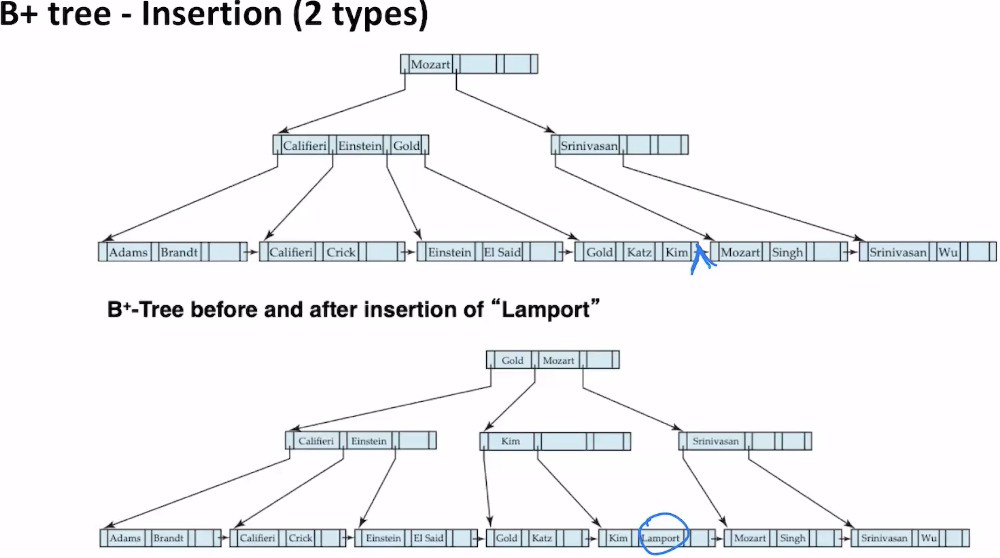
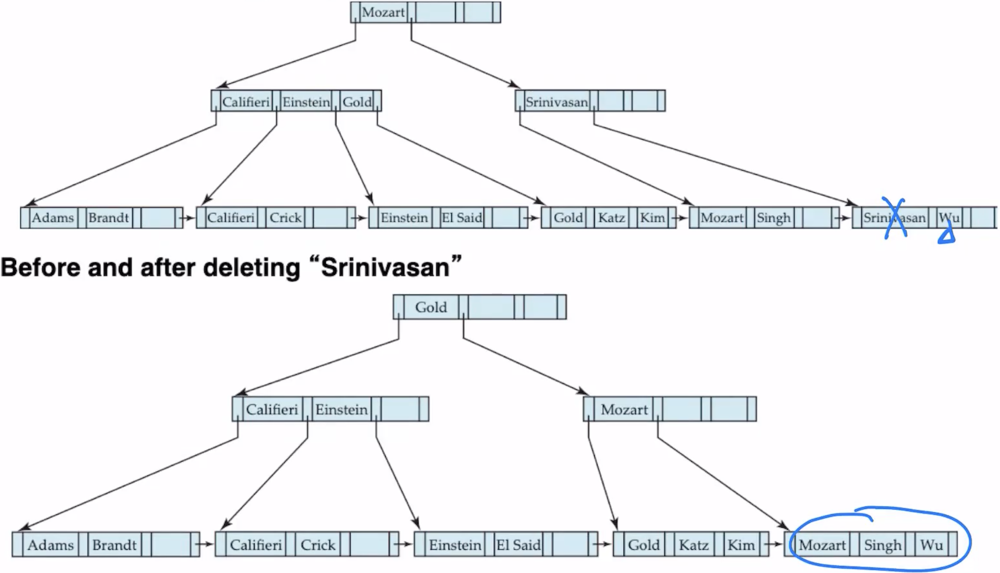
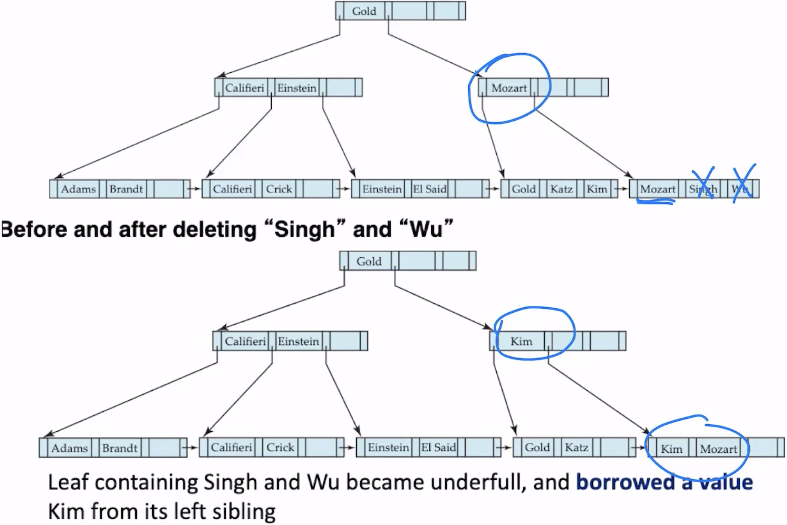

# 索引怎样降低查找成本，又增加哪些维护工作？

学生选课系统要按学号查单个学生，也要按学号范围输出名单；每次新增或修改选课，又会改变索引内容。读者需要根据等值、范围和分析查询判断索引怎样组织数据、查询能省下什么，以及维护要付出什么。

## 索引项怎样把搜索键带到记录？

index (索引) 是一份辅助结构，用 search key (搜索键) 定位数据行或数据页。键可以是一个属性，也可以由多个属性组成；index entry (索引项) 通常保存键值和指向数据的指针。索引能让部分查询避开全表扫描，但会占空间，并在插入、删除和修改相关键时增加维护工作。英语中 index 的复数可写 indexes 或 indices。

设选课表有 student_id、course_id、semester 等列：

- 查 student_id = 101 是等值查询，可以按键找到候选记录；
- 查 student_id 在 100 到 200 之间是范围查询，需要索引按顺序访问相邻键；
- 扫描所有记录时，索引未必比顺序读数据页更省 I/O；
- 更新 student_id 或索引覆盖的其他列时，索引页也可能要更新。

索引是否适合某张表，取决于实际查询、选择率、数据排列、可用内存、写入频率和具体 database management system (DBMS，数据库管理系统)。一个索引能快速定位键值，不等于查询只做一次磁盘 input/output (I/O，输入/输出)；索引页、数据页、缓存命中和回表都要计入访问成本。

## 键的顺序与数据顺序相同有什么好处？

ordered index (有序索引) 按搜索键排序。课程中的 clustering index (聚簇索引) 指索引键顺序与数据文件的物理顺序相对应；它通常但不一定使用主键。non-clustering index (非聚簇索引) 的键顺序与数据文件顺序不同，可为其他查询列提供访问路径。

聚簇数据上的范围扫描可能先定位起始页，再顺序读相邻页；非聚簇索引找到键后，若结果分散在许多数据页，仍可能产生大量随机访问。数据库引擎具体如何组织聚簇与辅助索引由产品定义。这里的课程术语 clustering index 也不等于 SQL schema 中的 PRIMARY KEY 约束；SQL Server 的 clustered index 物理组织语义见[SQL Server 索引语法与边界](./condensed-note-w2-sql-server-index-examples.md)。

## 哈希索引适合什么查询？

hash index (哈希索引) 把搜索键送入 hash function (哈希函数)，再定位 bucket (桶)。散列顺序不保留键的大小顺序，因此它适合按完整键值做等值查找，不适合直接提供有序范围扫描。

> [!example] 七个桶的课程例子
> 桶编号为 0–6；若 hash(A-215) = 1，就去桶 1 查找。不同键可能散列到同一桶，桶满后还可能用溢出页；因此“平均分布”是对不同键的理想目标，不代表每桶记录数一定相等，也不保证每次只读一个页。重复值本身会把许多记录放在相同键值对应的桶中。

PostgreSQL 的哈希索引实现只支持单列和等值运算，不支持唯一性检查。每个索引项只保存 4 字节哈希值，不保存原列值；查询命中桶后还要按原列值复核候选项，所以哈希碰撞会产生额外候选。这是 PostgreSQL 的具体实现边界，不能直接推广到所有哈希索引。

## 低基数列为什么可以用位图？

bitmap index (位图索引) 为属性的每个取值保存一串位。设关系中的记录按位置编号；若第 i 行的 gender 值为 m，则 m 对应位图的第 i 位为 1，其他值的位图该位为 0。查询多个低基数条件时，可以用位运算组合候选行，例如“性别为 m 且收入等级为 L2”可对两张位图做 AND。位图索引通常更适合不同值较少、分析查询较多的场景；高基数或频繁单行更新的适用性取决于产品如何存储和维护位图。

图中性别只有 m/f，收入等级有 L1–L5；位图按每个取值标出匹配记录。它是一种课程示意，不表示所有 DBMS 都按完全相同的位布局实现。

例如图中的 `m` 位图为 `10010`，`L2` 位图为 `01000`；逐位 AND 得到 `00000`，表示没有记录同时满足两个条件。

## B+ 树如何同时支持等值查找和范围扫描？

B+ tree (B+ 树) 用多叉平衡树把搜索路径压到少数页访问。叶页按键排序；内部页保存分隔键与子页指针。fan-out (分支数) 较高时，树的高度通常比同样记录数的二叉树低。根到任意叶的路径深度相同，但实际访问页是否已在缓存中由负载和内存决定。

课程使用的 order n 约定是：内部页最多有 n 个子指针、n−1 个分隔键；非根内部页至少有 ceil(n/2) 个子指针；叶页最多有 n−1 个键，非根叶页至少有 ceil((n−1)/2) 个键。若根不是叶页，它至少有两个子指针；若根同时是唯一叶页，允许空树到 n−1 个键。不同教材对 order 的定义可能不同，套用占用公式前先核对约定。

图中的内部页指针 $P_i$ 位于分隔键 $K_i$ 左侧。设当前节点实际有 $m$ 个分隔键；查找键 $k$ 时，遇到第一个大于 $k$ 的分隔键 $K_i$，就沿 $P_i$ 下行；若没有更大的分隔键，则走最右的有效子指针 $P_{m+1}$。页容量只是上限，不能把尚未使用的槽位当成有效指针。示意图中的根页最多容纳 5 个子指针，但当前只有两个有效指针；查 20 时应走实际存在的 $P_2$，$P_5$ 是空槽。下一层分隔键 24 使查找向左，最后在叶页中找到 20。

查找一个范围时，先沿树找到第一个不小于下界的键所在叶页；若下界本身不存在，就从第一个大于它的键开始，再顺着叶页之间的有序链接扫描到上界。课程图把 Brandt 与 Singh 两端都包含在内。

插入新键时，叶页有空间就直接插入；若超过容量，就分裂并把新的分隔键向上推，父页也可能继续分裂，必要时生成新根。删除后若页低于最小占用量，可从兄弟页借键，或合并页并向上调整分隔键。变化沿局部路径传播，树保持平衡。

逐图回放可看到父子页如何一起变化：插入 Adams 只分裂叶页，并把 Califeri 复制为父页分隔键；插入 Lamport 先分裂叶页，再分裂父页，把 Gold 提升到原根。删除 Srinivasan 后右侧两张叶页合并，右内部页从左内部页借一个子指针，根分隔键改为 Gold；再删除 Singh、Wu 后，右侧叶页从左邻借入 Kim，父页分隔键随之从 Mozart 改为 Kim。

在 B+ tree file organization (B+ 树文件组织) 中，叶页可以直接保存完整记录，而不只是行指针；普通 B+ 树索引的叶项则指向数据记录或键值对应的记录列表。文件组织与二级索引是两种不同的存储安排，选择时要同时考虑主数据的范围扫描和其他键的查找。

## 读写负载不同，索引选择为什么也不同？

| 查询模式 | 可先考虑的结构 | 还要计入的代价 |
| --- | --- | --- |
| 等值查找 | 哈希索引或 B+ 树 | 是否有重复键、是否需排序/范围，以及回表页分散程度 |
| 范围查询或按键排序 | B+ 树等有序索引 | 索引顺序与数据顺序的相关性、结果行数量和扫描页数 |
| 多个低基数条件的分析筛选 | 位图索引（若 DBMS 支持） | 位图更新方式、并发写入、列基数和组合条件 |
| 地理或几何查询 | 空间索引 | 包围盒候选数和精确几何判断；见[空间索引如何筛选候选对象](./condensed-note-w2-spatial-indexes.md) |

增加索引能降低某些查询的读取成本，但会占磁盘和内存、扩大写入维护量，并可能改变优化器估计。先从真实查询形态挑候选，再查看实际计划与读写指标；不要因为表“大”就给每一列都建索引。PostgreSQL 与 SQL Server 的具体索引类型和 DDL 可在各自官方文档及本目录的产品例子中核验。

> [!info]- 来源
> - **索引项、聚簇/辅助索引、位图、B+ 树页占用、分裂合并与文件组织：** [Database System Concepts, 7e, ch. 14, Indexing and Hashing](https://www.db-book.com/slides-dir/PDF-dir/ch14.pdf)，2019 年课程幻灯片。order n 的占用约定按本文明示的“最大子指针数”解释。
> - **索引带来的维护开销和类型边界：** [PostgreSQL 18, Indexes](https://www.postgresql.org/docs/18/indexes.html)，2026-11-06 核验；这里只用它说明索引是读写的整体权衡，不把产品可用索引类型当作通用清单。
> - **PostgreSQL 哈希索引项只存 4 字节哈希值、扫描需复核原列值、只支持等值且不做唯一性检查：** [PostgreSQL 18, Hash Indexes](https://www.postgresql.org/docs/18/hash-index.html)，2026-11-06 核验；此处明确是 PostgreSQL 实现例。
> - **SQL Server rowstore 索引的 B+ 树实现：** [Microsoft Learn, Clustered and nonclustered indexes](https://learn.microsoft.com/en-us/sql/relational-databases/indexes/clustered-and-nonclustered-indexes-described?view=sql-server-ver17)，2026-11-06 核验；此产品例不意味着每个 DBMS 都使用相同组织。
