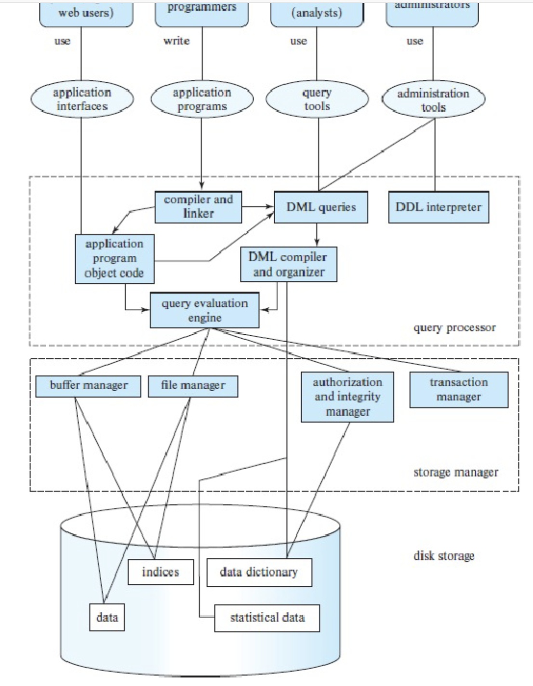

# 关系代数和连接算法怎样把查询变成可估算的页访问？

一个学生目录需要查出年龄超过 25 岁的员工、找出在澳大利亚任职的经理；银行报表还要把 5,000 条 depositor 记录与 10,000 条 customer 记录连接起来。读者要先说明 SQL 问题在逻辑上取哪些行、列和匹配对，再判断具体算法会读多少页。

图中查询执行引擎调用缓冲管理器、文件管理器和索引访问数据页。关系代数描述逻辑结果；连接算法规定物理访问顺序，页读取次数只是一部分成本。

## 先用表记录查询要什么结果

relational algebra (关系代数) 用关系作为输入，产生新的关系。relation (关系) 可以先理解为带列名的一张表；tuple (元组) 是一行，attribute (属性) 是一列。三张示例表如下：

| Employee.ID | Name | Age |
| --- | --- | ---: |
| 1001 | A | 25 |
| 1002 | B | 32 |
| 1003 | C | 19 |
| 1004 | D | 27 |
| 1005 | E | 40 |
| 1006 | F | 36 |

| Manager.ID | Department |
| --- | --- |
| 1001 | a |
| 1003 | b |
| 1004 | c |
| 1006 | d |

| Location.ID | Country | City |
| --- | --- | --- |
| 1001 | China | Beijing |
| 1002 | Australia | Melbourne |
| 1004 | China | Shanghai |
| 1006 | Australia | Sydney |

selection (选择) $\sigma_P$ 按谓词 $P$ 筛选行；projection (投影) $\Pi_A$ 只保留属性集合 $A$。于是“年龄大于 25 岁的员工姓名”可写成：

$$
\Pi_{Name}(\sigma_{Age>25}(Employee))
$$

结果为 B、D、E、F；年龄恰为 25 的 A 不满足严格大于条件。对应 SQL 是：

    SELECT Name
    FROM Employee
    WHERE Age > 25;

要找“在澳大利亚任职的经理”，需要按 ID 将三张表对应的行连接，再筛选 Country：

    SELECT E.Name
    FROM Employee AS E
    JOIN Manager AS M ON M.ID = E.ID
    JOIN Location AS L ON L.ID = E.ID
    WHERE L.Country = 'Australia';

在给定数据中结果是 F：Manager 的 ID 集合是 `{1001, 1003, 1004, 1006}`，Australia 对应的 Location ID 是 `{1002, 1006}`，两者交集只有 `1006`，再从 Employee 取到姓名 F。1002 虽在澳大利亚却不是经理；1003 虽是经理却没有 Location 记录。中间连接条件必须写清楚，否则不同表中的同名 ID、Country 等属性可能被错误地配对。

## 连接的谓词由谁指定？

join (连接) 把满足匹配条件的两行拼成一行。theta join (θ 连接) 用显式谓词，例如 $Employee.ID=Manager.ID$；natural join (自然连接) 则默认匹配两输入中所有同名列。自然连接在模式变化后可能悄悄增加匹配条件，因此实际 SQL 往往显式写 JOIN ... ON。

图中把带下标 θ 的 $r\bowtie_{\theta}s$ 标成 Natural join 是错误的；它表示带显式谓词的 θ 连接。自然连接通常写成不带谓词下标的 $\bowtie$，并匹配两侧所有同名列。

在关系代数里，连接可由笛卡尔积和选择表示：

$$
r\bowtie_{\theta}s=\sigma_{\theta}(r\times s)
$$

其中 $r$、$s$ 是两个输入关系，$\theta$ 是连接谓词；$r\times s$ 先枚举两侧每一对行，$\sigma_\theta$ 再只保留满足谓词的行对。此处是逻辑表达式，尚未指定哪一侧作物理算法中的外部或内部输入。比如：

    SELECT DISTINCT Employees.salary
    FROM Employees
    INNER JOIN Managers
      ON Employees.EmpID = Managers.EmpID;

可写为：

$$
\Pi_{Employees.salary}
\left(
\sigma_{Employees.EmpID=Managers.EmpID}
(Employees\times Managers)
\right)
$$

若要输出连接结果的整行，保留两侧全部属性即可省略投影；只有当输出只需要其中部分属性时，才用 $\Pi$ 选择这些列。

## 关系代数的集合结果与 SQL 重复行有什么区别？

经典关系代数按 set semantics (集合语义) 处理关系；同样的元组不重复出现。SQL 的 SELECT 默认保留重复行，也就是 bag semantics (多重集语义)。需要让 SQL 投影结果与集合语义一致时，应显式使用 DISTINCT；以下 SQL 因此与对应的集合投影一致：

    SELECT DISTINCT salary
    FROM Employees
    WHERE salary < 60000;

$$
\Pi_{salary}(\sigma_{salary<60000}(Employees))
$$

因为该选择谓词只依赖 salary，关系代数可先筛选再投影，也可先投影 salary 再筛选：

$$
\Pi_{salary}(\sigma_{salary<60000}(Employees))
=
\sigma_{salary<60000}(\Pi_{salary}(Employees))
$$

这类等价变换给查询优化器提供可替换的逻辑表达式；如果投影过早丢掉后续谓词或连接需要的属性，变换就不成立。

## 页读取公式里的每个量代表什么？

数据库将文件划分为 data page (数据页，也叫逻辑块)；一次 input/output (I/O，输入/输出) 通常传输一个或一批页。用下标 $r$ 表示外部输入关系、$s$ 表示内部输入关系：

- $b_r$、$b_s$：两关系各占多少页；
- $n_r$：外部关系有多少条元组；
- 页面读取量以 page read (页读取次数) 计；以下课程模型忽略 CPU 比较、写出结果和其他系统开销。

若记录平均占 55 bytes (字节)、页大小为 4,096 bytes，理想化容量是 $\lfloor4096/55\rfloor=74$ 条记录/页，尚余 26 bytes。真实页还要留空间给页头、槽目录、对齐和元数据；database management system (DBMS，数据库管理系统) 的具体页布局会影响可存行数，因此这只是理想化估计。

## 元组嵌套循环连接要读多少页？

tuple nested-loop join (元组嵌套循环连接) 对外部关系每条元组，都扫描一遍内部关系：

    for each tuple tr in r:
        for each tuple ts in s:
            if theta(tr, ts):
                emit(tr concatenated with ts)

它不要求索引，但比较每一对元组。课程公式假设缓冲区能同时容纳一个外部页和一个内部页，没有可用索引，也不把上轮扫描的内表页视为缓存命中；不计 CPU 比较和结果写出。先读一次外部关系，再为每条外部元组扫描完整内部关系：

$$
Cost_{tupleNLJ}=b_r+n_r b_s
$$

在内部页数 $b_s$ 固定时，较小的外部元组数 $n_r$ 会降低重复扫描项；交换内外关系也会同时改变 $n_r$ 和 $b_s$，不能只看外表行数。若输入已在内存，或有可用索引/跨轮缓存，实际 I/O 会不同。

## 按页配对为什么减少了扫描次数？

page-oriented nested-loop join (按页嵌套循环连接) 每次把一个外部页与一个内部页配对，比较页内元组，而不是让每条外部元组都重读整个内部文件：

    for each page Br of r:
        for each page Bs of s:
            compare every tuple pair in Br and Bs
            emit matching pairs

沿用缓冲区容纳一个外页与一个内页、无可用索引且不利用跨轮缓存的简化假设，它读一次外部文件，并为每个外部页扫描内部文件：

$$
Cost_{pageNLJ}=b_r+b_r b_s
$$

这个算法在同一外部页中的多条记录之间复用了内部页；它仍需比较候选元组对，且该公式不含 CPU 与结果输出成本。

## 银行例子里，哪种外部关系更便宜？

课程数据给出 customer 10,000 条、400 页；depositor 5,000 条、100 页。用两种循环连接公式分别核算：

> [!example] 交换外部、内部关系后复算页读取量
> 元组连接把 depositor 放外侧：$100+5000\times400=2{,}000{,}100$ 页；customer 放外侧：$400+10000\times100=1{,}000{,}400$ 页。
>
> 按页连接把 depositor 放外侧：$100+100\times400=40{,}100$ 页；customer 放外侧：$400+400\times100=40{,}400$ 页。
>
> 元组模型在这组输入中由 customer 作外表更省 999,700 页：交换两侧时，$n_r$ 与 $b_s$ 都改变。按页模型中两种顺序的乘积项都是 $400\times100=40{,}000$ 页；基项只相差外表页数，depositor 作外表少 $400-100=300$ 页。这个两页缓冲模型的结果不是对其他工作负载的通用胜负结论。

若连接算法、筛选条件、索引或内存大小改变，应该重新估算计划。比较优化器如何生成等价计划、使用统计信息并权衡全局代价，见[查询优化器怎样比较等价计划](./condensed-note-w2-query-plan-optimization.md)。

> [!info]- 来源
> - **选择、投影、连接和关系代数等价式：** [Database System Concepts, 7e, ch. 2, Introduction to the Relational Model](https://www.db-book.com/slides-dir/PDF-dir/ch2.pdf)，2019 年课程幻灯片；SQL 重复行行为另见 PostgreSQL 18 文档。
> - **SQL SELECT 默认保留重复行、DISTINCT 删除重复行：** [PostgreSQL 18, SELECT](https://www.postgresql.org/docs/18/sql-select.html)，2026-11-06 核验；课程关系代数转换按集合语义讨论。
> - **数据库引擎、页 I/O 与循环连接成本模型：** [Database System Concepts, 7e, ch. 15, Query Processing](https://www.db-book.com/slides-dir/PDF-dir/ch15.pdf)，2019 年课程幻灯片。银行例按本文所列记录数、页数及缓冲假设复算，不作为实测设备 I/O。
