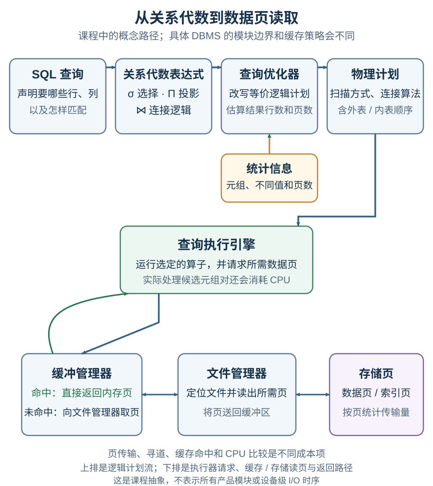

# 关系代数和连接算法怎样把查询变成可估算的页访问？

一个员工目录需要查出年龄超过 25 岁的员工，并找出在澳大利亚任职的经理；银行报表还要把 5,000 条 depositor 记录与 10,000 条 customer 记录连接起来。读者要先说明 SQL (Structured Query Language，结构化查询语言) 问题在逻辑上取哪些行、列和匹配对，再判断具体算法会读多少页。

图中先把查询写成关系代数表达式，再由优化器比较等价逻辑计划、估算行数与页数并选出物理算子；执行引擎按选定的算法请求数据页。缓冲管理器命中时可直接返回内存中的页，未命中时再由文件管理器读取存储页。它是课程中的概念路径，现代 DBMS 的组件划分、缓存和实际设备请求会因产品而异。

## 先用表记录查询要什么结果

relational algebra (关系代数) 用关系作为输入，产生新的关系。relation (关系) 可以先理解为带列名的一张表；tuple (元组) 是一行，attribute (属性) 是一列。以下三张表是用于跟踪结果的合成数据，不是课程银行算例：

| Employee.ID | Name | Age |
| --- | --- | ---: |
| 1001 | A | 25 |
| 1002 | B | 32 |
| 1003 | C | 19 |
| 1004 | D | 27 |
| 1005 | E | 40 |
| 1006 | F | 36 |

| Manager.ID | Department |
| --- | --- |
| 1001 | a |
| 1003 | b |
| 1004 | c |
| 1006 | d |

| Location.ID | Country | City |
| --- | --- | --- |
| 1001 | China | Beijing |
| 1002 | Australia | Melbourne |
| 1004 | China | Shanghai |
| 1006 | Australia | Sydney |

selection (选择) $\sigma_P$ 按谓词 $P$ 筛选行；projection (投影) $\Pi_A$ 只保留属性集合 $A$。于是“年龄大于 25 岁的员工姓名”可写成：

$$
\Pi_{Name}(\sigma_{Age>25}(Employee))
$$

结果为 B、D、E、F；年龄恰为 25 的 A 不满足严格大于条件。为与集合投影一致，对应 SQL 加 `DISTINCT`：

    SELECT DISTINCT Name
    FROM Employee
    WHERE Age > 25;

要找“在澳大利亚任职的经理”，需要按 ID 将三张表对应的行连接，再筛选 Country：

    SELECT E.Name
    FROM Employee AS E
    JOIN Manager AS M ON M.ID = E.ID
    JOIN Location AS L ON L.ID = E.ID
    WHERE L.Country = 'Australia';

在给定数据中结果是 F：Manager 的 ID 集合是 `{1001, 1003, 1004, 1006}`，Australia 对应的 Location ID 是 `{1002, 1006}`，两者交集只有 `1006`，再从 Employee 取到姓名 F。1002 虽在澳大利亚却不是经理；1003 虽是经理却没有 Location 记录。中间连接条件必须写清楚，否则不同表中的同名 ID、Country 等属性可能被错误地配对。

## 连接的谓词由谁指定？

join (连接) 把满足匹配条件的行对组合成结果行。theta join (θ 连接) 把匹配条件明确写出，例如 $Employee.ID=Manager.ID$；natural join (自然连接) 则把两侧所有同名属性都作为相等条件，并在结果中只保留一份公共属性。

| 形式 | 连接条件 | 示例写法 |
| --- | --- | --- |
| θ 连接 | 由谓词显式指定 | $r\bowtie_{r.ID=s.ID}s$；SQL 写 `JOIN ... ON r.ID = s.ID` |
| 自然连接 | 自动对齐所有同名属性 | $r\bowtie s$；SQL 写 `NATURAL JOIN` |

例如合成关系 $r(ID,dept)=\{(7,CS)\}$、$s(ID,dept,role)=\{(7,Math,clerk)\}$：按 `ID` 的 θ 连接会匹配这一对行；自然连接还要求 `dept` 相同，所以结果为空。若后来两表新增了同名列，自然连接会自动多出相等条件；需要固定业务谓词时，显式写 `JOIN ... ON` 更稳妥。原课程配图把 $r\bowtie_{\theta}s$ 误标为自然连接，现改用上表说明，原附件留在文末折叠参考。

在关系代数里，连接可由笛卡尔积和选择表示：

$$
r\bowtie_{\theta}s=\sigma_{\theta}(r\times s)
$$

其中 $r$、$s$ 是两个输入关系，$\theta$ 是连接谓词；$r\times s$ 先枚举两侧每一对行，$\sigma_\theta$ 再只保留满足谓词的行对。此处是逻辑表达式，尚未指定哪一侧作物理算法中的外部或内部输入。前面的员工例已展示按 ID 连接三表；下面收窄到两个输入，以便只看一个 θ 谓词在代数式中的写法：

    SELECT DISTINCT Employees.salary
    FROM Employees
    INNER JOIN Managers
      ON Employees.EmpID = Managers.EmpID;

可写为：

$$
\Pi_{Employees.salary}
\left(
\sigma_{Employees.EmpID=Managers.EmpID}
(Employees\times Managers)
\right)
$$

若要输出连接结果的整行，保留两侧全部属性即可省略投影；只有当输出只需要其中部分属性时，才用 $\Pi$ 选择这些列。

## 关系代数的集合结果与 SQL 重复行有什么区别？

经典关系代数按 set semantics (集合语义) 处理关系；同样的元组不重复出现。SQL 的 SELECT 默认保留重复行，也就是 bag semantics (多重集语义)。需要让 SQL 投影结果与集合语义一致时，应显式使用 DISTINCT；以下 SQL 因此与对应的集合投影一致：

    SELECT DISTINCT salary
    FROM Employees
    WHERE salary < 60000;

$$
\Pi_{salary}(\sigma_{salary<60000}(Employees))
$$

因为该选择谓词只依赖 salary，关系代数可先筛选再投影，也可先投影 salary 再筛选：

$$
\Pi_{salary}(\sigma_{salary<60000}(Employees))
=
\sigma_{salary<60000}(\Pi_{salary}(Employees))
$$

这类等价变换给查询优化器提供可替换的逻辑表达式；如果投影过早丢掉后续谓词或连接需要的属性，变换就不成立。

以上合成例没有 `NULL`。SQL 的 `WHERE` 过滤 `FROM` 产生的行，只留下条件为 TRUE 的行；FALSE 或 UNKNOWN（例如普通比较遇到 `NULL`）都会被过滤。`JOIN ... ON` 则逐对检查左右输入，只有条件为 TRUE 才算匹配。左外连接会为没有任何 ON 匹配的左行补出右侧 `NULL`；后续 WHERE 的谓词若对该右侧列执行普通比较并因 `NULL` 得到 UNKNOWN，就会过滤补出的行。因此，把条件在 ON 与 WHERE 间移动可能改变外连接结果，不能直接套用本节内连接的改写。

## 页读取公式里的每个量代表什么？

数据库把文件组织成 data page (数据页；课件也称 block)。本节把一次 block transfer (页传输) 记为移动一页；设备请求可以批量传输，但批量请求数不等于页传输数。用下标 $r$ 表示物理循环连接算法当前的外部关系、$s$ 表示内部关系；它们是算法读取角色，不表示 SQL 的 `LEFT OUTER JOIN` 左/右外连接类型：

- $b_r$、$b_s$：两关系各占多少数据页；
- $n_r$、$n_s$：外部关系、内部关系分别有多少条元组；
- $T$：页传输数；$S$：seek (寻道) 次数。它们是不同单位，不能直接相加当作时间。若有平均单页传输成本 $t_T$ 和平均寻道成本 $t_S$，简化模型可写成 $C=Tt_T+St_S$；没有这两个系数时只分别比较 $T$ 与 $S$。

后面的课程成本式忽略 CPU 比较、结果物化写盘和其他系统开销。它按重复扫描估计页传输，不表示每页都发生一次物理随机 I/O；实际缓存命中、顺序读、随机读和设备调度会改变运行成本。

单独看一个理想容量例子：若记录平均占 55 bytes (字节)、页大小为 4,096 bytes，$\lfloor4096/55\rfloor=74$ 条记录/页，余 26 bytes。真实页还要留空间给页头、槽目录、对齐和元数据；database management system (DBMS，数据库管理系统) 的页布局会影响可存行数。这个 55-byte 算例不用于后面的银行数据；银行关系的每页记录数由它自己的课程统计给出。

## 元组嵌套循环连接要读多少页？

tuple nested-loop join (元组嵌套循环连接) 对外部关系每条元组，都扫描一遍内部关系：

    for each tuple tr in r:
        for each tuple ts in s:
            if theta(tr, ts):
                emit(tr concatenated with ts)

它不要求索引，但会比较每一对元组。按课程的最坏缓冲假设，输入缓冲只能容纳一个外页和一个内页；没有可用索引，也不把前一轮扫描的内表页视为缓存命中。公式按朴素课件伪码计算，假设每个外表元组都将内表完整扫完，不利用已知内键唯一时在首个匹配后短路。若输出不物化，结果可交给上游算子；若物化写盘，输出页写入成本另计。先读一次外部关系，再为每条外部元组扫描完整内部关系：

$$
T_{tupleNLJ}=b_r+n_r b_s\qquad\text{（页传输数）}
$$

$$
S_{tupleNLJ}=b_r+n_r\qquad\text{（课程寻道估算）}
$$

页传输数中，$b_r$ 是外表扫描一次；$n_r b_s$ 是每条外表元组都重扫整个内表。课程的寻道数按 $b_r$ 个外表页定位和 $n_r$ 次内表扫描起点计算。交换内外关系会同时改变 $n_r$ 和 $b_s$，所以单看外表行数不够。若等值连接的内表键唯一，算法找到首个匹配后可以停止该轮；这会改变全扫成本式，具体页数还取决于匹配记录位置。银行算例沿用前面的全扫课件模型，不套用此短路。若整个内表能放进内存并复用，课件给出的另一个分支是 $T=b_r+b_s$、$S=2$；它要求额外内存，不能套到前面的最坏缓冲假设。

## 按页配对为什么减少了扫描次数？

block nested-loop join (块嵌套循环连接) 的课程一页外块版本，每次把一个外部页与一个内部页配对，再比较页内元组；同一外页的多条元组因此共用一次内表扫描：

    for each page Br of r:
        for each page Bs of s:
            compare every tuple pair in Br and Bs
            emit matching pairs

仍假设只能同时保留一个外页与一个内页、无可用索引且不复用跨轮缓存。该课程的一页外块算法读一次外部文件，并为每个外部页扫描一次内表：

$$
T_{pageNLJ}=b_r+b_r b_s\qquad\text{（页传输数）}
$$

$$
S_{pageNLJ}=2b_r\qquad\text{（每个外页定位外表一次、内表扫描起点一次）}
$$

课件 15.27 给出[一页外块的双层页循环](https://www.db-book.com/slides-dir/PDF-dir/ch15.pdf)；在每轮外表与内表扫描各计一个寻道起点的模型下，可得 $S_{pageNLJ}=2b_r$。该式是一般块嵌套循环连接的一页外块特例；外页批次更大时需要按批次数重算。朴素循环检查 $n_r n_s$ 个候选元组对，页传输式不含 CPU 比较和结果输出成本；若算法利用内表唯一键短路，实际检查数也会改变。

## 银行例子里，哪种外部关系更便宜？

课程银行例以 `customer_name` 连接 `depositor(customer_name, account_number, …)` 与 `customer(customer_name, street, city, …)`。题设把 `customer.customer_name` 设为主键，并把 depositor 中的对应值设为有效匹配的外键；按这组课程数据，每条 depositor 记录恰好匹配一条 customer 记录，完整连接输出 5,000 行。这里采用题设的完整匹配数据，不把“外键”泛化成 SQL 中每行必有匹配：SQL 外键列可以为空。课程还给出 `customer_name` 在 depositor 中有 2,500 个不同值，即这 5,000 条记录涉及 2,500 个有账户的客户名，平均每个这样的客户名对应两条账户记录；这不是对全部 10,000 个 customer 的平均数。若只投影客户名，普通 SQL SELECT 会输出 5,000 行客户名，其中有重复；`DISTINCT` 才返回 2,500 个不同姓名。

`customer` 作内表时，`customer_name` 是唯一键；若等值搜索找到首个匹配就能停止。下列成本数值有意严格按课件的全扫伪码计算：不使用索引，不因匹配到唯一内表键而提前结束，也不复用跨轮缓存。

课件给出的 blocking factor (阻塞因子，即每页元组数) 为 customer 每页 25 行、depositor 每页 50 行，因此 $b_{customer}=\lceil10{,}000/25\rceil=400$ 页，$b_{depositor}=\lceil5{,}000/50\rceil=100$ 页。这里用课程统计值，不从前面的 55-byte 理想容量例反推。下表按前述朴素全扫成本式列出四种顺序，分别比较页传输和寻道；CPU 比较和结果写出成本未加入。

| 算法（全扫模型） | 外部关系 $r$ | 页传输数 $T$（页） | 寻道数 $S$（次） |
| --- | --- | ---: | ---: |
| 元组嵌套循环 | depositor | 2,000,100 | 5,100 |
| 元组嵌套循环 | customer | 1,000,400 | 10,400 |
| 一页外块嵌套循环 | depositor | 40,100 | 200 |
| 一页外块嵌套循环 | customer | 40,400 | 800 |

> [!example] 代入一次：depositor 作元组连接外表
> $T=100+5{,}000\times400=2{,}000{,}100$ 页；$S=100+5{,}000=5{,}100$ 次寻道。表中其余三行同样代入前面的公式。

元组连接按全扫式把 customer 放外表时，少传输 $2{,}000{,}100-1{,}000{,}400=999{,}700$ 页，但多 $10{,}400-5{,}100=5{,}300$ 次寻道；没有 $t_T$ 和 $t_S$ 就不能把两个计数合成单一总时间结论。一页外块算法的乘积项同为 $400\times100=40{,}000$，depositor 作外表少传输 300 页、少寻道 600 次。按上述全扫伪码，两种算法都检查 $5{,}000\times10{,}000=50{,}000{,}000$ 个候选元组对；这是朴素模型的候选比较数，不是实测 CPU 指令数。若利用 customer 内表唯一键在首个匹配后短路，或使用索引，实际检查数和页数可能改变。两种顺序最终都输出 5,000 行；课件页传输式忽略这些结果行的写出。

若连接算法、筛选条件、索引或内存大小改变，应该重新估算计划。比较优化器如何生成等价计划、使用统计信息并权衡全局代价，见[查询优化器怎样比较等价计划](./condensed-note-w2-query-plan-optimization.md)。

> [!info]- 原课程图片（附件原件保留）
> - [database_engine.png](./database_engine.png)：课程引擎架构图。正文用较大的概念流程图重画了同一条查询、执行、缓冲和文件访问路径。
> - [join-syntax.png](./join-syntax.png)：原图把带 θ 谓词的连接标成自然连接；正文改用表格和合成关系例子区分两种连接。

> [!info]- 来源
> - **关系、选择、集合投影、笛卡尔积与 θ 连接：** [Database System Concepts, 7e, ch. 2, Introduction to the Relational Model](https://www.db-book.com/slides-dir/PDF-dir/ch2.pdf)，特别是幻灯片 2.11–2.22。SQL 自然连接的“所有同名列”行为还参照 PostgreSQL 文档。
> - **SQL 重复行、NULL 条件、自然连接与外连接：** [PostgreSQL 18, SELECT](https://www.postgresql.org/docs/18/sql-select.html) 和 [Table Expressions](https://www.postgresql.org/docs/18/queries-table-expressions.html)，2026-11-13 核验。合成例不含 NULL；关系代数等价式不因此自动适用于外连接。
> - **数据库组件路径：** [Database System Concepts, 7e, ch. 1, Introduction](https://www.db-book.com/slides-dir/PDF-dir/ch1.pdf)，幻灯片 1.23–1.27。正文 SVG 是便于阅读的课程抽象图，不能当作所有产品的固定模块图。
> - **页传输、寻道、元组嵌套循环连接：** [Database System Concepts, 7e, ch. 15, Query Processing](https://www.db-book.com/slides-dir/PDF-dir/ch15.pdf)，幻灯片 15.7–15.8、15.24–15.27。元组连接公式取自 15.26；一页外块公式由 15.27 的循环结构推得，$S_{pageNLJ}=2b_r$ 则是本文按每个外页定位一次、每轮内表扫描定位一次的课程寻道计数模型推算，并非该页直接列出的公式。
> - **银行例记录数、每页行数、不同客户名数量及主外键假设：** [Database System Concepts previous-edition archive, ch. 14 slides](https://www.db-book.com/Previous-editions/db4/slide-dir/ch14.pdf)。这是官网托管的旧版课程例；本文保留其题设，并按连接键和页成本公式复算，不将其描述成当前产品行为或设备实测 I/O。
