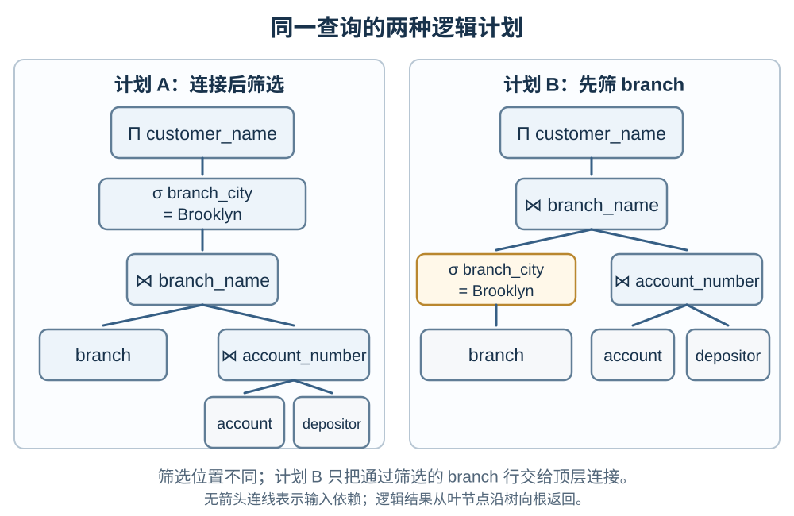
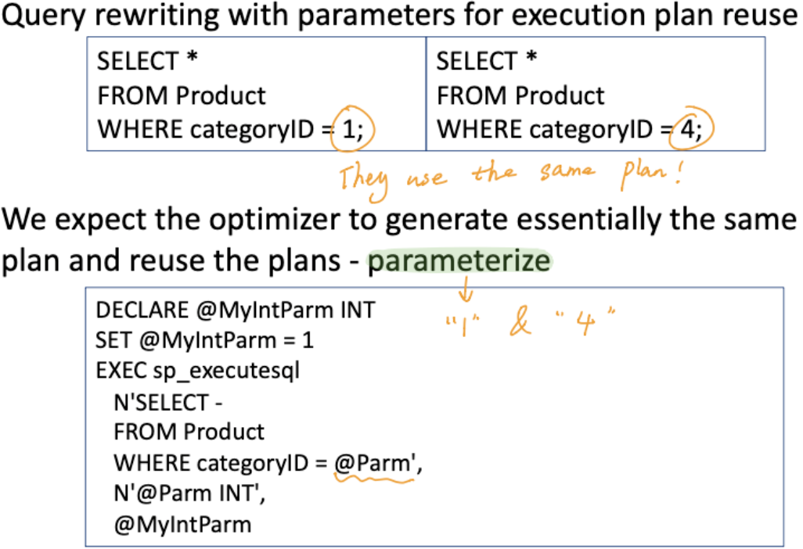

# 查询优化器怎样在等价计划之间作选择？

银行系统要找出布鲁克林分行关联的客户姓名。一个计划先把分行、账户和存款记录连接起来，再筛选分行城市；另一个计划先筛掉其他分行，再执行连接。读者要判断这两种执行顺序是否返回同一结果、哪种可能更省，以及优化器凭什么作出选择。

## 先分清查询写了什么和系统怎样执行

声明式查询 (declarative query) 说明要哪些结果，不必规定数据库先读哪张表。查询优化器 (query optimizer) 可以把同一逻辑结果改写成多种逻辑计划 (logical plan)，再为它们选定扫描、连接和排序等物理算子 (physical operator)，组成执行计划 (execution plan)。

以下课程例子采用银行模式：`branch(branch_name, branch_city, …)`、`account(account_number, branch_name, …)`、`depositor(customer_name, account_number)`。式中的 $\Pi$ 表示只保留指定属性并去重，$\sigma$ 表示筛选行，带下标的 $\bowtie$ 表示按该条件连接。账户与存款人按 `account_number` 匹配，结果再按 `branch_name` 与分行匹配。

用关系代数表示课程中的两种选择。先把相同的中间关系命名，便于看出计划只改变筛选位置：

$$
D = \texttt{account} \bowtie_{\texttt{account.account\_number} = \texttt{depositor.account\_number}} \texttt{depositor}
$$

$$
J = \texttt{branch} \bowtie_{\texttt{branch.branch\_name} = \texttt{account.branch\_name}} D
$$

$$
B_{\text{Brooklyn}} = \sigma_{\texttt{branch.branch\_city} = \text{'Brooklyn'}}(\texttt{branch})
$$

其中 $D$ 是按账户号匹配的账户与存款行，$J$ 再把它们按分行名与分行匹配，$B_{\text{Brooklyn}}$ 是只保留 Brooklyn 的分行。连接结果仍保留属性的来源名，例如 D 中的 `account.branch_name` 与分行表中的 `branch.branch_name`，所以后续连接条件不会混淆同名列。

计划 A 先连接再筛选；计划 B 先筛 branch 再连接：

$$
A = \Pi_{\texttt{depositor.customer\_name}}(\sigma_{\texttt{branch.branch\_city} = \text{'Brooklyn'}}(J))
$$

$$
B = \Pi_{\texttt{depositor.customer\_name}}(B_{\text{Brooklyn}} \bowtie_{\texttt{branch.branch\_name} = \texttt{account.branch\_name}} D)
$$

筛选条件只引用 `branch` 的列，所以能移入该关系输入处；在这两个内连接计划中，它保留相同的匹配行。下图的连线表示算子依赖哪些输入，不表示数据流向；逻辑结果从叶节点沿树向根返回。

上图两侧保留相同的 `branch`、`account`、`depositor` 和连接键：先连接 `account.account_number` 与 `depositor.account_number`，再按 `branch.branch_name` 连接。计划 A 先连接再按城市过滤；计划 B 把相同过滤移入 `branch` 输入。它们是内连接下的关系代数集合计划，投影会去重；若 SQL 要返回相同的不同客户名集合，应使用 `SELECT DISTINCT`。若报表要为每个账户/存款人匹配行保留一行，SQL 默认 `SELECT ALL` 会保留重复名。这个例子的筛选下推只减少非 Brooklyn 分行，不改变符合条件的匹配行及其多重性；外连接中把条件从 `WHERE` 移到输入或 `ON` 可能改变 NULL 补行，不能直接照搬。

下面用一组明确标为合成的行说明工作量；它们不是原题数据或产品实测。分行表有 B1/B4 两行城市为 Brooklyn、B2 为 Queens、B3 的城市为 SQL `NULL`。`D` 是 account 与 depositor 按账户号连接后的 5 行；为看清相同账户可有多个存款人、同一客户也可有多个账户，表中列出合成账户号及匹配后的分行名、客户名：

| branch.branch_name | branch.branch_city |
| --- | --- |
| B1 | Brooklyn |
| B2 | Queens |
| B3 | `NULL` |
| B4 | Brooklyn |

| account.account_number | account.branch_name | depositor.customer_name |
| --- | --- | --- |
| 1 | B1 | Mei |
| 1 | B1 | Alex |
| 2 | B1 | Mei |
| 3 | B2 | Bo |
| 4 | B3 | Yun |

计划 A 的顶层连接先得到 5 个匹配行，再由城市条件筛成 B1 的 3 行；计划 B 先筛出 B1、B4 两个分行，顶层连接得到同样 3 行。B3 的城市值为 SQL `NULL`，等值谓词求得 UNKNOWN，不会通过 `WHERE`，所以 A 在筛选时去掉 Yun，B 则在连接前就排除 B3。SQL 的结果多重集都含 Mei 两次、Alex 一次，集合投影则都是 `{Alex, Mei}`。若两计划的顶层连接都固定为朴素逐对比较的嵌套循环（nested loop），只数顶层分行键比较，A 是 `4×5=20`，B 是 `2×5=10`；D 的计算不变，顺序扫描仍读 4 个分行行。若 4 个分行都在 Brooklyn，顶层比较两边都是 20。这个次数只量化所声明算法的顶层工作，不是数据库运行时成本；城市索引也只有在定位并取回相关行的预计代价低于全扫时才会改变扫描选择。

> [!info]- 原课程查询树图（附件原件保留）
> [21winQ10.png](./21winQ10.png)：2021 年冬季题目的原图。树形结构保持，左侧 branch 标签在原图边缘被裁；正文使用上方可读重绘图标清输入关系和连接键。

## 逻辑改写为何必须保留结果语义？

优化器可以用选择下推、投影下推、连接交换与连接结合等规则生成候选计划，但每次改写都要保留原查询所要求的结果。投影如果过早丢掉后续连接键或筛选列，就不能直接下推；外连接也不总能像内连接那样交换或结合。SQL 的重复行语义、空值比较及排序要求同样可能影响改写是否等价。上方树图中，`branch_city = 'Brooklyn'` 只引用 branch，因此把相同筛选放到 branch 输入，不会改变内连接的行多重性；若换成外连接，需检查筛选是在匹配时生效还是在补出 NULL 行后生效。

在课程图中，选择下推只是逻辑计划变换。它还没有决定系统使用索引扫描还是顺序扫描，也没有决定连接算法；这些物理选择须结合数据统计和执行成本估算。

## 计划成本怎样估算？

优化器会估计基表和中间结果的行数、页数、不同键数量与值分布，再套用扫描、连接、排序等物理算法的成本模型。选择性 (selectivity) 表示谓词过滤后保留的数据比例；若过滤只保留很少行，后续连接通常能少处理输入。

统计信息不准确时，中间结果大小也可能估错。不同列之间的相关性、数据倾斜、缓存、索引和可用内存都会影响实际执行。成本单位是数据库自身的估算尺度，不能直接当成毫秒；同一条语句在不同数据量、统计信息或数据库版本下可能得到不同计划。

例如，如果 Brooklyn 只对应少量 branch 行，且存在按 `branch_city` 查找的索引，优化器可能估算索引定位加取回分行行比扫完整表便宜；若大多数分行都在 Brooklyn，顺序扫描可能更划算。这个物理选择取决于基数和页访问估价，课程查询树本身没有给出足以计算代价的行数。

优化器也不能只为每个算子分别挑看起来最便宜的算法。例如，某一步的归并连接 (merge join) 可能比哈希连接 (hash join) 多花一些成本，却能输出按键排序的结果，让下一步省掉排序。比较计划时要把后续算子一起考虑。

## 优化器会搜索所有等价计划吗？

不会。候选计划数量会随连接输入增加而迅速增长；枚举每一种组合可能花费过多规划时间和内存。系统可以使用动态规划复用子计划、剪除明显不合适的候选，或对很大的搜索空间采用启发式搜索。

PostgreSQL 18 在启用遗传查询优化器（Genetic Query Optimizer，GEQO）时，以当前连接搜索中的 `FROM` 输入项数是否达到 `geqo_threshold` 判断是否进入遗传搜索；默认阈值为 12。计数单位是解析后的输入项：例如一个 `FULL OUTER JOIN` 在外层算作一项，不能直接按 SQL 里的逗号、基础表数或二元 `JOIN` 个数代替。低于阈值时使用常规连接顺序搜索；达到或超过阈值时使用 GEQO，以较短规划时间寻找合理方案。因此“选择成本最低的计划”是指在生成的候选中按查询目标比较估算成本，例如全部输出或 `LIMIT` 下的部分输出；它不保证枚举所有计划，也不保证实际运行时间最低。

## 数据库事务保证和单条语句计划是什么关系？

事务（transaction）把多项数据库操作作为一个业务单元。例如转账的扣款与入账应放在同一事务中，才能作为一个整体提交或回滚。ACID 所描述的原子性、一致性、隔离性和持久性属于事务保证；查询优化器只为单条 SQL 选择执行计划，不会自动建立跨语句事务边界，也不会补全业务不变量。事务如何提交、隔离并发和从故障恢复，仍由事务协议、数据库配置和应用逻辑决定。

若要继续看提交后的数据页和日志怎样应对写入中断，可接着读[双写与日志能保证什么，循环冗余校验又能证明什么？](./condensed-note-w1-durable-writes-and-crc.md)。

## 怎样用实际证据处理计划退化？

先用数据库的执行计划查看工具（例如 PostgreSQL 的 `EXPLAIN`）检查扫描方式、连接算法、各节点预计输出行数和成本。`EXPLAIN ANALYZE` 会实际执行语句，并给出同一节点的实测 `actual rows` 与 `loops`；当节点被多次调用时，`actual rows` 是每轮平均行数，应和该节点的预计输出行数比较。对 UPDATE 等带副作用的语句执行 `EXPLAIN ANALYZE` 前，应在安全测试库操作；官方的 BEGIN/ROLLBACK 示例只撤销参与该事务且可回滚的变更。它不会回收已经由 `nextval` 消耗的序列值，也不能撤销发往外部系统的副作用，因此不能只凭回滚就认为执行无影响。若预计和实测输出行数差距很大，再检查统计信息是否过期、分布是否偏斜、查询条件是否匹配可用索引。

对于重复执行的查询，SQL Server Query Store 可以保留查询计划及运行历史，帮助定位计划变化导致的性能退化。计划强制 (plan forcing) 可用于已验证的临时修复，但数据分布、索引或模式变化后旧计划未必仍合适，必须继续观察实际指标。

课程图把 Product 的 categoryID 等于 1 和等于 4 的两条字面量查询归为含参数 @Parm 的同一查询模板，说明参数化（parameterization）有机会复用计划、减少重复编译。图中 `@Parm` 与 `sp_executesql` 是 SQL Server 的 T-SQL 示例语法，不代表所有数据库采用相同的参数绑定或计划缓存策略。下方 `sp_executesql` 调用框中的 `SELECT -` 应按 `SELECT *` 读；图示模板复用机会，不保证不同参数值使用同一计划。启用参数嗅探（parameter sniffing）时，SQL Server 会在 `sp_executesql` 查询编译或重编译时把当前参数值交给优化器；缓存命中并不表示每次执行都会重新编译。若 1 对应少量行、4 对应大量行，沿用针对 1 优选的索引查找计划执行 4 时可能大量回表；这只是说明参数敏感性（parameter sensitivity）的假设例，不是课程 Product 表的实测分布。SQL Server 2022 及以后版本在数据库兼容级别 160 或更高、参数嗅探开启且谓词符合条件时，还可为不同参数基数范围缓存多个计划；具体行为要看产品版本、配置和实测计划。

## 什么时候预先保存派生结果？

若查询反复读取某个派生值或连接结果，可以把结果预先保存为物化视图（materialized view），减少读取时的重复工作，但要承担额外存储、维护和刷新成本。查询读取受源数据变更影响、尚未同步刷新的物化结果时，可能得到旧值；采用前应明确刷新时机、一致性要求及失败后的重建方式。

查询表达式中的过滤和连接成本模型，见[关系代数和连接算法怎样把查询变成可估算的页访问？](./condensed-note-w2-query-algebra-and-join-cost.md)。

> [!info]- 来源
> - **关系代数等价变换、选择下推、连接顺序、成本估计和搜索空间：** [Database System Concepts, 7e, ch. 16, Query Optimization](https://www.db-book.com/slides-dir/PDF-dir/ch16.pdf)，2019 年课程幻灯片；配图题的两计划及结论按原课程假设解释。
> - **PostgreSQL 18 的扫描/连接计划搜索，以及 GEQO 启用条件：** [PostgreSQL 18, Planner/Optimizer](https://www.postgresql.org/docs/18/planner-optimizer.html) 与 [Query Planning 配置](https://www.postgresql.org/docs/18/runtime-config-query.html#GUC-GEQO-THRESHOLD)，2026-11-13 核验；GEQO 的阈值按 `FROM` 输入项数判断，默认 12，是 PostgreSQL 的实现而非所有优化器的共同算法。
> - **PostgreSQL `EXPLAIN` 的节点输出行数与 `EXPLAIN ANALYZE` 的实测行数/loops：** [PostgreSQL 18, Using EXPLAIN](https://www.postgresql.org/docs/18/using-explain.html) 与 [EXPLAIN command](https://www.postgresql.org/docs/18/sql-explain.html)，2026-11-13 核验；`ANALYZE` 会实际执行，事务回滚只撤销可回滚的事务变更。
> - **`nextval` 消耗值在事务中止后也不会回收：** [PostgreSQL 18, Sequence Manipulation Functions](https://www.postgresql.org/docs/18/functions-sequence.html)，2026-11-13 核验；此外，外部系统副作用不由 PostgreSQL 事务回滚。
> - **SQL Server Query Store 追踪计划和运行指标、定位计划变化退化及强制已有计划：** [Microsoft Learn, Query Store Usage Scenarios](https://learn.microsoft.com/en-us/sql/relational-databases/performance/query-store-usage-scenarios?view=sql-server-ver17)，2026-11-13 核验；强制计划是产品工具，需按工作负载复验。
> - **参数嗅探开关和敏感参数计划：** [Microsoft Learn, Query Processing Architecture Guide](https://learn.microsoft.com/en-us/sql/relational-databases/query-processing-architecture-guide?view=sql-server-ver17#parameter-sensitivity)、[PARAMETER_SNIFFING 配置](https://learn.microsoft.com/en-us/sql/t-sql/statements/alter-database-scoped-configuration-transact-sql?view=sql-server-ver17#parameter_sniffing--on--off--primary) 与 [Parameter Sensitive Plan optimization](https://learn.microsoft.com/en-us/sql/relational-databases/performance/parameter-sensitive-plan-optimization?view=sql-server-ver17)，2026-11-13 核验；这里只描述 SQL Server，PSP 适用版本和条件依产品文档。
> - **预先保存视图/派生结果的优化方法和维护权衡：** [Database System Concepts, 7e, ch. 16, Query Optimization](https://www.db-book.com/slides-dir/PDF-dir/ch16.pdf) 与 [PostgreSQL 18, Materialized Views](https://www.postgresql.org/docs/18/rules-materializedviews.html)，2019 年课程材料及 2026-11-13 产品文档；具体刷新和一致性行为取决于系统及应用实现。
