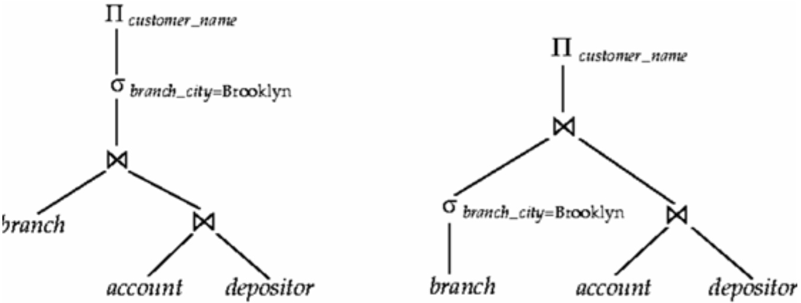

# How does a query optimizer compare equivalent plans? / 查询优化器如何比较等价计划？

An optimizer transforms a declarative query into equivalent logical plans, estimates physical costs using statistics and algorithm models, then selects among plans it considers. Early filtering often helps, but estimates and heuristics do not make one plan universally cheapest. / 优化器将声明式查询转化成等价逻辑计划，利用统计信息和算法模型估算物理成本，再从考虑的计划中选择。尽早过滤通常有帮助，但估算和启发式规则并不能让某一计划在所有情况下都最便宜。

## Query Cost & Query Optimization / 查询成本与优化
1. Parse query to relational algebra expression
2. Use optimizer and get execution plan
3. execute and get output

For example, [PostgreSQL's planner documentation](https://www.postgresql.org/docs/18/planner-optimizer.html) describes plan search and cost estimates; these remain estimates, not a guarantee that the chosen plan is fastest for every execution.

### Transaction Processing at core of RDBS
Definition: A transaction is a collection of operations that need to be performed as a complete unit. (e.g., A transfers $100 to B)

Structure of a transaction

```
begin_transaction()
    <sequence of operations to be performed>
    if (successful)
        commit_trans()
    else
        rollback()
end_transaction()
```

### Transaction Models - ACID Properties
- Atomicity: a transaction's changes are committed as a unit or rolled back as a unit. A duplex write can help protect a block, but does not by itself provide transaction atomicity.
- Consistency: a transaction should preserve declared constraints and application invariants. The DBMS can enforce declared constraints; application-level rules still need correct transactional logic.
  - For example, a primary key enforces uniqueness and non-nullness for the chosen key columns.
- Isolation controls which concurrent effects a transaction can observe. Together with atomic commit, it prevents another transaction from observing only one side of a completed transfer; isolation alone does not make the debit and credit atomic.
- Durability: the system should tolerate system failures and any committed updates should not be lost.

ACID properties might sometimes conflict with each other, yet, the system must still ensure:

- fast access to large amounts of data,
- provide a secure and stable repository when things fail,
- offer standard interfaces for data definition and manipulation,
- manage multi-user access in an orderly manner,
- allow convenient ways for report production and browsing,
- and ease data loading, archiving, and performance tuning.

### Query Optimisation Example - 2021Win Question 10
In the following figure we see two equal expressions a query optimizer is looking at to decide which one to run eventually:


$$
\Pi_{customer\_name}\sigma_{branch_city=Brooklyn}\bowtie(branch, \bowtie(account, depositor))
$$

$$
\Pi\bowtie(\sigma_{branch\_city=Brooklyn}, \bowtie(account, depositor))
$$

Please describe which one of these plans the optimizer should choose and why. Is this choice true in general? If so, where in query optimization such an observation can be used? Briefly explain.

**Answer**: Given the pictured query and the assumption that the Brooklyn predicate selects fewer branch rows, push the selection down before the join; the smaller intermediate relation can reduce join work. This is a heuristic and cost-based optimizers compare estimated plans: selectivity, available indexes, ordering, memory, and downstream operations can make another plan cheaper.

### How do query optimizer make the choices?
Steps in cost-based query optimization

1. Generate logically equivalent expressions of the SQL statement
2. Annotate resultant expressions to get alternative query plans
3. Choose the cheapest plan based on the estimated cost

### Estimation of plan cost based on:
- Statistical information about tables. Example: number of distinct values for an attribute
- Statistics estimation for intermediate results to compute cost of complex expressions
- Cost formulae for algorithms, computed using statistics again

### How to generate alternatives?
- SQL is declarative; an optimizer can translate it into internal relational operators and use equivalence rules to explore logically equivalent plans. Relational algebra provides a formal basis for many such transformations.
- One can generate all equivalent expressions exhaustively
- The above approach is very expensive in space and time though (In query optimizer some expressions are not generated if they are for sure very complex)

### How to choose?
- Must consider the interaction of evaluation techniques when choosing evaluation plans
- Choosing the cheapest algorithm for each operation independently may
  not yield best overall algorithm
- E.g., merge-join may be costlier than hash-join, but may provide a sorted output which could be useful later (the sorted result may be benefit to the later operation)

### In Real Life
- Practical query optimizers incorporate elements of the following two broad approaches:
  1. Search all the plans and choose the best plan in a cost-based fashion.
  2. Uses heuristics to choose a plan.
- Systems may use heuristics to reduce the number of choices that must be made in a cost-based fashion (because cost-based optimization is expensive)
- Heuristic optimization transforms the query-tree by using a set of rules that typically (but not in all cases) improve execution performance:
  1. Perform selections early (reduces the number of tuples)
  2. Perform projections early (reduces the number of attributes)
  3. Perform most restrictive selection and join operations (i.e. with smallest result size) before other similar operations
- Some systems use only heuristics, others combine heuristics with cost-based optimization
- Optimizers often use simple heuristics for very cheap queries, and perform exhaustive enumeration for more expensive queries

## Manage Query Cost in Practice
Troubleshoot plan and runtime regressions with engine-specific tools such as [SQL Server Query Store](https://learn.microsoft.com/en-us/sql/relational-databases/performance/query-store-usage-scenarios?view=sql-server-ver17), which retains query, plan, and runtime history and can be viewed through SQL Server tooling.

- Identify ‘regressed queries’ - Pinpoint the queries for which execution metrics have recently regressed (for example, changed to worse).
- Track specific queries - Track the execution of the most important queries in real time. (e.g., most frequently asked queries)

When you identify a query with suboptimal performance

- Force a query plan instead of the plan chosen by the optimizer
- Do we need an index? --- quickly find the data in the query
- Enforce statistic recompilation
- Rewrite query? (with parameters)

### Parameter in query


### To further lower query cost
- Store derived data
  - When you frequently need derived values
  - Original data do not change frequently
- Use pre-joined tables
  - When tables need to be joined frequently
  - Regularly check and update pre-joined table for updates in the original table May still return some ‘outdated’ result (pre-joined tables are not updated)
