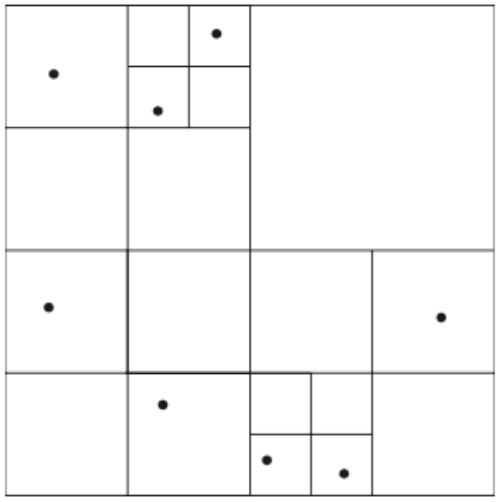
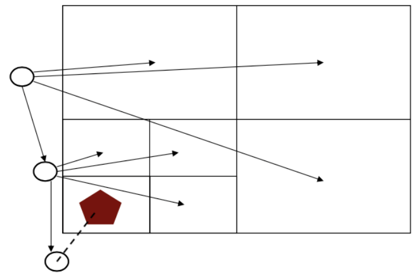
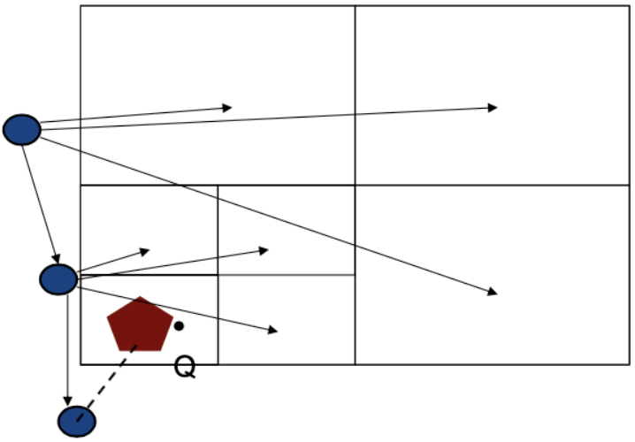
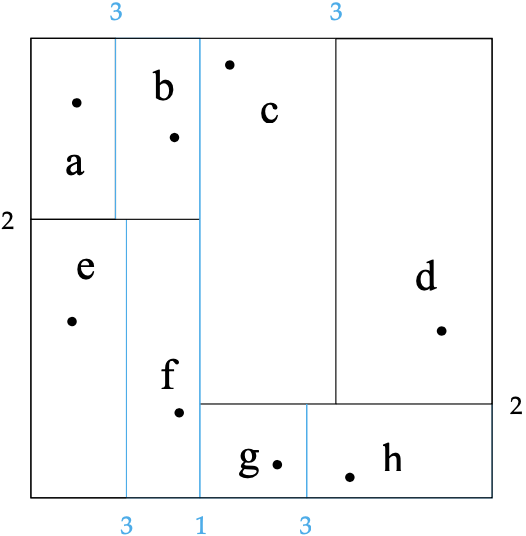
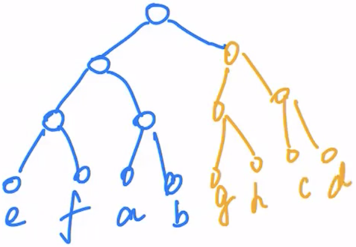
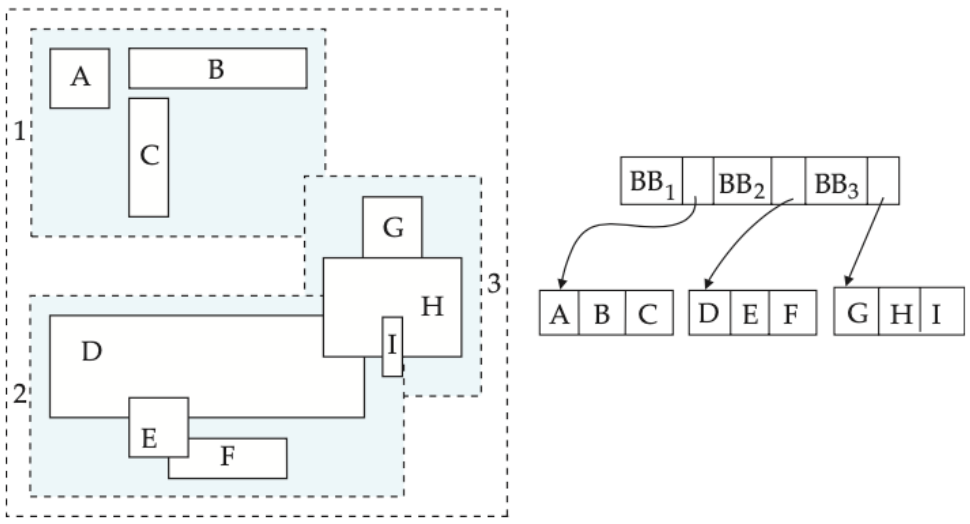

# How do spatial indexes find candidates for geometric queries? / 空间索引如何为几何查询筛选候选对象？

Spatial indexes partition points or group objects by bounding regions so queries can prune irrelevant areas. A bounding-box match is only a candidate test: the exact geometry predicate must still be checked. A k-d tree splits into two regions, unlike a quadtree’s four. / 空间索引通过划分点集或按包围区域组织对象来剪除不相关区域。包围盒相交只是候选测试，仍需核对精确几何谓词。k-d 树将区域一分为二，四叉树则划分为四个区域。

## Considering location data (spatial data)

- Unlike things we can access by names, ids, there is a lot of data that exists, and increasingly that requires special indexing
- For example, spatial data requires more complex computations for accessing data,
  - e.g., intersections of objects in space
- There is no trivial way to sort items which is a key issue,
  - e.g., range query on a simple set of items, e.g. all restaurants within 5 KM
  - e.g., a Nearest Neighbour query, e.g. find the nearest restaurant of my location

## Quadtree (for location data - points) / 四叉树
- Each quadtree node represents a rectangular region; an internal node partitions it into four quadrants, recursively, until a chosen stopping condition (for example, a maximum number of points per leaf).
- A k-d tree is a different spatial structure: each internal node splits a region with one axis-aligned line into two children, often alternating axes. The exam example below is a k-d tree, not a quadtree.

### Quadtree – e.g.,
Example: **Leaf nodes** have between zero and **some fixed maximum number** of points (set to 1 in example below)

It is keep spliting into squares until no more than n (1 in this example) leaf nodes are inside same square

### Quadtree Tree structure

### Quadtree – e.g., run NN (nearest neighbor) query

## k-d Tree / k-d 树
A k-d tree is a binary spatial search tree. Each internal node splits the current region into two using an axis-aligned boundary, often cycling through dimensions; unlike a quadtree, it does not divide every region into four quadrants ([Princeton, Geometric Applications of BSTs](https://algs4.cs.princeton.edu/92search/)).

### 2022S1 Exam Question 5: k-d Tree Example
Given the k-d tree below with point data, where black labeled dots represent spatial coordinate data, and the rectangular area is divided into regions with the division order given with numbers: draw the associated k-d tree as a tree structure with leaves labeled as the data labels given below. Assume **left subarea** of a division goes to a **left subtree**, and **lower subarea** of a division also goes to a **left subtree**. The figure for the k-tree follows:

The key idea is, for each division, split the current node (root) to 2 nodes. Put the left-down on left, right-up on right nodes.

## R-Trees / R树
- An R-tree is a balanced spatial index whose internal entries store minimum bounding rectangles (MBRs) for child subtrees; leaves index spatial objects. It is not simply a B+ tree with a one-dimensional interval replaced. See [Guttman's original 1984 R-tree paper](https://www.cs.princeton.edu/courses/archive/fall08/cos597B/papers/rtrees.pdf).
- Child MBRs may overlap, so a range query can visit multiple subtrees; the index returns candidates that must be checked with the exact spatial predicate. Variants include R+ trees and R* trees.
- **Bounding boxes of children of a node are allowed to overlap**
- Note: A **bounding box** of a node is a minimum sized rectangle that contains all the rectangles/polygons associated with the node

### R-Tree example

A range query tests relevant MBRs and may descend into multiple children when their bounds overlap. Candidate geometries still need the exact predicate, since MBR overlap alone does not prove an exact match.
