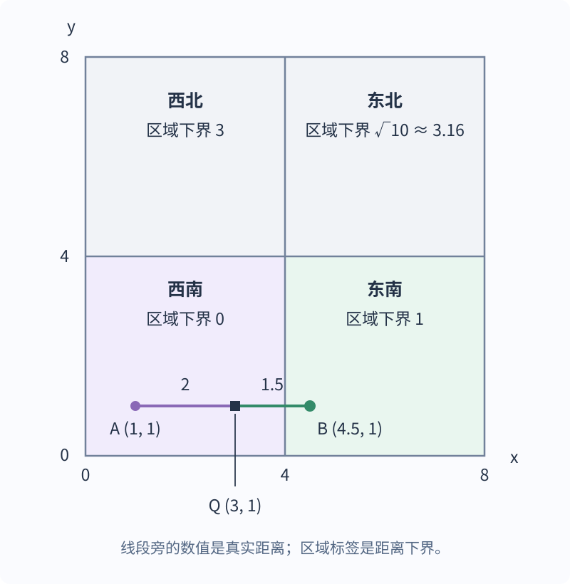

# 空间索引如何缩小搜索范围，又不漏掉几何结果？

**案例：** 地图服务要找距用户 5 公里内的餐馆，或返回与一条道路相交的地块。逐个精算代价很大：我们先用空间索引排除不可能命中的区域，再对候选检查真实距离或几何关系。下面沿着“怎样筛选而不漏结果”这条线，比较点集与形状数据的结构。

## 为什么普通的一维排序不够？

spatial index (空间索引) 为多维坐标或几何对象建立搜索结构，先排除不可能满足查询的对象。它不同于按一个键排序的普通 B+ 树：平面上的点有横、纵坐标，单一的一维顺序不能同时保留所有方向的空间邻近关系。索引框与查询范围相交只说明对象可能命中，索引结构还要把查询范围以外的对象安全排除。

常见查询包括 range query (范围查询)，例如找圆形服务区内的地点；nearest-neighbor query (最近邻查询)，例如找离当前位置最近的餐馆；以及判断两个线或多边形是否相交。包围区域相交通常只表示对象可能满足条件，不能替代精确距离或几何关系计算。

### 5 公里范围如何变成可剪枝的查询框？

先假定坐标是以米为单位的平面欧氏坐标。查询点 $(x,y)$ 的候选外框取 $[x-5000,x+5000]\times[y-5000,y+5000]$，它完整包含半径为 5 公里的圆。任何圆内点都在这个方框里，但方框角落的点仍须按真实距离排除。点树从根开始，只展开区域与外框相交的分支；外框跨过分割线时，可能命中的两侧都要查。

道路相交查询则使用道路本身的包围矩形：若道路与地块真的相交，交点必同时位于双方的包围矩形内，因此两个框不相交时可以安全排除地块。后文再展开这条推理怎样用于 R 树。两类候选最后都要精算；经纬度不能直接加减 5000 当作米，其他距离模型需要对应的安全外框。

## 四叉树如何逐层缩小点的范围？

point-region quadtree (点区域四叉树) 的每个节点代表一块矩形区域；图示在区域中点处横、纵各切一次，形成四个子区域；若区域内点数超过容量，就按点所在象限递归处理。这是课程图展示的四叉树变体，不代表所有四叉树共用一个分裂规则。课程示例把叶节点容量设为一个点，因此同一区域有多个点时继续细分。实现还须固定分割线上的点归属，例如横线相等归上、竖线相等归右，并在插入和查询时使用同一规则。

第一张图展示点区域怎样不断四分；第二张图是另一幅树节点与空间单元的对应示意，不是第一张点集的后续状态。箭头把左侧节点连到右侧区域，最下方的虚线指向红色五边形；空白子区域也属于一次四分的结果，即使没有点需要继续分派到其中。

范围查询从根开始，只递归访问与查询外框相交的子区域；若外框碰到分割线，就保留分割线两侧的候选区域。到叶节点后检查点是否落在外框内，再对圆形半径查询计算真实距离。例如以公里计的相对坐标中，$(3,4)$ 距查询点正好 5 公里而保留；$(4,4)$ 虽在候选正方形内，真实距离约为 5.66 公里，须排除。

每个点都按固定规则放在一个叶区域中，因此与外框不相交的整支不可能藏有范围内的点。实现还要规定何时停止细分，例如达到最大深度，或让无法继续分开的重合点留在同一叶页；否则完全重合的点可能造成无限分割。

### 最近邻查询为什么不能只取用户所在的象限？

用户所在的象限可能没有最近的对象：隔壁区域里离分界线很近的点，可能比本区远端的点更近。NNonQuadtree 图里的 Q 是红色五边形右侧的黑点，箭头表示节点与空间区域的对应关系，不表示查询访问次序；图中也没有画出跨区更近的对象。它只提出需要检查邻区的问题，下面的算法和合成点集另行说明。

下面从图中的形状对象切换到一组合成平面点，单独演示下界计算；坐标只是教学数值，不来自课程图，也不表示地图经纬度。branch-and-bound (分支限界) 最近邻搜索可以从根节点开始：先将根节点及其距离下界放入 min-priority queue (最小优先队列)，当前最优距离设为 $d^*=+\infty$，尚无候选点。每次取出下界最小的节点；若它是内部节点，就把所有子节点及各自下界加入队列；若它是叶节点，就对其中的点计算真实距离并更新 $d^*$ 和最近点。

所有尚未检查、也未被安全剪去的点都仍在队列某个节点之下。队列为空表示所有分支都已处理；若只需任意一个最近点，队列最小下界达到或超过 $d^*$ 时也可停止，因为剩余点不可能更近；若要返回所有并列最近点，则须等到最小下界严格大于 $d^*$ 才能停止。

对于矩形 $[x_{\min},x_{\max}]\times[y_{\min},y_{\max}]$ 和查询点 $(x,y)$，平面欧氏距离的下界为

$$
d_x=\max(x_{\min}-x,\ 0,\ x-x_{\max}),\qquad
d_y=\max(y_{\min}-y,\ 0,\ y-y_{\max}),
\qquad
d_{\min}=\sqrt{d_x^2+d_y^2}.
$$

$d_x$、$d_y$ 分别是查询点坐标到矩形轴区间的距离；落在区间内时该轴距离为 0。矩形内任何点在横、纵方向至少分别相距 $d_x$、$d_y$，所以 $d_{\min}$ 不会超过查询点到矩形内任何点的真实欧氏距离。若只需要返回任意一个最近点，下界等于 $d^*$ 的区域也不可能含有更近点，可以剪枝；若要返回所有并列最近点，只能在下界严格大于 $d^*$ 时剪枝。公式假设平面欧氏坐标，且与精确距离使用同一坐标单位；经纬度不能直接当作平面坐标套用，应使用适合坐标系的距离与区域下界。

> [!example] 同一象限中的 A，反而比邻区的 B 远
> 令根区域为 $[0,8]\times[0,8]$，数据点为 $A=(1,1)$ 与 $B=(4.5,1)$，查询点 $Q=(3,1)$，每个叶区域至多存一个点。这些是无单位的合成平面坐标，不来自上面的课程图。

从根入队开始，队列按下界从小到大展开；表中的 $d^*$ 是当前已检查点的最小真实距离。

| 当前处理哪个节点？ | 检查或加入什么？ | 当前最优与下一步 |
| --- | --- | --- |
| 根区域，下界 0 | 将西南、东南、西北、东北加入队列；下界为 0、1、3、$\sqrt{10}\approx3.16$。 | 尚无候选，$d^*=+\infty$；先检查西南。 |
| 西南叶，下界 0 | 计算 $Q$ 到 $A$ 的真实距离：2。 | $d^*=2$；东南下界 1，仍可能更近。 |
| 东南叶，下界 1 | 计算 $Q$ 到 $B$ 的真实距离：1.5。 | 更新为 $d^*=1.5$。 |
| 查看队首，下界 3 | 剩余区域的下界都大于 1.5，不必再弹出。 | 剪去北侧两区，返回 $B=(4.5,1)$。 |

## k-d 树和四叉树的分割规则有什么不同？

k-d tree (k-d 树) 是二叉空间树。每个内部节点选择一个维度和一条轴对齐分割线，把当前区域分成两部分；四叉树则每次同时沿两个轴切成四块。二维情形常交替使用横向和纵向切分，但具体切分轴、阈值及重复点规则取决于构造过程。

范围查询在 k-d 树中也从根开始：若节点本身存有数据点，先检查该点是否落在闭合查询矩形内，再只递归访问区域与查询矩形相交的子树；若矩形碰到分割线，两侧子树都可能有结果。恰在分割线上的数据点也要按建树时固定的左右规则归入一侧，查询时不能把边界接触当作无交集。

课程保留了 2022 年第一学期第 5 题。题图给出点的相对位置和分割次序；按下方答案树采用的左右约定，分割线左侧区域进入左子树，下侧区域也进入左子树。第 1 刀按竖线分成左半 `{a,b,e,f}` 和右半 `{c,d,g,h}`；第 2 层横切左半，下面的 `{e,f}` 进入左子树，上面的 `{a,b}` 进入右子树；横切右半时，下面的 `{g,h}` 进入左子树，上面的 `{c,d}` 进入右子树。第 3 层竖切再按左右分成 `{e}`/`{f}`、`{a}`/`{b}`、`{g}`/`{h}` 和 `{c}`/`{d}`；每对前者进左子树、后者进右子树。这样才能从每个点的位置还原答案树；不要把这题当作四叉树。

答案图记录的是这道题给定的分割序列和左右规则，不代表所有 k-d 树都必须按同一维度次序或同一平衡策略构造。

## R 树怎样索引线和多边形？

R-tree (R 树) 用层级结构索引线和多边形等复杂形状。minimum bounding rectangle (MBR，最小包围矩形) 是边平行于坐标轴、以各轴最小值和最大值确定的矩形；叶项保存对象的 MBR 和对象指针，内部项保存覆盖子树各项的 MBR 与子树指针。R 树维持平衡，使叶节点处于同一层，但兄弟项的 MBR 可以重叠。

左图虚线框 1、2、3 分别对应右图根项 BB₁、BB₂、BB₃，依次指向 A–C、D–F、G–I；第 2、3 组框在 H 附近重叠，所以查询框落在重叠处时必须继续搜索两个子树。

若道路与地块相交，交点必落在道路和地块各自的 MBR 内。对道路的 MBR $W$，从根开始检查每个子项的 MBR；与 $W$ 不相交的子树不可能包含相交地块，可以剪枝。MBR 相交仍只表示候选：多边形的 MBR 会覆盖对象之外的空角，候选还须对原始几何执行精确相交判断。这项“不相交就可剪枝”的推理针对相交查询，不能原样用来筛选正距离阈值。

filter-and-refine (筛选再精算) 的共同条件是：所有真命中都必须通过第一步的候选筛选；不要求一个长形对象整体落进查询框。若距离是同一平面坐标系下的欧氏距离，坐标单位为米，查询点 $P=(x,y)$ 的阈值为 $d$ 米，则用 $[x-d,x+d]\times[y-d,y+d]$ 作候选框不会漏掉距离不超过 $d$ 的点；框角上的假阳性仍由真实距离排除。在同一距离条件下，若查询对象是线或面，也可以把其 MBR 每个方向扩张 $d$，得到一个保守候选框，再保留与它相交的对象 MBR；对象只需有一部分足够接近查询几何，其 MBR 就能通过。对测地距离等其他度量，须使用该度量下保证覆盖真结果的外框，不能直接将未扩张的查询 MBR 当作距离候选框。PostGIS 3.6 的 `ST_DWithin` 会使用扩大的包围框筛选，再计算真实距离；`geometry` (几何类型)距离单位取决于空间参考系，`geography` (地理类型)距离用米。其他谓词也须使用各自正确的必要包围盒关系，不能默认一次 MBR 重叠检查适用于相交、包含和距离。

| 查询或对象 | 可先考虑的结构 | 需要记住的边界 |
| --- | --- | --- |
| 平面上的点集、区域内点 | 四叉树或 k-d 树 | 具体分区、重复点处理及终止条件由构造策略决定 |
| 线段、多边形及范围相交 | R 树等包围区域索引 | MBR 可重叠；候选仍须精确检查 |
| 最近邻 | 支持邻近搜索的空间结构 | 依据区域距离下界剪枝，不能只看一个网格或叶节点 |

课程图保留了几种结构的差别：四叉树重复四分空间，k-d 树逐次二分，R 树按多边形等对象的包围矩形聚组。选型时还要结合查询谓词、维数、对象形状、空间分布及具体数据库支持的操作符。

点能按分割线规则归入一个区格；线和多边形可能跨过许多区格，若只按某个代表点存放，另一侧的相交查询可能漏掉它们。R 树保存整个对象的 MBR，再用上层 MBR 覆盖一组对象；这样保留了对象范围，但 MBR 重叠会让查询多走分支。这解释了点分区树与形状包围框索引的取舍。

> [!info]- 来源
> - **点区域四叉树的单点叶、按区格定位、范围/距离查询剪枝、最近邻回溯及形状范围表示：** Hanan Samet, [Hierarchical Data Structures for Spatial Databases](https://www.cs.umd.edu/~hjs/pubs/Sametgisundkartographie91.pdf), 1991, §§3.1、4–5；文章说明点与形状需要按查询类型选择层级结构。本文的根入队优先队列是便于逐步说明的合成四叉树演示。
> - **最近邻的分支限界、点到 MBR 的 minimum distance (MINDIST，最小距离) 下界和剪枝条件：** Nick Roussopoulos, Stephen Kelley, and Frédéric Vincent, [Nearest Neighbor Queries](https://sigmodrecord.org/publications/sigmodRecord/9506/pdfs/568271.223794.pdf), SIGMOD 1995, §§2–3；原文给出 R 树搜索算法，并说明相关指标也可用于其他空间结构。本文以点到矩形的平面欧氏距离推导公式，并用优先队列组织合成四叉树点集的待处理节点；这是便于逐步讲解的 best-first search (最佳优先搜索) 版本，不是原文的具体遍历伪代码。
> - **数据库最近邻扫描中内部索引项必须提供不高于任一子项真实距离的距离值：** [PostgreSQL 18, §65.2 GiST (Generalized Search Tree，通用搜索树) Indexes](https://www.postgresql.org/docs/18/gist.html)，2026-11-12 核验；用于核对下界契约，不代表所有空间索引都采用 GiST。
> - **k-d 树轴向二分、内部节点数据点的范围命中检查及仅访问可能相交子树：** [Princeton Algorithms, §9.2 Geometric Search](https://algs4.cs.princeton.edu/92search/) 与 [COS226, “Geometric Applications of BSTs,” 2012 课件第 25–29、34 页](https://www.cs.princeton.edu/courses/archive/spring12/cos226/lectures/99GeometricSearch.pdf)，2026-11-12 核验；课程考试的点集与左右规则仍按原图。
> - **R 树 MBR 覆盖、叶对象指针、内部子树指针、树高平衡及遍历所有相交分支：** Antonin Guttman, [R-trees: A Dynamic Index Structure for Spatial Searching](https://sigmodrecord.org/publications/sigmodRecord/8406/pdfs/971697.602266.pdf), 1984, §§1–3.1；这是原始 R-tree 论文，不是当前产品规格。
> - **包围盒筛选后检查精确空间谓词、`ST_DWithin` 的扩大包围盒和真实距离复核，以及 PostGIS 的 `geometry` (几何类型)距离按空间参考系单位计量、`geography` (地理类型)距离默认以米计量：** [PostGIS 3.6, §5.2 Using Spatial Indexes](https://postgis.net/docs/manual-3.6/using_postgis_query.html) 与 [`ST_DWithin`](https://postgis.net/docs/manual-3.6/ST_DWithin.html)，2026-11-12 核验；PostGIS 的函数和索引路径是产品实现示例。
> - **课程四叉树分区、最近邻示意及 k-d 树作答：** `quadtreeExample.png`、`quadtreenodesexample.png`、`NNonQuadtree.png`、`2022S1Q5.png` 与 `2022S1Q5Answer.png`；树形、点位和作答规则按图中条件解释，不推广为唯一通用构造算法。
