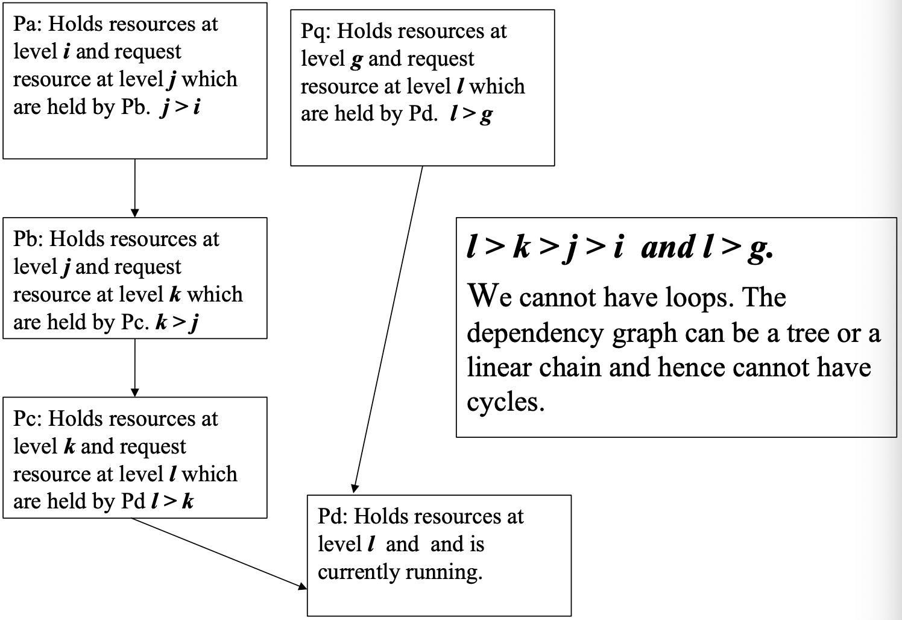

# 两个线程同时改写同一计数器时，怎样协调访问并处理死锁？

两个工作线程都要把共享计数器加一百万次；运行结束后，计数却少了几百次。与此同时，数据库里还有事务可能各自持有一把锁，再等对方释放另一把锁。要解释这两类故障，需要先看“读—改—写”为什么不是一个不可分割动作，再比较忙等与阻塞原语，最后检查等待关系是否形成闭环。

## 为什么一次自增会丢失？

把 `counter = counter + 1` 展开成三个步骤：读取旧值、计算新值、写回。若两个线程都读到 10，它们各自算出 11 并写回，最终仍是 11，而预期是 12。这是 race condition（竞态）：结果取决于多个操作交错的次序。

需要保护的 critical section（临界区）是“读取、计算、写回”这一整段。mutual exclusion（互斥）保证同一时刻只有一个执行者进入。不同方案的区别在于：等待者是在处理器上反复检查，还是被挂起等待唤醒；以及方案适用于多少参与者、要求什么内存模型。

## Peterson 算法怎样在两进程模型里互斥？

Peterson's algorithm（Peterson 算法）用两个意愿标志和一个让行变量实现两个进程之间的互斥。下面的伪代码展示进入区、临界区、退出区和其余代码：

```text
共享状态，两个进程启动前初始化：
    flag[1] = false
    flag[2] = false
    turn = 1

进程 1：
    flag[1] = true       # 我想进入
    turn = 2             # 若冲突，先让进程 2
    while flag[2] and turn == 2:
        等待
    counter = counter + 1  # 临界区
    flag[1] = false      # 退出
    执行其余代码

进程 2：
    flag[2] = true
    turn = 1
    while flag[1] and turn == 1:
        等待
    counter = counter + 1
    flag[2] = false
    执行其余代码
```

关键点是两个进程都表达“我想进”，随后写入相反的 `turn`。若两者几乎同时进入，最后写入 `turn` 的值只会使其中一个等待；先进入者离开后清除自己的标志，另一个才可继续。这里的布尔判断可直接读作“对方有意进入，而且当前轮到对方”。

这个证明依赖模型前提：共享读写是原子的，并按 sequentially consistent（顺序一致）的方式观察；只有两个参与进程；等待中的进程仍会继续运行。伪代码不是可直接复制的 C 程序，普通共享 `int` 不会自动满足并发内存模型，也不能把这个两进程算法扩展成通用锁。实际程序应使用语言或操作系统提供的同步原语。

## 等待者何时应忙等，何时应阻塞？

spin lock（自旋锁）在锁忙时循环检查状态。test-and-set（测试并置位）必须是一个原子读—改—写操作，否则两个线程仍可能同时读到“空闲”并都取得锁。

```text
初始：lock = UNLOCKED

atomic_test_and_set(lock):
    old = atomic_exchange(lock, LOCKED)
    return old == UNLOCKED

线程：
    while not atomic_test_and_set(lock):
        继续检查
    # 临界区
    atomic_store(lock, UNLOCKED)
```

compare-and-swap（比较并交换，CAS）也提供原子状态更新：只有当内存值仍等于期望旧值时，才写入新值；失败时返回当前值供调用方重试。一次尝试可抽象为：

```text
compare_and_swap(cell, expected, desired):
    atomically:
        observed = *cell
        if observed == expected:
            *cell = desired
            return success
        else:
            return failure, observed
```

失败时调用者可据返回值重算或重试。无论采用何种读—改—写指令，真实实现还要遵守平台的内存顺序要求，以上只是算法草图。

自旋适合临界区很短、线程很可能很快拿到锁、且运行环境允许消耗处理器时间的场景。竞争持续时，等待者会空转并争用缓存行。mutex（互斥锁）或 semaphore（信号量）可以让等待线程睡眠，交给调度器稍后唤醒，代价是等待队列和调度切换。实际互斥锁常先在用户态尝试原子快路径，只在需要睡眠或唤醒时进入内核；Linux futex（快速用户态互斥）就是这种用户态状态与内核阻塞机制协作的接口。

信号量维护一个计数或许可：获取（通常称 `wait` / `P`）在没有许可时等待，释放（通常称 `post` / `V`）归还许可并可能唤醒等待者。二值信号量可以表达互斥，但它与互斥锁在所有权和误用检查上并不等价。

若释放时一次唤醒所有等待者，它们会同时争抢刚释放的许可，造成 thundering herd（惊群）并产生额外调度开销。队列唤醒或直接把许可交给一名等待者可以减少无效竞争；具体策略要权衡公平性、吞吐量和调度开销，单靠信号量接口并不能保证某种队列策略。


图中从“无人持有”到 `P1` 持有，再到 `P2`、`P3` 排队的序列，用来说明一个独占许可只能由一个执行者占用，其他调用者等待释放。图示解释的是等待队列概念，不承诺实现一定按 FIFO（先进先出）唤醒；唤醒次序、是否直接交接锁及公平性由实现决定。

## 等待关系怎样变成死锁？

deadlock（死锁）指一组执行者都在等由组内其他成员持有的资源，因而没有一个成员能自行推进。对单实例资源，可以画 wait-for graph（等待图）：节点是事务，边 `T1 → T2` 表示 `T1` 正在等 `T2` 持有的锁。此模型下，有向环表示这些事务相互等待。对多实例资源，图中出现环不一定足以证明死锁，还要检查可用实例与每个请求需要的资源数。

先看资源排序为何能避免环。给每种资源指定一个全局严格顺序；任何事务只能按递增顺序申请资源。设 `Pa` 持有等级 `i` 的资源并等待 `Pb` 的等级 `j`，则 `j > i`；后续等待也只能从 `j` 到更高等级 `k`，如此继续。若真的形成环，就会得到 `i < j < k < … < i`，与严格递增矛盾。



图中的 `Pa → Pb → Pc → Pd` 分别对应 `i < j < k < l`；旁支 `Pq → Pd` 对应 `g < l`。在“所有等待都是等待更高等级资源”的假设下，图不可能回到较低等级形成环。实践中，所有事务都必须遵循同一排序；若调用路径可能以相反次序申请锁，这条保证就不成立。 另外，若事务开始前就能准确列出所需资源，也可尝试一次性申请整组资源，避免持有一部分再等待另一部分；动态业务流程通常难以预先列全。增加资源容量能降低等待概率，但除非需求有可信上界且容量足够，否则不能据此证明永远无等待或无死锁。

另一种办法是检测等待图中的环并选择代价较低的事务回滚；也可以给单次锁等待设置超时并取消事务。超时能限制等待时间，但本身不是全局死锁证明；反复立即重试可能造成 starvation（饥饿）或 livelock（活锁，持续运行却无法完成），通常还需退避与重试上限。分布式系统可能只能看到局部等待关系，因而需要超时或跨节点协调来处理全局环。

> [!info]- 来源
> - Peterson 两进程互斥的原子寄存器模型与正确性推理：Aspnes，《Notes on Theory of Distributed Systems》，Peterson 算法章节，https://www.cs.yale.edu/homes/aspnes/pinewiki/MutualExclusion.html 。
> - 阻塞等待与用户态快路径/内核唤醒的接口事实：Linux man-pages `futex(2)`，访问于 2026-11-06，DESCRIPTION，https://man7.org/linux/man-pages/man2/futex.2.html 。
> - 锁顺序、等待图与死锁处理的数据库背景：Silberschatz、Korth、Sudarshan，《Database System Concepts》第 7 版第 18 章“Concurrency Control”，2019 年 3 月课程幻灯片，https://www.db-book.com/slides-dir/PDF-dir/ch18.pdf 。
> - PostgreSQL 锁等待与死锁行为：PostgreSQL 18 文档第 13.3.4 节“Deadlocks”，访问于 2026-11-06，https://www.postgresql.org/docs/18/explicit-locking.html 。
