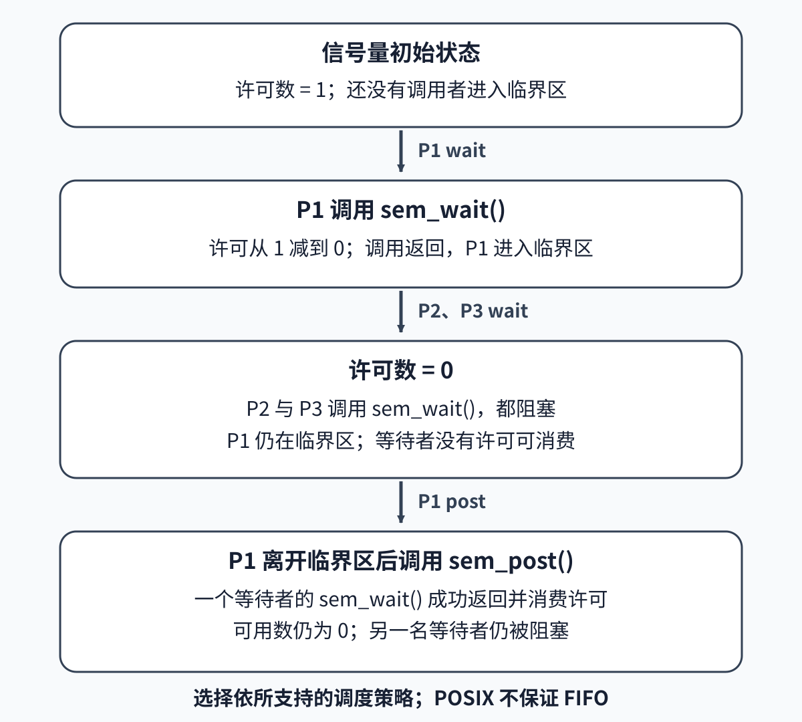
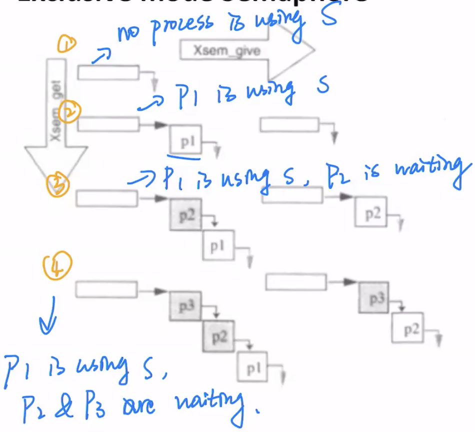
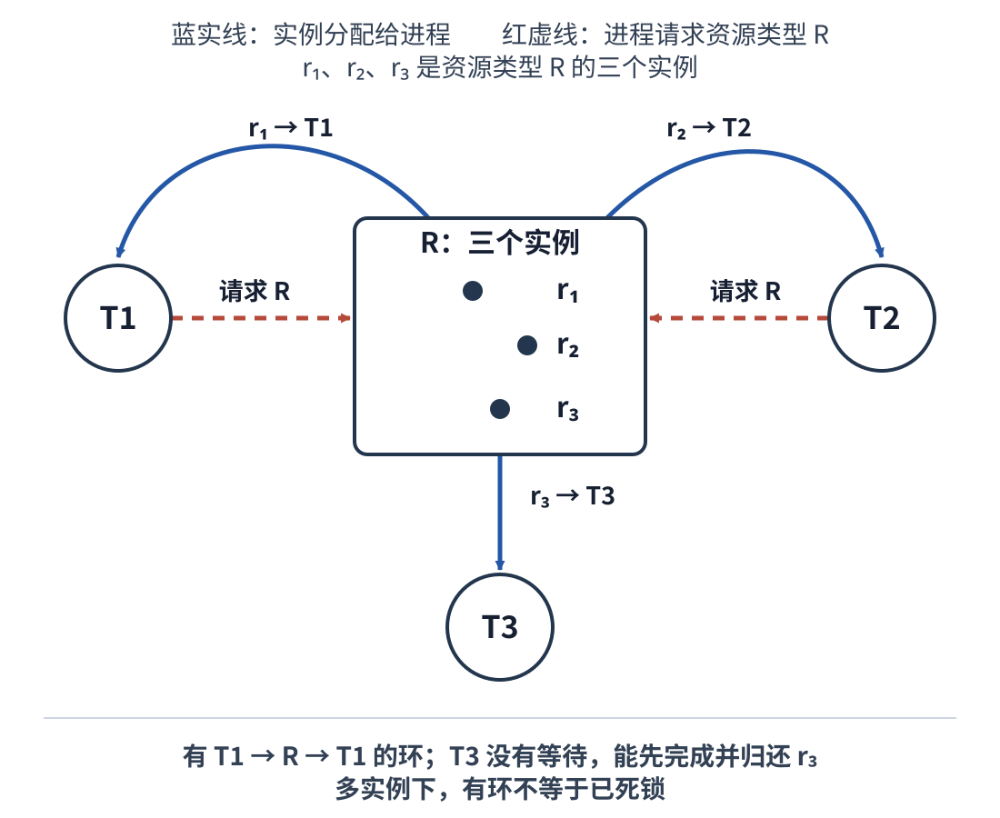

# 两个线程同时改写同一计数器时，怎样协调访问并处理死锁？

两个工作线程各自把共享计数器加一百万次，某次运行却少了几百次。这个数字是课堂情境，不是固定规律或本次测量。另一个常见故障发生在数据库：两个事务各拿着一把锁，又都等对方释放下一把。要理解这两类问题，本章先把一次读—改—写拆开，再看互斥算法实际依赖的内存顺序，最后从等待图判断何时会死锁。

## 为什么一次自增会丢失？

把 `counter = counter + 1` 展开成三个动作：读旧值、计算加一、写回。若初值为 10，线程 A、B 都读到 10；它们各自算出 11 并写回，最终是 11，而不是两次递增后的 12。只要这三个动作不是一个不可分割的操作，另一个线程就可能插入中间。

| 次序 | 线程 A | 线程 B | 内存中的 `counter` |
| ---: | --- | --- | ---: |
| 1 | 读取 10 |  | 10 |
| 2 |  | 读取 10 | 10 |
| 3 | 计算 11，写入 11 |  | 11 |
| 4 |  | 计算 11，写入 11 | 11 |

这个交错是读—改—写并发不安全的直观模型。它不是所有语言都承诺的具体运行结果：若把它直接写成 C++ 的普通共享 `int++`，无同步的冲突访问构成 data race（数据竞争），C++ 标准将其定义为 undefined behavior（未定义行为）；程序不能假定编译器只会“少算几次”。Java 有自己的内存模型：没有 happens-before（先行发生）关系的普通访问不保证读到最新值，因而不能照搬这条 C++ 未定义行为结论，也不能因此省掉同步。

需要保护的 critical section（临界区）是“读取、计算、写回”这一完整操作。mutual exclusion（互斥）保证同一时刻只有一个执行者通过入口。race condition（竞态）描述结果依赖交错次序；data race（数据竞争）则是特定语言内存模型中的冲突访问条件。它们相关，却不是同一个术语。

## Peterson 算法怎样在两进程模型里互斥？

Peterson's algorithm（Peterson 算法）用两个意愿标志和一个让行变量，在两个参与者之间实现互斥。它是说明共享读写顺序为何重要的算法，不是可直接复制成普通共享变量的生产锁。

```text
共享状态，两个进程启动前初始化：
    flag[1] = false
    flag[2] = false
    turn = 1

进程 i（另一个进程为 j）：
    flag[i] = true       # 我想进入
    turn = j             # 若冲突，先让 j
    while flag[j] and turn == j:
        等待
    执行临界区
    flag[i] = false      # 退出
    执行其余代码
```

先证互斥。`while flag[j] and turn == j` 中的 `and` 表示两项都为真才等待；任一项为假，进程就能通过。反设两方本轮临界区有重叠，取这两次进入尝试中最后发生的 `turn` 写入者 `j`，它写入 `turn=i`。按程序顺序，`i` 本轮先写 `flag[i]=true`，再写 `turn=j`，所以这两次写都早于 `j` 的最后写；这不表示 `i` 当时已经进入临界区。在假设的重叠里，`i` 到 `j` 检查时尚未退出并清旗；两方在退出当前临界区前也不会开始下一次进入并重写 `turn`。因此顺序一致的检查读到 `flag[i]=true` 且 `turn==i`，`j` 必须等待，不能与 `i` 同时处于临界区，矛盾。

互斥证明的条件是：恰有两个参与者；初始化先于线程启动；`flag` 与 `turn` 的共享读写是原子的，并按 sequentially consistent（顺序一致）次序观察。进展另需每次临界区和其余代码最终结束，等待中的进程最终获得运行机会；算法不能让一个永不退出的持有者自行恢复。

在 C++ 中，普通共享变量不满足这组前提。一种直接沿用上述证明的充分实现，是把 `flag`、`turn` 声明为 `std::atomic`，并对这两个对象的每次访问使用 `std::memory_order_seq_cst`；这不是要求程序中所有其他原子对象也都使用该顺序。初始化仍须在线程开始前完成。只把变量声明成 `volatile` 不会让 C++ 读写变成原子操作，也不会建立线程间同步。

较弱的 `memory_order_relaxed` 足以保证每个原子对象单独没有撕裂访问，却不把不同对象的操作排成一个全局序。于是标准允许这种观测：进程 1 写 `flag[1]=true` 后读到 `flag[2]=false`；进程 2 写 `flag[2]=true` 后也读到 `flag[1]=false`。两次循环都因对方标志为假而通过，进入临界区。`turn` 的原子性本身救不了这段算法，因为短路条件在读到 `false` 后根本不读 `turn`。

Peterson 算法因此既展示了“原子读写”与“读写顺序”是两件事，也展示了为什么手写锁很容易依赖语言模型的细节。实际程序通常应直接使用 `std::mutex` 等成熟同步原语；若临界区中的条件、多个变量或错误恢复超出这段两进程证明，不能从这段算法外推正确性。

## 等待者何时应忙等，何时应阻塞？

atomicity（原子性）说明一个特定对象的操作不可被同对象的并发访问拆开；memory ordering（内存顺序）说明操作与其他内存访问之间能建立什么先后和可见性。以 C++ 的原子操作为例：

| 机制 | 它给出的保证 | 还没有给出的保证 |
| --- | --- | --- |
| `memory_order_relaxed` | 对目标原子对象的访问仍是原子的，并遵守该对象自己的修改次序；适合只需要一个独立计数值的场景。 | 不会把其他普通数据的写入发布给读者；不同原子对象之间也没有因此形成一个全局顺序。 |
| release/acquire（释放/获取） | release 之前的操作可通过同一原子对象发布；当 acquire 读到该 release 写入的值或其 release sequence 时，两者建立 synchronizes-with（同步于）关系和 happens-before（先行发生）关系。 | acquire 读到别的值时不能凭空得到该发布关系；仅有 atomic 读改写不表示任意相关数据也已同步。 |
| `memory_order_seq_cst` | 顺序一致原子操作及顺序一致 fence 参加符合标准约束的全局总序；把 Peterson 的 `flag`、`turn` 访问都设为 `seq_cst`，是满足该算法顺序一致寄存器前提的一种充分实现。 | 要把 `seq_cst` 的一般保证推广为整个程序的顺序一致执行，C++ 还要求程序无数据竞争且所有原子操作都使用 `seq_cst`；混入较弱顺序时须另作证明。它不让普通变量自动变成原子，也不给等待者公平性或调度保证。 |

对前面的一百万次独立计数，使用 C++ 原子读改写即可，不需要让所有内存访问排成全局次序：

```cpp
#include <atomic>

std::atomic<unsigned long long> counter{0};

void worker() {
    for (long i = 0; i < 1'000'000; ++i) {
        counter.fetch_add(1, std::memory_order_relaxed);
    }
}
```

两个线程各自运行 `worker()`，主线程 `join()` 完成后读取 `counter`，预期值为 2,000,000。这里的每次 `fetch_add` 都是对同一原子值的读—改—写原子操作；`relaxed` 只表示这些递增不用承担发布其他数据的顺序成本，并没有把递增变回普通读写。若一个计数还需与另一个共享状态维持不变量，则应把整个不变量交给锁或设计更完整的原子协议。

test-and-set（测试并置位）是另一个原子读改写：它一次性设置锁标志，并返回设置前的值。以下是 C++20/23 的自旋锁骨架，显示锁位的互斥与临界区数据的可见性怎样关联：

```cpp
#include <atomic>

std::atomic_flag lock{};  // C++20 起默认初始化为 clear

void acquire() {
    while (lock.test_and_set(std::memory_order_acquire)) {
        // 已有人持锁；继续自旋
    }
}

void release() {
    lock.clear(std::memory_order_release);
}
```

唯一把 `false` 改为 `true` 的调用者取得锁；其他调用者看到旧值 `true`，继续等。持锁线程在 release 前对临界区数据的写入，会在后来成功 acquire 该标志的线程中可见。若把这些访问一律放宽为 relaxed，只保住锁位本身的原子更新，不自动保护临界区里的其他普通数据。

compare-and-swap（比较并交换，CAS）也把“检查旧值”和“按条件写新值”做成一个原子读改写：

```text
compare_exchange(cell, expected, desired):
    若 cell == expected：原子写入 desired，返回成功
    否则：把当前值写回 expected，返回失败
```

调用方通常在失败时按观察到的值重新判断，并循环重试。C++ 的 `compare_exchange_weak` 还允许即使值看起来相等也偶发失败，所以通常放在循环内；`compare_exchange_strong` 不允许这种伪失败。CAS 本身只回答“这一次条件更新是否赢了”；循环是否公平、能否停止、是否需要 acquire/release，仍取决于完整算法。

自旋锁让等待者一直运行检查，适合临界区极短、持锁者预期很快释放且运行环境能承受处理器争用的情况。持续竞争会消耗处理器时间、争用 cache line（缓存行），锁的抢占或 priority inversion（优先级反转）还可能拖长等待；自旋不等于公平。

`mutex（互斥锁）`和 `semaphore（信号量）`可以在锁或许可暂不可得时阻塞线程，让出处理器时间给其他可运行工作，代价是等待队列、唤醒和调度。它们的接口不承诺所有实现都必须进入内核。Linux 的 `futex（快速用户态互斥）`是低层 wait/wake 接口：线程先在用户态用原子操作尝试取锁；仍被占用时，它可用 `FUTEX_WAIT(word, expected=locked)` 请求阻塞。若释放方先把字改为空闲并执行 wake，等待方随后进入内核时若读到的值仍不等于 expected，就不会睡下而会返回重试；若等待方先完成内核中的比较并挂起，之后的 wake 才能唤起它。醒来只表示可重试，线程仍须重新检查锁字并竞争取得锁。这个原子比较并挂起避免了“检查完状态、尚未睡下就错过唤醒”的竞态；futex 不替应用选择公平策略。

信号量保存非负许可数。`sem_init(&s, 0, 1)` 把 POSIX 信号量 `s` 的初值设为 1，本身不会限制以后的 `sem_post()`；只有应用保证每次成功 `sem_wait()` 都由恰好一次 `sem_post()` 配对、没有额外 post，才可把它维持为一个可独占的许可。成功的 `sem_wait()` 消费一个许可；值为 0 时调用会等待，也可能被信号中断而没有成功取得许可。`sem_post()` 归还许可；当 post 后的值为 0 时，规范规定一个被阻塞的等待调用须获准成功返回。哪个等待者继续受调度策略约束，不普遍保证 FIFO（先进先出）。`P`/`V` 是教材中对 wait/post 的传统记号；生产者/消费者也可由一个线程 post、另一个线程 wait。POSIX 互斥锁在调用成功后使调用线程成为 owner（所有者）；重入与非所有者解锁行为按 mutex 类型定义。这是接口语义，不要求实现以某种固定方式保存线程 ID。因此两种原语不能仅按“都能挡住第二个线程”互换。

实现还可以选择排队唤醒，或在释放时把可用机会直接交给一名等待者，以减少大家醒来后再次竞争；这些是队列与调度策略，不是 `wait` / `post` 接口给出的 FIFO 或公平性承诺。



图里的一个许可最初可用；P1 成功 wait 后占用它，可用数为 0；P2、P3 等待。P1 离开临界区并 post 后，其中一个成功返回的 `sem_wait()` 消费该许可，可用数仍为 0，另一个继续等。POSIX 不承诺普遍 FIFO；采用哪种调度策略会影响谁先继续。

> [!example]- 课程原图（原样保留，含手写覆盖）
> 

广播唤醒是另一种原语或上层策略的选择：若对一个可用许可广播唤醒多个等待者，它们会同时争抢，形成 thundering herd（惊群）并增加无效调度。POSIX `sem_post()` 在有阻塞等待者且结果值为 0 时只让一个等待调用成功返回，不应把广播成本套到这个接口。

前面从一个计数器与同步原语看怎样保护一次更新；下面切换到数据库事务各自持有一把锁、再申请另一把锁，沿等待边判断是否形成闭环。

## 等待关系怎样变成死锁？

deadlock（死锁）是一组执行者都阻塞，且每个都只等另一成员释放的资源或触发推进事件，因而没有成员能自行继续。先看两个数据库事务各持有一把互斥锁：

| 时刻 | 事务 T1 | 事务 T2 |
| --- | --- | --- |
| 1 | 持有 `R1` | 持有 `R2` |
| 2 | 申请 `R2`，等待 T2 | 申请 `R1`，等待 T1 |
| 3 | 仍持有 `R1` 等 `R2` | 仍持有 `R2` 等 `R1` |

wait-for graph（等待图）用事务作节点；边 `T1 → T2` 表示 T1 正等 T2 持有的锁。这里有环 `T1 → T2 → T1`。当每类资源只有一个实例、等待不会超时或取消、持有者不能在不取得所等资源的情况下自行完成时，这个环证明有一组事务无法推进。

在多实例资源的资源分配图中，即使出现有向环，也未必意味着死锁。图中 `r₁`、`r₂`、`r₃` 是资源类型 `R` 的三个实例。资源分配图用进程到资源类型的边表示请求，用具体资源实例到进程的边表示分配。例：T1、T2、T3 各持一个实例；T1、T2 各请求一个额外许可：



图中有 `T1 → R → T1` 和 `T2 → R → T2` 的环，但 T3 没有额外请求，可以先完成并归还它持有的实例。授予一个等待请求后，获许可的事务持有两个实例并能完成，释放两个，再让另一个事务完成。假设 T1、T2 获得第二个许可后均无需再申请别的资源。只看每次释放完成后的可用数是 `0 → 1 → 2 → 3`；把释放与授予分开记账，这个教学分步序列是 `0 → 1 → 0 → 2 → 1 → 3`，不表示实现会暴露全部中间值。多个实例的分析要核对具体请求数、可用数和能先完成者，不能只数环。

给每种参与的锁规定全局严格全序，并要求进程申请新锁时，新锁等级高于它当前持有的所有锁，可以排除循环等待。注意等级属于锁，不属于进程；每条等待边要标出进程所申请、并由目标持有者持有的锁。课程例图中的局部关系如下：

| 等待边 | 等待者当前持有的锁 | 正在申请的锁（由目标持有） | 必须满足 |
| --- | --- | --- | --- |
| Pa → Pb | `i` | `j` | `i < j` |
| Pb → Pc | `j` | `k` | `j < k` |
| Pc → Pd | `k` | `l` | `k < l` |
| Pq → Pd | `g` | `l` | `g < l` |

若等待环上的每个进程都按同一规则持锁并申请，沿环每次转到下一条等待边，锁等级必须严格递增；回到起点会推出某个等级小于自身，矛盾。


图示的是一组符合等级关系的等待边，不是“等待图只能是树或链”的一般限制；排除环的原因是每条边所请求的锁等级严格递增。保证来自**所有**代码路径都遵守同一资源全序；若某处反序申请，证明失效。若业务开始前已知完整资源集合，可采用真正的 all-or-nothing（全有或全无）批量获取：要么同时拿到整组，要么失败时不保留任何部分锁；若仍逐把取得，则应使用同一全序。动态业务流程往往难以预先列出完整集合。

另一类防线是检测等待环并选择代价较低的事务回滚，再让剩余事务继续。若在两锁例子中中止 T2，T2 释放 `R2` 后，T1 就能继续。数据库可按实际锁依赖检测并中止一个 victim（牺牲者）事务，具体选中哪一方依实现和时序而定。单次等待超时只限制等待时长，不证明出现了全局死锁；请求被取消后如果立即同步重试，可能反复输掉资源或形成 livelock（活锁，线程持续活动却无业务完成），也可能让某个参与者长期 starvation（饥饿）。重试上限、退避和随机抖动能缓和重试争用，但不替代资源顺序或死锁检测。分布式服务的局部等待图看不到完整跨节点环；若要做全局检测，需要跨节点交换等待信息。也可用全局一致的资源顺序预防环，或定义超时、取消与恢复契约来限制等待并恢复工作，这两种途径不等于全局死锁检测。

增加资源实例可能减少给定负载下的排队，却不能单独证明永不等待。仅有反序申请也不足以推出容量短缺：例如 `R1`、`R2` 各有两个实例，两笔事务各最多需要每类一个，一笔先取 `R1`、另一笔先取 `R2`，双方仍能取得第二把锁并完成。若同时需求没有可信上界，有限增容无法保证永不等待；而等待或短暂资源不足本身也不必然是死锁。资源顺序、环检测和恢复针对的是等待依赖。

> [!info]- 来源
> - Peterson 两进程算法与原子读写寄存器的模型、证明入口：Aspnes，《Notes on Theory of Distributed Systems》，[Mutual Exclusion](https://www.cs.yale.edu/homes/aspnes/pinewiki/MutualExclusion.html)，accessed 2026-11-13。这里的两进程伪码按原子寄存器顺序推理，不是某种语言的普通变量实现。
> - C++ 中数据竞争、happens-before、每对象修改序与 acquire/release 关系：当前已发布版本是 C++23（ISO/IEC 14882:2024），见 [C++ 标准状态](https://isocpp.org/std/the-Standard) 与 [ISO 14882:2024](https://www.iso.org/standard/83626.html)；规范细节按 [N4950 C++23 最终工作稿](https://www.open-std.org/jtc1/sc22/wg21/docs/papers/2023/n4950.pdf) §§6.9.2、33.5（尤其 33.5.4 与 33.5.10）复核。WG21 [N5051 编辑报告](https://www.open-std.org/jtc1/sc22/wg21/docs/papers/2026/n5051.html) 说明 N5050 是 C++26 DIS 的基础稿；[N5054](https://www.open-std.org/jtc1/sc22/wg21/docs/papers/2026/n5054.pdf)（2026-07-16）现为 C++29 工作稿，见 [N5055 编辑报告](https://www.open-std.org/jtc1/sc22/wg21/docs/papers/2026/n5055.html)。在线章节 [intro.multithread](https://eel.is/c++draft/intro.multithread)、[atomics.order](https://eel.is/c++draft/atomics.order)、[atomics.types.operations](https://eel.is/c++draft/atomics.types.operations)、[atomics.flag](https://eel.is/c++draft/atomics.flag) 用于检查当前工作稿措辞；核对于 2026-11-13。代码只使用 C++20 起的 `atomic_flag{}` 默认初始化和 C++11 起的 acquire/release API。
> - 不把 C++ 数据竞争的未定义行为外推到 Java：当前 [Java SE 27 Language Specification §17](https://docs.oracle.com/javase/specs/jls/se27/html/jls-17.html)，含 happens-before、volatile 与数据竞争定义，核对于 2026-11-13。
> - futex 的 expected-value wait/wake、原子比较并挂起，以及用户态锁快速路径：Linux man-pages 6.19，2026-02-14，[futex(2)](https://man7.org/linux/man-pages/man2/futex.2.html)，网页校验于 2026-11-13。
> - POSIX Issue 8（IEEE Std 1003.1-2024）[sem_init](https://pubs.opengroup.org/onlinepubs/9799919799/functions/sem_init.html)、[sem_wait](https://pubs.opengroup.org/onlinepubs/9799919799/functions/sem_wait.html)、[sem_post](https://pubs.opengroup.org/onlinepubs/9799919799/functions/sem_post.html)、[pthread_mutex_lock](https://pubs.opengroup.org/onlinepubs/9799919799/functions/pthread_mutex_lock.html)：核对初始许可、成功 wait、阻塞者获准返回、调度选择及调用线程成为 mutex owner 的接口语义。Linux 的实现背景另见 [sem_overview(7)](https://man7.org/linux/man-pages/man7/sem_overview.7.html)。
> - 多实例资源分配图与死锁条件：Silberschatz、Galvin、Gagne，《Operating System Concepts》第 10 版第 8 章“Deadlocks”，作者[课件目录](https://www.os-book.com/OS10-global/slide-dir/index.html)及 [Chapter 8 课件](https://www.os-book.com/OS10-global/slide-dir/PPT-dir/ch8.ppt)，包含 Resource-Allocation Graph、带环但无死锁和多实例资源例。数据库锁等待与事务 victim 恢复可参见 Silberschatz、Korth、Sudarshan，《Database System Concepts》第 7 版第 18 章 [Chapter 18](https://www.db-book.com/slides-dir/PDF-dir/ch18.pdf) 及 PostgreSQL 18 [Explicit Locking §13.3.4](https://www.postgresql.org/docs/18/explicit-locking.html#LOCKING-DEADLOCK)。
