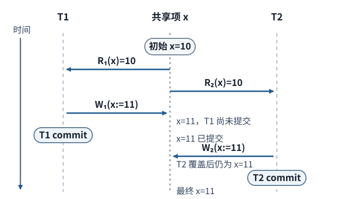
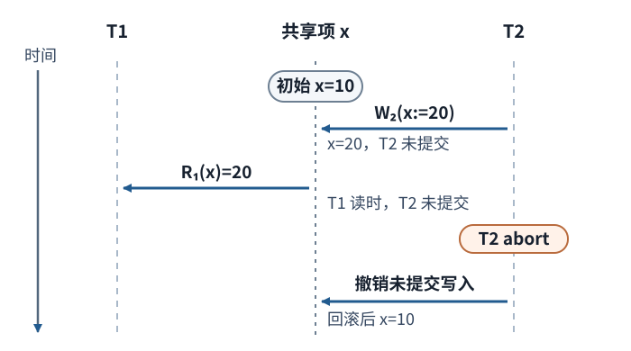
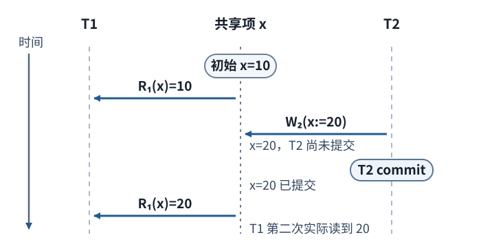
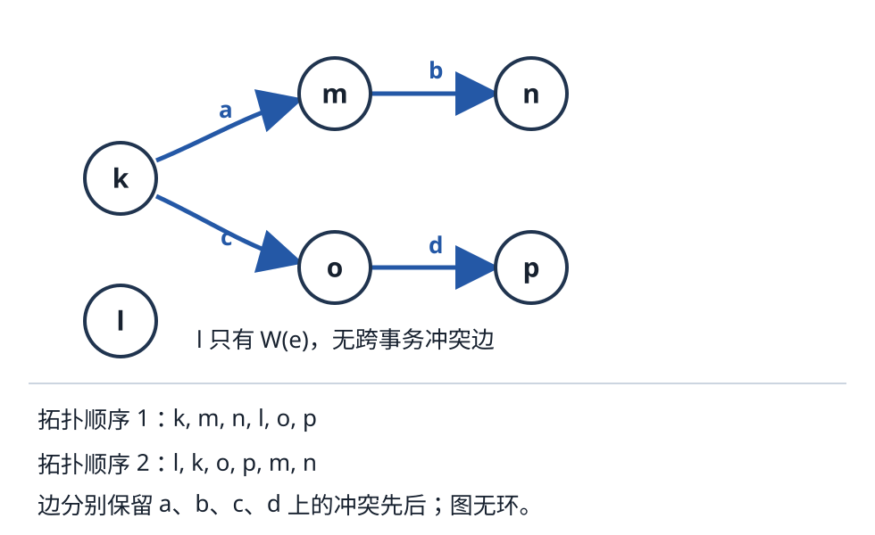
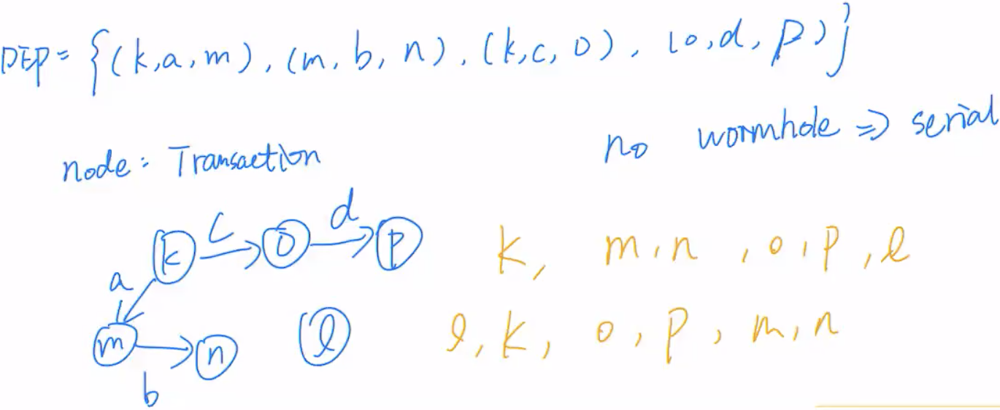

# 一段交错执行能否等价于串行执行？

两笔事务同时改账户与订单时，单看最后余额未必能看出谁读到了哪个版本。我们先按历史次序列出冲突操作，再用 precedence graph（优先图）判断是否存在一个串行事务顺序保留这些先后关系。优先图回答冲突可串行化问题；判断两条历史是否冲突等价，还要核对具体冲突操作顺序。

## 哪些操作顺序会影响结果？

history（历史）是事务读写操作按实际发生次序排列的序列。记 `R_i(x)` 为事务 `T_i` 读取数据项 `x`，`W_i(x)` 为写入 `x`。serial history（串行历史）先执行完一笔事务再执行下一笔；interleaved history（交错历史）允许事务操作穿插。

如果有 `N` 笔事务，只按“整笔事务依次排列”共有 `N!` 种候选顺序；3 笔事务有 `3! = 3×2×1 = 6` 种。优先图避免逐个执行这六种安排，而是把操作中互相约束的事务先后转成边。

conflict（冲突）满足三个条件：操作属于不同事务、访问同一数据项、至少一个操作是写。因此读—读不冲突，读—写和写—写会冲突。对两个相邻的读操作作交换，不会改变数据状态或任一方读到的值；例如 `R₁(x=10), R₂(x=10)` 中间没有写，交换后两边仍读到 10。若两次读取之间隔着写，就不能把它们当成无影响的相邻读。下面用同一共享数据项 `x` 展示三种局部交错：

### 丢失更新：两个事务基于同一旧值写回



两个事务都从 `x=10` 计算 `10+1=11`。T1 写入并提交后，T2 仍把基于旧值算出的 11 写回，覆盖了 T1 已提交的增量；交错终值是 11，而整笔串行执行两次加一应得 12。

### 脏读：读取发生在另一事务提交之前



按 PostgreSQL 18.7 的宽定义，脏读的判定点是读取那一刻：T1 读到了 T2 尚未提交的 `x=20`。随后 T2 中止并撤销写入是这段历史的后果，不是宽定义所要求的必经步骤。Berenson 等区分这种宽现象与写入者回滚、读者提交的较窄异常。

### 不可重复读：同一事务第二次读到已提交变化



这里 T1 的第二次读取实际看见了另一事务已提交的变化；仅仅在两次读取之间发生提交，并不保证第二次读取会看到不同值。三种并发异常示例不能单凭标签判断某个数据库隔离级别允许什么；产品保证要另查具体实现和隔离级别。

> [!note]- 课程原图（原始参考）
> 

## 怎样从历史生成优先图？

图的顶点是一笔事务。沿历史次序检查同一数据项上的操作：若 `T_i` 的冲突操作先于 `T_j` 的冲突操作，就加入有向边 `T_i → T_j`，可在边上写数据项名称以便复核。若同一对事务在不同对象上产生相反方向的边，就会形成环。

例如，`R_1(A)` 先于 `W_2(A)`，得到 `T1 → T2`；若另有 `W_2(B)` 先于 `R_1(B)`，则得到 `T2 → T1`。两边闭成环，表示冲突操作要求两个相反的串行先后。

先固定每笔事务内部的操作集合及次序。两段读写历史 conflict-equivalent（冲突等价），当且仅当它们包含相同操作，而且每一对跨事务、同一数据项上的冲突操作在两段历史中都保持相同的相对先后。串行历史就是把每笔事务的整段操作依次执行，不能重排事务内部的顺序。只考虑读写操作的历史 conflict-serializable（冲突可串行化），意为它与某个串行历史冲突等价。

优先图的判据是：历史冲突可串行化，当且仅当图无环。无环图的 topological sort（拓扑排序）给出一种串行事务顺序：每条边都把其起点事务放在终点之前，因此每对冲突操作在串行历史中仍保持原先后；各事务内部的顺序也原样保留。有环时，每个候选顺序都会违反至少一条边。这个测试只判断冲突可串行化，不推断事务是否可恢复、是否严格，也不分析未列入读写投影的提交状态；这些是另一些调度性质。

> [!info] 局部数学提示：怎样读有向边
> 边 `Ti → Tj` 意味着在至少一个共同数据项上，`Ti` 的冲突操作必须先于 `Tj`。拓扑排序反复选入度为零的顶点并移除它；若最后还有顶点，剩余子图含环。无环说明至少有一个满足这些偏序约束的串行次序，通常不唯一。

## 两条不同历史为什么可以有同一依赖图？

下面两个历史使用相同事务和数据项，但非冲突操作排列不同：

```text
H1 = <(T1,R,O1), (T2,W,O5), (T1,W,O3), (T3,W,O1),
      (T5,R,O3), (T3,W,O2), (T5,R,O4), (T4,R,O2), (T6,W,O4)>

H2 = <(T1,R,O1), (T3,W,O1), (T3,W,O2), (T4,R,O2),
      (T1,W,O3), (T2,W,O5), (T5,R,O3), (T5,R,O4), (T6,W,O4)>
```

逐对象比较跨事务冲突操作：`O1` 上 `T1` 读先于 `T3` 写，给出 `T1 → T3`；`O2` 上 `T3` 写先于 `T4` 读，给出 `T3 → T4`；`O3` 上 `T1` 写先于 `T5` 读，给出 `T1 → T5`；`O4` 上 `T5` 读先于 `T6` 写，给出 `T5 → T6`。`O5` 只有 `T2` 写，没有跨事务冲突。因此这两个具体历史逐项保留了同一组冲突操作的先后关系，属于冲突等价；这里的 H1/H2 是读写历史投影，提交操作省略，因为它们不参与本节的冲突边判据。

```text
DEP(H1) = DEP(H2)
         = {<T1,O1,T3>, <T3,O2,T4>, <T1,O3,T5>, <T5,O4,T6>}
```


左侧图以对象标记四条边；`T2` 是孤立顶点。课程原图只标了 `O1–O4`，没有画 `O5`；`O5` 是两条历史中相同的单笔写入，不产生冲突边。一个有效的拓扑顺序是 `T1, T2, T3, T4, T5, T6`，也可把不与其他事务冲突的 `T2` 放在别处。右侧课程图记录这两个具体历史在同一初态下的状态对应；这里相同结果来自这两个历史确实保持了全部冲突操作的先后。

但即使两条历史的优先图及对象标签完全相同，也不一定冲突等价；图把成对先后约束聚合起来，可能不记录究竟是哪一对写操作产生了同方向边。看初值 `x=0`、两笔事务都成功提交的两段四写历史；上标表示该事务内部第几次写，事务内部顺序分别是 `T1: 1 后 2`、`T2: 3 后 4`：

```text
H3 = <W1¹(x:=1), W2¹(x:=3), W2²(x:=4), W1²(x:=2)>
H4 = <W2¹(x:=3), W1¹(x:=1), W1²(x:=2), W2²(x:=4)>
```

聚合后，两段都有两条 `T1 → T2` 和两条 `T2 → T1` 的 `x` 冲突约束，平行边合并后图都只画成同一对反向边 `T1 ↔ T2`；但 `W1¹` 与 `W2¹` 的先后在 H3、H4 中翻转，所以这两段历史不冲突等价。两图都有环，因此两段历史都不属于冲突可串行化历史。H3 的最后写入是 `W1²(x:=2)`，最终值 2；H4 的最后写入是 `W2²(x:=4)`，最终值 4。图保留了是否有环所需的事务方向，却丢掉了逐个冲突操作对的身份；比较历史等价时，必须回到带操作身份的序列。

## 课程的 DEP 与 wormhole 应怎样读？

课程把一条边记为三元组 `<Ti, x, Tj>`，称为 dependency（依赖关系，`DEP`）；这相当于给 `Ti → Tj` 标上冲突对象 `x`。课程还用 `Before(T)` 表示能沿至少一条有向边到达 `T` 的事务，用 `After(T)` 表示能从 `T` 沿至少一条有向边到达的事务；零长度路径不计，因此不会把事务自身自动放进两组。对 H1/H2 的图，`After(T1)={T3,T4,T5,T6}`、`After(T3)={T4}`、`After(T5)={T6}`，而孤立的 `T2` 不在自己的 `Before` 或 `After` 中。

课程把 `T' ∈ Before(T) ∩ After(T)` 称作 `T` 的 wormhole transaction（课程用语“虫洞事务”）：从 `T` 可到 `T'`，同时又可从 `T'` 回到 `T`，所以图中存在有向环。这是本课程的术语；判定冲突可串行化仍直接看标准优先图是否有环。

## 2022S1 历史怎样复算？

题目给出的历史是：

```text
h = <(k,R,a), (m,W,a), (m,W,b), (n,R,b),
     (k,W,c), (l,W,e), (o,R,c), (o,R,d), (p,W,d)>
```

按数据项扫描跨事务冲突操作：`a` 上 `k` 读早于 `m` 写，所以 `k → m`；`b` 上 `m` 写早于 `n` 读，所以 `m → n`；`c` 上 `k` 写早于 `o` 读，所以 `k → o`；`d` 上 `o` 读早于 `p` 写，所以 `o → p`。`e` 只有 `l` 写，没有第二笔事务访问，不产生边。



> [!note]- 课程手写依赖图与排序（原始参考）
> 

图从共同顶点 `k` 分成 `k→m→n` 和 `k→o→p` 两支；两支之间没有额外的边，`l` 是孤立顶点。因此图无环，历史冲突可串行化；例如 `k,m,n,l,o,p` 与 `l,k,o,p,m,n` 都是合法拓扑顺序。课程原图中的手写 DEP 与逐项推导相符，也没有 wormhole；其中 “No wormhole ⇒ serial” 指这段历史冲突可串行化，不代表原历史本身已按串行方式执行。

> [!info]- 来源与核对范围
> - 冲突、冲突等价、优先图、无环判据和拓扑排序：Silberschatz、Korth、Sudarshan，《Database System Concepts》第 7 版第 17 章“Transactions”，2019 年课程幻灯片：[Chapter 17](https://db-book.com/slides-dir/PDF-dir/ch17.pdf)，尤其 “Conflict Serializability”（17.18–17.19）、“Testing for Serializability”（17.25）与“Test for Conflict Serializability”（17.26）。第 18 章主要展开并发控制协议；它可作邻接背景，但不是本页判据的直接来源。
> - 丢失更新、脏读、不可重复读与相关调度边界：Berenson 等，〈A Critique of ANSI SQL Isolation Levels〉（1995），§§2.2、3、4.1 P4，[作者公开稿](https://www.microsoft.com/en-us/research/wp-content/uploads/2016/02/tr-95-51.pdf)。PostgreSQL 18.7 官方文档 §13.2 [Transaction Isolation](https://www.postgresql.org/docs/18/transaction-iso.html#TRANSACTION-ISO) 用作当前产品对并发异常的背景；本页的优先图只分析显式列出的读写历史，不据此推断 PostgreSQL 的快照或隔离级别行为。核对于 2026-11-13。
> - `possibleDependency.png` 和 `2022S1Q3.png` 原文件逐字节复制到 `resources/course-originals/` 并折叠保留；两图在 700px 下的细节不宜继续作为主阅读依据。H1/H2 的 `dependencygraph.png` 在 700px 下可读，故仍作为主图。
