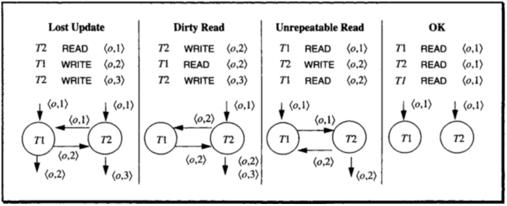
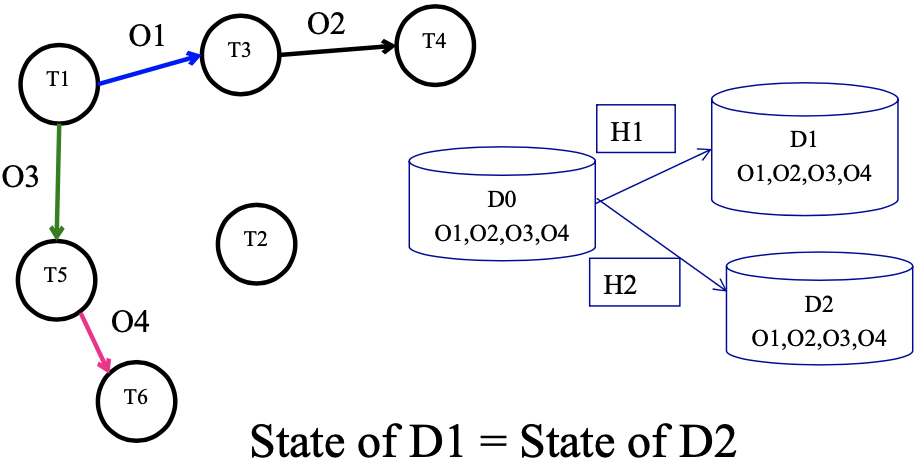

# How does a precedence graph test a transaction history? / 如何用优先图判断事务历史？

Represent each conflicting operation order as a directed edge between transactions. A history is conflict-serializable exactly when its precedence graph is acyclic. Course DEP and wormhole exercises use their own stated terminology. / 将每组冲突操作的先后顺序表示为事务间有向边。历史当且仅当优先图无环时才是冲突可串行化。课程 DEP 与 wormhole 练习使用其给定术语。

## Isolation & Dependency / 隔离与依赖
### Isolation Concept
- Isolation defines which effects concurrent transactions may observe. Serializable isolation makes the committed result equivalent to some serial execution; weaker isolation levels may permit anomalies. Isolation preserves application invariants only when constraints are enforced or every transaction follows the required logic.
- We can achieve isolation by sequentially processing each transaction - generally not efficient and provides poor response times.
- We need to run transactions concurrently with the following goals
  - Concurrent execution should not cause application programs (transactions) to malfunction (fail).
  - Concurrent execution should not have lower throughput or bad response times than serial execution.

### Possible dependencies


- Lost Update, Write-Write, T1 Write is covered by T2
- Dirty Read, Write-Read, T1 read in middle of write
- Unrepeatable Read, Read-Write, T1 reading while others writing
- OK, no dependency

### Dependency model
- $I_i$ : set of inputs (objects that are read) of a transaction $T_i$
- $O_i$ : set of outputs (objects that are modified) of a transaction $T_i$ Note $O_j$ and $I_j$ are not necessarily disjoint that is $O_j \cap I_j ≠ ∅$
- Given a set of transactions , Transaction $T_j$ has no dependency on any transaction $T_i$ in if -
  $$
  O_i\cap(I_j\cup O_j) = empty\ for\ all\ i ≠ j
  $$
- This approach cannot be planed ahead as in many situation inputs and outputs may be state dependant/not known in prior.

### Dependency Formal Definition
- Let **H** is a **history sequence** of tuples of the form (T, action, object). Here, T is transaction, action can be read/write, object is what the action operates on. e.g. (T1, Read, O1)
- For conflict-serializability, add an edge $T_i \to T_j$ when an operation of $T_i$ precedes and conflicts with an operation of $T_j$ on the same object: the transactions differ and at least one operation is a write. Read-read pairs do not conflict. The object may label the edge.
- A precedence graph is acyclic exactly when the history is conflict-equivalent to a serial history. This graph criterion is about conflict serializability, not every possible notion of serial equivalence ([Database System Concepts, 7e, ch. 18](https://www.db-book.com/Previous-editions/db7/slides-dir/PDF-dir/ch18.pdf)).

### Dependency Relations Example
H1 = <(T1,R,O1), (T2,W,O5), (T1,W,O3), (T3,W,O1), (T5,R,O3), (T3,W,O2), (T5,R,O4), (T4,R,O2), (T6,W,O4)>\
H2 = <(T1,R,O1), (T3,W,O1), (T3,W,O2), (T4,R,O2), (T1,W,O3), (T2,W,O5), (T5,R,O3), (T5,R,O4), (T6,W,O4)>

Give

- DEP(H1)
- DEP(H2)
- Dependency graph

For questions like this, first we focus on the object order: O1, O2.... We can notice that O1 is in T1 and T3, so we can write <T1, O1, T3> in the DEP(H1). Then we can see T3 and T4 both operate on O2, so we can write <T3, O2, T4>...

DEP(H1) = {<T1, O1,T3>, <T3,O2,T4>, <T1,O3,T5>, <T5,O4,T6> }\
DEP(H2) = {<T1, O1,T3>, <T3,O2,T4>, <T1,O3,T5>, <T5,O4,T6> }\
Dependency graph


### Isolated History
- A serial history is history that is resulted as a consequence of running transactions sequentially one by one.
- N transactions can result in a maximum of N! serial histories.
- A history is conflict-serializable if it is conflict-equivalent to a **serial history** (the conflicting operations have the same order).
- A history is legal if it respects the applicable lock-grant rules.
- In this course's dependency-graph terminology, the wormhole theorem characterizes the illustrated isolation condition. For the standard conflict-serializability test, use the acyclic-precedence-graph criterion above.

#### Isolated History – e.g.,

If T1 precedes T2, it is written as T1 << T2.

```
Before(T) = {T’ | T’ << T}
After(T) = {T’| T << T’}
```

E.g.

```
After(T1) = {T5,T6, T3, T4}
After(T3) = {T4}
After (T5) = {T6}
```

### Wormhole Transaction
A transaction T’ is called a **wormhole transaction** if

$$
T' \in Before(T) \cap After(T)
$$

That is T << T’ << T. This implies there is a **cycle** in the dependency graph of the history. Presence of a wormhole transaction implies it is not isolated (=> not a serial schedule).

Idea to solve wormhole problem:

1. Known history
2. Write DEP based on history
3. Draw Dependency graph based on DEP
4. See if there is a wormhole or not

#### 2022S1 Example
Given the following transaction history h we are told that k, l, m, n, o, and p are transactions, and operations are Read and Write operations which are labeled as R and W, and operations are done on the objects labeled as a, b, c, d, e:\
h = < (k,R,a),(m,W,a),(m,W,b),(n,R,b),(k,W,c),(l,W,e),(o,R,c),(o,R,d), (p,W,d) >\
Please find the DEP(h) and draw as a simple graph version as well. Then using the concept of wormholes explain whether this history is equal to a serial history or not, i.e., if this history is not equal to a serial history then give a wormhole example, and if it is then give a serial execution of these transactions that this history is equal to. Briefly explain your steps with sentences while answering this question.

Remind that the tuple is (Transaction, Action, Object), the DEP is <T1, O, T2>. The use of all characters is indeed confusing us.

Answer

