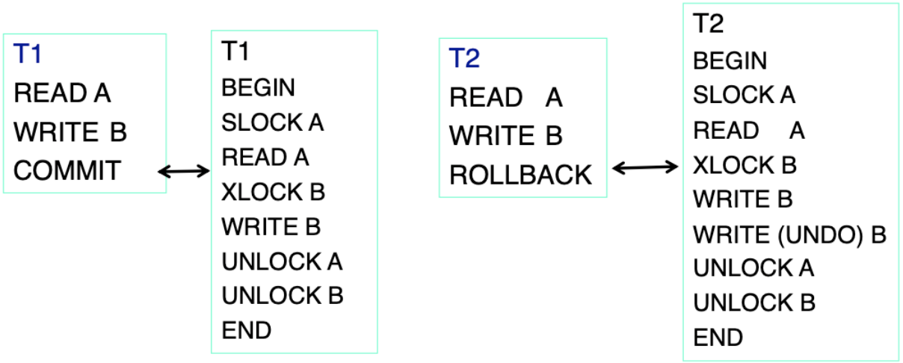
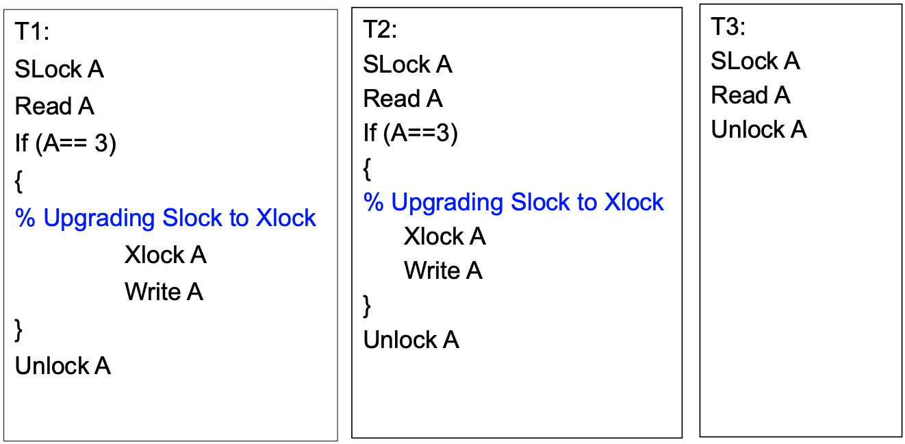
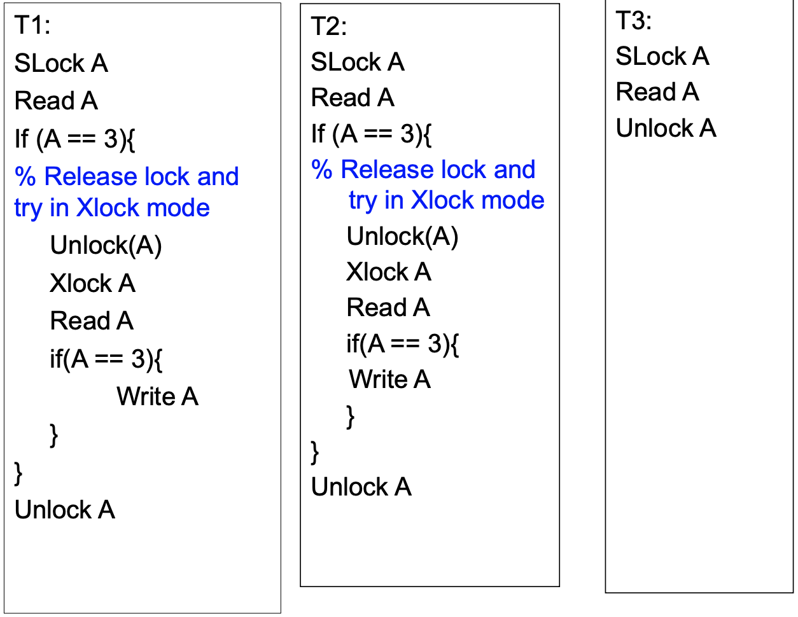
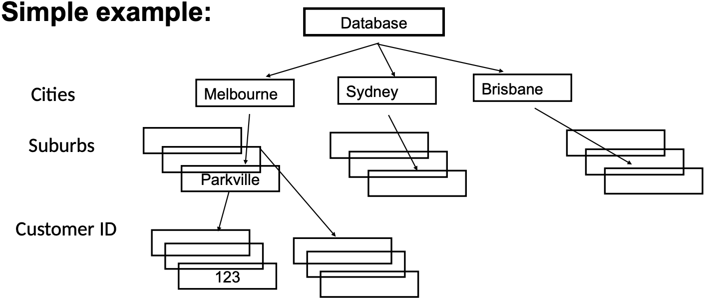
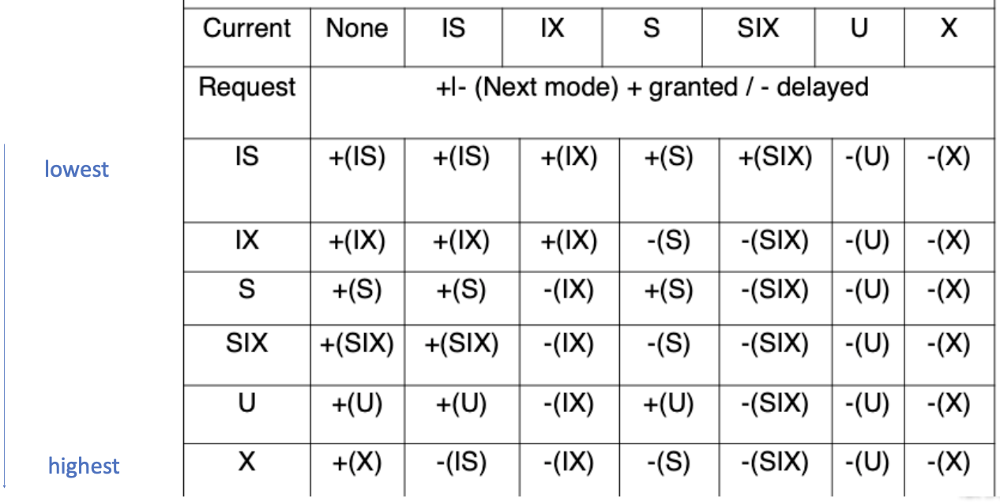
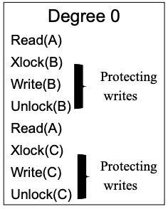
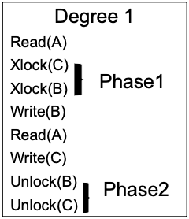
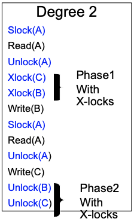
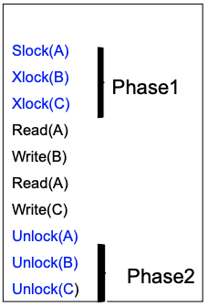

# 两笔事务同时升级锁时为何会互等，隔离级别又保证什么？

两个事务都先读到账户 `A=3`，随后都决定把它改成 4。每笔事务读数据时拿到共享锁，准备写入时再申请排他锁；由于对方仍持有共享锁，两边的升级请求都无法获准。要理解这个等待环，先明确锁兼容规则和两阶段锁的保证，再把课程里的锁协议与 PostgreSQL 18 的 MVCC 隔离行为分开看。

## 共享锁与排他锁如何协调读写？

shared lock（共享锁，`S`）允许多个事务同时读取同一数据项，但会阻止其他事务在该项上取得不兼容的写锁。exclusive lock（排他锁，`X`）允许持有者读取和修改该项，并阻止其他事务取得 `S` 或 `X` 锁。lock compatibility（锁兼容性）回答的是：一个资源已经有某种锁时，另一个请求能不能同时获准。

| 新请求 | 资源空闲 | 已有 S | 已有 X |
| --- | --- | --- | --- |
| S | 获准 | 获准 | 等待 |
| X | 获准 | 等待 | 等待 |

读操作需要 `S`、写操作需要 `X` 是本课程的基础锁模型。`BEGIN`、提交、解锁，以及回滚时如何撤销写入，需要结合具体恢复模型解释；它们不是所有数据库都必须由应用手写的同一种锁操作。

## 两阶段锁怎样保证冲突可串行化？

well-formed transaction（结构良好的事务）在读或写数据项前取得覆盖该操作的适当锁，并在操作受保护时保持锁。two-phase locking（两阶段锁，2PL）把锁管理分成两个阶段：增长阶段只能加锁或升级，第一次解锁之后进入收缩阶段，此后不能再加锁，也不能升级锁。

若所有事务都结构良好、都遵守 2PL，且锁管理器只授予兼容的锁请求，那么该调度是冲突可串行化的。直观上，每笔事务的最后一次加锁可用来排列事务先后；2PL 禁止事务在释放锁以后再重新取得更强的锁，从而不会把冲突次序绕成环。反向说法不能倒过来用：某笔事务不遵守 2PL，不表示它参与的每个具体调度都一定不可串行化，只表示 2PL 的这个充分保证不再适用。

strict two-phase locking（严格两阶段锁，strict 2PL）进一步把排他锁保持到提交或回滚完成。这样其他事务不能读到未提交的写入，也不会在其后才被迫跟随一个已经回滚的事务撤销；代价是写锁占用更久，等待可能增加。课程的基础 2PL 与严格 2PL 不应混为一条规则。

图左把读写历史和右侧的锁操作并列；`T2` 失败时，右栏先对 `B` 做 `WRITE(UNDO)`，再释放 `A`、`B` 上的锁。它表示课程中的锁调度/恢复模型：撤销未提交写入之前仍保护相关数据。实际数据库通过事务日志和恢复代码实现回滚；`ROLLBACK` 命令本身不是业务事务中的一条普通 `WRITE(B)`，不可把它当成普通写操作来套用 2PL 定理。

## 为什么共享锁升级会形成等待环？

课程图中的 `T1`、`T2` 都先取得 `S(A)` 并读到 3，然后各自请求把锁升级为 `X(A)`。`X` 与对方持有的 `S` 不兼容，因此每个升级都在等另一个事务释放共享锁：

| 时刻 | T1 | T2 | 等待关系 |
| --- | --- | --- | --- |
| 1 | 取得 S(A)，读到 3 |  |  |
| 2 |  | 取得 S(A)，读到 3 |  |
| 3 | 请求 X(A)，等待 T2 |  | T1 → T2 |
| 4 |  | 请求 X(A)，等待 T1 | T1 → T2，T2 → T1 |

wait-for graph（等待图）出现 `T1 → T2 → T1` 的环，所以两边都无法靠自行推进来完成。第三个事务 `T3` 只读后释放 `S(A)`；若它先完成，短暂等待可能解除，但不能保证 `T1` 与 `T2` 之间的升级环自动消失。

图中的一种教学解法是先释放 `S(A)`，再申请 `X(A)`；锁获准后必须重新读取 `A` 并重验条件。这样放弃了旧读值，避免两个事务都一直持有 `S` 相互等待。不过释放后再加锁违反 2PL，因而不再获得 2PL 的冲突可串行化保证；它也不是任何隔离级别下都通用的替代方案。实际应用可在读前取得适当的更新锁或排他锁，使用数据库条件更新，或让数据库检测死锁并回滚一个受害事务。跨多个资源时还应统一加锁次序；仅统一资源顺序不能消除同一资源上的共享锁升级环。

图中重新读 `A` 并再次判断 `A == 3` 是安全的关键：等待期间其他事务可能已改变 `A`。若不重验就照旧写，会用失效的判断覆盖新状态。这个示例是解决“先检查、后更新”竞态的一种流程，不是严格 2PL 的特例。

## 粗粒度与细粒度锁怎样取舍？

lock granularity（锁粒度）指锁覆盖的资源范围。粗粒度锁（如整张表）管理记录较少，但无关行也可能互相阻塞；细粒度锁（如单行）允许更多并发，却需要管理更多锁记录。树形层次让事务能选合适范围；如果要锁住某个叶子节点，锁管理器需要知道高层节点正在被更细地共享读取还是修改。

图示展示由根节点向下到叶子的资源层次。intention lock（意向锁）在祖先节点声明事务准备在后代加什么锁：`IS` 表示准备在更细层级加共享锁，`IX` 表示准备加排他锁，`SIX` 表示本节点共享读取且准备在后代排他修改。一般从根向叶取得锁，从叶向根释放，避免别的事务只看粗粒度节点时漏掉后代锁。

标准五模式协议按资源树从根向叶取锁：在节点显式请求 `S` 或 `IS` 前，沿祖先路径取得 `IS` 或 `IX`；请求 `X`、`IX` 或 `SIX` 前，沿祖先路径取得 `IX` 或 `SIX`。已有祖先 `S` 可隐含保护后代读取，已有祖先 `X` 可隐含保护后代读写，因此不必重复显式取得每个后代锁；`SIX` 同时包含子树读取与后代写入意向。提前解锁时从叶向根释放，仍需遵守所选事务锁协议。

下表的行是新请求，列是另一事务在同一资源上已获准的模式。`S` 与 `IX` 不是简单的强弱关系：`S` 保护整个子树读取，`IX` 允许在后代逐项申请写锁，两者冲突。

| 新请求 / 已有 | IS | IX | S | SIX | X |
| --- | --- | --- | --- | --- | --- |
| IS | 兼容 | 兼容 | 兼容 | 兼容 | 等待 |
| IX | 兼容 | 兼容 | 等待 | 等待 | 等待 |
| S | 兼容 | 等待 | 兼容 | 等待 | 等待 |
| SIX | 兼容 | 等待 | 等待 | 等待 | 等待 |
| X | 等待 | 等待 | 等待 | 等待 | 等待 |

> [!example] 表锁怎样发现某一行正在被修改
> T1 持有整张账户表的 `S`。T2 想写其中 A 行，必须先在表上取得 `IX`，再在 A 行取得 `X`。表上的 `S` 与 `IX` 冲突，T2 在祖先处就等待，因此不会出现“整表共享读取与某个后代排他修改同时获准”。

SQL Server 的 `update lock（更新锁，U）` 解决的是同一资源上准备从读转写的问题：按其兼容矩阵，`U` 与 `IS`、`S` 兼容，与另一个 `U`、`IX`、`SIX`、`X` 不兼容。单独 `U` 不提供后代写入意向，不能代替父节点的 `IX`；SQL Server 另有组合模式 `UIX` 表示 `U` 与 `IX` 同时持有。需要读后修改同一行时，先取得合适的 `U` 或 `X` 可避免两笔事务都先拿 `S` 再升级的特定死锁；产品语义要按实际锁管理器判断。

> [!example]- 课程原矩阵与修正说明
> 
>
> 原图的列为已有模式，行为新请求，`+/-` 表示授予或等待。图中已有 `U` 时请求 `IS`、`S` 的两格误标为等待；SQL Server 中均兼容。原课程把单独 `U` 当作支持后代写锁的父模式，也不能与这一产品兼容矩阵混用。上面的五模式表用于复算层级锁；原附件保留作课程记录。

## Degree 0 到 Degree 3 与 SQL 隔离级别有什么关系？

课程的 Degree 0–3 是历史锁协议分类，不是 SQL 隔离级别的别名。四张图用 `S/X` 锁和锁保持时长逐步提高保护程度；可按本课程模型这样读：

| 课程级别 | 图中保护方式 | 能避免什么 | 仍可能出现什么 |
| --- | --- | --- | --- |
| Degree 0 | 写入期间短暂使用 `X` | 不覆盖其他仍受 `X` 保护的未提交写入 | 自己提前释放写锁后不再受保护；读改写丢失、脏读等仍可能 |
| Degree 1 | 写入使用 `X` 并保持到事务结束 | 避免他人覆盖自己的未提交写入，以及回滚抹去后写的更新 | 读可无锁，脏读与基于旧读值覆盖已提交更新仍可能 |
| Degree 2 | 读时取得 `S` 后可释放；`X` 保持到事务结束 | 在 Degree 1 上避免脏读 | 不可重复读和基于旧读值的丢失更新仍可能 |
| Degree 3 | `S/X` 都保持到事务结束 | 保护已读数据及未提交写入，避免上述交错 | 谓词、范围和幻读仍取决于锁是否覆盖相应资源 |

这里区分两种曾被称为 lost update 的现象。Gray 原始 Degree 定义关注未提交写覆盖及回滚恢复；前一篇的“两个读改写都依据旧值”是另一种丢失更新。Degree 1/2 的长写锁本身不能保证后者不发生。

> [!example] 没有脏写也可能丢一次自增
> 初始 A=3。T1 与 T2 都先读取 3；Degree 2 下各自读时取 `S`，读完即释放。T1 随后取 `X`、写 4、提交并释放；T2 再取 `X`，仍把先前算出的 4 写回并提交。每次写锁都持到结束，没有未提交覆盖，但两次加一只得到 4。要保住检查到更新之间的条件，需要保持相应读保护、使用原子条件更新，或提交时验证旧读仍有效。

图中的概括针对课程给出的基本 `S/X` 模型；Degree 名称不能直接推断 PostgreSQL、SQL Server 或其他系统的实现行为。

## PostgreSQL 18 的隔离级别实际保证什么？

PostgreSQL 主要用 multiversion concurrency control（多版本并发控制，MVCC）：查询读取某个时点可见的数据版本，普通读取通常不会因另一个事务更新同一行而等待写锁。它也提供表级、行级及显式锁；`SELECT ... FOR UPDATE` 等操作会请求行锁，事务可按应用需求控制冲突。课程中的一把 `S` 锁阻止一切 `X` 锁，不等于 PostgreSQL 的读写实现。

PostgreSQL 18 文档中的隔离级别保证如下。这里的“可串行化异常”是指一组成功提交的事务结果无法等价于任何串行顺序；它比单次脏读或不可重复读更广。

| PostgreSQL 18 隔离级别 | 脏读 | 不可重复读 | 幻读 | 可串行化异常 |
| --- | --- | --- | --- | --- |
| `READ UNCOMMITTED` | 不可能，按 `READ COMMITTED` 执行 | 可能 | 可能 | 可能 |
| `READ COMMITTED` | 不可能 | 可能 | 可能 | 可能 |
| `REPEATABLE READ` | 不可能 | 不可能 | 不可能（高于 SQL 最低要求） | 仍可能 |
| `SERIALIZABLE` | 不可能 | 不可能 | 不可能 | 不可能 |

`READ COMMITTED` 通常为每条语句取一个新快照；同一事务后续语句可能看到其他事务已提交的更改。`REPEATABLE READ` 使用稳定事务快照，但仍可能遇到下一篇会展开的写偏斜。`SERIALIZABLE` 在快照上监测危险的读写依赖；若无法安全地按某个串行顺序提交，PostgreSQL 会中止一个事务，应用需从事务开头重试，常见错误码为 `40001`。这个保证适用于参与所需一致性检查的相关读写事务；外部副作用不由数据库隔离级别撤销。

PostgreSQL 也会检测实际的锁等待死锁，选择事务中止以打破等待环。官方文档建议多个事务以一致顺序取得锁，并让应用准备处理被取消事务后的重试；这种产品行为不同于前文由应用手工遍历锁层级的课程模型。

> [!info]- 来源
> - `S/X`、多粒度锁与 2PL 的算法基础：Silberschatz、Korth、Sudarshan，《Database System Concepts》第 7 版第 18 章“Concurrency Control”，2019 年 3 月课程幻灯片，https://www.db-book.com/slides-dir/PDF-dir/ch18.pdf 。
> - 当前 PostgreSQL 的 MVCC、隔离级别、快照和串行化失败：PostgreSQL 18 文档第 13.1 节“Introduction”、第 13.2 节“Transaction Isolation”，访问于 2026-11-06，https://www.postgresql.org/docs/18/mvcc-intro.html 和 https://www.postgresql.org/docs/18/transaction-iso.html 。
> - PostgreSQL 显式锁、锁模式和死锁：PostgreSQL 18 文档第 13.3 节“Explicit Locking”，访问于 2026-11-06，https://www.postgresql.org/docs/18/explicit-locking.html 。
> - 图中 `U` 更新锁的 SQL Server 语义和兼容矩阵：Microsoft Learn，“Transaction locking and row versioning guide”，SQL Server 17，访问于 2026-11-06，章节“Lock modes”“Update locks”“Lock compatibility”，https://learn.microsoft.com/en-us/sql/relational-databases/sql-server-transaction-locking-and-row-versioning-guide?view=sql-server-ver17 。
> - 层级锁五模式与 Degree 的原始含义：[Gray et al., Granularity of Locks and Degrees of Consistency in a Shared Data Base](https://people.eecs.berkeley.edu/~kubitron/courses/cs262a-F21/handouts/papers/Granularity%20of%20Locks%20and%20Degrees%20of%20Consistency%20RJ%201654.pdf)，1976，Table 1、Rules for requesting nodes、Definition 1；不要与基于旧读值的读改写丢失混同。
