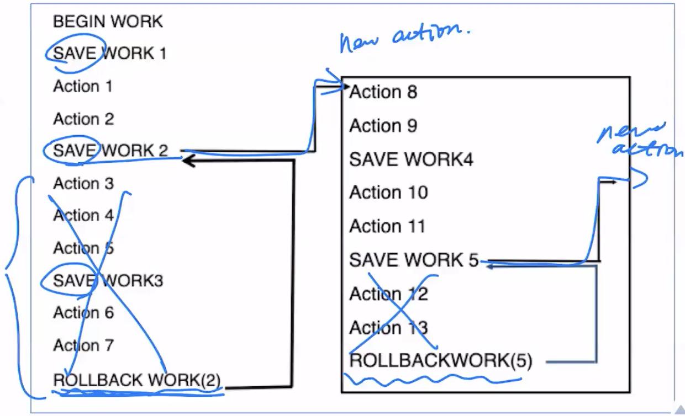
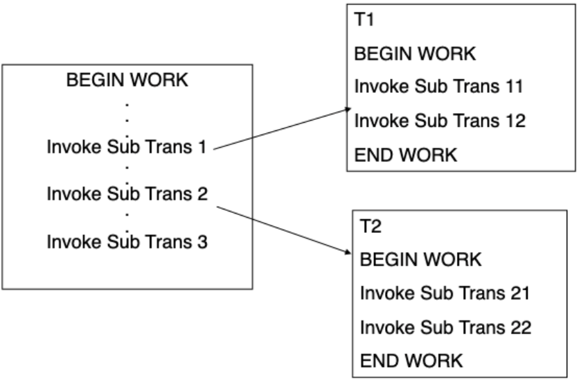

# 扣款成功但入账失败时，事务边界与局部回滚怎样保护业务？

Alice 向 Bob 转 100 元：系统先从 Alice 账户扣款，再向 Bob 账户入账。若扣款成功后进程崩溃，数据库里就会只少不多；若一次航班预订的第三段路线失败，整笔重做又很浪费。本章沿着这两个故障场景，说明事务如何定义原子边界、保存点怎样保留前面的工作，以及课程里的嵌套事务模型与数据库保存点有什么区别。

## 为什么转账必须由一个事务包住？

假设转账前 Alice 有 500 元、Bob 有 200 元。转账操作要依次把两行改成 400 元和 300 元。若两步之间发生错误，数据库需要回到 `(500,200)`；若提交成功，则结果应是 `(400,300)`。transaction（事务）把这些受保护的数据库操作视为一个逻辑工作单元，通过提交或回滚确定整组操作的结果。

ACID 四个性质分别回答不同问题：

- atomicity（原子性）：扣款与入账作为一组提交，或都撤销；不留下只做一半的数据库更新。
- consistency（一致性）：提交前后的数据满足已声明的约束与业务规则，例如账户余额不能为负、学生编号不能重复。数据库不会替应用猜出未声明的业务规则；初态有效、约束已声明且事务逻辑正确，才可保证规则不被破坏。
- isolation（隔离性）：并发事务看到的中间状态受隔离规则约束。隔离性本身不负责把两条更新变成原子整体；要避免另一个事务观察到只扣款、不入账的状态，还需要正确的事务边界。
- durability（持久性）：事务一旦成功提交，数据库应在其承诺范围内抵御故障并保留更新。

若扣款发生在银行服务、入账发生在另一套数据库，单个数据库事务通常无法自动把外部系统也纳入原子提交。要用双方都支持的分布式事务协议，或设计可重试、可补偿的业务流程；“本地 `ROLLBACK`”不能撤销已经发出的转账指令。

## 哪些动作能回滚，哪些只能补偿？

protected action（受保护动作）是在结果对外生效前由事务系统控制、可以撤销的数据库更新。real action（外部真实动作）一旦执行通常不能物理倒退，例如已发出的航班、已寄出的包裹或已发送的通知。事务回滚可以撤销本地记录，却不能让现实世界中的动作从未发生。

因此，涉及外部系统时要把数据库的提交状态与外部动作的交付状态分别设计。常见做法包括事务提交后再发送外部请求、失败后重试，或为已经完成的动作定义补偿步骤；若重试可能重复执行，就要让请求可去重或幂等。无论选择哪种流程，本地回滚都不能假装外部动作从未发生。

## 嵌入式 SQL 怎样表达事务边界？

embedded SQL（嵌入式 SQL）允许把 SQL 指令写进宿主语言代码。下面是 PostgreSQL 的 Embedded SQL in C（C 中的嵌入式 SQL，ECPG）片段，重点展示边界：开始事务、执行两个更新、请求提交；SQL 错误时尝试回滚。此片段假设连接已建立且当前没有外层事务，金额有效、账户存在，两次更新都恰好影响一行。ECPG 预处理器先把 `.pgc` 代码转为普通 C，再交给 C 编译器；运行时诊断可通过 SQL Communications Area（SQL 通信区，SQLCA）读取。

```c
#include <stdio.h>
EXEC SQL INCLUDE sqlca;

EXEC SQL BEGIN DECLARE SECTION;
long from_account;
long to_account;
long amount;
EXEC SQL END DECLARE SECTION;

int transfer(long from_id, long to_id, long cents) {
    from_account = from_id;
    to_account = to_id;
    amount = cents;

    EXEC SQL WHENEVER SQLERROR GOTO sql_error;
    EXEC SQL BEGIN WORK;
    EXEC SQL UPDATE accounts
        SET balance = balance - :amount
        WHERE account_id = :from_account;
    EXEC SQL UPDATE accounts
        SET balance = balance + :amount
        WHERE account_id = :to_account;
    EXEC SQL COMMIT WORK;
    return 0;

sql_error:
    fprintf(stderr, "database error: %ld\n", sqlca.sqlcode);
    /* 防止回滚本身出错时再次跳回本标签。 */
    EXEC SQL WHENEVER SQLERROR CONTINUE;
    EXEC SQL ROLLBACK WORK;
    return -1;
}
```

宿主变量在 `BEGIN DECLARE SECTION` 与 `END DECLARE SECTION` 之间声明，SQL 中用冒号前缀（例如 `:amount`）区分 C 变量和数据库列。实际业务必须在每条 UPDATE 后检查 `sqlca.sqlerrd[2]` 是否为 1，并检查余额约束和重复请求；零行更新不属于这里的 `SQLERROR`。若 COMMIT 已执行但确认在网络中丢失，错误标签里尝试 ROLLBACK 也不能证明原提交被撤销，需按稳定业务操作标识查证结果，见[未知结果与安全重试](../../../engineering-foundations/reliability/api-reliability-and-async-delivery.md)。错误标签通过 `sqlca.sqlcode` 输出 SQL 诊断。`WHENEVER SQLERROR` 是 ECPG 预处理器指令，用于生成错误跳转，不是 C 的异常语法。

> [!example] 课程购货函数怎样加入外层事务
> 课程里的 `BuySomething()` 展示了同一种平面事务组合：函数先向历史表插入购货记录，再扣减账户余额，最后用 `SELECT ... INTO` 取回扣款后的余额。外层 `process_purchase()` 执行 `BEGIN WORK` 后调用它；若 SQL 出错或余额不符合业务规则，就执行 `ROLLBACK WORK`，否则 `COMMIT WORK`。函数调用不会自动成为独立事务；它的数据库更新仍由外层边界一起提交或撤销。这里的 `SELECT ... INTO` 预期只取一行；需要读取多行时应使用游标或其他多行接口。

flat transaction（平面事务）只有一个提交层级：事务内所有数据库更改在根提交时一同持久化，根回滚时一同撤销。它适用于清晰的一组工作，但当大流程中一个可选步骤失败时，全部重做可能很昂贵。

## 航线的中间方案失败后怎样保留已完成部分？

假设用户要从墨尔本飞往都柏林：先订墨尔本—新加坡，再订新加坡—伦敦和伦敦—都柏林。若最后一段无座，系统想保留第一段，回到新加坡改订巴黎路线。savepoint（保存点）在一笔事务中标记局部位置；事务可以回滚到某个标记，撤销标记之后的操作，再继续当前事务。



图中 `SAVE WORK 1/2/3` 记录行程进度；`ROLLBACK WORK(2)` 撤销 work 2 之后的动作，蓝色标注表示改走备选路线。后面建立 work 4、work 5，若新路线之后的动作 12、13 失败，可再回到 work 5。图示强调的是“撤销到某个标记并继续”，不是独立提交多个子事务。

假设订票明细表为 `booking_segments(booking_id, segment_no, origin, destination)`。这里只处理同一个数据库内的航段记录，不是向外部航司实际出票。在 PostgreSQL 中，可用如下 SQL 表达“保留第一段、丢弃伦敦路线、改订巴黎路线”：

```sql
BEGIN;
INSERT INTO booking_segments VALUES (42, 1, 'Melbourne', 'Singapore');
SAVEPOINT after_singapore;
INSERT INTO booking_segments VALUES (42, 2, 'Singapore', 'London');
INSERT INTO booking_segments VALUES (42, 3, 'London', 'Dublin');
-- 假设这些记录插入后，业务校验判定伦敦路线不可用：
ROLLBACK TO SAVEPOINT after_singapore;
INSERT INTO booking_segments VALUES (42, 2, 'Singapore', 'Paris');
INSERT INTO booking_segments VALUES (42, 3, 'Paris', 'Dublin');
RELEASE SAVEPOINT after_singapore;
COMMIT;
```

`ROLLBACK TO SAVEPOINT` 撤销该标记之后的语句，事务仍可继续；`RELEASE SAVEPOINT` 移除标记但保留其后的更改。保存点释放不等于提交：航段记录仍是根事务的临时状态，直到最终 `COMMIT` 才提交；若整个事务随后回滚，保存点之后保留的修改也会被撤销。

## 课程中的嵌套事务与保存点有什么不同？

课程的 closed nesting（封闭嵌套）模型把一笔根事务表示成事务树：根事务可以调用子事务，子事务又可继续调用自己的孩子。图中根事务调用 `T1`、`T2` 等子事务；`T1`、`T2` 内部还能各自调用多个子事务。



在该课程模型里，子事务能读取父事务已产生的临时状态，完成后也可把暂定结果交给父事务；但子事务提交并不独立持久，也不对根事务以外的观察者公开。若子事务或祖先事务中止，其未最终提交的后代结果也需撤销；只有根事务提交后，整棵树的数据库工作才最终生效。课程假设父事务不与自己的子事务并行运行，兄弟子事务可并行。

数据库保存点只是一个现有事务里的回滚标记，不能自动提供“子事务独立调度与暂定提交、祖先仍可整体撤销”的完整运行模型。PostgreSQL 的 `SAVEPOINT` 与 `ROLLBACK TO` 提供局部恢复；`RELEASE SAVEPOINT` 释放标记，所做变更仍属于外层事务。使用时应按保存点语义理解，而不要把它当成可单独持久的嵌套事务。

## 事务处理监视器怎样协调多层业务系统？

transaction processing monitor（事务处理监视器，TP monitor）是课程对协调客户端、应用服务器和资源管理器的中间件角色的总称。课程列举的职责包括：把请求路由到服务器并管理事务、在异构资源之间协调提交、跟踪远程通信与恢复状态，以及管理终端、会话和表现层交互。这是课程的职责分类，不表示每个产品都提供同样一组服务。以 IBM CICS 为例，其事务环境文档描述了客户端、应用服务器池和资源管理器之间的协作；这只是一个具体实现参照。

跨多个支持该协议的数据库资源管理器时，two-phase commit（两阶段提交，2PC）可以协调各参与者对同一事务作出提交或中止决定；它本身不保证业务不变量，也不会自动把任意 HTTP 服务或不可逆真实动作纳入事务。并发隔离、约束验证、远程动作的重试/补偿仍需各自的机制。

> [!info]- 来源
> - 事务、ACID、保存点和嵌套事务的课程背景：Silberschatz、Korth、Sudarshan，《Database System Concepts》第 7 版第 17 章“Transactions”和第 18 章“Concurrency Control”，2019 年 3 月课程幻灯片，https://www.db-book.com/slides-dir/PDF-dir/ch17.pdf 和 https://www.db-book.com/slides-dir/PDF-dir/ch18.pdf 。
> - TP monitor 的课程职责分类与一个具体事务平台参照：IBM，“CICS transaction processing environment”，TXSeries 11.1 文档，访问于 2026-11-06，https://www.ibm.com/docs/en/txseries/11.1.0?topic=processing-cics-transaction-environment 。此处将产品实例作为参照，不把它推广成所有产品的定义。
> - 跨资源管理器协调提交的 2PC 算法背景：Silberschatz、Korth、Sudarshan，《Database System Concepts》第 7 版第 19 章“Recovery System”，2019 年 3 月课程幻灯片，https://www.db-book.com/slides-dir/PDF-dir/ch19.pdf 。
> - PostgreSQL ECPG 预处理、宿主变量和 SQL 嵌入方式：PostgreSQL 18 文档第 34.1 节“The Concept”，访问于 2026-11-06，https://www.postgresql.org/docs/18/ecpg-concept.html 。
> - ECPG 支持的事务与错误处理语句：PostgreSQL 18 文档第 34 章“ECPG — Embedded SQL in C”，访问于 2026-11-06，https://www.postgresql.org/docs/18/ecpg-sql-commands.html 。
> - PostgreSQL 保存点、局部回滚、释放标记后仍保留更改：PostgreSQL 18 文档“SAVEPOINT”，访问于 2026-11-06，https://www.postgresql.org/docs/18/sql-savepoint.html 。
> - 课程原图 `save-points.png`、`nestedTransaction.png` 支持本地流程示意；文中明确将它们与 PostgreSQL 保存点语义区分。
> - ECPG 连接与行数/错误诊断：[Managing Database Connections](https://www.postgresql.org/docs/18/ecpg-connect.html)、[Error Handling](https://www.postgresql.org/docs/18/ecpg-errors.html)，PostgreSQL 18，§34.2、§34.8；`NOT FOUND` 与 SQLERROR 区别、`sqlca.sqlerrd[2]` 行数。片段用本机 ECPG 14.24 预处理并通过 C 语法检查，未运行真实转账。
