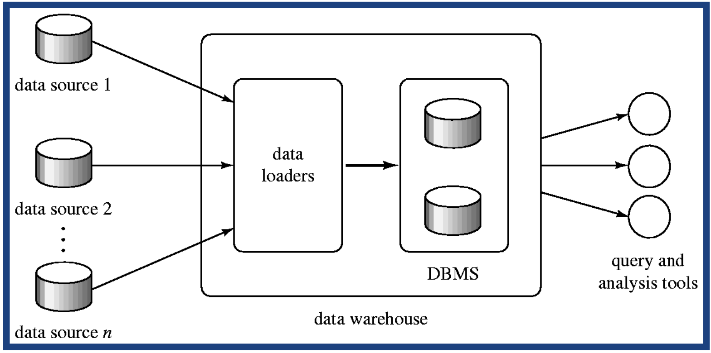

# 数据仓库怎样把多源业务数据整理成可分析的历史数据？

周一早上，分析师要比较上周各销售员的销售额。订单系统、会员系统和门店系统各有自己的字段名、编码方式和更新时间；同一批记录还可能因重试而重复到达。读者需要判断：数据由谁采集、怎样对齐和清洗、报告里的汇总数又是怎样算出来的？

## 数据如何从源系统进入仓库？

下图保留课程里的管道边界：多个数据源把数据送入加载器，加载器写入仓库，查询与分析工具从仓库读取。图没有规定传输一定由哪一端发起，也没有规定更新频率。

在经典定义中，data warehouse（数据仓库）把多个来源的数据按统一模式组织起来，并保留适合历史分析的信息。它可以把报表查询从 online transaction processing（OLTP，在线事务处理）系统上移开；现代仓库的物理存储也可以分布在多台机器或对象存储上，逻辑上仍提供共同的分析入口。

有两种课程中的采集方向：

- 来源驱动：源系统把变化推送到仓库，可连续发送，也可定时批量发送。
- 目标驱动：仓库定期向源系统请求新增或变化的数据。

另一条独立选择是数据在写入前还是写入后转换。extract-transform-load（ETL，抽取、转换、加载）先从源抽取、转换为目标格式，再写入仓库；extract-load-transform（ELT，抽取、加载、转换）先把原始或近原始数据放入目标平台，再在那里转换。两者都是数据管道形态，不与“推送还是拉取”一一绑定。

若业务要求源数据库和分析仓库在同一个事务中同步提交，可以跨系统协调；但这会让在线提交等待更远端的确认，并使外部系统不可用时的事务处理受影响。若报告能接受短暂滞后，异步采集或定期刷新通常更简单。实际选择取决于新鲜度、源系统负载、失败时的数据补偿能力和业务对跨系统原子性的要求。

## 清洗和整合怎样避免错误汇总？

先确定仓库希望表达的业务概念，再建立源字段到统一模式的映射。字段名字相似不代表语义一样；例如两个源里的 amount 可能一个含税、一个未税。还要明确单位、时区、有效时间和去重键，否则后续 SQL 即使计算正确，输入含义仍然可能错。

> [!info] ETL、ELT 与数据质量检查
> ETL 会在进入目标仓库前执行转换；ELT 会先落入目标环境再转换。两者都需要检查格式、业务规则、重复记录、缺失值和跨源映射。地址拼写、邮政编码错误、不同来源的地址表合并与去重，都是课程中的数据清洗例子。保留源记录标识与加载时间，能帮助追踪错误、重放批次和解释历史变化。

下面用一份小型合成销售明细追踪转换。表中四条输入行都已过滤到同一周；来源 A 的销售员字段末尾多一个空格，来源 B 同一订单事件、同一版本因采集重试出现两次。映射表已确认“陈”在两个系统中都是同一销售员，B-201 是该业务事件/版本的稳定去重键。

| 来源 | 订单事件/版本键 | 原始销售员 | 金额（元） |
| --- | --- | --- | ---: |
| A | A-101 | 陈␠ | 120 |
| B | B-201 | 陈 | 30 |
| B | B-201 | 陈 | 30 |
| B | B-202 | 李 | 80 |

处理步骤是先按稳定业务键 B-201 去掉同一事件/版本的重复投递，再去除陈的首尾空白，并通过映射表把两个源的销售员编码归到统一键。不能仅凭相同订单号去重：退款、冲销或更正若是新的业务事件或版本，应以各自事件和版本保留，按定义参与汇总。结果为：

| 统一销售员 | 保留订单 | 汇总 |
| --- | --- | ---: |
| 陈 | A-101、B-201 | 120 + 30 = 150 元 |
| 李 | B-202 | 80 元 |
| 全部 | 3 笔唯一订单 | 150 + 80 = 230 元 |

若没有去重，陈会被算成 180 元，全部会变成 260 元；这不是汇总公式错，而是重复输入改变了事实集合。反过来，如果 A-101 与 B-201 实际是两笔不同交易，就不能仅因金额或销售员相同而合并。去重必须依据业务上稳定、可解释的键。

仓库还要决定时间如何保存。交易发生时间、数据被采集的时间和某条业务属性生效的时间可能不同。保留这些时间维度，才能回答“上周末系统知道什么”或“某门店当时属于哪个区域”，也能在源系统更正迟到数据时重算受影响的结果。

## 为什么既要保留明细，也要准备汇总？

原始明细有助于追溯、重算和回答新的问题，但长期保存所有明细会增加存储与扫描成本。预先汇总能让常见报表更快，例如按销售员与日期保存销售额，再把每日结果相加为每周或每月结果。哪些汇总可以相加取决于度量：销售金额可求和；合并平均值时，应使用各组总和除以总笔数，或按每组计数加权平均。各组笔数相同时，可以直接平均各组均值；笔数不同时，一般需要加权。

> [!example] 从明细汇总到周报
> 本例三笔去重订单的销售额是 120、30、80 元。全周总额为 120 + 30 + 80 = 230 元；按销售员汇总得到陈 150 元、李 80 元，且 150 + 80 = 230 元，和全局合计相符。这个交叉核对能发现分组与全局两条计算路径之间的部分漏计或重计；若两条路径共享的输入都漏了同一笔，合计仍可能相符，因此还要核对输入范围和行数。
>
> 陈有 2 笔订单，平均每笔 150 ÷ 2 = 75 元；李有 1 笔，平均每笔 80 元。直接平均两个组均值会得到 (75 + 80) ÷ 2 = 77.5 元；正确的逐笔平均是按笔数加权，即 (75 × 2 + 80 × 1) ÷ (2 + 1) = 230 ÷ 3 ≈ 76.67 元。

仓库可以把汇总存成预聚合表或 materialized view（物化视图）。有些数据库能在特定查询满足条件时自动改用已有汇总；这属于引擎能力和查询资格，不是物化视图的普遍保证。以 PostgreSQL 18 为例，物化视图结果会被持久保存，但查询必须显式读取它；数据可能在刷新前过时，刷新由 REFRESH MATERIALIZED VIEW 执行。

## 读者怎样检查一份仓库报告？

沿报告的数值反向追踪四件事：

1. 这个指标的业务定义是什么，单位与含税口径是什么？
2. 每个源字段如何映射到统一模式，哪个键负责去重？
3. 数据保留的是交易时间、采集时间，还是维度生效时间？
4. 汇总覆盖哪些明细和时间窗口，是否有物化数据尚未刷新？

只要其中一项含糊，同一个查询就可能在不同报表中给出不同含义。仓库的核心工作不是“把数据放在一起”，而是让数据来源、转换规则、时间语义和汇总粒度都可解释。

> [!info]- 来源
> - 数据仓库的统一模式、来源驱动/目标驱动采集、同步与异步更新、清洗去重、更新时间传播和汇总选择：Silberschatz、Korth、Sudarshan，《Database System Concepts》第 7 版，2019，第 11 章，尤其 slides 11.8–11.11：[Data Analytics 课件](https://www.db-book.com/slides-dir/PDF-dir/ch11.pdf)。
> - ETL 与 ELT 都是现代仓库的数据转换路径：同一教材第 7 版第 11 章 slides 11.4；Microsoft Learn 的 Modern Data Warehouse playbook 对其示例架构也区分 ETL 与 ELT：[现代数据仓库方案](https://learn.microsoft.com/en-us/data-engineering/playbook/solutions/modern-data-warehouse/)。
> - PostgreSQL 18 物化视图保存查询结果、由 REFRESH 更新，并在显式引用时读取；不要据此推断其会自动替代基表查询：§39.3 与 REFRESH MATERIALIZED VIEW 文档：[物化视图](https://www.postgresql.org/docs/18/rules-materializedviews.html)、[刷新物化视图](https://www.postgresql.org/docs/18/sql-refreshmaterializedview.html)。
