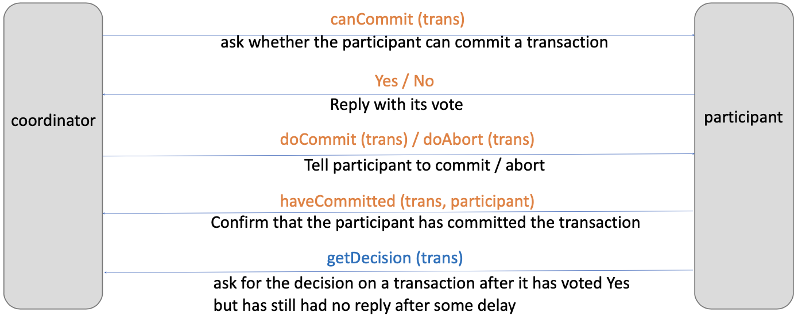
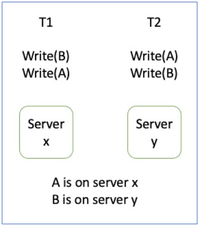

# 多个参与者怎样取得同一事务结果，副本又怎样等价于一份数据？

一笔银行转账要从西区账户扣 50 元、向东区账户加 50 元。假设转账前余额分别是 200 元和 100 元，完整提交应得到 150 元和 150 元；若一边只扣款、一边未入账，余额总和会从 300 元变成 250 元。两个参与者各自准备并投票后，西区与协调者之间的链路中断。协调者可能还没收到西区的 YES，也可能已经收到两票并持久记录 COMMIT、只是部分通知未送达。读者要判断：协调者在这两个阶段各能作出什么决定，东区能否自己宣布成功，西区恢复后又该查询什么？另一个问题是，同一账户还有多个副本；即使每笔交易都全提交或全回滚，副本各自采用不同事务顺序仍可能得到不可能的状态。本章先解释分布式提交，再解释隔离和副本顺序。

## 两阶段提交要解决哪一种一致性？

two-phase commit（2PC，两阶段提交）协调一笔 distributed transaction（分布式事务）在多个 resource manager（RM，资源管理器）上全提交或全回滚。coordinator（协调者）负责形成并公布一个全局决定。2PC 的名字容易与 two-phase locking（2PL，两阶段锁）混淆：2PC 决定事务结果，2PL 是可能用于隔离的并发控制规则。

继续转账例子。西区和东区各自先完成本地检查，但都不立即对外承诺结果：

1. 协调者向两个参与者发送 canCommit(trans)，询问能否准备提交。
2. 每个参与者检查本地约束和资源，并把 prepared（已准备）状态可靠记录后再投 YES。投 YES 表示“我已准备好按协调者之后的全局决定执行”，不是“我已经独立提交”。
3. 若所有必需参与者都投 YES，协调者先持久记录全局 COMMIT（提交），再通知参与者提交。任一票为 NO，或在全局决定之前缺少所需投票而超时，协调者可以持久记录 ABORT（中止）并通知所有参与者回滚。
4. 参与者执行收到的决定；提交分支再用 haveCommitted(trans, participant) 回报提交完成。回滚若需要确认，应使用协议中定义的中止确认，不把图中的 haveCommitted 当成提交/回滚共用的确认。

> [!example] 一笔转账只能有一个全局结果
> 初始余额合计为 200 + 100 = 300 元。若全局 COMMIT，结果是西区 200 - 50 = 150 元、东区 100 + 50 = 150 元，合计仍为 300 元；若全局 ABORT，两边都回到 200 元和 100 元。只扣款不入账会得到 150 + 100 = 250 元，违反转账原子性。

下图画出协调者与单个参与者之间的消息。canCommit 与 Yes/No 是准备投票；doCommit/doAbort 是决定；haveCommitted 是参与者确认提交。参与者若已经投 YES、却一直没收到决定，最下面的 getDecision 箭头表示它向协调者询问持久记录的结果。

在转账例中，若协调者仍可用，但尚未收到西区 YES、也尚未记录决定，它可以先持久记录 ABORT 并通知东区回滚；西区恢复后查询这项记录，再回滚本地 prepared 状态。若协调者已收到两票并持久记录 COMMIT，只是提交通知没到西区，东区按 COMMIT 执行，西区恢复后查询同一决定并提交。反之，若协调者本身不可达、东区只知道自己投了 YES，它无法分辨全局决定尚未产生还是已产生但通知丢失，因此必须等待恢复或查询到决定。

参与者在准备后可能仍持有锁或预留资源。如果协调者在决定写入日志之前故障，参与者没有足够信息自行选择提交或回滚；如果提交决定已经持久化，只是通知丢了，恢复后的参与者必须按该决定提交。2PC 保证各参与者遵循同一个全局提交或中止决定，但不保证它们在同一时刻执行决定，也不保证跨站读取能同时看见全部新值；读取可见性还依赖并发控制、锁或一致快照等机制。协调者故障时协议可能阻塞。超时能触发协调者在尚未决定时选择回滚，却不能让一个已投 YES 的参与者凭超时自行猜测全局结果。

> [!info] 需要区分安全与继续推进
> “所有参与者跟随同一决定”是安全性质；“即使协调者故障，事务也总能很快结束”是活性性质。经典 2PC 以可阻塞为代价保持前者。通过多数协调者推进的共识方案可以改变部分故障下的进展条件，但需要自己的持久状态和协议，不能把它当作无条件的 2PC 配置替换。

PostgreSQL 18 提供外部事务管理器使用的两阶段事务命令 PREPARE TRANSACTION、COMMIT PREPARED 和 ROLLBACK PREPARED。文档指出准备状态通常应很短；外部协调器不可达会让它延长。这个产品例子印证了 prepared 是持久状态，不意味着每个数据库都实现相同日志格式或都适合长期堆积 prepared 事务。

## 本地并发控制为什么必须接受同一个全局顺序？

2PC 只协调全局提交结果，不会自动让参与者对并发事务排序。看图中的两个对象 A、B：A 放在服务器 X，B 放在服务器 Y。事务 T1 先写 B、再写 A；T2 先写 A、再写 B。

若 X 先执行 T2 对 A 的写，再执行 T1 对 A 的写，则冲突要求 T2 在 T1 之前；若 Y 先执行 T1 对 B 的写，再执行 T2 对 B 的写，则冲突又要求 T1 在 T2 之前。依赖图于是有 T2 → T1 和 T1 → T2 的环，不存在满足两边局部顺序的串行顺序。即使两个事务最后都投 YES，结果也不是一个可串行化的全局历史。

各节点必须共同执行某种并发控制，例如全局两阶段锁、所有节点都遵守的时间戳序，或分布式 optimistic concurrency control（乐观并发控制）：验证要服从共同的全局序列，或合并跨站读写依赖并拒绝形成全局环。每个参与者单独验证本地读写集并投 YES，不足以保证全局可串行化；图中的 T1→T2 与 T2→T1 正可能同时通过互不知情的本地检查。2PC 本身不建立这一顺序。分布式时间戳方案不仅需要生成全局可比较且不冲突的时间戳，还必须把时间戳随对象访问传到每个节点，并让各节点拒绝违反同一顺序的访问。时间戳唯一本身不能建立串行化。

## 多副本如何维持“像一份数据”？

one-copy serializability（单副本可串行化）要求：对复制对象的并发事务效果，应等价于这些事务在一份逻辑数据上按某个串行顺序执行。这个目标约束副本更新顺序和冲突读写；它与 2PC 的全局提交/回滚不同。2PC 不保证隔离，单副本可串行化也不自动说明提交决定怎样跨参与者持久化。

课程中的 available-copies（可用副本）协议是一种教学模型，不是所有复制产品的通用 quorum（仲裁/法定人数）算法。它不只是“挑一个副本读、给当前节点写”：对同一数据项，读可选任一可用副本，写要应用到当时所有可用副本。站点故障被检测后，协议为其副本执行 EXCLUDE（排除）事务；站点恢复时，up-check（恢复探测）只说明站点重新可联系，还要执行 INCLUDE（纳入）事务，先将副本补到最新值，再声明它可用。原论文把站点故障可检测作为该算法的假设；网络分区不在其模型内，心跳超时本身不能授权分区两侧各自改写成员集合。

读写事务还要与 EXCLUDE/INCLUDE 操作建立共同的逻辑先后关系。可把规则概括为：①只读写已纳入的可用副本；②若事务读了某副本，而该站点随后故障，则该事务须逻辑先于该副本的 EXCLUDE，避免被排除副本上的读值在所有可用副本中都消失；③事务写某数据项时，至少一个被写副本也须满足上一条先后约束；④对事务要写的数据项，若尚未写到其某个副本、该站点便故障，则 EXCLUDE 须先于该事务；若尚未写到该数据项的某副本时它被 INCLUDE，则事务须先于 INCLUDE。用户事务的冲突边与这些成员变更边共同构成 available-copies serialization graph（可用副本序列化图）；图必须无环，才能得到单副本可串行化。原论文并没有说所有成员变化都无条件中止事务，而是要求这些逻辑约束成立。

> [!example] 可用副本失效后怎样重新加入？
> 假设西区账户有 X1、X2 两份副本，EXCLUDE(X1) 已在共同逻辑顺序中先于新事务 T，且 X2 可用。T 可从 X2 读取，并把更新应用到所有可用副本；此时集合只有 X2，不必要求已排除的 X1 在线。X1 恢复后，INCLUDE(X1) 先从最新的逻辑状态补齐数据，完成后才把它列为可用副本。再看失败与事务交错：若 T 要更新这项账户数据，且已从 X1 读值，但 X1 在 T 写到它之前故障，读规则要求 T 先于 EXCLUDE(X1)，而写规则要求 EXCLUDE(X1) 先于 T；两条边形成 T→EXCLUDE(X1)→T 的环。这一事务不能提交，应中止并在已一致排除 X1 的成员集合上重试。故障检测只是触发成员变更的输入，不是共同逻辑顺序的替代品。
>
> 这是 available-copies 的示意，不是读取/写入多数派算法。若课程中的另一个分布式事务例题明确规定某资源管理器是必需参与者，它的中止规则来自该事务的参与者集合，不能把它泛化成所有可用副本协议的规则。

可以用三个问题检查一个分布式事务设计：

- 哪些资源管理器必须参与，谁生成并持久保存全局决定？
- 参与者在哪一步写入 prepared 状态，故障后从哪里恢复决定？
- 哪条并发控制规则让所有冲突对象遵守同一串行顺序，副本更新如何保持单副本语义？

> [!info]- 来源
> - 两阶段提交的阶段、稳定存储、协调者故障时的阻塞，以及 Paxos Commit 的进展条件：Gray 与 Lamport，2006，*Consensus on Transaction Commit*（MSR-TR-2003-96，修订版 2017），§3–5：[原论文 PDF](https://lamport.azurewebsites.net/video/consensus-on-transaction-commit.pdf)。
> - PostgreSQL 18 对 PREPARE TRANSACTION、COMMIT PREPARED、ROLLBACK PREPARED 的支持及 prepared 状态持久方式：§67.4：[Two-Phase Transactions](https://www.postgresql.org/docs/18/two-phase.html)。
> - 全局事务、参与站点和跨节点并发控制/复制概念：Silberschatz、Korth、Sudarshan，《Database System Concepts》第 7 版，2019，第 23 章：[Parallel and Distributed Transaction Processing 课件](https://www.db-book.com/slides-dir/PDF-dir/ch23.pdf)。
> - available-copies 算法的读任一/写所有可用副本、INCLUDE/EXCLUDE 事务及成员变更的逻辑先后约束：Bernstein 与 Goodman，1983，*The Failure and Recovery Problem for Replicated Databases*，§6.1–6.2：[原论文 PDF](https://lass.cs.umass.edu/~shenoy/courses/spring04/677/readings/bernstein.pdf)。该论文假设站点故障可检测，并不处理网络分区。
> - 本地隔离级别与可串行化保证因数据库而异；PostgreSQL 18 的定义和实现说明见 §13.2：[Transaction Isolation](https://www.postgresql.org/docs/18/transaction-iso.html)。
