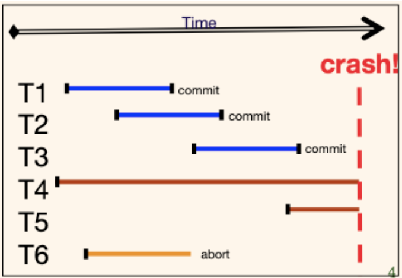
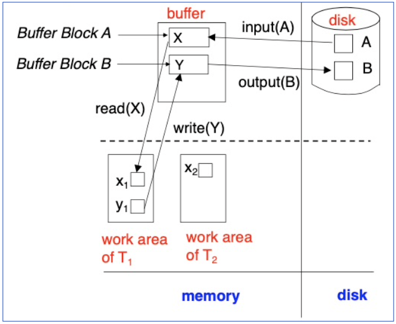
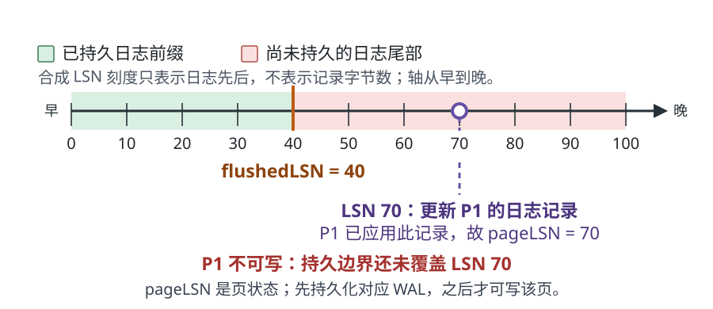
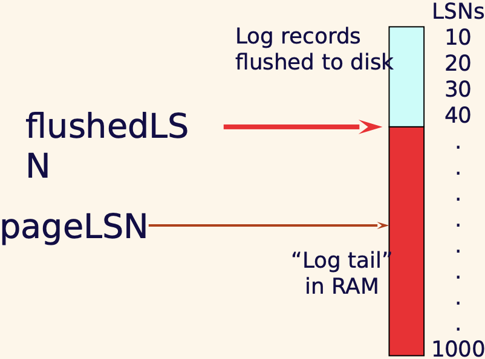
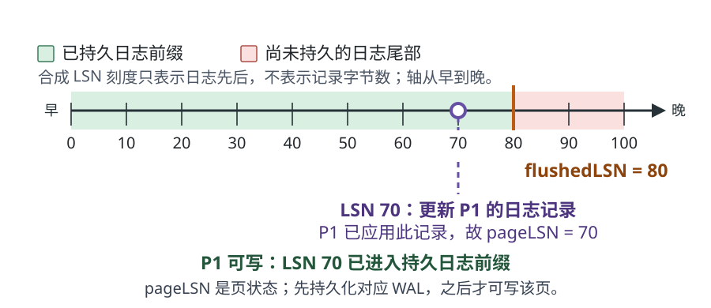
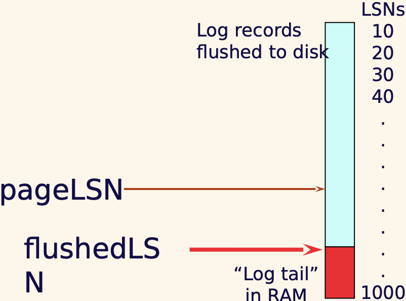
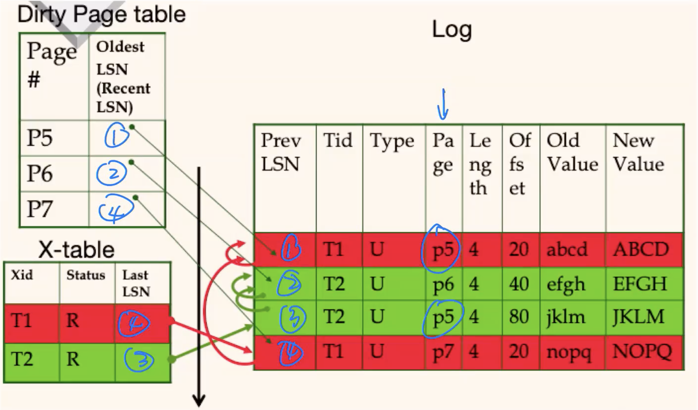

# 崩溃后，数据库如何重做已提交工作并撤销未完成事务？

午夜一次断电时，采用课程的同步持久提交假设：事务 T1 把账户页 P1 的余额从 500 改成 450，又把审计页 P2 加了一条记录；COMMIT 及其之前的日志已写稳，提交确认已经返回，但 P1、P2 仍只在内存缓冲区。另一笔事务 T2 改了库存页 P3，却还没有提交。机器重启后，恢复器要保留 T1、撤销 T2，并避免重复应用已经写到磁盘的更新。要作出这个判断，它需要什么日志和页状态？

## 恢复器需要区分哪些状态？

crash recovery（崩溃恢复）是在数据库进程或主机突然停止后，依据持久数据和日志恢复一个可继续服务的状态。它通常帮助实现 atomicity（原子性）和 durability（持久性）：已确认提交的修改在适用故障模型内仍可找回，未完成事务的影响不会留下。它不替代约束检查来保证 ACID consistency（一致性），也不负责并发事务的 isolation（隔离性）。

先看一张独立的课程事务时间线。图上的 T1、T2、T3 在崩溃前提交；T4、T5 在崩溃时仍未完成；T6 在崩溃前已标记中止，但图没有给出撤销是否完成。恢复要留下已提交事务的影响，撤销未完成事务；若 T6 的撤销尚未结束，也要继续完成。

数据库在运行时通常先把页从持久存储读入 buffer pool（缓冲池），再在内存中修改。下图用磁盘页 A、B、缓冲块 X、Y，以及事务 T1、T2 的工作区说明这些位置不同：Input(A) 把磁盘块 A 读到缓冲区 X；Output(B) 把缓冲区 Y 写回磁盘块 B；工作区中的 x1、y1、x2 是示意性的事务局部状态，不是磁盘页。

buffer frame（缓冲帧）是内存中暂存一页的槽位。页被 pin/fix（固定）时不能被缓冲替换器驱逐，unpin/unfix（解除固定）后才可能回收。dirty page（脏页）是已在内存中修改、但尚未写到持久存储的页。latch（闩锁）保护内存结构的瞬时访问；lock（锁）保护逻辑数据项以实现并发隔离，二者保护对象和持有时间不同。

> [!info] 两个独立的页写入策略
> force（强制写）要求事务提交时把修改过的数据页也写到持久存储；no-force（非强制写）允许提交后只保证日志持久，数据页稍后再写。
>
> steal（允许偷取）表示缓冲区可以在事务未提交时把含有其修改的页写出；no-steal（禁止偷取）不允许这么做。steal 需要日志支持撤销已落盘的未提交修改；no-force 需要日志支持重做已提交但尚未落盘的修改。因此常见的 steal/no-force 设计需要同时支持 undo（撤销）和 redo（重做）。

## 预写日志怎样约束页写入和提交确认？

write-ahead logging（预写日志，WAL）要求先把恢复所需日志写稳，再允许依赖它的页写稳。log sequence number（日志序列号，LSN）用来比较一条日志在同一日志流里的先后；它不是时间戳，也不表示记录的字节长度。每页记录最近一次已应用更新的 LSN，日志管理器记录目前已经持久刷新的最大 LSN。

> [!info] 本章常用的日志位置
> - pageLSN（页日志序号）：该数据页上最近一次更新所对应的日志序号。
> - flushedLSN（已刷日志序号）：已经写入持久存储的最大日志序号。
> - prevLSN（前一事务日志序号）：同一事务上一条记录的 LSN，用于沿事务链向回查找。
> - recLSN（恢复起始日志序号）：一页自上次干净以来第一次被修改的 LSN，是这页可能需要重做的最早位置。
> - undoNextLSN（下一撤销位置）：补偿日志记录指定恢复撤销时继续查找的位置。

若页 P 的 `pageLSN=70`，表示 P 当前内容已应用 LSN 70 的更新记录；这不是一次“刷新页LSN”的操作。写 P 之前，WAL 必须先持久化到该记录，即 `pageLSN ≤ flushedLSN`。下面用两张相同刻度的合成图比较日志持久前缀：第一张的 `flushedLSN=40`，LSN 70 仍在未持久尾部，所以 P 暂不能写；第二张的 `flushedLSN=80`，已持久前缀包含 LSN 70，所以 P 可以写。LSN 数字仅说明日志先后关系，不表示记录字节数，也不代表特定数据库产品的日志布局。

此时 `flushedLSN=40 < pageLSN=70`，更新 P1 的 LSN 70 还未持久化；WAL 先刷到至少 70，才可写 P1。

> [!info]- 原课程图附件（WALegCannot.png，原文件未修改）
> 

此时 `pageLSN=70 ≤ flushedLSN=80`，持久 WAL 已包含 P1 上的更新，P1 可写。

> [!info]- 原课程图附件（WALegCan.png，原文件未修改）
> 

在本例的同步持久提交假设下，成功确认前，COMMIT 记录以及恢复此事务所需的较早日志必须已经持久化。日志按序刷写时，刷到提交记录会一并保证之前的日志顺序。多个事务的提交记录可以共用一次日志刷写，这称为 group commit（组提交）；它摊薄刷写开销，但每个获确认事务的持久化边界不变。这样即使数据页仍在内存里，重启后也能从日志重建已提交的值。PostgreSQL 18 的 `synchronous_commit=off` 可以在本地 WAL 持久刷写前就报告成功，崩溃窗口内最近的已确认事务可能丢失；这不取消 WAL 必须先于数据页写稳的规则。实际设备缓存、断电保护和 flush（持久刷写）语义仍受数据库配置与硬件保证影响。

日志记录可以保存物理的前后值，也可以记录逻辑操作或其他恢复信息；并非每个数据库都把旧值和新值以同一格式写入日志。PostgreSQL 18 的 WAL 是一个当前实现例子：其文档说明日志在数据文件修改前刷到永久存储，崩溃恢复可以重放日志；这是产品特定实现，不能据此说 PostgreSQL 使用了 ARIES 的全部结构。

## ARIES 怎样记录事务与脏页的恢复位置？

Algorithm for Recovery and Isolation Exploiting Semantics（ARIES，利用语义实现恢复与隔离的算法）是一种具体的日志恢复算法。它把事务的记录串成日志链，并在内存中维护事务表和脏页表。它还会把恢复中的撤销写回日志，让恢复过程再次崩溃时也能继续。

以下 `COMMIT`（提交）与 `END`（结束）分开的记法采用 CMU Fall 2024 课程模型：持久化 `COMMIT` 表示提交已决定，稍后的 `TXN-END` 是内部收尾记录，不是提交确认点。若崩溃发生在两者之间，事务仍是 winner（已提交事务），不应撤销；重做阶段结束时会为这类 winner 补写 `TXN-END` 并移出事务表。这里说明的是课程记法，不把它推广成所有 ARIES 实现的固定日志格式。

事务表记录尚无 `END` 记录的事务及其状态、最后一个 LSN。脏页表记录崩溃时仍可能需要恢复的页；recLSN 是该页最早需要考虑重做的更新。页加载本身不会使页变脏，只有更新才会。

下图是课程的日志链示意。蓝色圈出的 1、2、3、4 是课上标记的记录自身序号；它们恰好写在原图的 Prev LSN 列附近，不是该字段值。按记录序号，LSN 1、3 更新 P5，LSN 2 更新 P6，LSN 4 更新 P7；因此脏页表的 recLSN 分别为 P5=1、P6=2、P7=4。左下事务表显示 T1 的 lastLSN=4、T2 的 lastLSN=3；实际 prevLSN 应沿事务链读取，例如 T2 在 LSN 3 的上一条记录是 LSN 2。原图左上表头括号中的 `Recent LSN` 是课程图的括号文字，不应理解为“最新 LSN”；这里显示的数值仍是每页 recLSN，即该页最早需要考虑重做的位置。彩色背景用于区分事务，不是恢复器的规范配色。

checkpoint（检查点）把恢复时要读的范围缩小。课程中的 begin checkpoint 和 end checkpoint 之间，事务仍可继续工作；结束记录保存 begin 时的事务表与脏页表快照。fuzzy checkpoint（模糊检查点）不要求所有事务停下，也不等于把所有脏页都刷到磁盘。ARIES 的 master record（主记录）指向最近完成检查点的 BEGIN CHECKPOINT；分析从这个起点扫描，并沿日志更新事务表中每笔事务的 `lastLSN` 与状态。首次扫描到某个可重做页更新时，若该页尚不在脏页表，就以该记录 LSN 作为 recLSN。

扫描到 `END` 时，analysis（分析）会把事务从 active transaction table（活动事务表，ATT）移除，并把事务 ID 记入本轮扫描的 `endedTransactions` 集合。这样，后面遇到 END CHECKPOINT 时，如果其中的模糊快照仍列有该事务，就跳过它，避免把已结束事务重新加入 ATT。对未结束且当前没有条目的事务，快照才可补入；已有条目保留已扫描日志得到的较新 `lastLSN` 和状态。这一条只处理过期快照对已结束事务的复活，不把 Berkeley CS186 项目实现中的其他规则并入本章采用的 CMU 教学模型。dirty page table（脏页表，DPT）则合并快照中的页，并保留较早的 recLSN（取两者较小值），以免漏掉 BEGIN CHECKPOINT 之前已变脏但尚未写回的页。随后分析继续到持久日志末尾。不能直接跳到 END 后面，否则会漏掉 begin/end 之间的更新记录。

看一个小型合成轨迹：LSN 80 的 T1 把 P1 从 YYY 改成 ZZZ；LSN 90 的 BEGIN CHECKPOINT 记录快照时，ATT 是 `T1=running,lastLSN=80`，DPT 是 `P1→80`；之后 T1 在 LSN 100 提交（`prevLSN=80`）、在 LSN 110 写 END（`prevLSN=100`）；LSN 120 的 END CHECKPOINT 仍带着 LSN 90 的旧快照，随后系统崩溃，P1 磁盘页仍是 YYY/pageLSN=0。analysis 扫到 END 110 后，`endedTransactions={T1}`，合并 END CHECKPOINT 时跳过快照里的 T1，因此最终 ATT 不含 T1，但 DPT 仍含 `P1→80`。redo 将尚未写回的 P1 补为 ZZZ；T1 不会进入 ToUndo。若没有 ended 标记，旧快照会把 T1 复活成 running，恢复就可能错误撤销已提交更新。Berkeley CS186 Project 5 的分析实现也显式用 `endedTransactions` 过滤旧 checkpoint 表项；此处只借它核对该合并陷阱，不采用 CS186 项目的其他状态推进或实现约定。

DPT 因而可能保守地包含已经写回的页，redo 再用磁盘页的 pageLSN 跳过已应用记录；若合并和扫描后 DPT 为空，可跳过页更新的 redo scan，但仍须执行 redo 收尾，为 winner 追加 `TXN-END` 并移出 ATT。

事务显式中止时，恢复器从该事务的 lastLSN 沿 prevLSN 向回撤销更新。每撤销一条更新，会写入 compensation log record（CLR，补偿日志记录）；CLR 记录已经完成的撤销并可在重启时重做，且不会再次被撤销。undoNextLSN 指向接下来还需要撤销的位置。WAL 同样适用于 CLR：包含撤销结果的 CLR 必须先持久化，受它影响的数据页才能写回；若在 CLR 已持久化而页尚未写回时再次崩溃，redo 会重做 CLR，undo 再沿 undoNextLSN 跳过已完成的部分。

> [!example] 多次改同一值时按逆序撤销
> T1 把 A 从 100 改为 200，再改为 300，最后改为 400。撤销要按相反顺序处理更新：400→300、300→200、200→100。每步写 CLR 并把下一撤销位置记入日志，若撤销途中又崩溃，重启后可重做已经完成的 CLR，再从 undoNextLSN 接续。

下面保留另一段交错日志：T2 的更新穿插在 T1 的两次更新之间。补上 BEGIN 与事务链位置后，T1 中止只回退 T1 的记录，不会撤销 T2 对 P3 的更新。T1 先撤销 P4 的 LSN 430 并写 LSN 445 的 CLR，再撤销 P5 的 LSN 410 并写 LSN 450 的 CLR；LSN 460 是 T1 结束后 T3 的新更新。

| LSN | 记录 | 事务链说明 |
| ---: | --- | --- |
| 400 | BEGIN CHECKPOINT | 检查点开始 |
| 405 | END CHECKPOINT | 结束记录；课程例假定事务表和脏页表为空 |
| 408 | T1 BEGIN | T1 首条事务记录 |
| 410 | T1 更新 P5 | prevLSN=408 |
| 415 | T2 BEGIN | T2 首条事务记录 |
| 420 | T2 更新 P3 | prevLSN=415 |
| 430 | T1 更新 P4 | prevLSN=410 |
| 440 | T1 ABORT | prevLSN=430 |
| 445 | T1 CLR：撤销 LSN 430 | prevLSN=440；undoNextLSN=410 |
| 450 | T1 CLR：撤销 LSN 410 | prevLSN=445；undoNextLSN=408 |
| 455 | T1 END | prevLSN=450；T1 的回滚结束 |
| 458 | T3 BEGIN | T3 首条事务记录 |
| 460 | T3 更新 P5 | prevLSN=458；T1 结束后的新事务更新 |

## 崩溃后为什么要先分析，再重做，最后撤销？

ARIES 恢复分三阶段：

1. analysis（分析）阶段从主记录指向的最近完成检查点的 BEGIN 开始，逐条推进 ATT 中事务的 `lastLSN` 与状态，并用首次遇到的页更新建立 DPT 的 recLSN。遇到 END CHECKPOINT 时按前述规则合并快照，继续扫到持久日志末尾。COMMIT 把事务标为已提交；崩溃时尚无 END 的已提交事务是 winner，运行或回滚中的事务是 loser。
2. redo（重做）阶段若 DPT 非空，从最小 recLSN 开始重复历史，包括 loser 的更新。对一条可重做的页更新或 CLR，只有页在 DPT 中且记录 LSN 不早于该页 recLSN 时才是候选；若磁盘页的 pageLSN 已大于或等于该记录 LSN，就跳过，否则重做并更新 pageLSN。DPT 为空时跳过这一步。redo 收尾时，为 ATT 中仍处于 COMMIT 状态的 winner 追加 `TXN-END` 并移出 ATT。
3. undo（撤销）阶段只处理剩余 loser。把每个 loser 的 lastLSN 放进 ToUndo 集合，每次取最大 LSN。遇到 CLR 时沿 undoNextLSN 跳过已撤销部分；遇到可撤销更新时撤销它、追加一个 CLR，再沿 prevLSN 前进；其他记录只沿 prevLSN 前进。到达事务链末端后写 END。

ARIES 先重做所有事务在日志中留下的历史，再撤销 loser；这样恢复得到的页状态才与 pageLSN 所表示的日志前缀一致。考虑同一页 P 上两个独立记录 A、B，初值为 A=100、B=0：LSN 10 的未提交 T2 把 A 增加 10，LSN 20 的已提交事务 T1 把 B 设为 1，T1 的 COMMIT 位于 LSN 25；假设日志持久到 LSN 25，但 P 仍未写回。本例的日志语义是 T2 对 A 做增量操作、undo 用逆增量 A−10，T1 对 B 则是绝对赋值。重复历史后 P 为 A=110、B=1，再撤销 T2 的 A−10，得到 A=100、B=1。若只重做 winner 的 LSN 20，页会变成 A=100、B=1、pageLSN=20；随后对未重做的 loser 执行 A−10 就会得到错误的 A=90。此例说明 pageLSN 不能越过同页被省略的前序更新；对于采用其他日志/撤销表示的恢复系统，具体判断要按其协议分析。

只按事务最终是否提交筛选日志也不够：磁盘上可能已有 loser 更新，也可能尚未落盘的 winner 更新需要重做。重演完整历史后，ARIES 才能从确定的崩溃前状态撤销 loser。

> [!info] 与分布式两阶段提交的边界
> 本章的事务表和 loser 例题是单库崩溃恢复模型。若分布式参与者已持久写入 prepared 并投 YES，崩溃后它处于 in-doubt（等待全局决定）状态；它不能仅因本地看不到 COMMIT 就按普通 loser 自行回滚，而要查询两阶段提交协调者的持久决定。

> [!example] 例一：已提交事务的脏页还没写回
> 假设检查点完成后开始 T1，P1、P2 都尚未写回磁盘；T1 在 LSN 20 写入 COMMIT，且该提交记录和之前日志都已持久化，随后系统崩溃。为便于核对，初始磁盘页值分别为 P1=YYY、P2=WWW，pageLSN 都设为 0。
>
> | LSN | 记录 | prevLSN |
> | ---: | --- | ---: |
> | 0 | BEGIN CHECKPOINT | — |
> | 5 | END CHECKPOINT（空事务表、空脏页表） | — |
> | 8 | T1 BEGIN | — |
> | 10 | T1 更新 P1：YYY→ZZZ | 8 |
> | 15 | T1 更新 P2：WWW→XXX | 10 |
> | 20 | T1 COMMIT | 15 |
>
> - 分析：T1 的状态为 committed，lastLSN=20；脏页表为 P1→recLSN 10、P2→recLSN 15。T1 尚无 END，但它是 winner。
> - 重做：最小 recLSN=10。P1 的 pageLSN 0<10，重做 LSN 10 后为 ZZZ、pageLSN=10；P2 的 pageLSN 0<15，重做 LSN 15 后为 XXX、pageLSN=15。
> - 收尾：redo 后为 T1 追加 END 21（prevLSN=20），再从事务表移除；没有 loser 需要撤销。
>
> 若磁盘上的某页 pageLSN 已经等于或大于对应更新的 LSN，该条更新跳过；实际 pageLSN 由崩溃前哪些脏页已写出决定。

> [!example] 例二：保留 T1 的提交、撤销 T2 的后续覆盖
> 本例中，T1 先把 P1 从 YYY 改成 ZZZ、把 P2 从 WWW 改成 XXX，T2 在 T1 提交前把 P3 从 UUU 改成 VVV；T1 随后提交，T2 再把 P1 从 ZZZ 覆盖成 TTT，却在自身提交前崩溃。假设 WAL 已持久化到 LSN 30（可由后台刷写），而 P1、P2、P3 的数据页都仍未写回磁盘、pageLSN 都是 0；崩溃时这些页都还在脏页表中。
>
> | LSN | 记录 | prevLSN |
> | ---: | --- | ---: |
> | 0 | BEGIN CHECKPOINT | — |
> | 5 | END CHECKPOINT（空事务表、空脏页表） | — |
> | 8 | T1 BEGIN | — |
> | 10 | T1 更新 P1：YYY→ZZZ | 8 |
> | 12 | T2 BEGIN | — |
> | 15 | T1 更新 P2：WWW→XXX | 10 |
> | 20 | T2 更新 P3：UUU→VVV | 12 |
> | 25 | T1 COMMIT | 15 |
> | 30 | T2 更新 P1：ZZZ→TTT | 20 |
>
> **分析阶段的状态**
>
> | 项目 | 恢复结果 |
> | --- | --- |
> | 事务表 T1 | committed（已提交），lastLSN=25，winner（胜者） |
> | 事务表 T2 | running（运行中），lastLSN=30，loser（未完成事务） |
> | 脏页表 | P1→10，P2→15，P3→20 |
>
> **重做阶段的状态**：候选更新是 LSN 10、15、20、30。按 pageLSN 条件，从 pageLSN=0 开始时依序重做：P1 在 LSN 10 变成 ZZZ，P2 在 LSN 15 变成 XXX，P3 在 LSN 20 变成 VVV，P1 在 LSN 30 再变成 TTT；各页的 pageLSN 随后分别为 P1=30、P2=15、P3=20。随后在 LSN 31 为 winner T1 追加 END（prevLSN=25），并移出 ATT；该 END 是恢复日志，不在首次崩溃前的日志表中。
>
> **撤销阶段的状态**：ToUndo 初始为 {30}。撤销 LSN 30，把 P1 从 TTT 恢复为 ZZZ，写 CLR 32（prevLSN=30、undoNextLSN=20）；随后沿 T2 链撤销 LSN 20，把 P3 从 VVV 恢复为 UUU，写 CLR 33（prevLSN=32、undoNextLSN=12）。应用 CLR 32、33 时，相应缓冲页的 pageLSN 分别更新为 P1=32、P3=33；P2 的 pageLSN 仍为 15。受影响数据页写回前，必须先把相应 CLR 持久化。LSN 12 是 T2 BEGIN，沿其 prevLSN 到链末端后写 END 34（prevLSN=33）。最终保留 T1 的提交：P1=ZZZ、P2=XXX；撤销 T2 的影响：P3=UUU。
>
> 这里按过程展示 T2 的 LSN 30 如何暂时覆盖 T1 已提交的 P1 值，再由 T2 的撤销恢复为 ZZZ；先重做历史的必要性由上文同页更新反例说明，而不是由本例的绝对值覆盖推导。若第二次崩溃发生在 CLR 32 已持久化、P1 页尚未写回，且持久 WAL 的末端恰为 LSN 32，分析会看到 T1 END 31、T2 的 lastLSN=32 与 undoNextLSN=20；从旧页重做时，CLR 32 会把 P1 恢复为 ZZZ 并设 pageLSN=32，随后 undo 只处理 T2 的 LSN 20，追加 CLR 33 与 END 34。最终仍为 P1=ZZZ/pageLSN=32、P2=XXX/15、P3=UUU/33。

恢复日志只保护它所覆盖的崩溃故障和存储假设。若整个设备损毁、日志也无法读取，还需要独立备份与日志归档；若应用逻辑写错但事务正常提交，崩溃恢复不会自动知道业务上应该回到哪里。

> [!info]- 来源
> - ARIES 的 write-ahead logging、repeating history、分析/重做/撤销、检查点扫描起点与 CLR/undoNextLSN：Mohan 等，1992，*ARIES: A Transaction Recovery Method Supporting Fine-Granularity Locking and Partial Rollbacks Using Write-Ahead Logging*，§§5.3–6.3、§10.1：[IBM Research 论文条目](https://research.ibm.com/publications/aries-a-transaction-recovery-method-supporting-fine-granularity-locking-and-partial-rollbacks-using-write-ahead-logging)。
> - pageLSN、flushedLSN、recLSN、ATT/DPT 检查点合并、COMMIT 确认与 redo 尾的 TXN-END 收尾：CMU 15-445/645，Fall 2024，Lecture 21，尤其 pp. 3–6：[Database Crash Recovery 讲义](https://15445.courses.cs.cmu.edu/fall2024/notes/21-recovery.pdf)。
> - WAL 先于数据页持久化、提交只需刷写 WAL，以及归档 WAL 支持时间点恢复：PostgreSQL 18，§28.3（包括 group commit）：[Write-Ahead Logging](https://www.postgresql.org/docs/18/wal-intro.html)。
> - PostgreSQL 18 的异步提交可在本地 WAL 刷写前返回，最近已确认事务因此可能在崩溃后丢失；这与数据页写出仍须满足 WAL 顺序是两条不同的保证：§28.4、`synchronous_commit`：[Asynchronous Commit](https://www.postgresql.org/docs/18/wal-async-commit.html)、[WAL Runtime Configuration](https://www.postgresql.org/docs/18/runtime-config-wal.html#GUC-SYNCHRONOUS-COMMIT)。
> - 旧 END CHECKPOINT ATT 快照可能复活已结束事务；Berkeley CS186 Project 5 Task 5 明确用 `endedTransactions` 过滤该类表项。这里仅将其作为快照合并安全性的交叉核对，课程推演仍沿用 CMU Fall 2024 简化模型：[Analysis Task](https://cs186berkeley.net/projects/5/your-tasks/#task-5-analysis)。
> - 崩溃恢复日志与检查点算法的课程背景：Silberschatz、Korth、Sudarshan，《Database System Concepts》第 7 版，2019，第 19 章：[Recovery System 课件](https://www.db-book.com/slides-dir/PDF-dir/ch19.pdf)。
> - ACID 隔离与产品版本相关的隔离保证并不由 WAL 代替：PostgreSQL 18，§13.2：[Transaction Isolation](https://www.postgresql.org/docs/18/transaction-iso.html)。
