# COMP90050 Advanced Database Systems / COMP90050高级数据库系统

## Database Performance Metrics
核心概念：数据库性能由存储层级、数据访问、查询计划与资源配置共同决定；可靠性分析要区分固定时段故障概率、恒定故障率/MTTF和可修复系统的可用度。RAID 的容量、冗余和读写表现取决于布局、工作负载及修复假设。

The performance of a database system is evaluated based on:

1. **Efficiency (Speed)**
2. **Effectiveness**
3. **Security & Reliability**

### Efficiency
Efficiency of a database system is influenced by both hardware and software aspects:

- **Hardware**
  - Disks and I/O bandwidth
  - Main memory
  - Number of processors
  - Communication network
  - Type of architecture
- **Software/DB Tuning**
  - Types of DB
  - Indexing
  - Query optimisation

### Effectiveness
Effectiveness of a database system is determined by:

- Concurrent users: Users reading and writing over the same data
- Transactions: Required tasks are all done together

### Reliability
Reliability of a database system is ensured by:

- Crash recovery
  - Hardware:
    - Arrangement of multiple disks
    - Voting among multiple disks/modules
    - Disk block write
- Fault tolerance
- Data duplication

## Hard Disk & Memory Hierarchy
### Hard Disk Drive
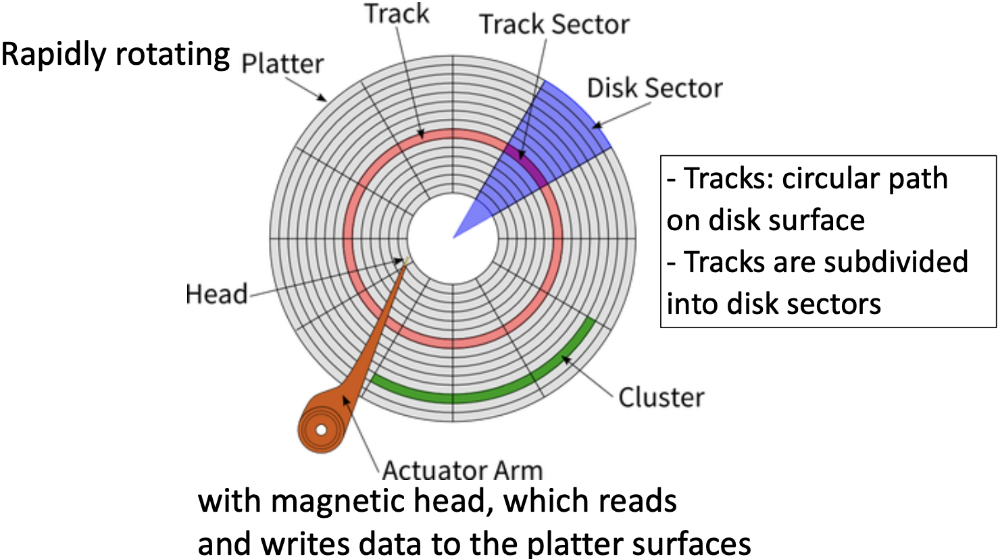

A **hard disk drive (HDD)** is a crucial component of computing systems that provides data storage. Its structure comprises of several key elements:

- **Platter**: The entire circular disk.
- **Sector**: A device exposes sectors as addressable units; logical and physical sector sizes can differ.
- **Track**: A circular path on a platter. The red highlighted area in the image is one track.
- **Cylinder**: Tracks at the same radial position across platters. A file-system cluster is an allocation unit made of sectors, not a mechanical disk component.
- **Actuator Arm**: The component that moves the head to the required position.
- **Head**: This component is responsible for reading and writing data on the disk.

Note that the disk rotates at high speed, allowing the head to read and write data at different locations.

#### Disk Access Time in HDD
In this simplified model, estimate the transfer delay as:

$$
\text{Disk Access Time} = \text{Seek Time} + \text{Rotational Delay} + \frac{\text{Transfer Length}}{\text{Bandwidth}}
$$

Where:

- **Seek Time**: This is the time taken by the head to move from its current position to the desired track. Also known as seek latency.
- **Rotational Delay**: The time the disk takes to rotate and bring the desired sector under the head. This is also referred to as rotational latency.
- **Transfer Length**: This refers to the amount of data to be transferred. The units for this measure can vary, such as KB, MB, GB, etc.
- **Bandwidth**: This measures the amount of data that can be transferred within a given timeframe. Its unit is Storage/Time (e.g., 4MB/S).

#### Exercise
What is the disk access time for a 4 KB transfer when average seek time is 12 ms, rotational delay is 4 ms, and transfer rate is 4 MB/s?

Using decimal units (1 MB = 1000 KB), transfer time is 4 KB / 4000 KB/s = 0.001 s = 1 ms, so the estimate is 12 + 4 + 1 = 17 ms. This model omits controller and queueing delays and assumes the request is not already cached.

### Solid-State Drives (SSD)
Solid-state drives (SSDs) store data in flash memory and have no moving head or rotating platter. They avoid HDD seek and rotational delay, but still have controller, flash, queueing, and write-management latency. Read and write performance depends on the device, workload, and queue depth; overwrites are not universally slower. Flash pages are erased in larger blocks and the flash translation layer manages remapping and wear leveling ([Database System Concepts, 7e, ch. 12](https://www.db-book.com/Previous-editions/db7/slides-dir/PDF-dir/ch12.pdf)).

#### Disk Access Time in SSDs
A bandwidth-only estimate for a transfer is:

$$
\text{Disk Access Time} = \frac{\text{Transfer Length}}{\text{Bandwidth}}
$$

### Memory Hierarchy
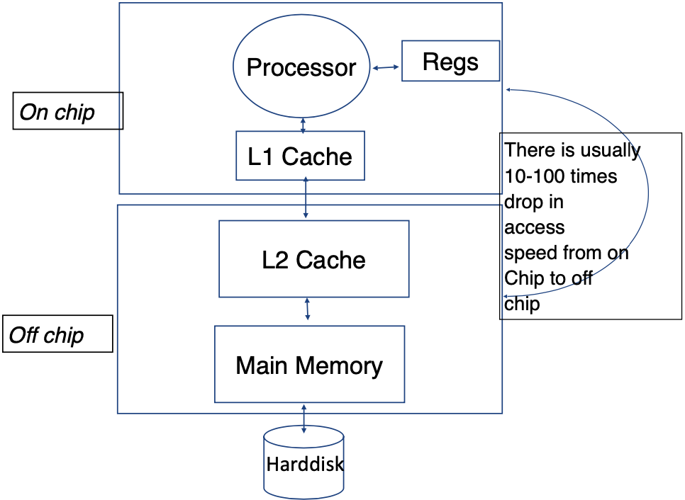

- Reg: Register
- CPU caches (L1/L2 and other levels) reduce the average cost of CPU memory access; they do not directly cache hard-disk blocks. Operating-system file caches, storage-device caches, and a DBMS buffer pool are separate layers with different units and behavior.
- Main Memory: If the system is shut down, data stored in the main memory (but not in the hard disk) will be lost. The unit of measurement for Main Memory is typically in GB.
- Hard Disk: The unit of measurement is usually in TB.
- Speed: Cache > Main Memory > Hard Disk
- Storage Capacity: Cache (in MB) < Main Memory (in GB) < Hard Disk (in TB)
- Simplified CPU path: check the CPU cache hierarchy, then access DRAM on a miss. A page fault or database storage request may involve an OS file cache, DBMS buffer pool, controller cache, and persistent storage; these are not one universal linear path.

#### Effective Memory Access Time
For a single cache level, if $M$ is the full cost of the miss path, including lookup, then:

$$
EA = H \times C + (1 - H) \times M
$$

where:

- $H$ is the hit ratio (the percentage probability of finding data in the cache)
- $C$ is the cache access time
- $M$ is the full miss-path cost. If $M$ means only lower-memory access time, use $EA = H C + (1-H)(C+M)$ instead.

The CPU-cache example concerns L1/L2 memory hierarchy. It is distinct from both a storage-device/controller cache and the DBMS buffer pool, which caches database pages in main memory. The latter is the buffer model used in query-cost calculations.

Why don't we have larger caches?

1. They are expensive.
2. If the processor and the cache are not on the same chip, the access time increases.

#### Effective Disk Buffer Access Time
A device or controller cache is different from the DBMS buffer pool in main memory. In this one-level model, BC is the hit-path cost and D is the full miss-path cost; the estimate excludes other caching levels and queueing:

$$
EA = HB \times BC + (1 - HB) \times D
$$

where:

- $HB$ is the hit ratio of the disk buffer
- $BC$ is the buffer access time
- $D$ is the disk access time

#### Example
e.g., Assume disk access time is S, buffer access time is C, hit ratio is H, and S = 1000C. What is the effective access time, EA, expressed as a multiple of C when H = 30%?

$EA = 30\% \times C + (1 - 30\%) \times S = 0.3C + 0.7 \times 1000C = 700.3C$

## Type of DB systems and DB Architectures
### Database Types
#### Simple File
- **Definition**: A data storage system where data is stored as a plain text file. Each line represents one record, with fields separated by delimiters (e.g., commas or tabs).
- **Tradeoffs**: A flat-file design can be sufficient for a small, single-process workload. Schema enforcement, indexes, transactions, and concurrent updates then need to be supplied by the application or another layer; speed and reliability depend on the implementation.

#### Relational Database Management Systems (RDBMS)
- **Definition**: A relational database represents data as relations (commonly shown as tables) and provides operations for querying and updating them. Primary and foreign keys are constraints that a schema may declare; tables need not all be joined by such constraints.
- **Tradeoffs**: A DBMS can provide query planning, indexes, transactions, and constraint enforcement, but performance and reliability depend on the engine, schema, workload, and configuration.

#### Object Oriented Database Systems (OODB)
- **Definition**: A data storage system where data is stored in the form of 'objects' directly, similar to Object Oriented Programming (OOP).
- **Strengths**: Reliable, well suited for applications requiring complex data.
- **Weaknesses**: Can be slow on some applications, limited application independent optimisation.
- **Use Cases**: Suitable for applications requiring complex data structures and methods.

#### NoSQL Databases - Key-value Storage
- **Definition**: Stores values addressed by keys. Key uniqueness, atomicity, transactions, and query features depend on the product.
- **Related idea**: MapReduce is a distributed data-processing model, and Hadoop is an ecosystem that includes MapReduce; neither is itself a definition of a key-value database.

#### Deductive Database Systems (DDBS)
- **Definition**: A database system that can make deductions based on rules and facts stored in the database.
- **Tradeoffs**: Rule languages can express derived relations and queries. Whether that model is useful depends on the application and implementation.
- **Use Cases**: Applications that require rule-based deductions.

### Database Architectures
These are broad course categories, not guarantees about performance, availability, consistency, or security. Those properties depend on the particular design and workload.

#### Centralized (Client-Server) Database Architecture
- **Description**:
  - The central server is with database in one location.
  - The client and server can be in different locations.
- **Advantages**:
  - Suitable for simple applications,
  - easy to manage,
  - simple system administration,
  - effective optimization process.
- **Disadvantages**: May not scale well, limited to one location.
- **Use Cases**: Suitable for applications that can be managed centrally, such as PC/Cluster Computing/data centres.

#### Distributed Database Architecture
- **Description**:
  - Data is distributed across several nodes in different locations.
  - Communicate with each other using network.
- **Advantages**:
  - Scalable, can handle large data sets, databases can be in different locations
  - provides concurrency, recovery, and transaction processing.
- **Tradeoffs**: Distribution can improve locality or capacity and can add network, coordination, replication, and recovery costs. Replication can create stale or conflicting views unless the chosen protocol prevents or resolves them.

#### World Wide Web (WWW) Database Architecture
- **Description**: In the WWW database architecture, data is stored in many locations with **several owners** of data.
- **Advantages**: Very convenient to access and share data, wide data availability.
- **Tradeoffs**: Independent ownership and network boundaries make authority, availability, consistency, and query planning depend on the participating services and protocols; there is no single universal WWW database architecture or guarantee.

#### Grid Database Architecture
- **Description**: In a grid database architecture, data and processing are shared among a group of computer systems which may be geographically separated.
- **Advantages**:
  - High processing capability,
  - access at different locations,
  - shared data and processing.
- **Tradeoffs**: Grid computing shares distributed compute and data resources under multiple administrative domains. Reliability and security depend on the participating systems; this model is not a claim that all grid deployments use a database architecture.

#### Peer-to-Peer (P2P) Database Architecture
- **Description**: Data and processing are shared among a group of computer systems which may be **geographically separated**. **Nodes can join and leave the network at will**. Administration is done by owner.
- **Advantages**: Suitable when the nodes of the network cannot be planned in advance, or some may leave and join frequently, shared data and processing, flexible network membership.
- **Tradeoffs**: Membership changes make coordination and replica management harder. A peer-to-peer design can serve workloads beyond file sharing; its guarantees depend on the protocol and trust model.

#### Cloud-Based Database Architecture
- **Description**: Cloud-based database architecture offers online computing, storage, and a range of new services for data and devices that are accessible through the Internet.
- **Advantages**:
  - Pay as you go, On-demand resources, cost-effective,
  - maintenance done externally by the cloud provider,
  - user pays for the services just like phone services, electricity, etc., huge potential for developing applications with minimal infrastructure costs.
- **Tradeoffs**: A provider may manage infrastructure and offer on-demand resources, while the customer still needs to evaluate access control, data location, availability, cost, and provider dependency. Cloud services differ in their contracts and behavior.

## Fault Tolerance Introduction
### Basic Probability and Mean Time to Event
Let $p_A$ and $p_B$ be independent probabilities that events occur during the same fixed observation interval. Then:

- $P(A \cap B) = p_A p_B$
- $P(A \cup B) = p_A + p_B - p_A p_B$

For small probabilities, $P(A \cup B) \approx p_A+p_B$. A probability over a fixed interval is not itself a time or a failure rate. If a component has a constant failure rate $\lambda$ per unit time (an exponential lifetime model), its MTTF is $1/\lambda$. For rare failures over an interval of length $\Delta t$, $p \approx \lambda \Delta t$.

For $n$ independent modules with the same per-interval failure probability $p$, the exact chance of at least one failure in that interval is $1-(1-p)^n$, approximately $np$ when $p$ is small. Under the constant-rate model, the rate of the first failure is $n\lambda$, so the time to the first failure has mean $1/(n\lambda)$.

### Module Availability
Module availability is the ratio of service accomplishment to elapsed time.
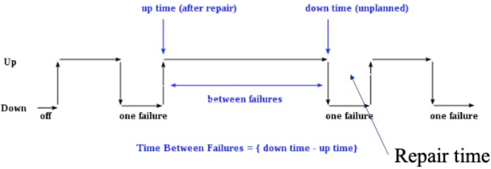
For a repairable module that alternates between up and down periods, long-run availability is:
$$\text{Availability} = \frac{MTTF}{MTTF + MTTR}$$
Here MTTF is the mean up-time and MTTR is the mean time spent repairing. This is a long-run average under the stated up/down model, not a probability of avoiding failure forever.

## Redundant Array of Independent Disks (RAID) / 独立磁盘冗余阵列
RAID is a method of combining multiple disks as a unit for fault tolerance or performance improvement, or both, of a database system ([Patterson, Gibson, and Katz's 1988 paper](https://www.cs.cmu.edu/~garth/RAIDpaper/Patterson88.pdf); [Database System Concepts, 7e, ch. 12](https://www.db-book.com/Previous-editions/db7/slides-dir/PDF-dir/ch12.pdf)).

For graphs below, we use the following conventions:

- We use b for Bit; B for byte; 8 continuous bits = 1 byte
- A for block, 4000/8000 continuous bytes = 1 block
- p for parity, Parity (or check bits) are used for error detection
  - P0 is parity for bytes B0 and B1, $P_i = B_{2i} \oplus B_{2i+1}$, here $\oplus$ is the exclusive-or operator

Please note that the RAID levels are not exhaustive and there are other RAID levels such as RAID 10, RAID 50, etc. that combine the features of the basic RAID levels for additional redundancy or performance.

Reliability model for the calculations below: let $p$ be the probability that one disk fails within one fixed observation interval, and assume independent disk failures. If a disk has constant failure rate $\lambda$ per hour, then $MTTF_{disk}=1/\lambda$; $1/p$ is not a time unless the interval and rate model are specified. For $N$ disks, the probability of at least $k$ failures during an interval with no repair is
$$P(\text{at least }k)=\sum_{j=k}^{N}\binom{N}{j}p^j(1-p)^{N-j}.$$
These mission-interval probabilities are not MTTF estimates for a repaired array.

### RAID 0 (Block Level Striping)
<image alt="RAID0" src="raid0.png" width=300/>

- Data is split into blocks and spread across multiple disks.
- Note the data is stored in a zig-zag way (A0, A2, A4, A6 in Disk 1, A1, A3, A5, A7 in Disk 2)
- Advantages: Independent block requests can run in parallel; a large sequential transfer may use both disks.
- Drawbacks: There is no redundancy, so either disk failing loses the array. With two independent disks and failure probability $p$ per fixed interval, $P(\text{loss})=1-(1-p)^2=2p-p^2\approx2p$. With constant per-disk failure rate $\lambda$ and no repair, array MTTF is $1/(2\lambda)=MTTF_{disk}/2$. Throughput gains depend on workload and bottlenecks.

### RAID 1 (Mirroring)
<image alt="RAID1" src="raid1.png" width=300/>

- Data is duplicated across two or more disks.
- Advantages: Two copies can serve reads, and data remains available after one independent disk failure if the surviving copy is sound.
- Drawbacks: Usable capacity is about half for a two-disk mirror. Both disks must receive writes, so write performance depends on workload and implementation.
- In a no-repair observation interval, both disks failing has probability $p^2$. In a repairable two-disk mirror with independent constant failure rate $\lambda$, rare failures, and mean repair/rebuild time $r$, the approximate mean time to data loss is $1/(2\lambda^2r)=MTTF_{disk}^2/(2r)$. This assumes independent failures and ignores common causes; it is not $MTTF_{disk}^2$ ([Database System Concepts, 7e, ch. 12](https://www.db-book.com/Previous-editions/db7/slides-dir/PDF-dir/ch12.pdf)).

### RAID 2 (Bit Level Striping)
<image alt="RAID2" src="raid2.png" width=300/>

- Data is striped at bit level and protected by a memory-style error-correcting code (ECC); the redundancy disks are not shown in the preserved data-only sketch.
- Protection and failure tolerance depend on the code and array layout. RAID 2 is largely of historical/teaching interest; it is not equivalent to nonredundant RAID 0.

### RAID 3 (Byte Level Striping)
<image alt="RAID3" src="raid3.png" width=300/>

- As drawn, consecutive data units are striped across two data drives with a dedicated parity drive; RAID 3 uses fine-grained (commonly byte-level or bit-interleaved) striping. One failed drive can be reconstructed; two simultaneous failures exceed this layout's single parity.
- In a no-repair observation interval, loss probability is $\binom{3}{2}p^2(1-p)+p^3=3p^2-2p^3\approx3p^2$. For a repairable array under the same independent constant-rate assumptions, the rare-event approximation is $MTTDL\approx1/(6\lambda^2r)=MTTF_{disk}^2/(6r)$, where $r$ is the time to restore redundancy. This is a model, not a field guarantee.

### RAID 4 (Block Level Striping)
<image alt="RAID4" src="raid4.png" width=300/>

- Data is split into blocks and spread across multiple disks, with a dedicated disk for parity blocks.
- Block striping with one dedicated parity disk can serve independent reads in parallel and reconstruct one failed disk.
- Small random writes update parity and can make the dedicated parity disk a bottleneck; large sequential writes behave differently. There is no generic throughput or MTTF value independent of the workload and repair model.

### RAID 5 (Block Level Striping with Parity Striping)
<image alt="RAID5" src="raid5.png" width=300/>

- Data and parity blocks are distributed across the drives, avoiding RAID 4's single dedicated parity drive. One failed drive can be reconstructed from the remaining data and parity.
- A single-parity array loses data after two unrecoverable drive failures before redundancy is restored. Small random writes still incur parity work; the relative performance of RAID 4 and RAID 5 depends on workload and implementation.
- Drawbacks: Complex to implement and manage.

### RAID 6 (Block Level Striping with Double Parity)
<image alt="RAID6" src="raid6.png" width=500/>

- This five-drive illustration has three data drives and two independent parity streams (P and Q). The second parity lets this layout reconstruct up to two failed drives; writes must maintain both parity values.
- With independent per-drive failure probability $p$ in one fixed interval and no repair, loss requires at least three failed drives:
$$P(\text{loss})=\binom{5}{3}p^3(1-p)^2+\binom{5}{4}p^4(1-p)+p^5=10p^3-15p^4+6p^5\approx10p^3.$$
This is an interval probability, not an MTTF. Repaired-array MTTDL also depends on repair/rebuild time, correlated failures, and latent errors.

### Choosing RAID Level
The tradeoff depends on layout and workload: striping can improve parallel reads or writes, while RAID 0 has no redundancy; mirroring and parity consume capacity and add write work to tolerate specified failures. Compare usable capacity, tolerated failures, rebuild exposure, workload, and system support.
When choosing the suitable RAID level, the following factors should be considered:

- **Reliability**: The ability of the system to handle and recover from hardware failure.
- **Performance**: The speed at which data can be read from or written to the disk.
- **Storage Utilization**: The amount of storage space that is effectively used.
- **Price/Number of Disks**: The cost and the number of disks required.

## Fault Tolerance by Voting / 多数表决容错
### Definition of majority here
if n nodes, then:

- if n is odd, majority means $\frac{(n + 1)}{2}$
- if n is even, majority means $\frac{n}{2} + 1$

### Failvote
In the fail-vote/fail-fast model described by [Saltzer and Kaashoek, ch. 8](https://live.ocw.mit.edu/courses/res-6-004-principles-of-computer-system-design-an-introduction-spring-2009/6b31587ec59b1b002cb7a710d9781453_faults_open_5_0.pdf), a failvote voter accepts an output only when a strict majority of all configured replicas agrees. For three replicas, two matching outputs suffice; for four, three are required. A replica being powered on does not prove that its output is correct.

### Failfast
A self-checking fail-fast replica model can continue with one surviving replica after failed replicas are detected. An ordinary untrusted survivor cannot validate its answer by comparison with another result, so this is a model prerequisite rather than a guarantee for every fail-fast design. Detection errors and common-mode failures remain outside this simple model.

### Supermodule
A supermodule combines modules with a voter or comparator. Its failure condition depends on the design: a design that remains usable with one self-checking module fails only when all modules are unavailable; failvote has a stricter output-agreement threshold. Do not use the all-modules-down formula below for a failvote system.

#### Fault Tolerance with Repair
Assume independent module failures with a constant rate, immediate detection, and repair time with mean MTTR. In a two-state up/down model, one module's long-run unavailability is
$$q = \frac{MTTR}{MTTF + MTTR} \approx \frac{MTTR}{MTTF}$$
when MTTR is much smaller than MTTF. Values such as MTTR of a few hours to one day and MTTF of 750,000 hours (about 85.6 years) are illustrative inputs for this model, not a general current disk specification.

#### Approximate Failure Rate of a One-Available-Module Supermodule
For a supermodule that can operate with any one self-checking module available, the approximate rate of total failure is
$$\lambda_{sys} \approx n\lambda q^{n-1}, \qquad \lambda=1/MTTF,$$
when failures are rare, independent, and repaired independently. This follows because any of the n modules can fail while the other n-1 are unavailable. The result has units of failures per time; its reciprocal is an approximate MTTDL. It excludes common-cause failures, repair queues, latent errors, and voter failures. Failvote/failfast systems with a different voting threshold need a different failure-state calculation.

## Communication Reliability / 通信可靠性
In a reliable message passing system, the communication between two nodes can be represented as a series of states. The key components of this system include:

- **Out**: Number of messages sent
- **In**: Number of messages received
- **Ack**: Number of acknowledgements

For example, the communication between Node A and Node B can be represented as follows:
<image alt="State 0: Node A (In:6, Ack:3, Out:3), Node B (Out:6, Ack:6, In:3)" src="com_01.png" width=600/>
<image alt="State 1: Node B sends message 7, Node A (In:6, Ack:3, Out:3), Node B (Out:7, Ack:6, In:3)" src="com_02.png" width=600/>
<image alt="State 2: Node A sends acknowledge 7, Node A (In:7, Ack:3, Out:3), Node B (Out:7, Ack:6, In:3)" src="com_03.png" width=600/>
<image alt="State 3: Node B receives acknowledge 7, Node A (In:7, Ack:3, Out:3), Node B (Out:7, Ack:7, In:3)" src="com_04.png" width=600/>
If B does not receive the acknowledgement, it may retry message 7. Retries can deliver the same message more than once; acknowledgements alone do not guarantee exactly-once effects. Applications that need deduplication use message identifiers or sequence numbers and durable receiver-side state.

If two nodes want to communicate with each other, how to make sure the data sent is correctly?

- Stable storage – data in stable storage is durable and not be lost easily
- Acknowledgement info

## Duplex Write & Logged Write / 双写与日志写入
### Atomicity
Atomicity means a transaction's changes are committed as a unit or rolled back as a unit. A redundant disk write is a storage technique, not by itself transaction atomicity. For a transfer of $100, the debit, credit, and recovery record must be coordinated so recovery cannot expose only one side.

### Atomic Disk Write – Duplex Write
- A duplex-write scheme keeps redundant copies, often with version or sequence metadata, and may consult a log during recovery.
- A checksum such as CRC can detect many accidental corruptions, but it does not correct data or prove that a copy is the latest valid one.
- Two sequential writes are not an atomic transaction and do not guarantee that one good copy always exists: a crash, torn write, shared failure, or undetected corruption can affect both copies. The recovery protocol and its failure assumptions determine what can be recovered.

### Example
State 0: Main Memory (empty), Hard Disk (100 700 (v#7) Block 123)
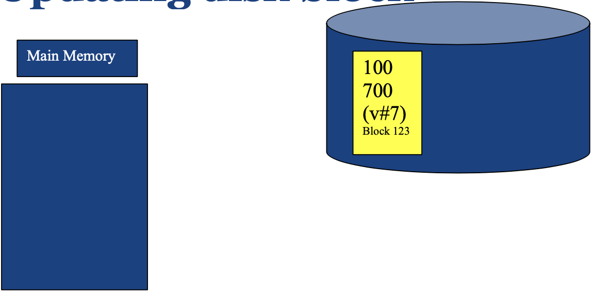
State 1: Operation: read, Main Memory (100 700), Hard Disk (100 700 (v#7) Block 123)
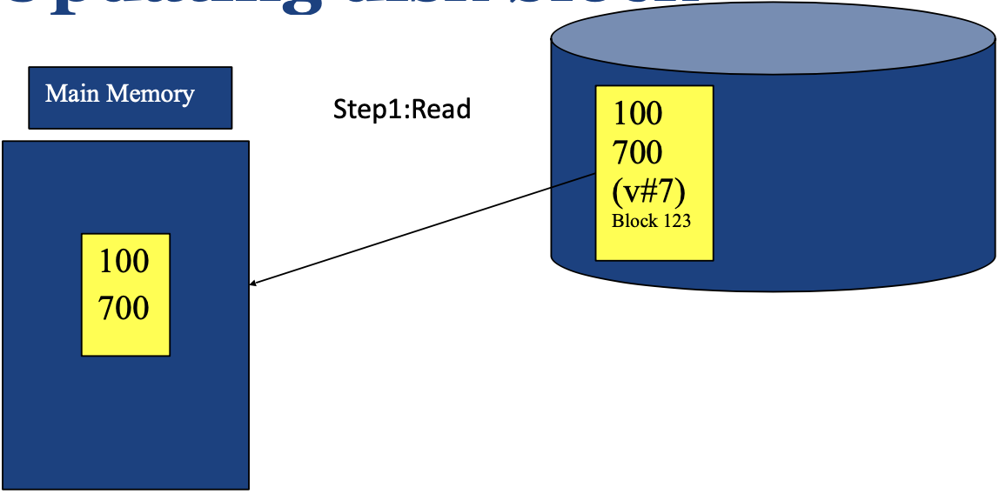
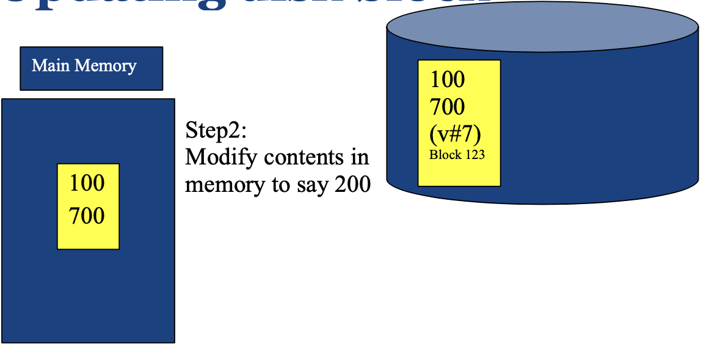
State 2: Operation: Modify contents in memory to say 200, contents modified to 200 in memory, update changes to disk, Main Memory (200 700), Hard Disk (100 700 (v#7) Block 123)
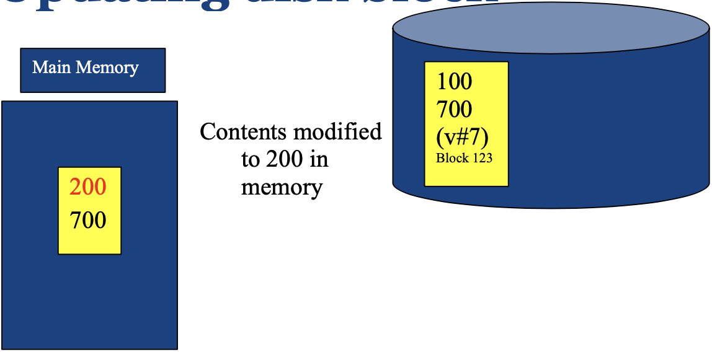
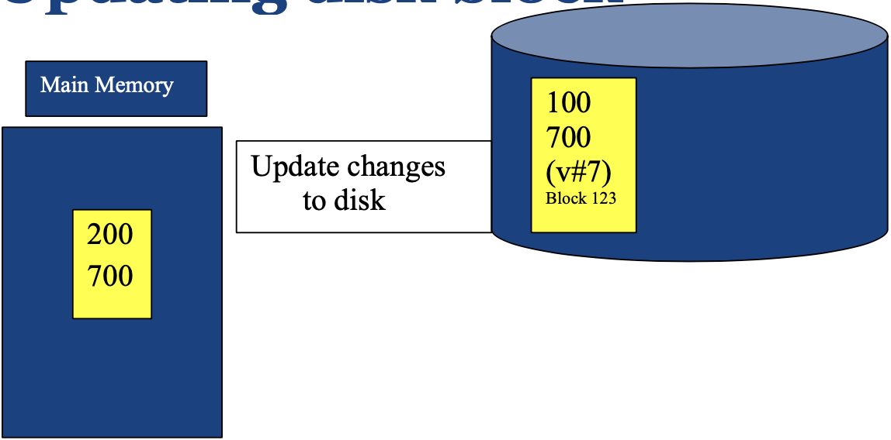
State 3: Operation: Write to disk in a different block, Written to a different block, Next update will take place to Block 123 and the version number V#7 will be changed to v#9. (Two different physical disks can be used for duplex writes as well), Main Memory (200 700), Hard Disk (100 700 (v#7) Block 123; 200 700 (v#8) Block 475)
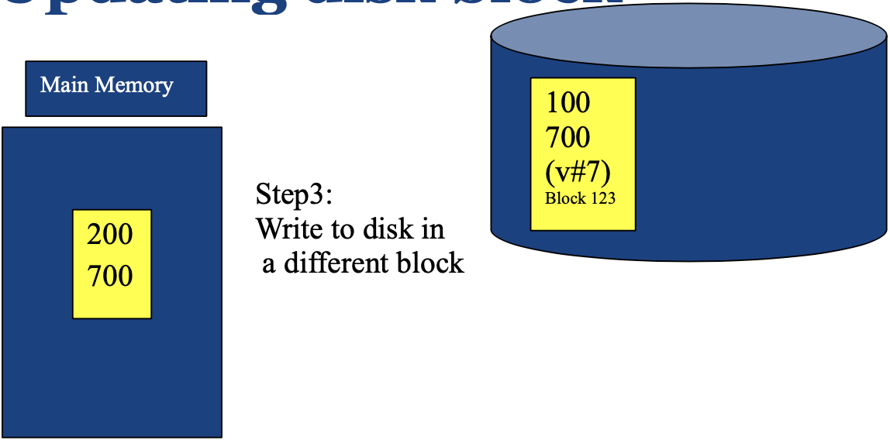

### Logged write
- similar to duplex write, except one of the writes goes to a log.
- Log – durable & can be read quickly
- If the log stores a compact change record, logging a small update may avoid rewriting a full block. Durability and replay still depend on the log protocol.

## CRC Calculation / 循环冗余校验
To compute an n-bit binary CRC, follow these steps:

1. **Padding**: Add n zero bits to the right of the input bits. For example, a 3-bit CRC with polynomial $x^3 + x + 1$ appends 000 before division.
2. **Compute Polynomial**: Compute the (n + 1)-bit pattern representing the CRC's divisor (called a "polynomial"). For example, a 3-bit CRC with a polynomial $x^3 + x + 1$ would have the coefficients 1, 0, 1, and 1. i.e. $1 \times x^3 + 0 \times x^2 + 1 \times x^1 + 1 \times x^0$

3. **Position Polynomial**: Position the (n + 1)-bit pattern representing the CRC's divisor underneath the left-hand end of the input bits.

4. **Perform XOR Operations**: Starting at the leftmost bit, XOR the divisor with the current message window when its leading bit is 1; otherwise shift to the next position. Continue polynomial long division over GF(2) across the padded message. The final n-bit remainder is the CRC. A CRC detects many transmission or storage errors but does not repair data or authenticate its source; detection strength depends on the chosen polynomial and error pattern.

Example:

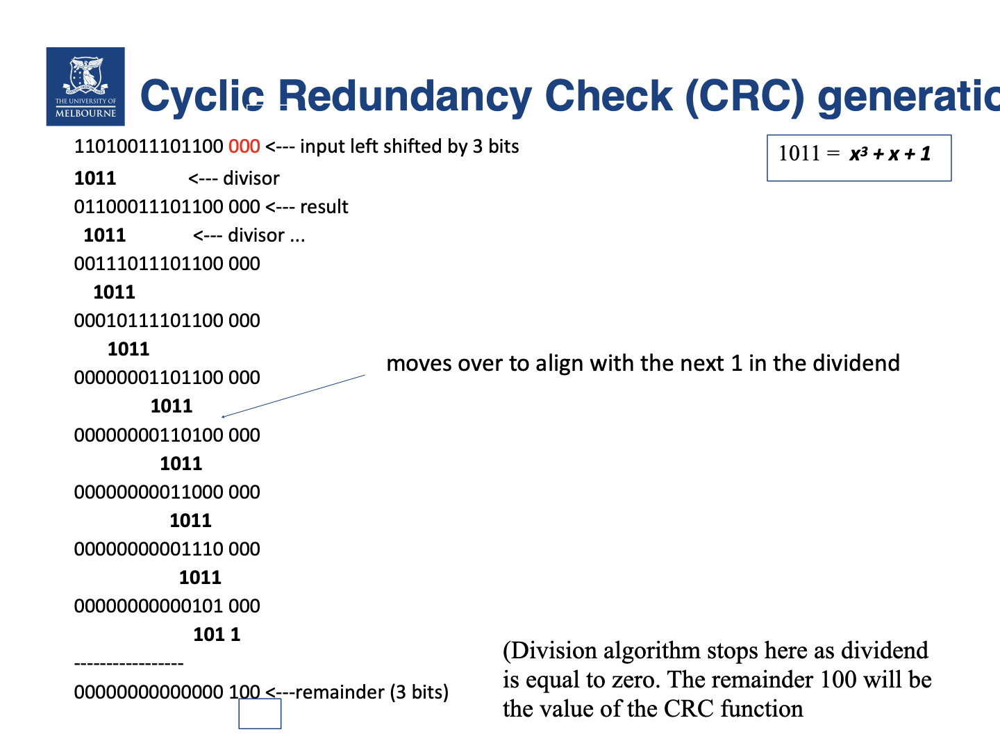

## Database Engine (Database management system)
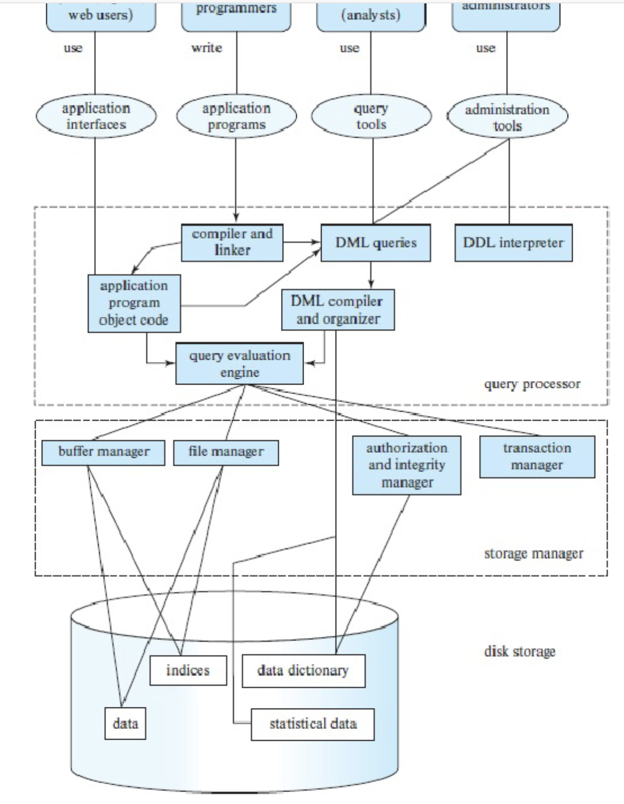
The diagram highlights the query evaluation engine, file manager, buffer manager, indexes, and stored data as execution-time performance components; query optimization also depends on statistics, configuration, and workload.

## Relational Algebra & Join / 关系代数与连接
核心概念：查询先表示为关系操作，再由优化器按统计信息估算计划成本；索引和连接算法改变访问代价，不保证任何固定加速。空间索引的包围盒用于筛选候选，还需用精确几何谓词确认；索引语法和物理行为取决于数据库产品。

Table – “Employee”
|ID|Name|Age|
|---|---|---|
|1001|A|25|
|1002|B|32|
|1003|C|19|
|1004|D|27|
|1005|E|40|
|1006|F|36|

Table - "Manager"

| ID   | Department |
| ---- | ---------- |
| 1001 | a          |
| 1003 | b          |
| 1004 | c          |
| 1006 | d          |

Table - "Location"

| ID   | Country   | City      |
| ---- | --------- | --------- |
| 1001 | China     | Beijing   |
| 1002 | Australia | Melbourne |
| 1004 | China     | Shanghai  |
| 1006 | Australia | Sydney    |

- Attribute (column)
- Record (row)
- Query examples (IDs are joined across the three tables):
  - Names of all employees older than 25: **B, D, E, F**. Age 25 is not over 25.
        SELECT Name FROM Employee WHERE Age > 25;
  - Names of managers located in Australia: **F**. Join Employee to Manager to identify managers, then join to Location and filter the country.
        SELECT E.Name
        FROM Employee AS E
        JOIN Manager AS M ON M.ID = E.ID
        JOIN Location AS L ON L.ID = E.ID
        WHERE L.Country = 'Australia';

### Join
Join is a very common and very expensive operation

Different types of join: inner join, outer join... (we focus on inner join)
A natural join matches columns with the same name in both inputs; an explicit theta join uses a specified predicate.

$r \bowtie_θ s$

- r: **outer** relation
- s: **inner** relation
- r and s are two tables
- Theta (θ) is the join predicate; it need not be a single common column.

### Relational Algebra Expressions
#### Overview
Classical relational algebra uses set semantics, while SQL SELECT defaults to retaining duplicate rows (bag semantics). The equivalence below is at the set-semantics level; use DISTINCT when exact classical projection behavior is needed ([PostgreSQL SELECT documentation](https://www.postgresql.org/docs/18/sql-select.html#SQL-SELECT-DISTINCT)).

```sql
Select A1, A2, ..., An
FROM r1, r2, ..., rm
Where P
```

.... Is same as the following in relational algebra expression:

$$
\Pi_{A_1, A_2, ..., A_n}(\sigma_P(r_1 \times r_2 \times ... \times r_m))
$$

#### Example
```sql
SELECT *
FROM r1 AS T1
INNER JOIN r2 AS T2 ON T1.a = T2.b;
```

```sql
SELECT salary
FROM Employees
INNER JOIN Managers
ON Employees.EmpID = Managers.EmpID;
```

.... Is same as the following in relational algebra expression:

$$
\Pi_{\text{salary}}(\sigma_{\text{Employees.EMPID}=\text{Managers.EMPID}}(\text{Employees} \times \text{Managers}))
$$

#### Example
```sql
Select salary
From Employees Where salary < 60000
```

Is same as the following in relational algebra expression:

$$
\Pi_{salary}(\sigma_{salary<60000}(Employees))
$$

Can also be written as:

$$
\sigma_{salary < 60000} (\Pi_{salary} (Employees))
$$

## Two types of Join Algorithm
### How data is stored in disk?
- Files – A database is mapped into different files. A file is a sequence of records.
- Data blocks – Each file is mapped into fixed length storage units, called data blocks (also called logical blocks, or pages)

Example: if a record is 55 bytes and a page is 4,096 bytes, the idealized capacity is $\lfloor 4096/55 \rfloor=74$ records per page. This ignores page headers, slot directories, alignment, and other storage overhead.

### Nested Loop Join
```sql
for each tuple tr in r do begin
    for each tuple ts in s do begin
        test pair (tr,ts) to see if they satisfy the join condition theta (θ)
        if they do, add tr • ts to the result.
    end
end
```

- Requires no indices because it checks everything in r against everything in s
- Expensive since it **examines every pair of tuples** in the two relations.
- Could be cheap if you do it on two small tables where they fit to main memory (disk brings the whole tables with first block access).
- Under the textbook assumption of one buffer page per input and no useful index/cache, tuple nested-loop join reads the outer relation once and scans the inner relation once per outer tuple: $b_r+n_r b_s$ page reads. CPU comparisons and result-output cost are omitted.

### Page-Oriented Nested-Loop Join
```sql
for each page Br of r do begin
    for each page Bs of s do begin
        for each tuple tr in Br do begin
            for each tuple ts in Bs do begin
                Check if (tr,ts) satisfy the join condition
                if they do, add tr • ts to the result.
            end
        end
    end
end
```

- Variant of nested-loop join in which every page of inner relation is paired with every page of outer relation.
- With one buffer page per input, page-oriented nested-loop join reads the outer relation once and scans the inner relation once per outer page: $b_r+b_r b_s$ page reads. This simplified estimate omits CPU and result-output cost.

### Example of simple and page-oriented calculation
Let’s see an example with the following bank database:

- Number of records of customer: 10,000 depositor: 5000
- Number of Pages of customer: 400 depositor: 100

#### Simple Nested-Loop Join
- With depositor as the outer relation: $b_r + n_r b_s = 100 + 5000 \times 400 = 2{,}000{,}100$ page reads.
- With customer as the outer relation: $400 + 10{,}000 \times 100 = 1{,}000{,}400$ page reads.

#### Page-oriented Nested-Loop Join
- With depositor as the outer relation: $b_r + b_r b_s = 100 + 100 \times 400 = 40{,}100$ page reads.
- With customer as the outer relation: $400 + 400 \times 100 = 40{,}400$ page reads.

## Query Cost & Query Optimization / 查询成本与优化
1. Parse query to relational algebra expression
2. Use optimizer and get execution plan
3. execute and get output

For example, [PostgreSQL's planner documentation](https://www.postgresql.org/docs/18/planner-optimizer.html) describes plan search and cost estimates; these remain estimates, not a guarantee that the chosen plan is fastest for every execution.

### Transaction Processing at core of RDBS
Definition: A transaction is a collection of operations that need to be performed as a complete unit. (e.g., A transfers $100 to B)

Structure of a transaction

```
begin_transaction()
    <sequence of operations to be performed>
    if (successful)
        commit_trans()
    else
        rollback()
end_transaction()
```

### Transaction Models - ACID Properties
- Atomicity: a transaction's changes are committed as a unit or rolled back as a unit. A duplex write can help protect a block, but does not by itself provide transaction atomicity.
- Consistency: a transaction should preserve declared constraints and application invariants. The DBMS can enforce declared constraints; application-level rules still need correct transactional logic.
  - For example, a primary key enforces uniqueness and non-nullness for the chosen key columns.
- Isolation controls which concurrent effects a transaction can observe. Together with atomic commit, it prevents another transaction from observing only one side of a completed transfer; isolation alone does not make the debit and credit atomic.
- Durability: the system should tolerate system failures and any committed updates should not be lost.

ACID properties might sometimes conflict with each other, yet, the system must still ensure:

- fast access to large amounts of data,
- provide a secure and stable repository when things fail,
- offer standard interfaces for data definition and manipulation,
- manage multi-user access in an orderly manner,
- allow convenient ways for report production and browsing,
- and ease data loading, archiving, and performance tuning.

### Query Optimisation Example - 2021Win Question 10
In the following figure we see two equal expressions a query optimizer is looking at to decide which one to run eventually:
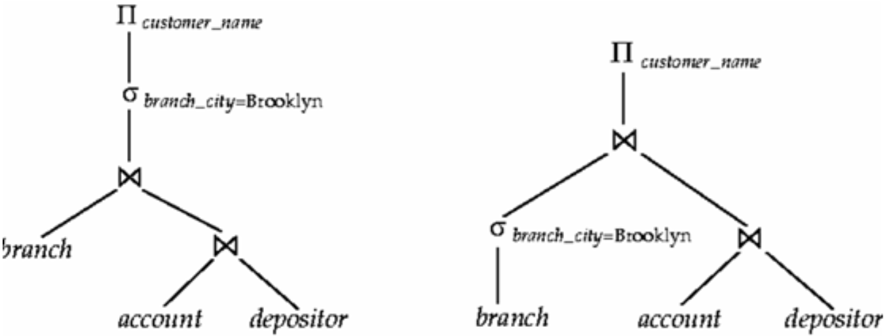

$$
\Pi_{customer\_name}\sigma_{branch_city=Brooklyn}\bowtie(branch, \bowtie(account, depositor))
$$

$$
\Pi\bowtie(\sigma_{branch\_city=Brooklyn}, \bowtie(account, depositor))
$$

Please describe which one of these plans the optimizer should choose and why. Is this choice true in general? If so, where in query optimization such an observation can be used? Briefly explain.

**Answer**: Given the pictured query and the assumption that the Brooklyn predicate selects fewer branch rows, push the selection down before the join; the smaller intermediate relation can reduce join work. This is a heuristic and cost-based optimizers compare estimated plans: selectivity, available indexes, ordering, memory, and downstream operations can make another plan cheaper.

### How do query optimizer make the choices?
Steps in cost-based query optimization

1. Generate logically equivalent expressions of the SQL statement
2. Annotate resultant expressions to get alternative query plans
3. Choose the cheapest plan based on the estimated cost

### Estimation of plan cost based on:
- Statistical information about tables. Example: number of distinct values for an attribute
- Statistics estimation for intermediate results to compute cost of complex expressions
- Cost formulae for algorithms, computed using statistics again

### How to generate alternatives?
- SQL is declarative; an optimizer can translate it into internal relational operators and use equivalence rules to explore logically equivalent plans. Relational algebra provides a formal basis for many such transformations.
- One can generate all equivalent expressions exhaustively
- The above approach is very expensive in space and time though (In query optimizer some expressions are not generated if they are for sure very complex)

### How to choose?
- Must consider the interaction of evaluation techniques when choosing evaluation plans
- Choosing the cheapest algorithm for each operation independently may
  not yield best overall algorithm
- E.g., merge-join may be costlier than hash-join, but may provide a sorted output which could be useful later (the sorted result may be benefit to the later operation)

### In Real Life
- Practical query optimizers incorporate elements of the following two broad approaches:
  1. Search all the plans and choose the best plan in a cost-based fashion.
  2. Uses heuristics to choose a plan.
- Systems may use heuristics to reduce the number of choices that must be made in a cost-based fashion (because cost-based optimization is expensive)
- Heuristic optimization transforms the query-tree by using a set of rules that typically (but not in all cases) improve execution performance:
  1. Perform selections early (reduces the number of tuples)
  2. Perform projections early (reduces the number of attributes)
  3. Perform most restrictive selection and join operations (i.e. with smallest result size) before other similar operations
- Some systems use only heuristics, others combine heuristics with cost-based optimization
- Optimizers often use simple heuristics for very cheap queries, and perform exhaustive enumeration for more expensive queries

## Manage Query Cost in Practice
Troubleshoot plan and runtime regressions with engine-specific tools such as [SQL Server Query Store](https://learn.microsoft.com/en-us/sql/relational-databases/performance/query-store-usage-scenarios?view=sql-server-ver17), which retains query, plan, and runtime history and can be viewed through SQL Server tooling.

- Identify ‘regressed queries’ - Pinpoint the queries for which execution metrics have recently regressed (for example, changed to worse).
- Track specific queries - Track the execution of the most important queries in real time. (e.g., most frequently asked queries)

When you identify a query with suboptimal performance

- Force a query plan instead of the plan chosen by the optimizer
- Do we need an index? --- quickly find the data in the query
- Enforce statistic recompilation
- Rewrite query? (with parameters)

### Parameter in query
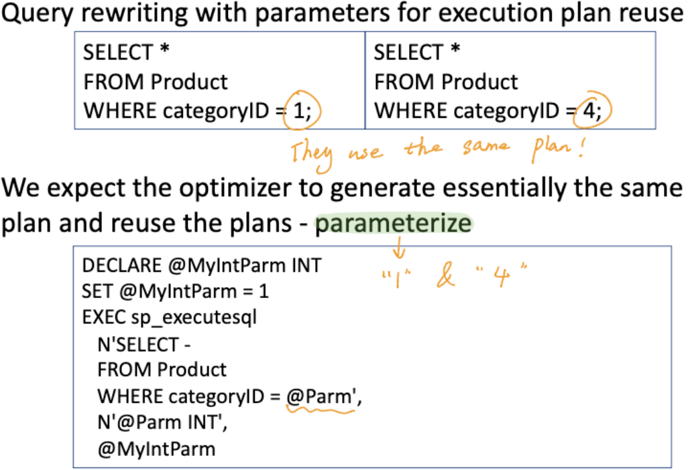

### To further lower query cost
- Store derived data
  - When you frequently need derived values
  - Original data do not change frequently
- Use pre-joined tables
  - When tables need to be joined frequently
  - Regularly check and update pre-joined table for updates in the original table May still return some ‘outdated’ result (pre-joined tables are not updated)

## Indexing / 索引
- DBMS admin generally creates indices to allow almost direct access to individual items (index = indice)
- DBMS must support
  - insert/delete/modify record
  - read a particular record (specified using record id)
  - scan all records (possibly with some conditions on the records to be retrieved), or scan a range of records

### Indexing overview
- Indexing mechanisms used to speed up access to desired data in a similar way to look up a phone book or dictionary
- **Search Key** - **attribute** or **set of attributes** used to look up records/rows in a system like an ID of a person (The ID will take us to get the entire record)
- An index file consists of records (called index entries) of the form search- key, pointer to where data is
- Index structures are often smaller than their base data, and frequently accessed pages may be cached in main memory; the cached working set depends on index size and available memory.

### Indexing makes Disk Access Time become faster through
- records with a **specified value** in the attribute accessed with minimal disk accesses (e.g., Student ID = 101, the index file tells us which data block in disk to go)
- records with an attribute value falling in a specified range of values can be retrieved with a single seek and then consecutive sequential reads (e.g., ID:100-200, find where is the first record (single seek of starting block), then read sequentially)
- Note: not all DB stores sequential data sequentially, so this method may not useful for some DB

### Criteria to choose index – always tradeoff
- Insertion time to index is also important
- Deletion time is important as well
- No big index rearrangement after insertion and deletion
- Space overhead needs to be considered for the index itself
- No single indexing technique is the best. Rather, each technique is best suited to particular applications.

### Types of indices based on search keys
Ordered indices – Search keys are stored in some order

- Clustering index / primary index
- Non-clustering index / secondary index
- Hash indices – Search keys are distributed
- **B+ tree**
- Bitmap index
- Trees for spatial data
  - Quadtree
  - k-d tree
  - R-tree

### Clustering Index / Primary Index
- in a sequentially **ordered file**, the index whose **search key** specifies the sequential order of the file
- The search key of a primary index is usually but not necessarily the **primary key**
  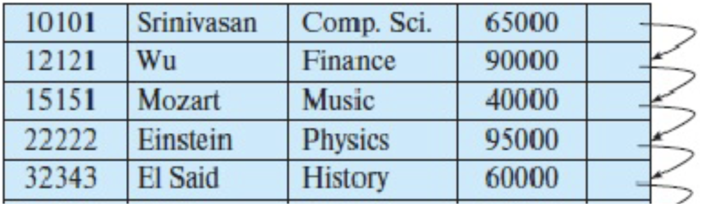
  As shown in graph, the order is sorted

### Non-clustering Index / Secondary Index
- An index whose **search key specifies an order** different from the sequential order of the file
- Secondary indices improve the performance of queries that use keys other than the search key of the clustering index.
  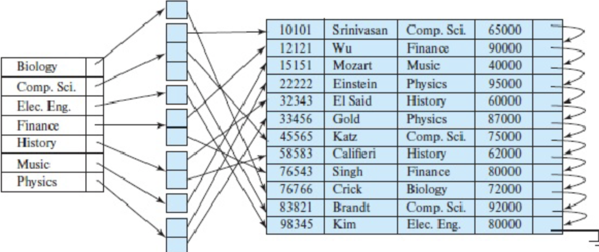
  As shown in graph, the search key here is the major

### Hash indices
- A hash function aims to spread distinct search-key values approximately uniformly across buckets.
- A hash index organizes the search keys, with their associated record pointers, into a hash file structure. Order is not important.
- Equal search-key values still hash to the same bucket. Skew or many duplicate records can overload a bucket and require overflow pages; bucket record counts need not be equal, and lookup is not guaranteed to take one I/O ([PostgreSQL hash indexes](https://www.postgresql.org/docs/18/hash-index.html)).
- Typical hash functions perform computation on the internal binary representation of the search-key.
  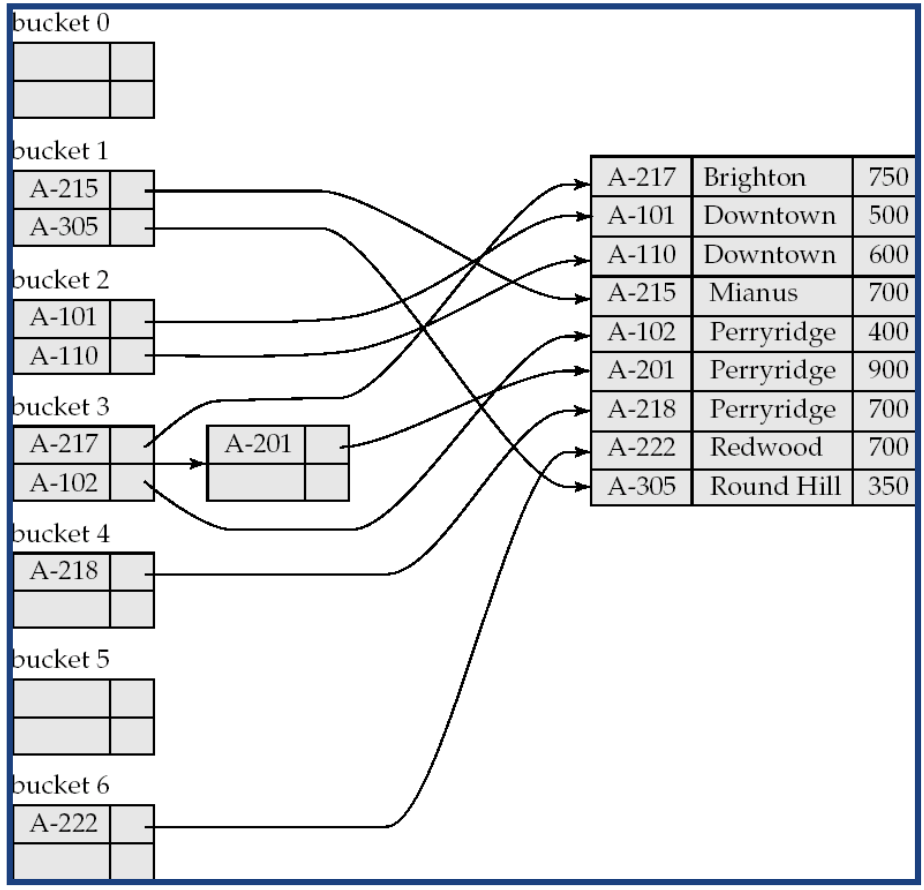
- With seven buckets, a hash function should distribute distinct keys across bucket values 0–6 approximately evenly; this does not guarantee the same number of records per bucket when keys repeat.
- Goes to which bucket here determined by Hash function return value, e.g. Hash(A-215) = 1

### Bitmap index
- Records in a relation are assumed to be numbered sequentially from, say, 0
- Applicable on attributes that take on a relatively small number of distinct Values
  - E.g. gender, country, state, ...
  - E.g. income-level (income broken up into a small number of levels such as 0-9999, 10000-19999, 20000-50000, 50000- infinity)
- A bitmap is simply an array of bits
- In its simplest form a bitmap index on an attribute has a bitmap for each value of the attribute
  - Bitmap has as many bits as records
  - In a bitmap for value v, the bit for a record is 1 if the record has the value v for the attribute, and is 0 otherwise
  - Used for business analysis, where rather than individual records say how much of one type exists is the query/important

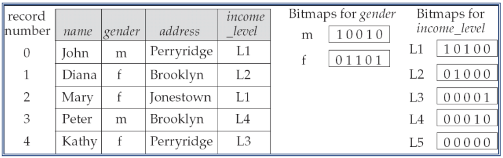
In this graph,

- gender is distinct value which is m or f
- income-level is distinct value, which is L1, L2, ..., L5

### B+ tree / B+树
Why?

- As an ordered file grows, insertions can create overflow pages and weaken locality; binary search can still be used only when the file's organization supports it, and may incur extra I/O. Periodic reorganization is one possible remedy.
- A B+ tree maintains balance through local splits and merges, keeping all root-to-leaf paths at the same depth. In this convention, order n is the maximum number of child pointers: each non-root internal node has between $\lceil n/2 \rceil$ and $n$ children, and each leaf has between $\lceil(n-1)/2 \rceil$ and $n-1$ key entries. The root has separate minimum-occupancy rules. For a product example, [SQL Server rowstore indexes are organized as B+ trees](https://learn.microsoft.com/en-us/sql/relational-databases/indexes/clustered-and-nonclustered-indexes-described?view=sql-server-ver17).
- Special cases:
  - If the root is not a leaf, it has at least 2 children.
  - If the root is a leaf (that is, there are no other nodes in the tree), it can have between 0 and (n–1) values.

#### B+ tree Typical Node
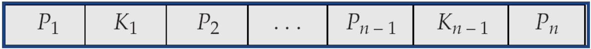

- $K_i$ are ordered search-key values. Internal-node pointers refer to child pages; leaf entries contain a key and a record identifier, or a key and a bucket/record list, depending on the index. In a B+ tree file organization, leaves may instead contain the rows.
- Upper levels are often cached because they are smaller and accessed frequently, but the tree's height does not guarantee that they are resident in memory.

#### Example B+ tree
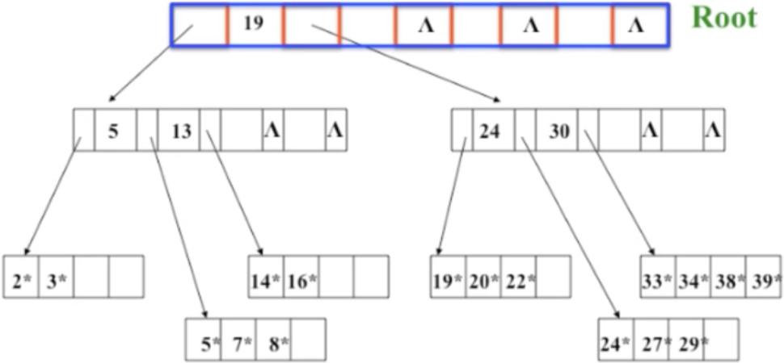
In this graph, the nodes with _ are records, that's why all leaf nodes have _

#### Finding all records with a search-key value of k.
Using the illustrated convention, pointer $P_i$ lies immediately to the left of separator $K_i$:
1. N=root initially
2. Repeat
   1. Examine N for the smallest search-key value > k.
   2. If such a value exists, assume it is Ki. Then set N = Pi
   3. Otherwise k ≥ Kn–1. Set N = Pn . Follow pointer.
      Until N is a leaf node
3. If for some i, key Ki = k follow pointer Pi to the desired record or bucket.
4. Else no record with search-key value k exists.
   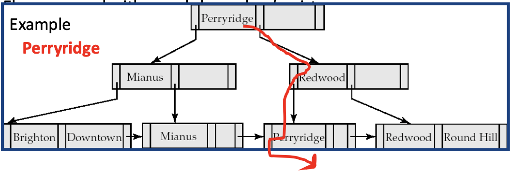
   Note don't get confused by the Perryridge on the root, it is just the search key by chance.

#### Run range queries in B+ tree
Range queries find all records with search key values in a given range e.g., from Brandt to Singh
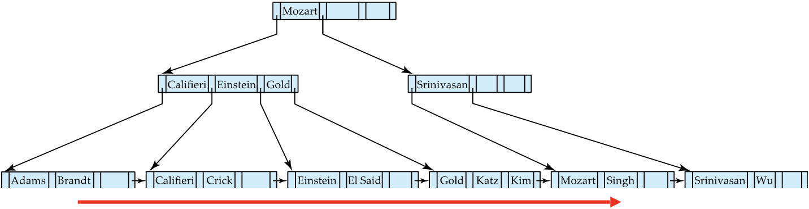

#### B+ tree - Insertion (2 types)
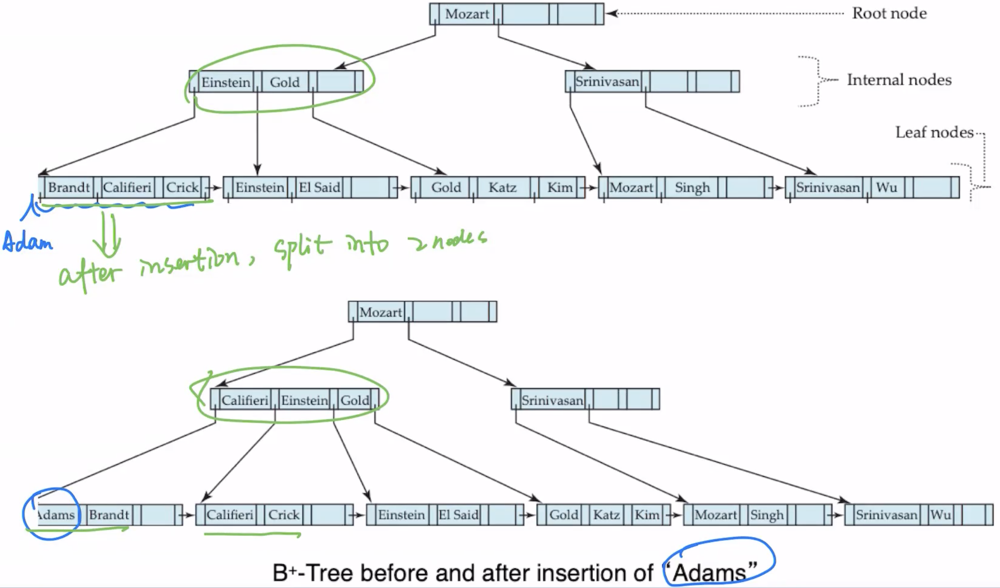
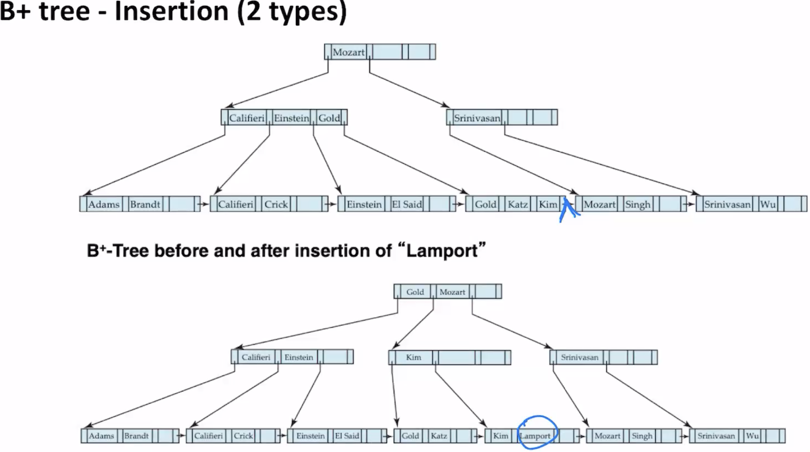
It will split nodes to avoid having leaf node > n–1

#### B+ tree - Deletion (2 types)
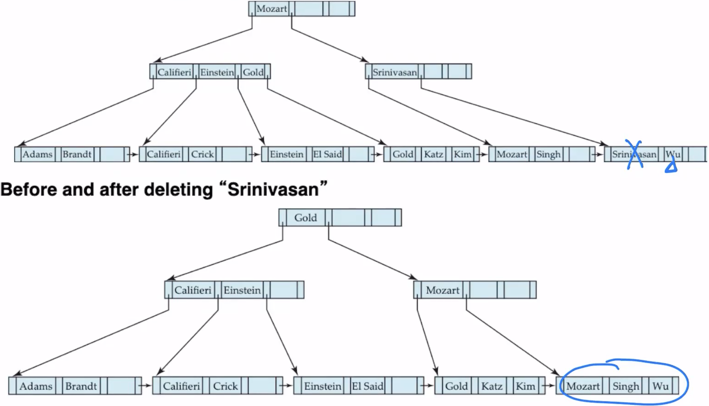
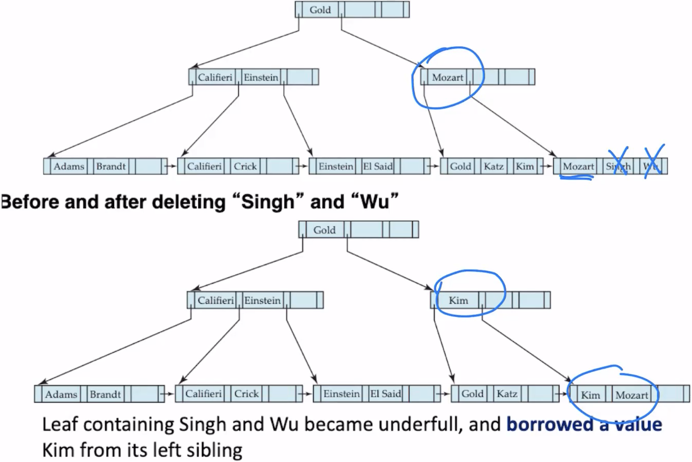
It will merge to avoid having leaf node < ⎡(n–1)/2⎤

#### B+ tree – File organization
- Leaf nodes in a B+-tree file organization store records, instead of pointers to children
- Helps keep data records clustered (ordered) even when there are insertions/deletions/updates
- Insertion and deletion or records are handled in the same way as insertion and deletion of entries in a B+-tree index.

#### B+ tree Advantages
- Automatically reorganizes itself with small, local changes in the face of insertions and deletions.
- Reorganization of entire file is not required to maintain performance
- Similar to Binary tree in many aspects but the **fan out** is much higher (height of B+ tree is smaller than binary tree)

#### B+ tree Disdvantages
- Extra insertion and deletion over head and space over head (reorganisation)

Advantages of B+-trees outweigh disadvantages for DBMSs (B+ trees are used extensively)

### Considering location data (spatial data)
- Unlike things we can access by names, ids, there is a lot of data that exists, and increasingly that requires special indexing
- For example, spatial data requires more complex computations for accessing data,
  - e.g., intersections of objects in space
- There is no trivial way to sort items which is a key issue,
  - e.g., range query on a simple set of items, e.g. all restaurants within 5 KM
  - e.g., a Nearest Neighbour query, e.g. find the nearest restaurant of my location

### Quadtree (for location data - points) / 四叉树
- Each quadtree node represents a rectangular region; an internal node partitions it into four quadrants, recursively, until a chosen stopping condition (for example, a maximum number of points per leaf).
- A k-d tree is a different spatial structure: each internal node splits a region with one axis-aligned line into two children, often alternating axes. The exam example below is a k-d tree, not a quadtree.

#### Quadtree – e.g.,
Example: **Leaf nodes** have between zero and **some fixed maximum number** of points (set to 1 in example below)  
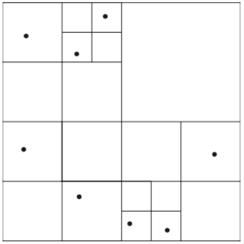  
It is keep spliting into squares until no more than n (1 in this example) leaf nodes are inside same square

#### Quadtree Tree structure
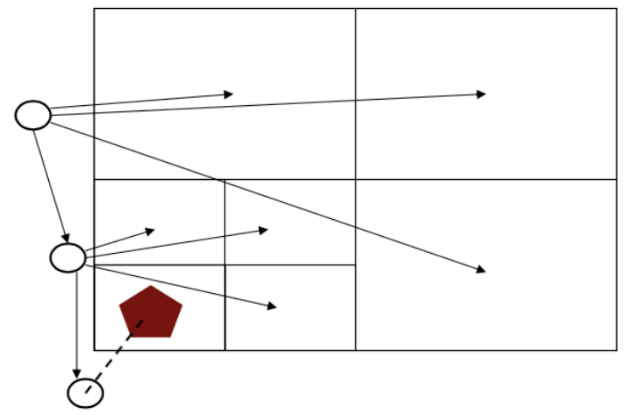

#### Quadtree – e.g., run NN (nearest neighbor) query
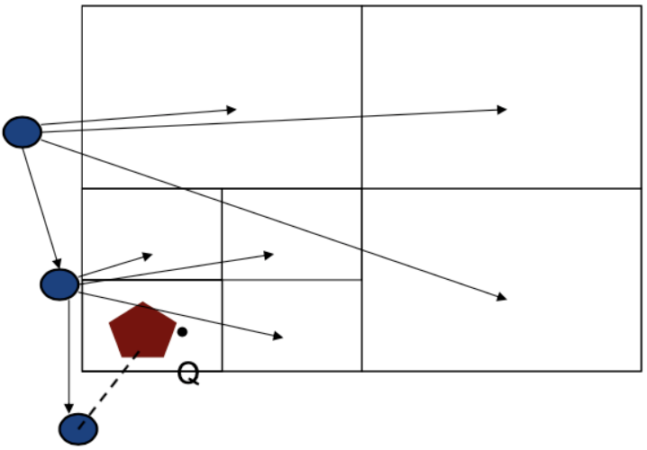

### k-d Tree / k-d 树
A k-d tree is a binary spatial search tree. Each internal node splits the current region into two using an axis-aligned boundary, often cycling through dimensions; unlike a quadtree, it does not divide every region into four quadrants ([Princeton, Geometric Applications of BSTs](https://algs4.cs.princeton.edu/92search/)).

#### 2022S1 Exam Question 5: k-d Tree Example
Given the k-d tree below with point data, where black labeled dots represent spatial coordinate data, and the rectangular area is divided into regions with the division order given with numbers: draw the associated k-d tree as a tree structure with leaves labeled as the data labels given below. Assume **left subarea** of a division goes to a **left subtree**, and **lower subarea** of a division also goes to a **left subtree**. The figure for the k-tree follows:  
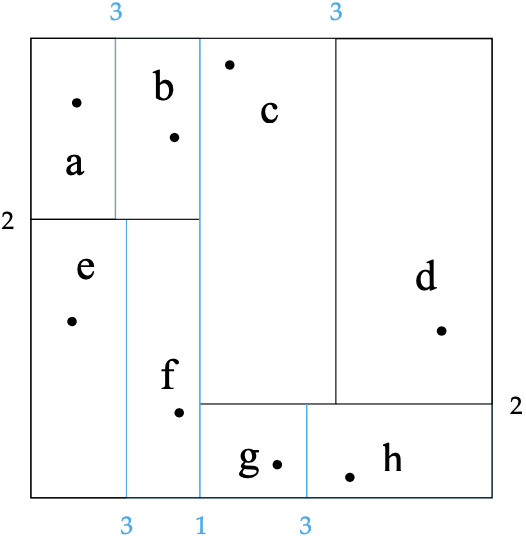  
The key idea is, for each division, split the current node (root) to 2 nodes. Put the left-down on left, right-up on right nodes.  
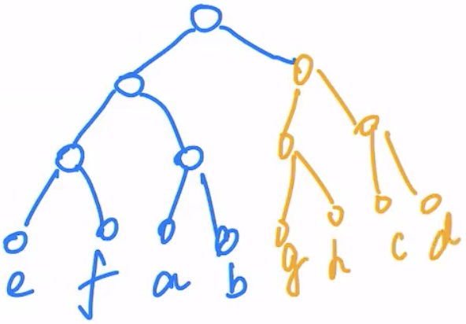

### R-Trees / R树
- An R-tree is a balanced spatial index whose internal entries store minimum bounding rectangles (MBRs) for child subtrees; leaves index spatial objects. It is not simply a B+ tree with a one-dimensional interval replaced. See [Guttman's original 1984 R-tree paper](https://www.cs.princeton.edu/courses/archive/fall08/cos597B/papers/rtrees.pdf).
- Child MBRs may overlap, so a range query can visit multiple subtrees; the index returns candidates that must be checked with the exact spatial predicate. Variants include R+ trees and R* trees.
- **Bounding boxes of children of a node are allowed to overlap**
- Note: A **bounding box** of a node is a minimum sized rectangle that contains all the rectangles/polygons associated with the node

#### R-Tree example
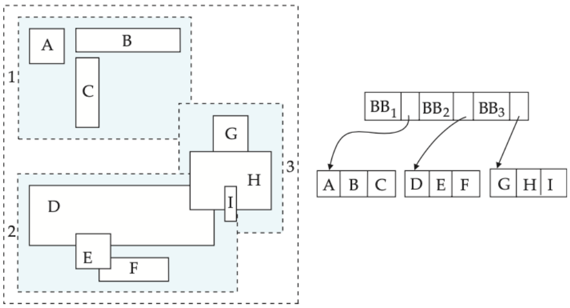
A range query tests relevant MBRs and may descend into multiple children when their bounds overlap. Candidate geometries still need the exact predicate, since MBR overlap alone does not prove an exact match.

## Using Indexes in SQL
### Index Definition in SQL
- Index creation and physical organization are DBMS-specific. In SQL Server, UNIQUE constraints are backed by a unique index; a PRIMARY KEY is clustered by default only when the table has no clustered index, and can be declared nonclustered. Other products use different defaults and terminology.
- Indexes on views are also product-specific and have additional restrictions; a query result is not universally indexable.

### Create an index
SQL syntax varies by product. The following CLUSTERED, NONCLUSTERED, filtered-index, and spatial-index examples use SQL Server syntax ([index architecture](https://learn.microsoft.com/en-us/sql/relational-databases/sql-server-index-design-guide?view=sql-server-ver17)).

1. Create a clustered index on a table
   CREATE CLUSTERED INDEX index1 ON table1 (column1);
2. Create a non-clustered index with a unique constraints
   CREATE UNIQUE INDEX index1 ON table1 (column1 DESC, column2 ASC, column3 DESC);

(A unique index is one in which no two rows are permitted to have the same index key value)

### Drop an index (SQL Server)
DROP INDEX index_name ON table_name; ([official SQL Server syntax](https://learn.microsoft.com/en-us/sql/t-sql/statements/drop-index-transact-sql?view=sql-server-ver17))

Most database systems allow specification of type of index, and clustering

### Specialized indexes - Filtered index
CREATE INDEX index1 ON table1 (column1) WHERE [Year] > '2010';

(A filtered index is an optimized nonclustered index, suited for queries that select a small percentage of rows from a table. It uses a filter predicate to index a portion of the data in the table)

### Spatial index
In SQL Server, a spatial index is defined for a geometry or geography column and has product-specific requirements, including a clustered primary key. The BOUNDING_BOX option applies to geometry; geography indexes use a different configuration ([CREATE SPATIAL INDEX](https://learn.microsoft.com/en-us/sql/t-sql/statements/create-spatial-index-transact-sql?view=sql-server-ver17)).

CREATE SPATIAL INDEX index_name ON table_name(Geometry_type_col_name) WITH ( BOUNDING_BOX = ( 0, 0, 500, 200 ) );

## Summary
- There is no point going through all index types for all data types
  - There is hundreds of them
  - Even each type would have many subtypes
    - E.g., MX-CIF quadtree is one quadtree type among many
  - Same with R-trees, etc
  - Same with many other index types
- Given a data set, when uploading to the DBMS
  - Find the potential query types
  - Research what indices that particular DBMS would have for that data type
  - Research for what queries you would better do on what index
  - Create index if you have large data
  - Monitor performance
  - Tune or create other indices
  - Your DMBS will have a version of the “create index” SQL statement

## Transactions / 事务
### Transaction - A unit of work in a database
- A transaction can have any number and type of operations in it
- Either happens as a whole or not
- Transactions ideally have four properties, commonly known as ACID properties

### ACID (Atomicity, Consistency, Isolation, Durability) properties:
- Atomicity - All changes to data are performed as if they are a single operation. That is, all the changes are performed, or none of them are.
  Example – A transaction that (i) subtracts $100 if balance >100 (ii) deposits $100 to another account
  (both actions with either happen together or none will happen)
- Consistency - Data is in a ‘consistent’ state when a transaction starts and when it ends – in other words, any data written to the database must be valid according to all defined rules (e.g., no duplicate student ID, no negative fund transfer, etc.)
  - What is ‘consistent’ - depends on the application and context constraints
  - It is not easily computable in general
  - Serializable execution orders participating transactions as if they ran one at a time. It does not enforce an application invariant unless the relevant constraints are declared or every transaction checks them correctly.
- Isolation controls how concurrent transactions observe one another. Together with atomic commit, it prevents another transaction from observing only one side of a completed transfer; isolation alone does not make the debit and credit atomic.
- Durability- the system should tolerate system failures and any committed updates should not be lost.

### Types of Actions
- Unprotected actions - no ACID property
- Protected actions - these actions are not externalised before they are completely done. These actions are controlled and can be rolled back if required. These have ACID property.
- Real actions - these are real physical actions once performed cannot be undone. In many situations, atomicity is not possible with real actions (e.g., firing two rockets as a single atomic action)

### Embedded SQL example in C
(PostgreSQL ECPG partial example; assume the connection is established and the surrounding C program includes the required headers. ECPG preprocesses embedded EXEC SQL statements before the C compiler; this is not ODBC ([ECPG documentation](https://www.postgresql.org/docs/18/ecpg-concept.html)).)

```c
EXEC SQL INCLUDE sqlca;

int main(void) {
    EXEC SQL BEGIN DECLARE SECTION;
    /* Host variables used to exchange values with SQL */
    int order_id;
    int cust_id;
    char salesperson[10];
    char status[6];
    EXEC SQL END DECLARE SECTION;

    EXEC SQL WHENEVER SQLERROR GOTO query_error;
    EXEC SQL WHENEVER NOT FOUND GOTO bad_number;
    printf("Enter order number: ");
    scanf("%d", &order_id);
    EXEC SQL SELECT CustID, SalesPerson, Status
        INTO :cust_id, :salesperson, :status
        FROM Orders
        WHERE OrderID = :order_id;
    printf("Customer number: %d\n", cust_id);
    printf("Salesperson: %s\n", salesperson);
    printf("Status: %s\n", status);
    return 0;

query_error:
    fprintf(stderr, "SQL error: %ld\n", sqlca.sqlcode);
    return 1;
bad_number:
    fprintf(stderr, "Invalid order number.\n");
    return 1;
    EXEC SQL WHENEVER SQLERROR CONTINUE;
    EXEC SQL WHENEVER NOT FOUND CONTINUE;
}
```

- **Host Variables** - Declared in a section enclosed by the **BEGIN** DECLARE SECTION and **END** DECLARE SECTION. While accessing these variables, they are prefixed by a colon “:”. The colon is essential to distinguish between host variables and database objects (for example tables and columns).
- **Data Types** - The data types supported by a DBMS and a host language can be quite different. e.g. if we have int type id in DB, we can't use string id in C
- **Error Handling** - The DBMS reports run-time errors to the applications program through an SQL Communications Area (SQLCA) by INCLUDE SQLCA. The WHENEVER...GOTO statement tells the pre-processor to generate error- handling code to process errors returned by the DBMS.
- **Singleton SELECT** - The statement used to return the data is a singleton SELECT statement; that is, it returns only a single row of data. Therefore, the code
  example does not declare or use cursors.

### Flat Transaction
Everything inside the BEGIN WORK and COMMIT WORK is at the same level. The transaction will either survive together with everything else (commit) Or it will be rolled back with everything else (abort) – if some errors happen

```c
/* PostgreSQL ECPG fragment; assumes an open connection and the preceding sample's global sqlca. */
long BuySomething(long acc_id, long amount) {
    EXEC SQL BEGIN DECLARE SECTION;
    long sql_acc_id;
    long sql_amount;
    long balance_after;
    EXEC SQL END DECLARE SECTION;
    sql_acc_id = acc_id;
    sql_amount = amount;

    EXEC SQL WHENEVER SQLERROR CONTINUE;
    EXEC SQL INSERT INTO history(AccId, Amount, time)
        VALUES (:sql_acc_id, :sql_amount, CURRENT_TIMESTAMP);
    if (sqlca.sqlcode < 0) return -1;
    EXEC SQL UPDATE accounts
        SET AccBalance = AccBalance - :sql_amount
        WHERE AccId = :sql_acc_id;
    if (sqlca.sqlcode < 0) return -1;
    EXEC SQL SELECT AccBalance INTO :balance_after
        FROM accounts
        WHERE AccId = :sql_acc_id;
    if (sqlca.sqlcode != 0) return -1;
    return balance_after; /* the post-update balance */
}

int process_purchase(long acc_id, long amount) {
    long acc_balance;
    EXEC SQL BEGIN WORK;
    if (sqlca.sqlcode < 0) return -1;
    acc_balance = BuySomething(acc_id, amount);
    if (sqlca.sqlcode < 0 || acc_balance < 0) {
        EXEC SQL ROLLBACK WORK;
        return -1;
    }
    EXEC SQL COMMIT WORK;
    return sqlca.sqlcode < 0 ? -1 : 0;
}
```

#### Flat Transaction - Limitation
Flat transactions do not model many real applications.

```
BEGIN WORK
S1 : book flight from Melbourne to Singapore S2: book flight from Singapore to London
S3: book flight from London to Dublin
END WORK
```

From Dublin if we cannot reach our final destination instead we wish to fly to Paris from Singapore and then reach our final destination.

If we roll back we need to redo the booking from Melbourne to Singapore which is a waste.

#### Flat Transaction – Solution: Save Points
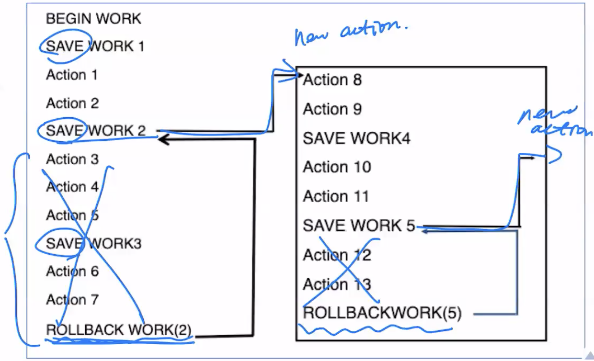

- The only reason why an application program needs an identifier for a savepoint is that it may later want to re-establish (return to) that savepoint.
- To do that, the application invokes the ROLLBACK WORK function, but rather than requesting the entire transaction to be aborted, it passes the number of the savepoint it wants to be restored.

### Nested Transaction
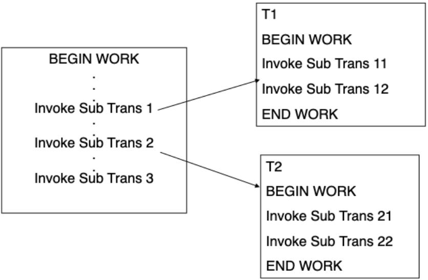
It is a tree of executions, T1 can have more T11 and T12.... The left hand side is called parent transaction.

#### Rules to follow in Nested Transaction
##### Commit rule
- In the course's closed-nesting model, a child may provisionally commit before its parent finishes; that result becomes visible to the parent but is not durable or externally visible until the root transaction commits.
- If an ancestor aborts, the provisional effects of its descendants are rolled back.

##### Roll back rules
- If a subtransaction rolls back all its children are forced to roll back

##### Visibility rules
- Changes made by a subtransaction are visible to the parent only when the subtransaction commits.
- All objects of parent are visible to its children.

Implication of this is that the parent should not modify objects while children are accessing them. This is not a problem as parent is not run in parallel with its children.

This course model does not run a parent and its child in parallel; sibling children may run in parallel.

### Transaction Processing Monitor (TP Monitor)
The main function of a TP monitor is to integrate other system components and manage resources.

- TP monitors manage the transfer of data between clients and servers
- breaks down applications or code into transactions and ensures that all databases are updated properly
- It also takes appropriate actions if any error occurs

### TP Monitor Services
- **Heterogeneity**: A transaction spanning different resource managers needs a coordinated outcome. Two-phase commit can coordinate atomic commit; isolation and application consistency require separate mechanisms.
- **Control communication**: If the application communicates with other **remote processes**, the local TP monitor should maintain the communication status among the processes to be able to recover from a crash.
- **Terminal management**: Since many terminals run client software, the TP monitor should provide appropriate ACID property between the client and the server processes.
- **Presentation service**: this is similar to terminal management in the sense it has to deal with different presentation ( user interface) software -- e.g. X-windows
- **Context management**: E.g. maintaining the sessions etc.
  Start/Restart: There is no difference between start and restart in TP based system.

## Concurrency Control / 并发控制
核心概念：并发控制协调事务交错，锁兼容与两阶段规则限制冲突；隔离级别说明可观察的并发异常，不等同于某一种锁或 MVCC 机制。快照隔离读取固定快照且通常检测同一行写冲突，仍可能因不同写集产生写偏斜；应用不变量和产品保证需另外核对。

For correct execution, we need to impose exclusive access to the shared variable counter by Tasks.

- To resolve conflicts
- To preserve database consistency

### Different ways for concurrency control
- **Peterson's algorithm (two-process pseudocode)** demonstrates mutual exclusion under atomic, sequentially consistent shared-register assumptions; it busy-waits and is not a multi-process solution.
- **OS-supported blocking primitives**, such as mutexes and semaphores, can park waiters instead of busy-waiting; implementations may use a user-space atomic fast path and involve the kernel only when needed ([Linux futex manual](https://man7.org/linux/man-pages/man2/futex.2.html)).
- **Spin locks** use atomic operations to busy-wait; they can suit short waits in an appropriate environment but consume CPU while contended.

### Peterson's algorithm (two processes)
This is Peterson's two-process algorithm, not Dekker's: each process raises its flag, gives the other process priority, and waits while the other flag is raised and it is the other process's turn. The pseudocode assumes atomic, sequentially consistent shared-register reads and writes; ordinary shared C `int` variables do not by themselves provide those concurrent-memory guarantees ([Peterson's mutual-exclusion algorithm](https://www.cs.yale.edu/homes/aspnes/pinewiki/MutualExclusion.html)). Repeat each process's entry, critical-section, exit, and remainder sequence as needed.

```text
Shared state, initialized before either process runs:
    flag[1] = 0
    flag[2] = 0
    turn = 1

Process 1:
    flag[1] = 1
    turn = 2
    while flag[2] == 1 and turn == 2:
        wait
    # critical section
    counter = counter + 1
    flag[1] = 0
    # remainder section

Process 2:
    flag[2] = 1
    turn = 1
    while flag[1] == 1 and turn == 1:
        wait
    # critical section
    counter = counter + 1
    flag[2] = 0
    # remainder section
```

- The protocol uses busy waiting. Its performance depends on the workload and platform; this teaching pseudocode is not a substitute for language or operating-system synchronization primitives in application code.

### OS supported primitives
- A blocking mutex or semaphore may ask the OS scheduler to park a waiting thread and wake it later; this avoids spinning while blocked but has scheduling and context-switch overhead. The implementation may still use hardware atomic operations internally. It is not necessarily an interrupt on every lock request.

### Spin Lock
- Spin locks use an atomic read-modify-write primitive such as test-and-set or compare-and-swap, and busy-wait while the lock is held. They can be useful for very short critical sections with low contention, but waste CPU under contention; database systems also use blocking locks and latches. Implementation and processor support vary.

#### Spin lock – Test and Set
```text
Atomic pseudocode (not C or a processor-specific implementation):
testAndSet(lock):
    old = atomic_exchange(lock, LOCKED)
    return old == UNLOCKED
```

Using test and set in spin lock for exclusive access

```text
lock = UNLOCKED
```

T1

```text
while (!testAndSet(&lock)) { /* spin until acquired */ }
/* exclusive access for T1 */
counter = counter + 1
atomic_store(lock, UNLOCKED)
```

T2

```text
while (!testAndSet(&lock)) { /* spin until acquired */ }
/* exclusive access for T2 */
counter = counter + 1
atomic_store(lock, UNLOCKED)
```

#### Spin lock – Compare and Swap
```c
boolean cs(int *cell, int *old, int *new)
{/* the following is executed atomically*/
if (*cell == *old) { *cell = *new; return TRUE;}
else { *old = *cell; return FALSE;} //put it into old and will be used later
}
```

#### Short summary
Test-and-set and compare-and-swap are both atomic read-modify-write operations used to implement synchronization. Neither is accurately described as locking only reads or only writes. The pseudocode above is a teaching sketch; real primitives also have memory-ordering requirements.

## Semaphore
Derived from train and track

- Try to Get track, wait if track not clear
- If Get track was successful, use it (no other train will be able to use it at the same time)
- Once the train passes, the semaphore is set until the train exits that section of track
  Computer semaphores have a **get()** routine that acquires the semaphore (perhaps waiting until it is free) and a **give()** routine that returns the semaphore to the free state, perhaps **signalling** (waking up) a waiting process.

### Exclusive mode Semaphore
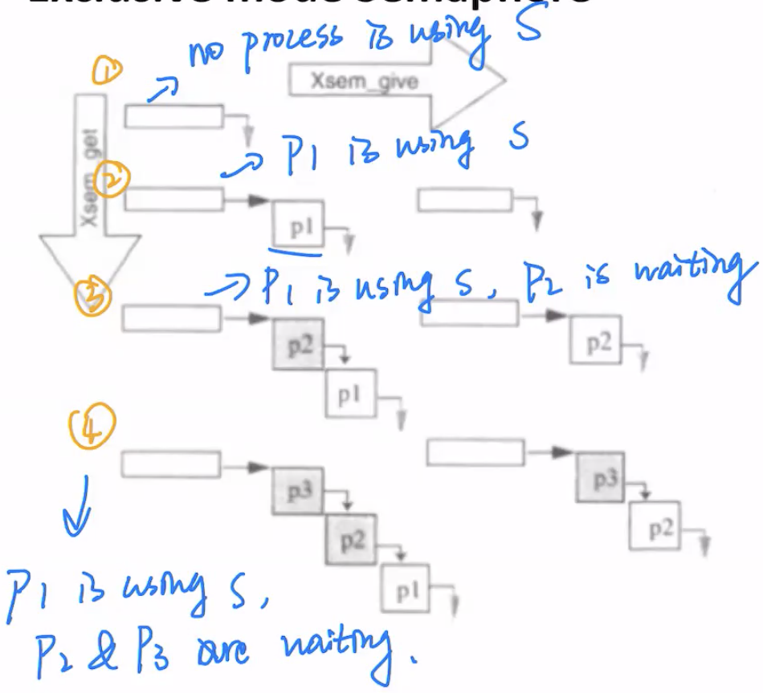

- A semaphore or mutex implementation may track waiters in a queue; whether the queue is FIFO and how ownership is represented are implementation choices. A waiting thread can be awakened when the resource becomes available.

### Convoy avoiding semaphore
Waking every waiter can cause a thundering herd as they all compete to acquire the resource. Queueing and handoff policies trade fairness, throughput, and scheduling overhead; waking all waiters is not a general convoy-avoidance guarantee.

## Deadlock / 死锁
- Deadlocks are rare, however, they do occur and the database has to deal with them when they occur
- In a deadlock, each process in the deadlock is waiting for another member to release the resources it wants.

### Deadlock - Solutions
- Have enough resources so that no waiting occurs – not practical since we cannot have infinite resources
- Do not allow a process to wait, simply rollback after a certain time. This can create live locks which are worse than deadlocks.
- Linearly order the resources and request of resources should follow this order,
- i.e., a transaction after requesting ith resource can request jth resource if j > i. This type of allocation guarantees no cyclic dependencies among the transactions.

### Linear Order
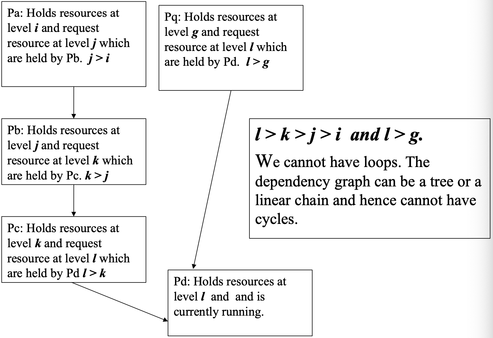

- Pa: Holds resources at level i and request resource at level j which are held by Pb. j > i
- Pb: Holds resources at level j and request resource at level k which are held by Pc. k > j
- Pc: Holds resources at level k and request resource at level l which are held by Pd l > k
- Pd: Holds resources at level l and and is currently running.
- Pq: Holds resources at level g and request resource at level l which are held by Pd. l > g
- l > k > j > i and l > g.
  We cannot have loops. The dependency graph can be a tree or a linear chain and hence cannot have cycles.

### Deadlock – Avoidance / Mitigation
- Pre-declare all necessary resources and allocate in a single request, not practical as not possible to know about all requests.
- Periodically check the resource dependency graph for cycles. If a **cycle** exists - rollback (i.e., terminate) one or more transaction to eliminate cycles (deadlocks). The chosen transactions should be cheap (e.g., they have not consumed too many resources).
- Allow waiting for a maximum time **on a lock** then **force Rollback**. Many successful systems (IBM, Tandem) have chosen this approach.
- (Many distributed database systems maintain only local dependency graphs and use time outs for global deadlocks.)

## Isolation & Dependency / 隔离与依赖
### Isolation Concept
- Isolation defines which effects concurrent transactions may observe. Serializable isolation makes the committed result equivalent to some serial execution; weaker isolation levels may permit anomalies. Isolation preserves application invariants only when constraints are enforced or every transaction follows the required logic.
- We can achieve isolation by sequentially processing each transaction - generally not efficient and provides poor response times.
- We need to run transactions concurrently with the following goals
  - Concurrent execution should not cause application programs (transactions) to malfunction (fail).
  - Concurrent execution should not have lower throughput or bad response times than serial execution.

### Possible dependencies
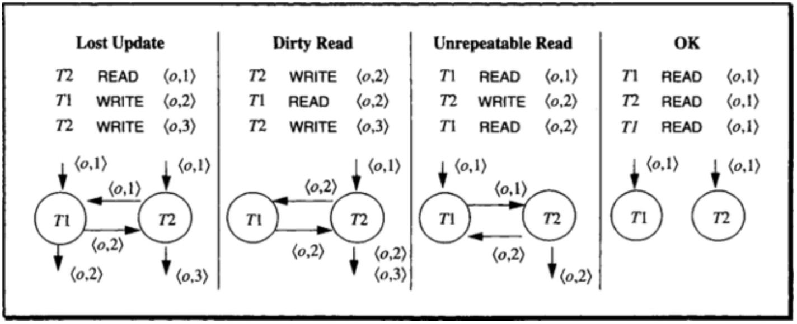

- Lost Update, Write-Write, T1 Write is covered by T2
- Dirty Read, Write-Read, T1 read in middle of write
- Unrepeatable Read, Read-Write, T1 reading while others writing
- OK, no dependency

### Dependency model
- $I_i$ : set of inputs (objects that are read) of a transaction $T_i$
- $O_i$ : set of outputs (objects that are modified) of a transaction $T_i$ Note $O_j$ and $I_j$ are not necessarily disjoint that is $O_j \cap I_j ≠ ∅$
- Given a set of transactions , Transaction $T_j$ has no dependency on any transaction $T_i$ in if -
  $$
  O_i\cap(I_j\cup O_j) = empty\ for\ all\ i ≠ j
  $$
- This approach cannot be planed ahead as in many situation inputs and outputs may be state dependant/not known in prior.

### Dependency Formal Definition
- Let **H** is a **history sequence** of tuples of the form (T, action, object). Here, T is transaction, action can be read/write, object is what the action operates on. e.g. (T1, Read, O1)
- For conflict-serializability, add an edge $T_i \to T_j$ when an operation of $T_i$ precedes and conflicts with an operation of $T_j$ on the same object: the transactions differ and at least one operation is a write. Read-read pairs do not conflict. The object may label the edge.
- A precedence graph is acyclic exactly when the history is conflict-equivalent to a serial history. This graph criterion is about conflict serializability, not every possible notion of serial equivalence ([Database System Concepts, 7e, ch. 18](https://www.db-book.com/Previous-editions/db7/slides-dir/PDF-dir/ch18.pdf)).

### Dependency Relations Example
H1 = <(T1,R,O1), (T2,W,O5), (T1,W,O3), (T3,W,O1), (T5,R,O3), (T3,W,O2), (T5,R,O4), (T4,R,O2), (T6,W,O4)>  
H2 = <(T1,R,O1), (T3,W,O1), (T3,W,O2), (T4,R,O2), (T1,W,O3), (T2,W,O5), (T5,R,O3), (T5,R,O4), (T6,W,O4)>

Give

- DEP(H1)
- DEP(H2)
- Dependency graph

For questions like this, first we focus on the object order: O1, O2.... We can notice that O1 is in T1 and T3, so we can write <T1, O1, T3> in the DEP(H1). Then we can see T3 and T4 both operate on O2, so we can write <T3, O2, T4>...

DEP(H1) = {<T1, O1,T3>, <T3,O2,T4>, <T1,O3,T5>, <T5,O4,T6> }  
DEP(H2) = {<T1, O1,T3>, <T3,O2,T4>, <T1,O3,T5>, <T5,O4,T6> }  
Dependency graph
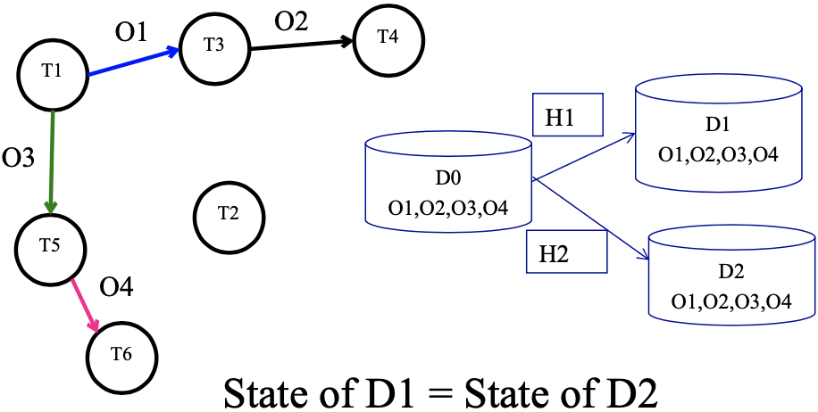

### Isolated History
- A serial history is history that is resulted as a consequence of running transactions sequentially one by one.
- N transactions can result in a maximum of N! serial histories.
- A history is conflict-serializable if it is conflict-equivalent to a **serial history** (the conflicting operations have the same order).
- A history is legal if it respects the applicable lock-grant rules.
- In this course's dependency-graph terminology, the wormhole theorem characterizes the illustrated isolation condition. For the standard conflict-serializability test, use the acyclic-precedence-graph criterion above.

#### Isolated History – e.g.,

If T1 precedes T2, it is written as T1 << T2.

```
Before(T) = {T’ | T’ << T}
After(T) = {T’| T << T’}
```

E.g.

```
After(T1) = {T5,T6, T3, T4}
After(T3) = {T4}
After (T5) = {T6}
```

### Wormhole Transaction
A transaction T’ is called a **wormhole transaction** if

$$
T' \in Before(T) \cap After(T)
$$

That is T << T’ << T. This implies there is a **cycle** in the dependency graph of the history. Presence of a wormhole transaction implies it is not isolated (=> not a serial schedule).

Idea to solve wormhole problem:

1. Known history
2. Write DEP based on history
3. Draw Dependency graph based on DEP
4. See if there is a wormhole or not

#### 2022S1 Example
Given the following transaction history h we are told that k, l, m, n, o, and p are transactions, and operations are Read and Write operations which are labeled as R and W, and operations are done on the objects labeled as a, b, c, d, e:  
h = < (k,R,a),(m,W,a),(m,W,b),(n,R,b),(k,W,c),(l,W,e),(o,R,c),(o,R,d), (p,W,d) >  
Please find the DEP(h) and draw as a simple graph version as well. Then using the concept of wormholes explain whether this history is equal to a serial history or not, i.e., if this history is not equal to a serial history then give a wormhole example, and if it is then give a serial execution of these transactions that this history is equal to. Briefly explain your steps with sentences while answering this question.

Remind that the tuple is (Transaction, Action, Object), the DEP is <T1, O, T2>. The use of all characters is indeed confusing us.

Answer
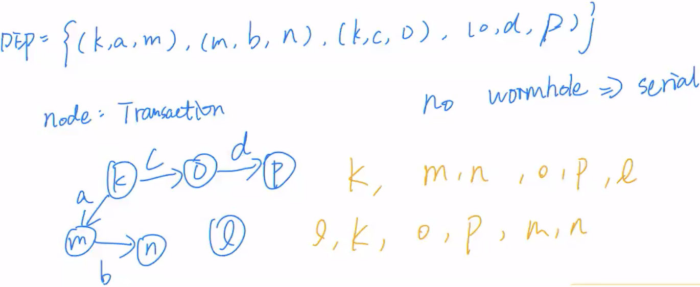

## Locks / 锁
### Slock & Xlock
- SLOCK (shared lock) that allows other transactions to **read**, but not write/modify the shared resource.
- A lock on an object should not be granted to a transaction while that object is locked by another transaction in an incompatible mode.
- An XLOCK lets its holder read and modify the object; while it is held, other transactions cannot hold an incompatible SLOCK or XLOCK on that object ([CMU two-phase locking notes](https://15445.courses.cs.cmu.edu/fall2024/notes/17-twophaselocking.pdf)).

#### Lock Compability
|                 | Free | Shared (Slock) | Exclusive (Xlock) |
| --------------- | ---- | -------------- | ----------------- |
| Request - Slock | √    | √              | ×                 |
| Request - Xlock | √    | ×              | ×                 |

#### Slock & Xlock – When to use which one?
- Actions in Transactions are: READ, WRITE, XLOCK, SLOCK, UNLOCK, BEGIN, COMMIT, ROLLBACK
- BEGIN, END , SLOCK, XLOCK can be ignored as they can be automatically inserted in terms of the corresponding operations
- If a transaction ends with a COMMIT, it is replaced with: {UNLOCK A if SLOCK A or XLOCK A appears in T for any object A}.
- ROLLBACK can be replaced by {**WRITE(UNDO)** A if WRITE A appears in T for any object A} { UNLOCK A if SLOCK A or XLOCK A appears in T for any object A}.

#### Example
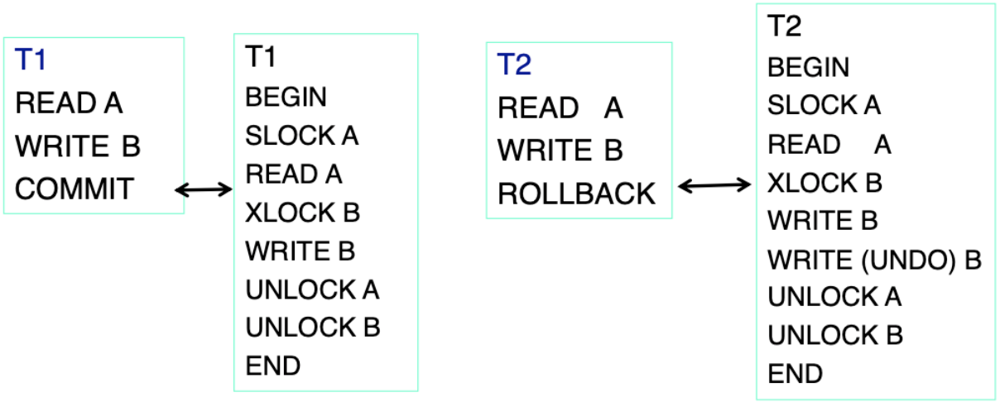
Note T2 need to WRITE (UNDO) B because it want to ROLLBACK

### Isolation Concept
- **Well-formed transactions**: A transaction is well formed if all READ, WRITE and UNLOCK operations are covered by appropriate LOCK operations
- **Two phase transactions**: A transaction is two phased if all LOCK operations precede all its UNLOCK operations. I.e. All locks are before unlocks

### Isolation Theorem
- **Locking theorem**: If all transactions are well formed and two-phased, then any legal (does not grant conflicting grants) history will be isolated.
- **Locking theorem (Converse)**: If a transaction is not well formed or not two-phase, there exists a counterexample with another transaction that violates the theorem's guarantee. This does not mean every schedule involving it is nonserializable.
- **Rollback theorem**: An update transaction that does an UNLOCK and then does a ROLLBACK is **not** two phase. The idea is ROLLBACK is a Write action, therefore it is a unlock before lock.

### Degree of Isolation
The degrees below are a historical lock-based classification, not names or exact equivalents for SQL isolation levels.

#### Degree 3:
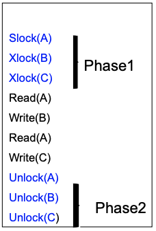  
A Three degree isolated Transaction has no lost updates, and has repeatable reads.  
Lock protocol is **two phase and well formed**.  
It is sensitive to the following conflicts: write->write; write ->read; read->write

#### Degree 2
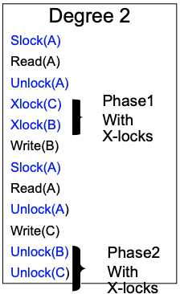  
Degree 2: A Two degree isolated transaction has no lost updates and no dirty reads.  
Lock protocol is two phase with **respect to exclusive locks** and well formed with respect to **Reads and writes**. (May have Non repeatable reads.)  
It is sensitive to the following conflicts: write- >write; write ->read;

#### Degree 1
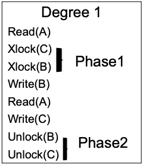  
Degree 1: A One degree isolation has no lost updates.  
Lock protocol is two phase with **respect to exclusive locks** and well formed with respect to **writes**.  
It is sensitive the following conflicts: write- >write;

#### Degree 0
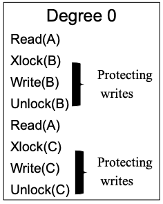  
Degree 0 : A Zero degree transaction does not overwrite another transactions dirty data if the other transaction is at least One degree.  
Lock protocol is well-formed with respect to writes. It ignores all conflicts.

## Granular Lock
- **Definition** - we need to build some **hierarchy**, then locks can be taken at any level, which will automatically grant the locks on its descendants.
- **Intention** - allow concurrent runs as much as possible for a better performance, while avoiding conflicts as much as possible
- **Steps**
  - Pick a set of column values (predicates).
  - They form a graph/tree structure.
  - Lock the nodes in this graph/tree
- Example  
  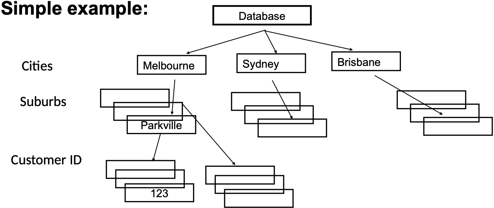

### Granularity of locks (coarse & fine)
Coarse locks reduce the number of lock-manager entries and their overhead, but limit concurrency and can increase contention. Fine-grained record locks require more lock entries but can allow more independent work to proceed concurrently ([CMU two-phase locking notes](https://15445.courses.cs.cmu.edu/fall2024/notes/17-twophaselocking.pdf)).

### Express intention
Intention mode locks on coarse granules.

### Types of granular locks
| Type | Name                                                                                     |
| ---- | ---------------------------------------------------------------------------------------- |
| X    | exclusive lock                                                                           |
| S    | shared lock                                                                              |
| U    | update lock – intention to update in the future                                          |
| IS   | intent to set shared locks at finer granularity                                          |
| IX   | Intent to set shared or exclusive locks at finer granularity                             |
| SIX  | a coarse granularity shared lock with an Intent to set finer granularity exclusive locks |

### Compatibility Mode of Granular Locks (symmetric)
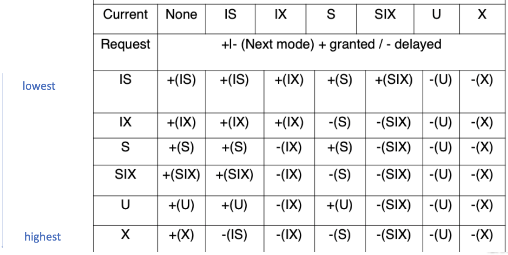

### Isolation Concept
- Acquire locks from root to leaf.
- Release locks from leaf to root.
- To acquire an S mode or IS mode lock on a non-root node, **one** parent must be held in IS mode or higher (one of {IS,IX,S,SIX,U,X}).
- To acquire an X, U, SIX, or IX mode lock on a non-root node, **all** parents must be held in IX mode or higher (one of {IX,SIX,U,X}).

#### e.g., - deadlock
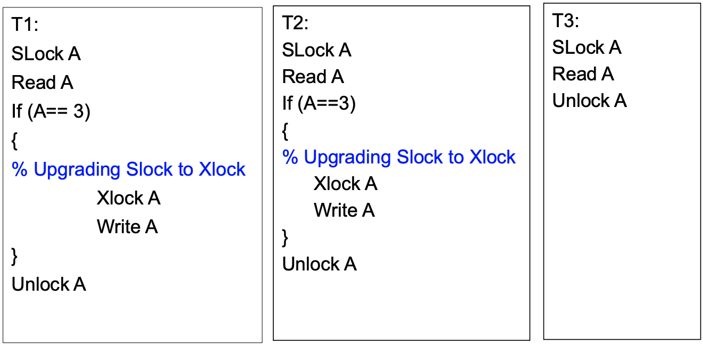
T1:

```
SLock A
Read A
If (A== 3) {
    % Upgrading Slock to Xlock
    Xlock A
    Write A
}
Unlock A
```

T2:

```
SLock A
Read A
If (A==3) {
    % Upgrading Slock to Xlock
    Xlock A
    Write A
}
Unlock A
```

T3:

```
SLock A
Read A
Unlock A
```

Both T1 and T2 already hold SLOCK A. Each then requests an XLOCK upgrade; each request waits because the other transaction still holds SLOCK A, so neither can proceed to release its shared lock.

#### solution
For this illustrated conditional update, releasing SLOCK A and then requesting XLOCK A avoids the upgrade cycle only if the transaction rereads and rechecks the condition after the XLOCK is granted. This is a specialized read/recheck pattern, not a general strict-2PL recipe.
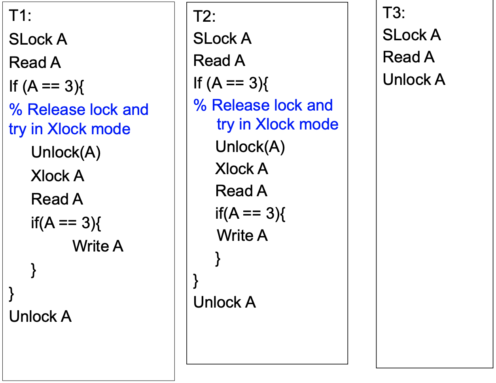
T1:

```
SLock A
Read A
If (A == 3){
    % Release lock and try in Xlock mode
    Unlock(A)
    Xlock A
    Read A
    if(A == 3){
        Write A
    }
}
Unlock A
```

T2:

```
SLock A
Read A
If (A == 3){
    % Release lock and try in Xlock mode
    Unlock(A)
    Xlock A
    Read A
    if(A == 3){
        Write A
    }
}
Unlock A
```

T3

```
SLock A
Read A
Unlock A
```

### Optimistic Locking
- When conflicts are rare, transactions can execute operations without managing locks and without waiting for locks - higher throughput
- Use data without locks
- Before committing, each transaction rechecks its read-set and validates the values or versions used by the computation. A value comparison can miss an intervening update that changes a value and later restores it (ABA); version or write-sequence checks are needed when that history matters.
- If any conflict found, the transaction repeats the attempt
- If no conflict, make changes and commit

#### Example
```sql
% Read without lock
Read A into A1
Read B into B1
Read C into C1
Loop: Compute new values based on A1 and B1
    % Start taking locks
    % Read again
    Slock A; Read A into A2
    Slock B; Read B into B2
    Xlock C; Read C into C2
    if (A1 == A2 & B1 == B2 & C1 == C2)
        Write new value into C
        commit
        Unlock A, B and C
    else % read data is changed
        A1 = A2
        B1 = B2
        C1 = C2
        unlock A ,B and C
        goto Loop
end
```

On success, this path holds locks for the recheck and write, but lock duration and throughput depend on contention and work inside the critical section. Value equality does not prove that no intervening update occurred.  
Advantage: avoids holding locks during the initial computation when conflicts are rare  
Disadvantage: Repeat in Loop for long time

### Snapshot Isolation / 快照隔离
Assume every read in one transaction attempt uses a fixed snapshot S. The write-conflict test below represents first-committer-wins validation against versions committed after S; a conflict aborts the attempt, and a retry starts a new transaction with a new snapshot.

```text
begin attempt using snapshot S
Read C, D, A, and B from S
Compute new values C3 and D3 from A and B
if either C or D has a version committed after S:
    abort this attempt
    retry in a new transaction using a new snapshot
else:
    write C3 to C and D3 to D
    commit
```

Snapshot isolation gives a transaction a consistent snapshot and commonly uses first-committer-wins for concurrent writes to the same row. It can still permit write skew, so it is not generally serializable. Product behavior and isolation-level names differ: [PostgreSQL 18 documents MVCC and Serializable Snapshot Isolation](https://www.postgresql.org/docs/18/mvcc-intro.html) and [application-level consistency anomalies](https://www.postgresql.org/docs/18/applevel-consistency.html); [SQL Server 17 distinguishes RCSI from SNAPSHOT](https://learn.microsoft.com/en-us/sql/relational-databases/sql-server-transaction-locking-and-row-versioning-guide?view=sql-server-ver17); [Oracle 26 documents its own multiversion read-consistency model](https://docs.oracle.com/en/database/oracle/oracle-database/26/cncpt/data-concurrency-and-consistency.html). These implementations should not be collapsed into one generic product claim.

### Two phase locking Transaction - Snapshot Locking potential problem
Integrity constraint A+B >= 0; A = 100; B = 100;
T1:

```
Lock(X,A)
Lock(S,B)
Read A to A1;
Read B to B1;
A1 = A1 -200;
if (A1+ B1 >= 0)
    Write A1 to A
    Commit
else abort
end
Unlock (all locks)
```

T2:

```
Lock(S,A)
Lock(X,B)
Read A to A1;
Read B to B1;
B1 = B1 -200;
If (A1+ B1 >= 0)
    Write B1 to B
    Commit
else abort
end
Unlock (all locks)
```

Only one transaction can commit.

Snapshot Isolation Transaction - Snapshot Locking potential problem
Integrity constraint A+B >= 0; A = 100; B = 100;
T1:

```sql
Loop:
    Read A to A1;
    Read B to B1;
    A3 = A1 -200;
    Lock(X, A)
    Read A to A2
    if (A1 != A2)
        Unlock(A)
        goto Loop
    % potential problem: B1 is read without lock, the value of B possiblily has been changed
    elseif (A3+ B1 >= 0)
        Write A3 to A
        Commit
    else abort
Unlock (all locks)
```

T2:

```sql
Loop:
    Read A to A1;
    Read B to B1;
    B3 = B1 -200;
    Lock(X, B)
    Read B to B2
    if (B1 != B2)
        Unlock(B)
        goto Loop
    % A1 is read without lock
    elseif (A1+ B3 >= 0)
        Write B3 to B
        Commit
    else abort
Unlock (all locks)
```

Under snapshot-style validation, both transactions can commit because they write different rows, yet the invariant A+B >= 0 is violated. This is write skew: no serial order permits both updates.

### Time Stamping / 时间戳排序
This is one optimistic timestamp-validation model: at validation, a transaction may abort if a conflicting update is newer than the version it read. Basic timestamp-ordering protocols instead assign transaction timestamps and maintain read/write timestamps per item, checking operations against those timestamps. Do not treat this sentence as the general timestamp-ordering algorithm. Validation, commit durability, and version retention are separate concerns.

**Time Domain Versioning**  
In this time-domain versioning example, an update creates a new version with a validity interval rather than overwriting the earlier version. This temporal-data model is distinct from the basic timestamp-ordering protocol above.  
<o,<V1, [t1, t2)>, <V2, [t2,t3)>, <V3,[t3,\*)>

e.g.
T1
select average (salary)
from employee

T2
update employee
set salary = salary\*1.1
where salary < $40000

If T1 reads from a snapshot taken before T2 commits, it can compute the average from the older salary versions and the read-only T1 may commit after T2. This schedule alone does not require T1 to abort; a timestamp-validation protocol that rejects stale reads would need to be specified separately. Under MVCC, T2 need not wait for this read-only T1 to finish, subject to product-specific rules.

## Crash Recovery / 崩溃恢复
核心概念：持久日志与检查点帮助系统在崩溃后重建事务和脏页状态；ARIES 按 analysis、redo、undo 恢复，WAL 要求相关日志先于数据页持久化。分布式提交的原子决议（2PC）不等同于隔离；CAP 只讨论网络分区下线性一致性与逐请求可用性的模型取舍。

Recover from a failure either when a single-instance database crashes or all instances crash.  
Crash recovery restores a usable state after a crash: preserve the effects of committed transactions, and undo incomplete transactions (or finish recovery of transactions that had already aborted).

### ACID properties
Recovery manager guarantees Atomicity and Durability.

- Atomicity - All changes to data are performed as if they are a single operation. That is, all the changes are performed, or none of them are.
- Consistency - Data is in a ‘consistent’ state when a transaction starts and when it ends – in other words, any data written to the database must be valid according to all defined rules (e.g., no duplicate student ID, no negative fund transfer, etc.)
- Isolation controls interactions among concurrent transactions. Serializable isolation is equivalent to some serial order; weaker isolation levels permit defined anomalies, and product guarantees vary ([PostgreSQL isolation documentation](https://www.postgresql.org/docs/18/transaction-iso.html)).
- Durability means acknowledged commits survive the failures covered by the engine's durability configuration and failure model.

### Desired behaviors when crash happens
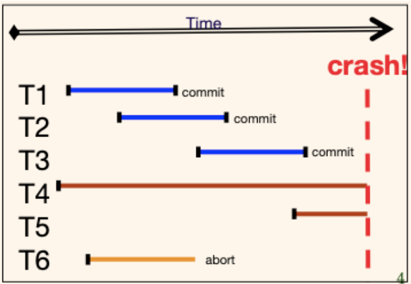  
The graph shows T1, T2, and T3 committed before the crash; T4 and T5 were incomplete; T6 had aborted. Recovery preserves the committed updates, undoes T4 and T5, and ensures T6's abort is reflected if its undo was not yet complete.

### Data Access
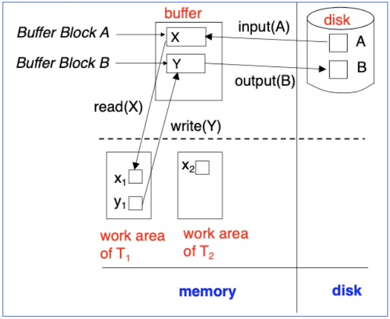  
Two types of data blocks

- **Disk pages/blocks** are logical storage units on persistent storage.
- **Buffer frames** are in-memory slots that hold copies of database pages in the DBMS buffer pool. A device/controller cache is a separate layer.

Two operations between disk and main memory

- **Input(A)** transfers the physical block A to main memory.
- **Output(B)** transfers the buffer block B to the disk and replaces the data there.

### Some Concepts
- Persistent storage holds database pages; the DBMS buffer pool keeps page copies in main-memory frames.
- A frame can be evicted when it is unpinned; a dirty page may be written back as part of eviction, subject to the WAL rule. Pin/unpin prevents replacement while an operation needs the page.
- Latches protect short-lived in-memory structures; transaction locks protect logical data access for transaction isolation. Fix/unfix commonly refers to pinning/unpinning a buffer page.

More Concepts:

- **Force** requires modified pages to reach persistent storage at commit; **no-force** permits commit after the required log is durable while data pages remain buffered. No-force does not by itself make a commit nondurable when WAL is used.
- **Steal** permits flushing a page that contains uncommitted updates; recovery must be able to undo those updates. Together, steal/no-force commonly requires both undo and redo.

## Log-based Crash Recovery / 基于日志的崩溃恢复
### Logging
- A recovery log records enough information to redo or undo updates, along with transaction and page identifiers and ordering metadata. Log records may contain physical before/after values, logical operations, or other engine-specific data; not every engine stores both old and new bytes in every record. [ARIES](https://research.ibm.com/publications/aries-a-transaction-recovery-method-supporting-fine-granularity-locking-and-partial-rollbacks-using-write-ahead-logging) is one specific recovery design; [Database System Concepts, 7e, ch. 19](https://www.db-book.com/slides-dir/PDF-dir/ch19.pdf) presents its recovery algorithm; [PostgreSQL WAL](https://www.postgresql.org/docs/18/wal-intro.html) documents a product-specific implementation.
- Logs are appended in log sequence order, commonly to buffered log pages. Record size and format depend on the recovery design.

### Write-Ahead Logging (WAL) / 预写日志
1. Before a dirty data page is written to persistent storage, its update log records must be durable through that page's pageLSN.
2. Before commit is acknowledged, the commit record and the transaction's preceding log records required by the recovery protocol must be durable. WAL record formats vary by engine.

#### Write-Ahead Logging (WAL) – e.g.,
- LSN (log sequence number) – LSNs increase monotonically within the illustrated log sequence.
- pageLSN - The LSN of the most recent log record for an update to that page.
- flushedLSN - max LSN flushed so far (flush to disk)
- In this ARIES-style illustration, WAL requires **pageLSN <= flushedLSN** before the data page can be written.

**Cannot** write the page to disk  
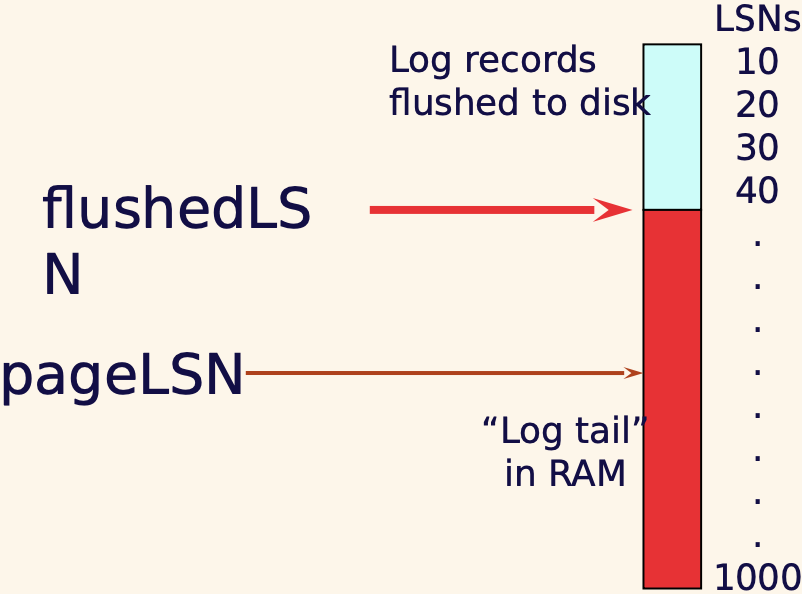  
**Can** write the page to disk  


### Transaction Table
- The transaction table tracks transactions that have not yet written an end record; it stores transaction ID, status, and lastLSN.
- Contains transactionID, status (running/committed/aborted), and lastLSN.  
  A durable COMMIT without a later END at crash is a winner that may remain in the table; it is not undone.
  e.g.

| transactionID | status     | lastLSN |
| ------------- | ---------- | ------- |
| T1            | running    | 40      |
| T2            | committed  | 80      |

### Dirty Page Table
- One entry per dirty page in the buffer pool. A page becomes dirty after an update changes it.
- In ARIES, **recLSN** is the LSN of the first update that made the page dirty after it was last clean; it is the earliest update that may need redo for that page. Loading a page does not itself make it dirty ([Database System Concepts, 7e, ch. 19](https://www.db-book.com/slides-dir/PDF-dir/ch19.pdf)).  
  e.g.

| Pageid | recLSN |
| ------ | ------ |
| P1     | 10     |
| P2     | 50     |
| P3     | 80     |


### Checkpoint
Periodically, the DBMS creates a checkpoint, in order to **minimize the time taken to recover in the event of a system crash**.  
Write to log:

- Begin checkpoint record: Indicates when checkpoint began.
- End checkpoint record: Contains current Transaction table and dirty page table.

**Fuzzy Checkpoint** – the creation of checkpoint **takes a little time**

- Transactions continue while a fuzzy checkpoint is collected; it is not a quiescent database image. Recovery uses the checkpoint metadata and scans the subsequent log. A fuzzy checkpoint does not itself force dirty pages to disk ([ARIES](https://research.ibm.com/publications/aries-a-transaction-recovery-method-supporting-fine-granularity-locking-and-partial-rollbacks-using-write-ahead-logging)).

### Transaction – Abort
- Get lastLSN of transaction from transaction table.
- Follow the transaction's log chain backward through prevLSN. For each update undone, write a Compensation Log Record (CLR) describing the undo and its undoNextLSN; CLRs are redoable and are not themselves undone.
  - Continue logging while undo proceeds.
- At end of UNDO, write an “end” log record.

#### e.g.
T1

1. Update A: 100 -> 200
2. Update A: 200 -> 300
3. Update A: 300 -> 400

---

              Abort 400

We will go backward, from UNDO 3, 400 -> 300, to UNDO 2..., finally get 100

#### Transaction – Abort e.g.,
| LSN | Log                  |
| --- | -------------------- |
| 400 | begin checkpoint     |
| 405 | end checkpoint       |
| 410 | update: T1 writes P5 |
| 420 | update: T2 writes P3 |
| 430 | update: T1 writes P4 |
| 440 | T1 abort             |
| 445 | CLR: Undo T1 LSN 430 |
| 450 | CLR: Undo T1 LSN 410 |
| 455 | T1 End               |
| 460 | update: T3 writes P5 |

### Transaction - Commit
- Write commit record to log.
- Mark the transaction committed in the transaction table, then flush the log through the COMMIT record's LSN before acknowledging commit. Earlier transaction records are flushed with it because the log is ordered.
- Append an END record after commit processing and remove the transaction from the in-memory transaction table. Group commit can amortize flushes; acknowledgment semantics still depend on the engine and its durability configuration.

### Crash recovery
Three phases

- Phase 1 – **Analysis**: reconstruct the transaction table and dirty page table from the checkpoint and subsequent log.
- Phase 2 – **Redo** repeats history from the earliest recLSN, including updates from transactions that were incomplete at the crash.
- Phase 3 – **Undo** the remaining effects of loser (incomplete) transactions.

### Crash recovery – Steps
1. **Analysis phase**

- When analysis encounters an END record, remove that transaction from the transaction table. Undo only loser transactions that were active or aborting at the crash; committed transactions are winners and are not undone.
- Dirty page table

2. **Redo phase (top - bottom)**

- Start scanning at the smallest recLSN in the Dirty Page Table. For each redoable update or CLR, consider it only when its page is in the table and its LSN is at least that page's recLSN; redo it only if the on-disk pageLSN is less than the record LSN. Update pageLSN after redo. This is the ARIES-style per-page test, not just a comparison to one global x.

3. **Undo phase (bottom - top)**

- Process the remaining loser entries from the transaction table.
- Initialize ToUndo with the lastLSN of every loser. Repeatedly remove the largest LSN.
- For a CLR, follow undoNextLSN without undoing the CLR. For an undoable update, undo it, append a CLR whose undoNextLSN is that update's prevLSN, then follow prevLSN. For other records, follow prevLSN ([CMU recovery notes, pp. 2 and 5–6](https://15445.courses.cs.cmu.edu/fall2024/notes/21-recovery.pdf)).
- Add each non-null next LSN to ToUndo. When a loser's chain reaches null, write END for that transaction; recovery Undo finishes only when ToUndo is empty.

#### Example1
| Time | Transaction Info                        |
| ---- | --------------------------------------- |
| 0    | BEGIN CHECKPOINT                        |
| 5    | END CHECKPOINT EMPTY XACT TABLE AND DPT |
| 10   | T1: UPDATE P1 OLD: YYY NEW: ZZZ         |
| 15   | T1: UPDATE P2 OLD: WWW NEW: XXX         |
| 20   | T1: COMMIT                              |

Answer:

1. Analysis phase  
   Transaction table:  
   T1, commit, 20  
   Dirty page table:  
   P1 10  
   P2 15
1. Redo phase  
   Dirty page smallest LSN: 10  
   Update logs: LSN 10 and LSN 15  
   LSN 10 => if pageLSN(P1) < 10, redo LSN 10, set pageLSN(P1) = 10  
   LSN 15 => if pageLSN(P2) < 15, redo LSN 15, set pageLSN(P2) = 15
1. Undo phase  
   nothing

#### Example2
| Time | Transaction Info                          |
| ---- | ----------------------------------------- |
| 0    | BEGIN CHECKPOINT                          |
| 5    | END CHECKPOINT (EMPTY XACT TABLE AND DPT) |
| 10   | T1: UPDATE P1 (OLD: YYY NEW: ZZZ)         |
| 15   | T1: UPDATE P2 (OLD: WWW NEW: XXX)         |
| 20   | T2: UPDATE P3 (OLD: UUU NEW: VVV)         |
| 25   | T1: COMMIT                                |
| 30   | T2: UPDATE P1 (OLD: ZZZ NEW: TTT)         |

Answer

1. Analysis phase  
   Transaction table:  
   T1, commit, 25  
   T2, running, 30
   Dirty page table:  
   P1 10  
   P2 15  
   P3 20
2. Redo phase  
   Dirty page smallest LSN: 10  
   Update-log candidates: LSN 10, 15, 20, and 30; apply the DPT/recLSN/pageLSN test to each.  
   LSN 10 => if pageLSN(P1) < 10, redo LSN 10, set pageLSN(P1) = 10  
   LSN 15 => if pageLSN(P2) < 15, redo LSN 15, set pageLSN(P2) = 15  
   LSN 20 => if pageLSN(P3) < 20, redo LSN 20, set pageLSN(P3) = 20  
   LSN 30 => if pageLSN(P1) < 30, redo LSN 30 and set pageLSN(P1) = 30; otherwise, skip it.
3. Undo phase  
   Initialize ToUndo with T2's lastLSN, 30. Undo LSN 30 and write a CLR whose undoNextLSN points to T2's previous log record, LSN 20.  
   Follow T2's prevLSN chain; undo each remaining undoable update and write a CLR pointing to that update's prevLSN. Continue through any non-update records until the chain reaches null, then write END for T2. The example table omits any BEGIN record.

## Remote Backup System
Remote backup systems provide high availability by allowing transaction processing to continue even if the primary site is destroyed

- Detection of failure: **Backup site must detect when primary site has failed**
  - Heartbeats detect loss of contact but cannot by themselves distinguish a failed primary from a network partition. A safe promotion also needs fencing or an agreed quorum/ownership rule to prevent two primaries.
- Transfer of control
  - To take over control, **backup site first perform recovery using its copy of the database and all the log records it has received from primary**. Thus, completed transactions are redone and incomplete transactions are rolled back
  - After safe promotion, the backup becomes the new primary.

### Remote Backup System
- Time to recover
  - To reduce delay in takeover, backup site periodically processes the redo log records (don't do undo)
  - In effect, it performs a **checkpoint**, and can then delete earlier parts of the log
- Hot-Spare configuration permits very fast takeover:
  - Backup continually processes redo log record as they arrive, applying the updates locally
  - When failure of the primary is detected, the backup rolls back incomplete transactions, and is ready to process new transactions

### Remote Backup System
Ensure durability of updates by delaying transaction commit until update is logged at backup. But we can avoid this delay by permitting lower degrees of durability. i.e. delay commits until the log is committed in backup

- One-safe: acknowledge commit when its commit record is durable at the primary, without waiting for the backup. A primary-site loss before log transfer can lose an acknowledged commit.  
  (A primary-site failure can occur before the latest log records arrive at the backup.)
- Two-very-safe: acknowledge commit after the commit record is durable at both primary and backup. This reduces the risk of losing an acknowledged commit but reduces availability if either site is unavailable.
  (Acknowledgments wait for both sites, so a failure of either site can reduce commit availability.)
- Two-safe: use the two-site acknowledgment rule while both sites are active; if only the primary remains, acknowledge after the primary commit record is durable. This improves availability but has a failover scenario in which the backup may not contain a primary-only acknowledged commit.  
  (This improves availability over two-very-safe but can lose a primary-only acknowledged commit if failover uses a stale backup.)

## Shadow Paging
Shadow Paging

- Idea: maintain two page tables during the lifetime of a transaction, i.e., the current page table, and the shadow page table
- To start with, both the page tables are identical. Only current page table is used for data item accesses during execution of the transaction
- Whenever any page is about to be written
  - A copy of this page is made onto an unused page
  - The current page table is then made to point to the copy
  - The update is performed on the copy
- To commit a transaction
  1. Flush all modified pages in main memory to disk
  2. Output current page table to disk
  3. Make the current page table the new shadow page table
- Once the new root-page-table pointer is atomically and durably published, the transaction is committed; the modified pages and page table must already be durable.

Advantages of shadow-paging over **log-based schemes**

- No overhead of writing log records
- Recovery is trivial - new transactions can start right away, using the shadow page table.

Disadvantages

- Copying the entire page table is very expensive when the page table is large
- Commit overhead is high - Need to flush every updated page, and page table
- Data gets fragmented (related pages get separated on disk)
- Hard to extend algorithm to allow transactions to run concurrently

### In Practice
Strategy plan based on:

- Goals and requirement of your organization/task
- The nature of your data and usage pattern
- Constraint on resources

Design backup strategy:

- Full disk backup vs partial - Are changes likely to occur in only a small part of the database or in a large part of the database?
- How frequently data changes - If frequent: use differential backup that captures only the changes since the last full database backup
- Space requirement of the backups – depends on the resource
- Multiple past instances of backup – useful if point-in-time recovery is needed

## CAP Theorem / CAP定理

During a network partition, a distributed service cannot guarantee both availability for every request and linearizable consistency for all operations. Partition tolerance describes the failure model, not a property that a system can simply opt out of. A system may reject or delay some requests, or return responses that do not preserve linearizability. This statement does not imply that a product permanently chooses only two labels in ordinary operation. [Gilbert and Lynch's formal CAP result](https://www.comp.nus.edu.sg/~gilbert/pubs/BrewersConjecture-SigAct.pdf) states the impossibility under its model.

- **Consistency** in the CAP result means linearizability: operations appear to take effect atomically in an order consistent with real time.
- **Availability** means every request to a non-failing node eventually receives a response.
- **Partition tolerance** means the system continues operating despite communication partitions, under the theorem's model.

## Different Types of Consistency
Consistency guarantees form a spectrum and should be named precisely:

- Linearizable (strong) reads reflect the latest completed write in a real-time order.
- Eventual consistency means replicas converge if updates stop; a read before convergence may be stale.
- Causal consistency preserves the order of causally related operations.
- Session guarantees include read-your-writes and monotonic reads/writes. Their usefulness depends on the application.

### Tradeoff between C and A
e.g., Airline reservation system

- As an application example, a reservation service might tolerate stale reads when many seats remain but require stricter coordination near capacity. This is a business policy example, not a statement of the CAP theorem.

### Segment C and A
- Segment the system into different components. Each provides different types of guarantees.
- Service components may provide different consistency and availability guarantees; summarize each component's contract rather than assigning one binary label to the whole application.
- Can be partitioned along different dimensions (time)
- E.g., partition according to different data
  - Product information - availability, if there is some out dated data, it's OK
  - Shopping cart – availability, eventually add to cart is fine
  - Checkout, pay the bill, shipping records - consistency, avoid sold out or outdated delivery...

### If no network partition
- No network partition, but still some failure of the node
- Tradeoff between Consistency and Latency (unavailable -> extreme high latency)
- Achieving different levels of consistency/availability takes different amount of time
- Maintaining consistency should balance between the strictness of consistency versus availability

## BASE Properties

BASE is an informal design mnemonic sometimes used for systems that favor availability and asynchronous convergence; it is not a consequence that every partition-tolerant system must follow. The terms are commonly expanded as Basically Available, Soft state, and Eventual consistency. NoSQL products vary and do not all share one consistency model.

### CAP -> PACELC
PACELC asks: if there is a partition (P), does the design favor availability (A) or consistency (C); else (E), does it favor lower latency (L) or consistency (C)? The labels describe a chosen design tradeoff, not a universal property of a product. [Abadi's PACELC paper](https://www.cs.umd.edu/~abadi/papers/abadi-pacelc.pdf) introduces this extension.

- PA/EL: favor availability during partitions and lower latency otherwise.
- PC/EC: favor consistency in both cases, accepting reduced availability during partitions and higher latency otherwise.
- PA/EC: favor availability during partitions and consistency otherwise.
- PC/EL: favor consistency during partitions and lower latency otherwise.

## NoSQL
### Type of NoSQL Databases
1. Document Stores
   - Documents are stored as self-contained values, commonly JSON, BSON, or XML; supported encodings and query features depend on the product.
   - Documents can be indexed
2. Graph Databases
   - Data are represented as vertices and edges
   - Graph databases are powerful for graph-like queries (e.g., find the shortest path between two elements)
3. Key-Value Stores
   - Keys are mapped to (possibly) more complex value (e.g., lists)
   - Keys can be stored in a hash table and can be distributed easily
   - Many key-value stores expose get/put/update/delete operations by key and do not provide relational joins; query and transaction features vary by product.
4. Columnar Databases
   - Columnar storage lays out values by column rather than by row and can be used by relational or analytical systems; it is a storage organization, not a NoSQL model by itself.

## Data Warehousing


- A classical data warehouse consolidates historical data from multiple sources under an integrated schema for analysis. Modern warehouses may be physically distributed.
- When and how to gather data
  - Source driven architecture: data sources transmit new information to warehouse, either continuously or periodically (e.g. at night) I.e. data source give out
  - Destination driven architecture: warehouse periodically requests new information from data sources. I.e. Data warehouse requesting

### Data Warehousing – Design Issues
- Synchronous coordination such as two-phase commit across an OLTP source and analytical warehouse can add latency and reduce availability. Many designs accept ingestion lag and load updates periodically, but freshness requirements vary by workload.
- What schema to use
  - Depends on purpose
  - Schema integration
- Data cleansing
  - e.g., Correct mistakes in addresses (misspellings, zip code errors)
  - e.g., Merge address lists from different sources and purge duplicates
- How to propagate updates - The data stored in a data warehouse is documented with an element of time, either explicitly or implicitly
- What data to summarize
  - Raw data may be too large to store
  - Aggregate values (totals/subtotals) often suffice
  - Where the engine supports materialized-view rewrite and the query is eligible, a query on raw data may be answered from a stored aggregate.

## Distributed Database / 分布式数据库
### DBMS in Real life
- Many production DBMS deployments serve networked clients; embedded databases are also common.
- Large companies have multiple servers working together
- Many systems has a complex distributed architecture
- e.g., bank transactions in different branches

### Two-Phase Commit Protocol (2PC), distinct from Two-Phase Locking (2PL)
2PC coordinates the atomic outcome across participants; it does not itself provide transaction isolation. [PostgreSQL's two-phase transaction documentation](https://www.postgresql.org/docs/18/two-phase.html) describes durable prepared transactions; [Gray and Lamport's transaction-commit paper](https://lamport.azurewebsites.net/video/consensus-on-transaction-commit.pdf) explains why the coordinator waits for all resource managers before committing.

- Goal: either all of the servers commit the transaction, or all of them abort the transaction
- One of the servers becomes the coordinator who must ensures the same outcome at all of the servers

Phase 1 (voting phase)

- coordinator asks all participants if they can commit
- each participant votes
- A YES vote means the participant is prepared: it must durably record the prepared state and wait for the coordinator's decision. It cannot unilaterally decide the global outcome after voting YES.
- A NO vote lets the coordinator decide abort.

Phase 2 (completion phase)

- coordinator tells all participants to commit or abort
- the participants carry out the joint decision


1. `Coordinator -> Participant`: `canCommit (trans)`  
   The coordinator asks whether the participant can commit a transaction.

2. `Participant -> Coordinator`: `Yes / No`  
   The participant replies with its vote on whether it can commit the transaction.

3. The coordinator makes one global decision: COMMIT requires every required YES vote, while a NO vote or a pre-decision timeout can lead to ABORT:

   - `Coordinator -> Participant`: `doCommit (trans)`  
      Only when every required participant has voted YES does the coordinator durably record the global COMMIT decision and then notify all participants to commit.
   - `Coordinator -> Participant`: `doAbort (trans)`  
      If any participant votes NO, or a required vote is still missing when the coordinator times out before making a commit decision, the coordinator durably records global ABORT and notifies all participants to abort, including participants that already voted YES.

4. `Participant -> Coordinator`: `haveCommitted (trans, participant)`  
   The participant confirms that it has committed the transaction, notifying the coordinator.

5. If a participant recovers in the prepared state without a recorded decision, it asks the coordinator for the durable outcome. If the coordinator is unreachable, the prepared participant may have to wait.

- Before the global decision, a participant may vote NO and the coordinator may choose abort if any vote is NO or a participant fails to respond. After a participant has voted YES, it remains durably prepared and can block if the coordinator is unreachable; timeout alone does not safely tell it to abort. The coordinator records and communicates the decision, and participants follow it.
- If the decision is abort, the coordinator asks participants to roll back.
- The coordinator records its decision durably before notifying participants; participants record and follow the decision as required by their recovery protocol.

### Concurrency Control in Networked System


- Each server is responsible for applying concurrency control to its own objects
- The members of a collection of servers of distributed transactions are jointly responsible for ensuring that they are performed in a serially equivalent manner
- Servers independently acting would not work
- If transaction T is before transaction U in their conflicting access to objects at one of the servers
- Then: They must be in that order at all of the servers whose objects are accessed in a conflicting manner by both T and U
- The Coordinator should assure this

### Concurrency Control Review
Timestamp ordering concurrency control

- The coordinator accessed by a transaction issues a **globally unique timestamp**
- The timestamp is passed **with each object access**
- The servers are jointly responsible for ensuring serial equivalence, that is if T access an object before U, then T is before U at all objects

Optimistic concurrency control  
For distributed transactions to work:

- When optimistic concurrency control is combined with 2PC, each participant validates before voting YES; 2PC itself does not provide concurrency validation.
- A distributed optimistic protocol must define a consistent transaction order, often using globally comparable timestamps.

### Transactions with replicated data
One-copy Serializability  
The effect of transactions on replicated objects should be the **same as if they had been performed one at a time on a single set of objects**

If all servers are available then no issue – but what if some servers are not available?

### Available copies replication
- The available copies replication scheme is designed to allow some servers to be temporarily unavailable
- Before a transaction commits, it checks for failures and recoveries of the RMs it has contacted, the set should not change during execution

e.g., X fails before T’s deposit. T would check if X is still available. If X is unavailable, then T will abort.
