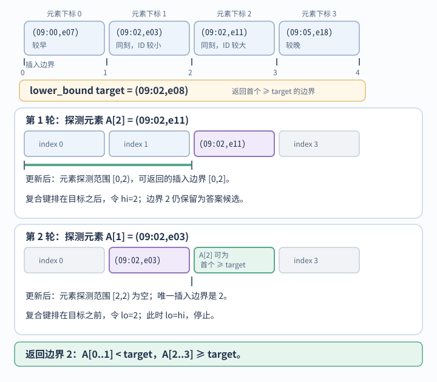

# 怎样根据输入约束和访问模式选择算法？

以合成的报表 42 为例：请求已从数据库得到 acct-17 的事件页，共 1,024 条，按 (occurred_at, event_id) 升序排列。接口要定位游标、显示分类树、缓存最近查看的页面，并按事件描述处理 Unicode（统一码）文本。这里完整展开游标定位；分类树、缓存和文本处理仅作情境，具体操作见后续链接。选算法前先写明输入保证、要执行的操作和结果约束；只有这样才能证明候选范围可以缩小，并估计成本。

本篇给出选型与复杂度模型。后续章节分别回答[数据结构怎样匹配访问方式](core-data-structures.md)、[队列和栈怎样表示待处理工作](queue-and-stack-representations.md)、[LRU 如何维护按键查找与新近顺序](practical-data-structure-implementations.md)、[有序数据怎样缩小候选范围](ordered-array-search.md)、[动态规划怎样定义状态和更新顺序](dynamic-programming-state-and-order.md)、[分区如何改变排序成本](partitioning-and-sorting-costs.md)和[文本算法应选哪种字符单位](text-units-and-algorithms.md)。

## 先写明不变量，再选方法

事件页按复合键 (occurred_at, event_id) 排序，因此只有使用同一比较规则才能二分定位游标；这不意味着 event_id 单独有序。若排序规则、键字段或空值规则改变，数据顺序和比较器也要一起改变。若数据未排序，则不能直接二分；可扫描，或先排序并把预处理计入成本。

~~~mermaid
flowchart TB
    I[输入保证与规模] --> O[需要执行的操作]
    O --> P[候选方法能利用的输入保证、表示或已有信息]
    P --> C[时间、空间与分配成本]
    C --> V[用边界输入复算结果]
~~~

### 同一条比较规则如何缩小区间？

为了看清每轮保留什么，下面把 1,024 条页数据缩成四条合成教学记录；沿用同一复合排序键和比较规则，并具体取 `(09:02, e08)` 作为下界查询。这里在已加载的有序页中找 `≥ target` 的插入位置，不是分页取下一页要求的严格 `> cursor`。例如已有游标 `(09:02,e03)` 时，`lower_bound` 返回 1（游标本身），而 `upper_bound` 返回 2（下一个更大键）。lower_bound 返回首个键不小于目标的下标；若所有键都小于目标，则返回 `n`。对升序数组，循环从 `lo=0, hi=n` 开始，并保持左侧 `[0,lo)` 的键都小于目标、右侧 `[hi,n)` 的键都不小于目标。`[lo, hi)` 是后续仍可能探测的元素下标范围，`[lo, hi]` 是可能的插入边界。若中点键小于目标，答案边界必须在 `mid` 右侧，令 `lo=mid+1`；若中点键不小于目标，`mid` 自己仍可能是答案，令 `hi=mid`，把它保留为右边界。直到 `lo=hi`，该边界就是结果。

第一次探测 index 2 的 `(09:02, e11)`；复合键排在目标之后，令 `hi=2`。下轮只探测元素下标 `[0, 2)`，但边界 2 仍可能是答案。第二次探测 index 1 的 `(09:02, e03)`；复合键排在目标之前，令 `lo=2`。元素探测范围变成空的 `[2, 2)`，唯一可能边界是 2。若只比时间戳，`e03`、`e08`、`e11` 在该比较器下都相等，便无法确定目标相对于这两条记录的精确位置。

例如，有序页中每次中点比较可以排除一半范围；动态规划复用相同子问题的结果；队列用头下标出队可免于搬移其余项。若缺少相应不变量，复杂度表中的数字便不适用。

## Big-O 表示增长，不是耗时承诺

Big-O notation（大 O 记号）描述输入规模增大时，所选成本单位的操作数或额外空间的渐近上界，省略常数因子和低阶项。这里 n 是元素数；示例默认键和数值能以常数时间比较或运算。若字符串长度、任意精度整数的位数或记录字段数随输入增长，就要把这些大小另列为参数。背包问题的 W 是数值容量，不是表示容量所需的位数。期望复杂度还依赖哈希分布等假设，需要明确标出。

| 增长量 | 典型例子 | 成立条件 |
|---|---|---|
| O(1) | 数组下标访问 | 下标已知且合法；按值查找不是常数时间 |
| O(1) 期望 | 哈希表查找 | 负载因子受控且哈希值充分分散；这是期望模型，不是所有实现的严格界 |
| O(log n) | 有序数组二分、平衡搜索树 | 数据有序或树高受不变量约束 |
| O(n) | 顺序扫描 | 每个元素检查常数次 |
| O(n log n) | 归并排序；划分大致均衡的快速排序 | 快速排序最坏可退化到 O(n²) |
| O(n²) | 两层全量扫描、平方级简单排序 | 两层循环均随 n 线性增长 |
| O(2ⁿ) | 朴素递归 Fibonacci 的上界、枚举子集 | 搜索树节点或候选数；按每个候选常数工作计 |
| O(n!) | 枚举所有排列 | 搜索树节点工作；每个节点做常数工作时成立 |

这些界只覆盖指定模型中的工作量。若枚举器还要复制并输出每个完整候选，输出成本要另算：从 n 个元素生成全部子集并复制为数组，元素总数为 n·2ⁿ⁻¹；输出所有 n 项排列则要写出 n·n! 个元素。连续数组扫描可能比指针跳转更快；哈希表扩容会让单次插入成本波动；数据库索引还涉及存储页读取。大 O 不替代测量，也不消除数据布局、内存局部性和运行时常数的影响，见[内存局部性如何改变实际成本](../operating-systems/memory-hierarchy-and-data-locality.md)。

> [!example] 1,024 条事件页上的查找
> 假设 1,024 条事件已经按复合游标键升序，且一次键比较按常数时间计。扫描到末尾要比较 1,024 次。lower_bound 在最坏路径每轮将待探测元素数减半，直到空：`1,024→512→256→128→64→32→16→8→4→2→1→0`，共有 11 次探测；例如找首个元素时，探测下标 `512,256,128,64,32,16,8,4,2,1,0`。另换成数值键和闭区间 `[low, high]` 的普通查找，若先判 `A[mid] === target`、再判 `A[mid] < target`，搜索最后一项也会探测 11 次：前 10 轮各做两次关系判断，末轮只做一次，共 21 次。复合键比较器内部还需另数比较了几个字段。若数据无序且只需判断是否存在某键，可线性扫描并返回匹配/未找到；无序数组没有有意义的 lower_bound 插入位置，需先按同一比较器排序、用有序结构查找，或返回排序副本，且要计入预处理成本。

## 怎样判断选型假设是否成立？

检查目标是定位还是排序、排序由谁建立且是否使用同一比较规则；是否存在可复用子问题、状态是否包含转移需要的信息；是否允许原地修改、复制、分配、扩容和递归栈是否进入内存预算；空输入、重复键、相同排序值、零容量、超大数和非 ASCII 文本是否改变结果。最后用边界输入复算返回值、副作用和复杂度条件。对本例的有序查找，排序保证失效时不能二分；精确查找可线性扫描，lower_bound 则须先按同一比较器排序并计入成本。其他算法应按各自不变量重新验证。

> [!info]- 来源
> - 二分查找只在输入已按同一键顺序排列时反复减半候选：[NIST Dictionary of Algorithms and Data Structures 的 binary search 条目](https://xlinux.nist.gov/dads/HTML/binarySearch.html)；复杂度分析的规模模型见 [MIT 6.006 Lecture 3: Sorting](https://ocw.mit.edu/courses/6-006-introduction-to-algorithms-spring-2020/6d1ae5278d02bbecb5c4428928b24194_MIT6_006S20_lec3.pdf)。四项下界图与 1,024 项探测数按区间更新手算复核；子集和排列输出量由各候选长度求和。
