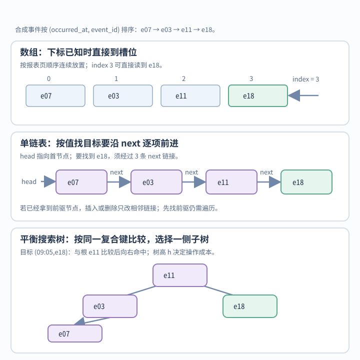
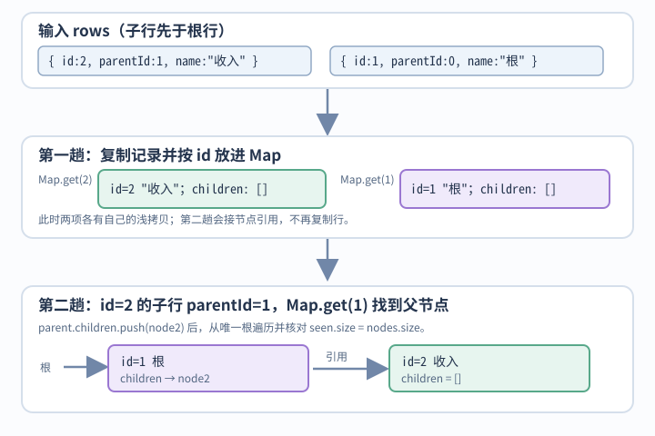

# 数据结构如何匹配访问方式，复杂度界何时成立？

案例背景：以一份合成事件报表为例，报表 42 要按下标显示事件页、按 event_id 找记录、按时间顺序遍历；分类视图需要层级结构，运行时也可能保存工作树。选择数据结构时，应看目标如何被找到、链接如何更新、是否需要排序，以及树高或哈希分布等前提是否成立。实际速度还会受连续存储和指针跳转影响。

## 数组、链表和树各自适合什么操作？

| 结构 | 访问或查找 | 插入、删除 | 条件与代价 |
|---|---|---|---|
| 数组 | 已知下标 O(1)；按查询值扫描 O(n)，按该查询键排序后可二分 O(log n) | 中间改动 O(n)，后续元素要移动 | 连续访问方便；增长时可能分配和复制 |
| 单链表 | 按值或下标找节点 O(n) | 已知前驱链接时 O(1)，否则先找前驱 | 删除节点需要前驱 |
| 双向链表 | 查找通常需外部索引；裸链表 O(n) | 已知节点时 O(1) 改邻接链接 | 每个节点多存前后引用 |
| 高度平衡搜索树 | 搜索 O(log n) | 插入、删除 O(log n) | 需要不变量限制树高 |
| 未平衡搜索树 | 最坏 O(n) | 最坏 O(n) | 递增插入可形成长链 |
| Trie 前缀树 | 长度 m 的键约 O(m) | 沿字符路径增删 | 子边选择成本需受控；可能占较多内存 |

**同一批事件在数组、单链表和平衡搜索树中的布局与查找路径：**

这组四条合成事件沿用本章报表页，按 `(occurred_at, event_id)` 排序。知道下标时，数组直接读槽位；按时间遍历可顺扫这份有序数组；按完整排序键精确查找或找边界可二分。只知道 `event_id` 时不能在这份时间加 ID 的排序上二分，可另建 ID 哈希索引，但它不提供时间顺序。沿单链表按值找 e18 要经过三个 next；搜索树也按同一复合键比较，查找 e18 需要完整目标键 `(09:05, e18)`，图示形状中先比较 e11，再走到右孩子。若数据频繁插入或删除，需比较数组搬移与树更新的维护成本。图只展示一个具体树形布局：树操作一般按树高 h 计，只有维持平衡的不变量才能保证 h=O(log n)。

链表只有在已知所需节点/链接时才是 O(1) 更新；先扫描定位会让整体操作成为 O(n)。树的 O(log n) 需要高度界。连续数组扫描通常比指针追逐更有局部性，硬件成本见[内存局部性如何影响访问](../operating-systems/memory-hierarchy-and-data-locality.md)。

## 树的遍历顺序和搜索条件是什么？

二叉树深度优先遍历有三种访问时机：中序为左、节点、右。若 binary search tree（BST，二叉搜索树）的次序不变量保证左子树所有键不大于当前键、右子树所有键不小于当前键，中序输出非降序；若实现还规定相等键只能放某一侧，非降序结果本身不能证明这条重复键规则成立。例如根 2、左子 2、右子 3 的中序仍为 2、2、3，但违反“相等键只能放右侧”的约定。前序先节点，适合配合结构信息序列化；后序先子节点，适合先计算或释放子树。下面迭代中序返回第 k 小值；要求节点值为有限数字、比较规则一致且树满足 BST 次序（含其重复值规则）。重复值按节点分别计数；若实现把同值压在一个节点的计数器里，选择第 k 项时也要计入该计数。k 非正、非整数或节点不足时返回 null。本算法至多弹出 k 个节点；结束时栈中至多还留 h 个祖先，所以 push 次数至多 k+h、pop 次数至多 k，总时间 O(h+k)，最坏 O(n)；栈空间 O(h)，h 是树高；平衡树 h=O(log n)，退化时 h=O(n)。

~~~javascript
function kthSmallest(root, k) {
  if (!Number.isInteger(k) || k <= 0) return null;
  const stack = [];
  let node = root;
  while (node || stack.length) {
    while (node) {
      stack.push(node);
      node = node.left;
    }
    node = stack.pop();
    if (--k === 0) return node.val;
    node = node.right;
  }
  return null;
}
~~~

> [!example] 栈怎样找出中序第 k 项？
> 为看清序号，暂换成一棵 4 节点合成数值树：根 3，左子 1（其右子为 2），右子 4；取 `k=3`。算法先 push 3、1，pop 1 后剩 `k=2`；转到 1 的右子，push 并 pop 2 后剩 `k=1`；再 pop 3 时返回 3。中序次序为 1、2、3、4，因此第三项确为 3。

red-black tree（红黑树）给二叉搜索树节点着色，要求红节点的孩子为黑、从任一节点到后代叶哨兵的黑节点数相同，并依实现把根和哨兵视为黑色。这些约束给出树高 O(log n)，所以基于树高的搜索、插入、删除在最坏情况下为 O(log n)。Java SE 25 的 TreeMap API 明确说明它基于红黑树，并保证 containsKey、get、put、remove 为 O(log n)；键按自然顺序或构造时给定的 Comparator 排序，Comparator 若与 equals 不一致会破坏 Map 接口的通用约定。C++ std::map 按 Compare 的严格弱序维护唯一键；标准对操作分别规定 find 和不带提示的单项 insert 为 O(log n)，按已知位置 erase(iterator) 摊还 O(1)，erase(first,last) 为 O(log n + k)，k 是被删元素数；标准不规定底层树形。这里的树界按一次键比较为常数计；字符串或复合键比较若随字段长度增长，还要乘上比较器成本。不能从一种实现推断另一种产品。

B-tree（B 树）每个节点容纳多个键，以降低存储页读取次数；其内部节点也可以保存记录或记录引用。B+ tree（B+ 树）内部节点只用于导航，叶节点保存完整记录或指向记录的条目，叶页通常相连以支持范围扫描；具体数据库索引布局由产品文档决定。trie（前缀树）共享键前缀，适合前缀查询；m 是键的被遍历表示单元数（如字节或代码单元），若每个单元的子边能以常数期望时间选出，查找约 O(m)，否则还要加上各节点的子边查找成本。子边表示也会改变总内存。

## 哈希表为什么有碰撞，何时能快速查找？

### Java SE 25 HashMap 契约与 OpenJDK 25u 实现边界

哈希表根据键的哈希值选桶，再在桶内处理冲突。不同键可落入同一桶；扩容按新容量重分桶，能拆开一部分碰撞，但不能保证不再碰撞。以 OpenJDK 25u HashMap 的扩散后哈希 `h` 为例，容量 16 时 `h=1` 与 `h=17` 都落在桶 1，容量 32 时分别落在桶 1 和 17；扩容也无法拆开扩散后哈希完全相同的键。Java 中 equals 相等的键必须有相同 hashCode；若键入表后改变参与 hashCode/equals 的字段，后续查询可能找不到原条目。哈希表适合精确键查找，不保证按键排序。

Java SE 25（LTS）HashMap 允许一个 null 键和多个 null 值，不保证迭代顺序，也不负责并发安全。合理散列下 get/put 有常数时间期望；哈希分布很差时碰撞会增加成本。键的 hashCode/equals 若随变长内容增长，也要计入访问成本。默认初始容量为 16、负载因子为 0.75；超过阈值后表会扩容。扩容时要重分桶，单次 put 可能花 Θ(n)，把一系列插入的扩容成本摊开后才是均摊常数；散列冲突仍另算。

OpenJDK 25u 维护分支在桶索引前用 h ^ (h >>> 16) 扩散哈希高位，并定义 TREEIFY_THRESHOLD=8、MIN_TREEIFY_CAPACITY=64。对普通 putVal 的链表桶追加路径，8 个既有碰撞节点后追加第 9 个：若表容量已是 64，该次 put 将桶树化；若初始容量为 16，且这些键的扩散后哈希值完全相同，第 9、10 个碰撞项分别触发扩容到 32、64，第 11 个才树化。仅在旧表中同桶的不同哈希值可能在扩容时分到不同桶，不能沿用这个极端例的计数。这个计数只描述该源码路径，不能外推到 compute/merge 或任意树桶查询的严格 O(log n) 界。旧档案原解释针对 OpenJDK 17；17u 维护分支在 2026-11-11 对照了同一组哈希扰动和相关阈值。桶细节是源码实现，不是 Java Map 接口保证；键的可比较性可帮助处理哈希值相同的树桶项，差的哈希分布仍会影响总体成本。

## 怎样遍历文档树并转换扁平记录？

报表分类可用树显示。Document Object Model（DOM，文档对象模型）分类节点组成树。depth-first search（DFS，深度优先搜索）沿一个分支前进，breadth-first search（BFS，广度优先搜索）按层访问；DOM 树每个节点从根只有一条路径，而无权图 BFS 的最短路结论按边数计。代码在每个节点调用 visit 后立即快照该节点的子节点：该回调对当前节点做的修改会进入随后快照；这不是从遍历开始时冻结的整棵 DOM 快照。

~~~javascript
function dfs(root, visit) {
  if (!root) return;
  visit(root);
  for (const child of Array.from(root.childNodes)) dfs(child, visit);
}
function dfsIterative(root, visit) {
  if (!root) return;
  const stack = [root];
  while (stack.length) {
    const node = stack.pop();
    visit(node);
    const children = Array.from(node.childNodes);
    for (let i = children.length - 1; i >= 0; i--) stack.push(children[i]);
  }
}
function bfs(root, visit) {
  if (!root) return;
  const queue = [root];
  for (let head = 0; head < queue.length; head++) {
    const node = queue[head];
    visit(node);
    for (const child of Array.from(node.childNodes)) queue.push(child);
  }
}
~~~

对固定树且 `visit` 每次为 O(1) 时，访问 n 个节点的遍历工作为 O(n)。递归 DFS 的调用栈为 O(h)，h 是树高；每个活动递归帧还会保留该节点的 `childNodes` 数组快照，树高之外的快照元素合计最坏 O(n)，例如根节点有 n−1 个孩子。显式 DFS 栈或 BFS 队列最坏 O(n) 空间。若回调改树，应按实际访问的节点数和回调成本另算。每个节点在调用 `visit` 后立即把自己的 `childNodes` 转成数组快照；回调对该节点的修改会影响随后快照，遍历不是整棵树在开始时的一致快照。BFS 用递增 head 下标；反复对普通密集数组调用 `shift` 会移动后续索引，若每次还需搬移剩余项，总工作可达 O(n²)。实现见[队列和栈如何表示待处理工作](queue-and-stack-representations.md)。

扁平分类行可两趟转成树：第一趟用 Map 按唯一 ID 建浅拷贝节点，第二趟按 parentId 把节点引用接到父节点的 children 数组。每个父节点的 children 按输入行出现顺序追加，因此保留各自子项的相对输入顺序；这不会保留不同父节点之间原先交错的行顺序。输入约定为普通数据记录（字段是数据属性，不依赖 getter 或 Proxy 自定义访问），ID 是互不重复的正安全整数且不能使用根标记 0、一个根的 parentId=0、其他行的父 ID 都存在；然后从根遍历检查不可达环。

节点复制时显式写回 `id` 与 `parentId`，所以即使这两个数据属性不可枚举，节点索引和父子连接仍保留所需字段。其他预期随节点复制的业务字段（如 `name`）应是自有可枚举属性，或由实现显式复制。若采用平均常数时间的哈希 Map/Set 操作模型，节点索引、链接和可达性检查预期 O(n)；ECMAScript 2026 对 Map/Set 只要求平均访问次线性，并未承诺 O(1)。对象展开按 ECMAScript 的 CopyDataProperties 先枚举自有键、再检查每个属性描述符，只复制可枚举属性。设 Q 为所有行的自有键总数（含不可枚举），P 为其中自有可枚举属性总数，浅拷贝扫描时间为 O(Q)，实际复制输出的属性空间为 O(P)；每行显式保留 `id`、`parentId`、`children` 等固定字段和数组另需 O(n)，所以总时间为 O(n+Q)，输出空间为 O(n+P)。属性值没有递归深拷贝；若字段或值的复制成本随内容长度增长，还须另计字节数。

**两行分类记录先建立 `id` 索引，再按 `parentId` 接成一棵树：**

~~~javascript
function arrayToTree(rows) {
  if (!Array.isArray(rows)) throw new TypeError('rows must be an array');
  const nodes = new Map();
  for (const row of rows) {
    if (!row || !Number.isSafeInteger(row.id) || row.id <= 0 || nodes.has(row.id)) {
      throw new RangeError('rows must have unique positive safe-integer IDs');
    }
    nodes.set(row.id, { ...row, id: row.id, parentId: row.parentId, children: [] });
  }
  const roots = [];
  for (const row of rows) {
    const node = nodes.get(row.id);
    if (row.parentId === 0) roots.push(node);
    else {
      if (!Number.isSafeInteger(row.parentId) || row.parentId <= 0) {
        throw new RangeError('parentId must be 0 or a positive safe integer');
      }
      const parent = nodes.get(row.parentId);
      if (!parent) throw new RangeError('parent ID does not exist');
      parent.children.push(node);
    }
  }
  if (roots.length !== 1) throw new RangeError('expected exactly one root');
  const root = roots[0];
  const seen = new Set();
  const stack = [root];
  while (stack.length) {
    const node = stack.pop();
    seen.add(node);
    for (const child of node.children) stack.push(child);
  }
  if (seen.size !== nodes.size) throw new RangeError('rows contain a disconnected cycle');
  return root;
}

function treeToArray(root) {
  if (!root) return [];
  const rows = [];
  const stack = [{ node: root, parentId: 0 }];
  while (stack.length) {
    const { node, parentId } = stack.pop();
    rows.push({ id: node.id, parentId, name: node.name });
    const children = node.children ?? [];
    for (let i = children.length - 1; i >= 0; i--) {
      stack.push({ node: children[i], parentId: node.id });
    }
  }
  return rows;
}
~~~

> [!example] 两行分类记录怎样变成一棵树？
> 输入故意先放子行：`[{id:2,parentId:1,name:"收入"},{id:1,parentId:0,name:"根"}]`。第一趟 `Map` 先建 node 2，再建 node 1；第二趟读到子行时，虽然根行尚未出现在输入位置，`Map.get(1)` 已找到根节点，于是把 node 2 引用接到根的 `children`。根遍历访问 1、2，`seen` 与 Map 都有两项，因此数据可达且合法。`treeToArray` 按树的前序输出 `[{id:1,parentId:0,name:"根"},{id:2,parentId:1,name:"收入"}]`。

treeToArray 按前序输出父节点后再输出各子树；它不恢复任意扁平输入原先跨父节点交错的行顺序。回转假设输入为 ID 正安全整数、单根无环树，根 ID 标记 0 只用于 parentId；示例只输出 id、parentId、name；其他业务字段需显式复制。根标记不是 0 时应替换为实际协议。

## React Fiber 内部为什么把树节点链接起来？

React Fiber 节点用 child、sibling、return 等链接表达父子关系和同级顺序，使协调器能按工作单元保存进度。树仍是树，只是同级孩子通过 sibling 串联。transition 等并发特性允许某些渲染工作暂停、重启或让位；不能据此说每个 render 和 DOM commit 都可任意中断。DOM 变更在准备好的 commit 阶段应用。Fiber 布局是实现细节，应用应依赖 React 公共 API。

> [!info]- 来源
> - HashMap 契约、默认值与期望复杂度：[Java SE 25 HashMap API](https://docs.oracle.com/en/java/javase/25/docs/api/java.base/java/util/HashMap.html)，Java SE 25。
> - 哈希扰动与树化机制：[OpenJDK 17u HashMap 源码](https://github.com/openjdk/jdk17u/blob/master/src/java.base/share/classes/java/util/HashMap.java)（2026-11-11 对照）、[OpenJDK 25u HashMap 源码](https://github.com/openjdk/jdk25u/blob/master/src/java.base/share/classes/java/util/HashMap.java)（2026-11-11 核对）；比较 hash、TREEIFY_THRESHOLD、MIN_TREEIFY_CAPACITY 与 putVal，作为实现样本。
> - JavaScript Map/Set 的复杂度边界：[ECMAScript 2026 §24.1、§24.2](https://tc39.es/ecma262/2026/multipage/keyed-collections.html)，只要求平均访问次线性；本文 O(1) 是常见哈希实现的分析模型，不是规范保证。对象展开的 [CopyDataProperties §7.3.25](https://tc39.es/ecma262/2026/multipage/abstract-operations.html#sec-copydataproperties) 先枚举全部自有键并检查描述符，再复制可枚举属性，不递归复制属性值。
> - 有序容器契约：[Java SE 25 TreeMap API](https://docs.oracle.com/en/java/javase/25/docs/api/java.base/java/util/TreeMap.html) 的 red-black tree、键序和 containsKey/get/put/remove 成本；[C++ associative container requirements §23.2.7](https://eel.is/c++draft/associative.reqmts) 的 find/insert、erase(iterator) 与 erase(first,last) 复杂度要求。
> - DOM 子节点快照：[WHATWG DOM Standard](https://dom.spec.whatwg.org/#old-style-collections-nodelist) 的 live `NodeList` 与 `childNodes`；[`Array.from`](https://tc39.es/ecma262/2026/multipage/indexed-collections.html#sec-array.from) 将当下迭代结果放入新数组。
> - React 阶段与并发：[Render and Commit](https://react.dev/learn/render-and-commit) 说明提交到 DOM 的阶段；[React 18](https://react.dev/blog/2022/03/29/react-v18) 说明并发渲染仅在使用并发特性时启用，2022-03-29；Fiber 内部字段见[React Fiber 类型](https://github.com/react/react/blob/main/packages/react-reconciler/src/ReactInternalTypes.js)，2026-11-11 核对。
> - B+ 树索引结构：[Database System Concepts 第 7 版 Chapter 14](https://db-book.com/slides-dir/PDF-dir/ch14.pdf)，14.20–14.22；内部节点作导航，叶节点保存索引/记录指针并按键顺序链接。具体数据库布局由产品文档决定。
