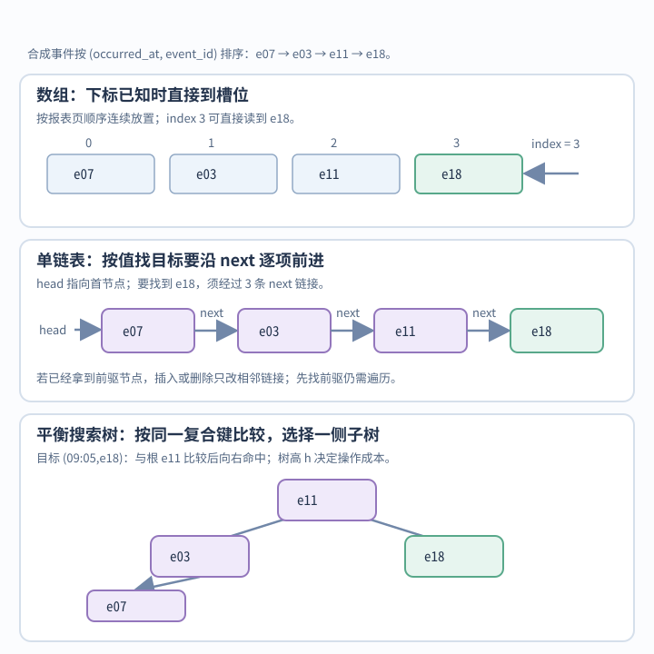
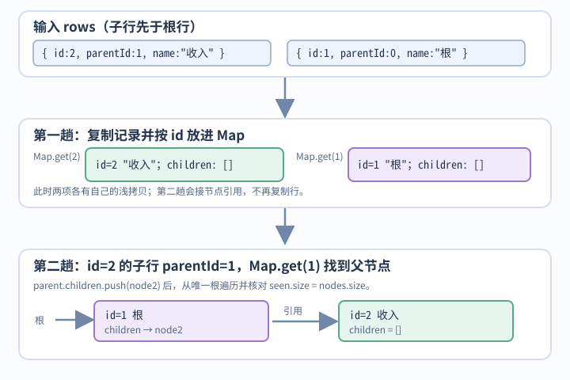

# 数据结构如何匹配访问方式，复杂度界何时成立？

案例背景：本章以一份合成事件报表（报表 42）为例。它要按下标翻到某一页事件、按 `event_id` 找到某条记录、按时间顺序遍历全部事件；分类视图需要层级结构，前端运行时也可能维护一棵工作树。选择数据结构时要问四件事：目标靠什么找到、链接怎样更新、是否需要保持有序，以及树高、哈希分布等复杂度前提是否成立。除了渐近复杂度，实际速度还受数据是否连续存放、是否需要频繁跳指针影响。

## 数组、链表和树各自适合什么操作？

| 结构 | 访问或查找 | 插入、删除 | 条件与代价 |
|---|---|---|---|
| 数组 | 已知下标 O(1)；按查询值扫描 O(n)，按该查询键排序后可二分 O(log n) | 中间改动 O(n)，后续元素要移动 | 连续访问方便；增长时可能分配和复制 |
| 单链表 | 按值或下标找节点 O(n) | 已知前驱链接时 O(1)，否则先找前驱 | 删除节点需要前驱 |
| 双向链表 | 查找通常需外部索引；裸链表 O(n) | 已知节点时 O(1) 改邻接链接 | 每个节点多存前后引用 |
| 高度平衡搜索树 | 搜索 O(log n) | 插入、删除 O(log n) | 需要不变量限制树高 |
| 非平衡搜索树 | 最坏 O(n) | 最坏 O(n) | 递增插入可形成长链 |
| Trie 前缀树 | 长度 m 的键约 O(m) | 沿字符路径增删 | 子边选择成本需受控；可能占较多内存 |

**同一批事件在数组、单链表和平衡搜索树中的布局与查找路径：**

图中四条合成事件来自报表 42 的同一页，按 `(occurred_at, event_id)` 排序，即先比时间、时间相同再比 ID。三种结构的用法如下：

- **数组**：知道下标时直接读槽位；按时间遍历就是顺序扫描；用完整排序键做精确查找或找边界时可以二分。但只知道 `event_id` 时不能二分，因为数组是按“时间加 ID”排的，不是按 ID 排的。这时可另建一个以 ID 为键的哈希索引，代价是它不提供时间顺序。
- **单链表**：按值找 e18 要从头沿 `next` 走三步。
- **搜索树**：同样按复合键比较，所以查找 e18 要给出完整的键 `(09:05, e18)`；在图示的树形中，先与根 e11 比较，再走到右孩子。

如果数据频繁插入或删除，还要比较数组搬移元素与树更新结构的维护成本。图里只是一种具体的树形：树操作的成本一般按树高 h 计算，只有维持平衡不变量的树才能保证 h=O(log n)。

链表只有在已经拿到目标节点或其前驱链接时，更新才是 O(1)；如果要先扫描定位，整个操作就是 O(n)。树的 O(log n) 同样以树高受控为前提。连续数组的扫描通常比沿指针跳转有更好的局部性，硬件层面的原因见[内存局部性如何影响访问](../operating-systems/memory-hierarchy-and-data-locality.md)。

## 树的遍历顺序和搜索条件是什么？

二叉树的深度优先遍历按“何时访问当前节点”分为三种：

- **中序**（左、节点、右）：binary search tree（BST，二叉搜索树）要求左子树的键都不大于当前键、右子树的键都不小于当前键，因此中序输出非降序。
- **前序**（节点、左、右）：先输出节点，配合空子树标记等结构信息即可序列化一棵树。
- **后序**（左、右、节点）：先处理子树，适合先汇总子树结果或先释放子节点。

有些实现还约定相等键只能放在某一侧。中序结果非降序并不能证明这条约定成立：例如根 2、左子 2、右子 3，中序是 2、2、3，却违反了“相等键只放右侧”。

下面的迭代中序返回第 k 小的值。前提是节点值为有限数字、比较规则一致，且树满足 BST 次序（包括它自己的重复键规则）。重复值按节点分别计数；如果实现把同值合并到一个节点并记录计数，选第 k 项时也要把这个计数算进去。k 不是正整数或节点不足 k 个时返回 null。

复杂度：算法至多弹出 k 个节点；结束时栈里最多还留着 h 个祖先，所以 push 至多 k+h 次、pop 至多 k 次，总时间 O(h+k)，最坏 O(n)；栈空间 O(h)。h 是树高，平衡树 h=O(log n)，退化成链时 h=O(n)。

~~~javascript
function kthSmallest(root, k) {
  if (!Number.isInteger(k) || k <= 0) return null;
  const stack = [];
  let node = root;
  while (node || stack.length) {
    while (node) {
      stack.push(node);
      node = node.left;
    }
    node = stack.pop();
    if (--k === 0) return node.val;
    node = node.right;
  }
  return null;
}
~~~

> [!example] 栈怎样找出中序第 k 项？
> 为了让序号一目了然，这里换成一棵 4 个节点的合成数值树：根 3，左子 1（1 的右子为 2），右子 4；取 `k=3`。算法先 push 3、1；pop 1 后 `k=2`；转到 1 的右子，push 并 pop 2 后 `k=1`；再 pop 3 时 `k` 归零，返回 3。中序次序是 1、2、3、4，第三项确实是 3。

前面说过，树操作的界取决于树高。red-black tree（红黑树）就是一种用着色规则控制树高的二叉搜索树：红节点的孩子必须是黑色；从任一节点到其后代叶哨兵的每条路径上黑节点数相同；根和叶哨兵按实现约定视为黑色。这些约束保证树高为 O(log n)，因此搜索、插入、删除在最坏情况下都是 O(log n)。

标准库对有序容器的承诺各不相同，不能从一种产品推断另一种：

- **Java SE 25 `TreeMap`**：API 文档明确说明基于红黑树，并保证 `containsKey`、`get`、`put`、`remove` 为 O(log n)。键按自然顺序或构造时给定的 `Comparator` 排序；`Comparator` 若与 `equals` 不一致，会违反 `Map` 接口的通用约定。
- **C++ `std::map`**：按 `Compare` 的严格弱序维护唯一键。标准只规定操作复杂度，不规定底层树形：`find` 和不带位置提示的单元素 `insert` 为 O(log n)；按迭代器 `erase(iterator)` 摊还 O(1)；`erase(first,last)` 为 O(log n + k)，k 是被删元素数。

以上界都把一次键比较算作常数；若字符串或复合键的比较成本随长度增长，还要乘上比较成本。

当数据放在磁盘或 SSD 上时，瓶颈变成读取了多少个存储页。B-tree（B 树）让每个节点容纳多个键，降低树高，从而减少页读取次数；它的内部节点也可以保存记录或记录引用。B+ tree（B+ 树）的内部节点只负责导航，叶节点保存完整记录或指向记录的条目，叶页通常相互链接以支持范围扫描；具体数据库的索引布局以产品文档为准。

trie（前缀树）让共享前缀的键共用路径，适合前缀查询。设 m 为键在遍历时的单元数（如字节数或代码单元数）：如果每一层都能以期望常数时间选出子边，查找约为 O(m)；否则还要加上每个节点选子边的成本。子边用数组、哈希表还是有序列表表示，也会显著改变总内存。

## 哈希表为什么有碰撞，何时能快速查找？

### Java SE 25 HashMap 契约与 OpenJDK 25u 实现边界

树靠比较维持顺序；如果报表只需要按 `event_id` 精确查找、不需要顺序，哈希表通常更快。哈希表用键的哈希值选出一个桶，再在桶内处理冲突。不同的键可能落入同一个桶，这就是 collision（碰撞）。扩容时按新容量重新分桶，能拆开一部分碰撞，但不能保证从此没有碰撞。以 OpenJDK 25u `HashMap` 中经过扩散处理的哈希值 `h` 为例：容量为 16 时，`h=1` 与 `h=17` 都落在桶 1；扩容到 32 后，它们分别落在桶 1 和桶 17。如果两个键扩散后的哈希值完全相同，扩容也分不开它们。

Java 要求 `equals` 相等的键必须有相同的 `hashCode`；如果键放入表之后，又修改了参与 `hashCode`/`equals` 计算的字段，后续查询可能找不到原来的条目。哈希表适合按键精确查找，但不保证按键的顺序遍历。

Java SE 25（LTS）的 `HashMap` 公共契约如下：允许一个 null 键和多个 null 值；不保证迭代顺序；不是线程安全的。哈希值分布合理时，`get`/`put` 的期望时间为常数；分布很差时，碰撞会抬高成本。若键的 `hashCode`/`equals` 计算量随内容长度增长，也要计入访问成本。默认初始容量 16、负载因子 0.75，条目数超过“容量 × 负载因子”这个阈值后表会扩容。扩容要重新分桶，单次 `put` 可能花 Θ(n)；把扩容成本摊到一系列插入上，每次插入才是均摊常数，碰撞成本另算。

本节内容由原先按 Java SE 17 讲解的归档笔记并入。Java SE 17 的 API 同样规定默认初始容量 16、负载因子 0.75，null、顺序和并发方面的边界也与上面相同，因此本节的解释对两个版本通用。负载因子越高，表的空间开销通常越小，但碰撞和查找成本越高；越低则用更多桶换取更少碰撞。选择时还要考虑条目数和迭代成本：`HashMap` 迭代要走遍所有桶和实际条目，预留容量过大也有代价。

下面是源码实现细节，不是 Java `Map` 接口的保证。OpenJDK 25u 维护分支在计算桶下标前，先用 `h ^ (h >>> 16)` 把哈希高位扩散到低位，并定义 `TREEIFY_THRESHOLD=8`、`MIN_TREEIFY_CAPACITY=64`：一个桶的链表过长时，可能把它转成红黑树（树化）。以普通 `putVal` 向链表桶追加节点的路径为例，桶里已有 8 个碰撞节点、再追加第 9 个时：

- 若表容量已达 64，这次 `put` 把该桶树化；
- 若初始容量为 16，且这些键扩散后的哈希值完全相同，那么第 9、10 个碰撞项不会树化，而是分别触发扩容到 32 和 64，第 11 个才触发树化。

这是哈希值完全相同的极端情况；如果只是在旧表中同桶、哈希值不同，扩容时可能分到不同桶，计数就不同。这个计数也只描述上述源码路径，不能推广到 `compute`/`merge`，也不能据此认为树桶查询总有严格的 O(log n) 界：键可比较时有助于在树桶中区分哈希值相同的项，但差的哈希分布仍会拖慢整体。OpenJDK 17u 维护分支在 2026-11-11 对照过，哈希扩散方式和这两个阈值与 25u 相同。

## 怎样遍历文档树并转换扁平记录？

回到报表 42 的分类视图：页面上的分类节点在 Document Object Model（DOM，文档对象模型）中组成一棵树。遍历它有两种基本顺序：depth-first search（DFS，深度优先搜索）沿一个分支走到底再回头，breadth-first search（BFS，广度优先搜索）一层一层访问。树中每个节点从根出发只有一条路径，所以这里不涉及“最短路”；BFS 在一般图中按边数求最短路的用法见[搜索状态图时，何时永久标记节点，何时必须回退？](graph-search-and-backtracking.md)。

下面三个函数都在对节点调用 `visit` 之后，才把该节点的子节点列表复制成数组。所以回调对当前节点子节点的修改会反映在随后的复制中；遍历看到的不是开始时冻结的整棵树。

~~~javascript
function dfs(root, visit) {
  if (!root) return;
  visit(root);
  for (const child of Array.from(root.childNodes)) dfs(child, visit);
}
function dfsIterative(root, visit) {
  if (!root) return;
  const stack = [root];
  while (stack.length) {
    const node = stack.pop();
    visit(node);
    const children = Array.from(node.childNodes);
    for (let i = children.length - 1; i >= 0; i--) stack.push(children[i]);
  }
}
function bfs(root, visit) {
  if (!root) return;
  const queue = [root];
  for (let head = 0; head < queue.length; head++) {
    const node = queue[head];
    visit(node);
    for (const child of Array.from(node.childNodes)) queue.push(child);
  }
}
~~~

树不变、且每次 `visit` 为 O(1) 时，访问 n 个节点的总工作是 O(n)。空间方面：递归 DFS 的调用栈深度为 O(h)，h 是树高；但每个尚未返回的递归帧还持有一份子节点数组，这些数组的元素合计最坏可达 O(n)，例如根节点有 n−1 个孩子时。显式 DFS 栈或 BFS 队列最坏也需要 O(n) 空间。如果回调会改树，就要按实际访问的节点数和回调成本另算。

BFS 用递增的 `head` 下标取队首，而不是反复调用 `shift`：对普通密集数组，`shift` 要把后续元素逐个前移，若每次都真的搬移剩余项，总工作可达 O(n²)。队列的几种表示见[队列和栈怎样表示待处理工作](queue-and-stack-representations.md)。

分类数据从后端取回时通常是扁平的行，每行用 `parentId` 指向父分类。要显示成树，可以分两趟转换：第一趟用 `Map` 按唯一 ID 为每行建一个浅拷贝节点；第二趟按 `parentId` 把节点引用挂到父节点的 `children` 数组。每个父节点的 `children` 按输入行的出现顺序追加，所以同一父节点下的子项保持输入中的相对顺序；但不同父节点的行原先在输入中怎样交错，转换后不再保留。

输入约定：每行是普通数据记录（字段都是数据属性，不依赖 getter 或 Proxy 自定义访问）；ID 是互不重复的正安全整数，不能使用根标记 0；恰好一行的 `parentId=0`，作为根；其他行的父 ID 都必须存在。连接完成后，再从根遍历一次，检查有没有与根不连通的环。

复制节点时，代码显式写回 `id` 和 `parentId`，因此即使这两个属性在原行中不可枚举，建索引和连接父子所需的字段也不会丢。其他需要随节点复制的业务字段（如 `name`）应是自有可枚举属性，否则要由实现显式复制。

复杂度：若按哈希 `Map`/`Set` 操作平均常数时间的模型计算，建索引、连接和可达性检查合计期望 O(n)；不过 ECMAScript 2026 只要求 `Map`/`Set` 平均访问时间次线性，没有承诺 O(1)。对象展开 `{ ...row }` 按规范的 CopyDataProperties 先枚举每行的全部自有键、逐个检查属性描述符，再只复制可枚举属性。设 Q 为所有行的自有键总数（含不可枚举的），P 为其中可枚举属性的总数，则浅拷贝的扫描时间为 O(Q)，复制出的属性占 O(P) 空间；每个节点另有 `id`、`parentId`、`children` 等固定字段，合计 O(n)。所以总时间 O(n+Q)，输出空间 O(n+P)。属性值不会被递归深拷贝；如果字段或值的复制成本随内容长度增长，还要另计字节数。

**两行分类记录先建立 `id` 索引，再按 `parentId` 接成一棵树：**

~~~javascript
function arrayToTree(rows) {
  if (!Array.isArray(rows)) throw new TypeError('rows must be an array');
  const nodes = new Map();
  for (const row of rows) {
    if (!row || !Number.isSafeInteger(row.id) || row.id <= 0 || nodes.has(row.id)) {
      throw new RangeError('rows must have unique positive safe-integer IDs');
    }
    nodes.set(row.id, { ...row, id: row.id, parentId: row.parentId, children: [] });
  }
  const roots = [];
  for (const row of rows) {
    const node = nodes.get(row.id);
    if (row.parentId === 0) roots.push(node);
    else {
      if (!Number.isSafeInteger(row.parentId) || row.parentId <= 0) {
        throw new RangeError('parentId must be 0 or a positive safe integer');
      }
      const parent = nodes.get(row.parentId);
      if (!parent) throw new RangeError('parent ID does not exist');
      parent.children.push(node);
    }
  }
  if (roots.length !== 1) throw new RangeError('expected exactly one root');
  const root = roots[0];
  const seen = new Set();
  const stack = [root];
  while (stack.length) {
    const node = stack.pop();
    seen.add(node);
    for (const child of node.children) stack.push(child);
  }
  if (seen.size !== nodes.size) throw new RangeError('rows contain a disconnected cycle');
  return root;
}

function treeToArray(root) {
  if (!root) return [];
  const rows = [];
  const stack = [{ node: root, parentId: 0 }];
  while (stack.length) {
    const { node, parentId } = stack.pop();
    rows.push({ id: node.id, parentId, name: node.name });
    const children = node.children ?? [];
    for (let i = children.length - 1; i >= 0; i--) {
      stack.push({ node: children[i], parentId: node.id });
    }
  }
  return rows;
}
~~~

> [!example] 两行分类记录怎样变成一棵树？
> 输入故意先放子行：`[{id:2,parentId:1,name:"收入"},{id:1,parentId:0,name:"根"}]`。第一趟 `Map` 先建 node 2，再建 node 1；第二趟读到子行时，虽然根行尚未出现在输入位置，`Map.get(1)` 已找到根节点，于是把 node 2 引用接到根的 `children`。根遍历访问 1、2，`seen` 与 Map 都有两项，因此数据可达且合法。`treeToArray` 按树的前序输出 `[{id:1,parentId:0,name:"根"},{id:2,parentId:1,name:"收入"}]`。

反向转换 `treeToArray` 按前序输出：先输出父节点，再依次输出各子树。它无法恢复原始扁平输入中跨父节点交错的行顺序。它假设输入是单根、无环的树，ID 为正安全整数，0 只作为根的 `parentId` 标记；示例只输出 `id`、`parentId`、`name`，其他业务字段需要显式复制。如果实际协议的根标记不是 0，应替换成协议规定的值。

## React Fiber 内部为什么把树节点链接起来？

上面的分类树用 `children` 数组表示孩子。React 在内部维护的工作树换了一种链接方式：每个 Fiber 节点用 `child` 指向第一个孩子、`sibling` 指向下一个兄弟、`return` 指向父节点。这样 reconciler（协调器）每处理完一个节点，只需记住“下一个要处理的节点”，就能把渲染拆成可暂停的工作单元并保存进度。结构上仍是一棵树，只是同级孩子通过 `sibling` 串成链表。

注意适用范围：只有 transition 等并发特性下的渲染工作可以暂停、重启或让位给更紧急的更新，不能据此认为每次 render 和 DOM 提交都能随时中断；DOM 变更在 render 完成后的 commit 阶段一次性应用。Fiber 的字段布局是 React 的实现细节，应用代码应依赖公共 API。

> [!info]- 来源
> - Java SE 17 的公共契约、默认容量/负载因子及空间与访问成本取舍：[HashMap API](https://docs.oracle.com/en/java/javase/17/docs/api/java.base/java/util/HashMap.html)（2026-11-13 核对）。
> - HashMap 契约、默认值与期望复杂度：[Java SE 25 HashMap API](https://docs.oracle.com/en/java/javase/25/docs/api/java.base/java/util/HashMap.html)，Java SE 25。
> - 哈希扰动与树化机制：[OpenJDK 17u HashMap 源码](https://github.com/openjdk/jdk17u/blob/master/src/java.base/share/classes/java/util/HashMap.java)（2026-11-11 对照）、[OpenJDK 25u HashMap 源码](https://github.com/openjdk/jdk25u/blob/master/src/java.base/share/classes/java/util/HashMap.java)（2026-11-11 核对）；比较 hash、TREEIFY_THRESHOLD、MIN_TREEIFY_CAPACITY 与 putVal，作为实现样本。
> - JavaScript Map/Set 的复杂度边界：[ECMAScript 2026 §24.1、§24.2](https://tc39.es/ecma262/2026/multipage/keyed-collections.html)，只要求平均访问次线性；本文 O(1) 是常见哈希实现的分析模型，不是规范保证。对象展开的 [CopyDataProperties §7.3.25](https://tc39.es/ecma262/2026/multipage/abstract-operations.html#sec-copydataproperties) 先枚举全部自有键并检查描述符，再复制可枚举属性，不递归复制属性值。
> - 有序容器契约：[Java SE 25 TreeMap API](https://docs.oracle.com/en/java/javase/25/docs/api/java.base/java/util/TreeMap.html) 的 red-black tree、键序和 containsKey/get/put/remove 成本；[C++ associative container requirements §23.2.7](https://eel.is/c++draft/associative.reqmts) 的 find/insert、erase(iterator) 与 erase(first,last) 复杂度要求。
> - DOM 子节点快照：[WHATWG DOM Standard](https://dom.spec.whatwg.org/#old-style-collections-nodelist) 的 live `NodeList` 与 `childNodes`；[`Array.from`](https://tc39.es/ecma262/2026/multipage/indexed-collections.html#sec-array.from) 将当下迭代结果放入新数组。
> - React 阶段与并发：[Render and Commit](https://react.dev/learn/render-and-commit) 说明提交到 DOM 的阶段；[React 18](https://react.dev/blog/2022/03/29/react-v18) 说明并发渲染仅在使用并发特性时启用，2022-03-29；Fiber 内部字段见[React Fiber 类型](https://github.com/react/react/blob/main/packages/react-reconciler/src/ReactInternalTypes.js)，2026-11-11 核对。
> - B+ 树索引结构：[Database System Concepts 第 7 版 Chapter 14](https://db-book.com/slides-dir/PDF-dir/ch14.pdf)，14.20–14.22；内部节点作导航，叶节点保存索引/记录指针并按键顺序链接。具体数据库布局由产品文档决定。
