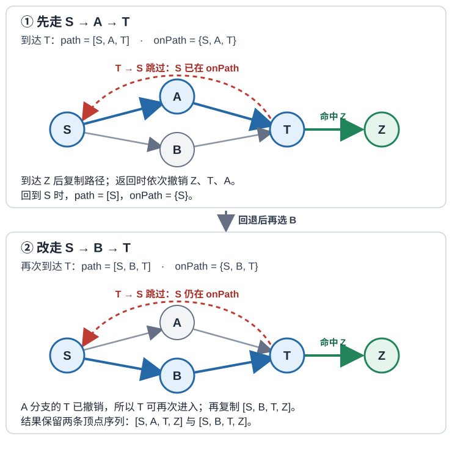

# 搜索状态图时，何时永久标记节点，何时必须回退？

案例背景：一张合成路网中，站点 S 要把包裹送到 Z。路网是有向图：S 可到 A、B；A 与 B 都通往会合点 T；T 可以回到 S，也可以到 Z。T→S 这条回边让图里出现环，会合点 T 让两条路线合流。本章用同一张图依次回答四个问题：找一条跳数最少的路线；列出所有不重复经过站点的路线；把边改读作依赖关系时能否排出执行顺序；给路段加上非负耗时后，代价最低的路线是哪条。

搜索时要决定用什么代表一个“状态”。在 BFS 与 Dijkstra 的路网查询里，站点 ID 就够了，前提是从某站点出发能走哪些边、每条边多少代价，只取决于当前站点，与之前怎么走过来无关。如果持有的钥匙、剩余预算等到达信息会改变后续可走的边，就要把这些信息并入状态键；否则只按站点去重，会把实际上不同的状态当成同一个。枚举简单路径则不同：一条路线是否合法取决于它已经经过哪些站点，所以另用 `onPath` 记录当前分支的历史。

代码中的无权图用 `Map<顶点 ID, 邻居数组>` 表示：ID 是字符串；每个顶点都作为键出现，没有出边时对应空数组；邻居也必须是图中的键。邻居数组按给定顺序扫描。简单路径示例按顶点序列输出结果，所以邻居数组里不放重复项。BFS 用 `null` 表示起点没有父节点，因此 `null` 不能用作顶点 ID。

~~~mermaid
flowchart LR
    S --> A
    S --> B
    A --> T
    B --> T
    T --> S
    T --> Z
~~~

下文的复杂度假设邻接表已经建好，不计建图成本；并采用常见的哈希字典模型：一次 `Map`/`Set` 查询或更新、一次堆比较或交换都按平均 O(1) 计，短顶点 ID 的处理成本视为常数。这只是分析模型：ECMAScript 规范只要求 `Map`/`Set` 平均访问时间次线性，没有保证 O(1)。如果键很长或字典操作成本显著，要另计键处理时间。

四个问题都沿着边扩展候选状态，区别在于标记什么、何时标记：

- breadth-first search（BFS，广度优先搜索）在顶点首次入队时记录父节点；队列按边数分层，所以之后可以全局去重。
- 枚举简单路径时，同一顶点可能出现在多条合法路线上，只能在当前递归路径内标记，返回时撤销。
- 拓扑排序维护每个顶点尚未满足的依赖数，要求图无环。
- Dijkstra 先记录暂定距离，只在某顶点的最小距离项出堆时才把它定型；堆里的旧项可能过期，且边权必须非负。

## 无权图最短路：顶点第一次入队时记录父节点

BFS 用先进先出队列按层扩展：先看距 S 一条边的顶点，再看两条边的顶点。队列中的顶点按发现距离非递减排列，所以第一次发现一个顶点时，已找到它的最少边数路径。用 parent 同时记录“已经发现”与首次父节点，之后的回边或另一条同层路线不再入队。

| 处理的顶点 | 刚发现的邻居 | 队列（从前到后） | parent 新增 |
|---|---|---|---|
| S | A、B | A、B | A←S，B←S |
| A | T | B、T | T←A |
| B | T 已发现 | T | 无 |
| T | S 已发现、Z | Z | Z←T |
| Z | 已到目标 | 空 | — |

按首次父节点从 Z 回溯得到 S→A→T→Z，共 3 条边。若邻接表把 B 放在 A 前，BFS 可能返回 S→B→T→Z；两条都是最少边数路径。起点或目标不存在、或目标不可达时返回 `null`；起点等于目标时返回仅含起点的路径。

~~~javascript
const routes = new Map([
  ['S', ['A', 'B']],
  ['A', ['T']],
  ['B', ['T']],
  ['T', ['S', 'Z']],
  ['Z', []]
]);

function shortestUnweightedPath(graph, start, target) {
  if (!graph.has(start) || !graph.has(target)) return null;
  const parent = new Map([[start, null]]); // 同时是全局 visited 集合
  const queue = [start];

  for (let head = 0; head < queue.length; head++) {
    const vertex = queue[head];
    if (vertex === target) break;
    for (const next of graph.get(vertex) ?? []) {
      if (parent.has(next)) continue;
      parent.set(next, vertex); // 入队时标记，避免重复排队
      queue.push(next);
    }
  }

  if (!parent.has(target)) return null;
  const path = [];
  for (let vertex = target; vertex !== null; vertex = parent.get(vertex)) {
    path.push(vertex);
  }
  return path.reverse();
}

console.log(shortestUnweightedPath(routes, 'S', 'Z')); // ['S', 'A', 'T', 'Z']
console.log(shortestUnweightedPath(routes, 'S', 'missing')); // null
~~~

设 V 为顶点数、E 为边数，邻接表上的 BFS 需要 O(V + E) 时间、O(V) 额外空间。代码用递增的 `head` 下标代替反复 `shift`，队首前进时不搬移剩余元素。这里能用全局 visited，是因为每个顶点只需保留一条最短路线的父节点；这并不意味着一个顶点只能出现在一条合法简单路径上，下一节就会遇到反例。

## 枚举简单路径：visited 只属于当前路径，并在回退时撤销

若要列出所有不重复经过同一站点的路线（simple path，简单路径），S→A→T→Z 与 S→B→T→Z 都应输出。BFS 的 parent 只保留 T 的第一个父节点 A；如果把全局 visited 直接用于路径枚举，T 经 A 被标记后，经 B 到达 T 的分支就会被错误剪掉。这里用顶点序列区分不同路线；若邻接数组含重复邻居，同一路线会被重复输出。如果两点之间的平行边本身代表不同路线，结果中还要记录走的是哪条边。

backtracking（回溯）沿候选边选择下一站并递归扩展；返回上一层时，撤销刚才加入的站点和路径项。`onPath` 只表示“这个顶点正在当前候选路径上”：它会拒绝 T→S，因为 S 已在这条路径里；而回到 S 去尝试另一条分支时，T 的标记已被撤销，T 可以再次进入新路线。

下图跟踪同一张路网的两个分支。走完 A 分支并返回 S 后，`onPath` 恢复为 `{S}`；因此 B 分支可以再次进入 T。到 T 时仍会跳过回到 S 的边，因为 S 还在当前路径上。

~~~javascript
function allSimplePaths(graph, start, target) {
  const results = [];
  if (!graph.has(start) || !graph.has(target)) return results;
  const path = [start];
  const onPath = new Set([start]);

  function visit(vertex) {
    if (vertex === target) {
      results.push(path.slice());
      return;
    }
    for (const next of graph.get(vertex) ?? []) {
      if (onPath.has(next)) continue; // 本路径内重复才构成环
      onPath.add(next);
      path.push(next);
      visit(next);
      path.pop();
      onPath.delete(next); // 回退后允许别的分支复用 next
    }
  }

  visit(start);
  return results;
}

const routeGraphForPaths = new Map([
  ['S', ['A', 'B']],
  ['A', ['T']],
  ['B', ['T']],
  ['T', ['S', 'Z']],
  ['Z', []]
]);
console.log(allSimplePaths(routeGraphForPaths, 'S', 'Z'));
// [['S', 'A', 'T', 'Z'], ['S', 'B', 'T', 'Z']]
~~~

调用 `visit` 时，`path` 和 `onPath` 都已含起点；到达目标时先复制路径，再逐层返回并撤销各自加入的顶点。起点等于目标时只返回零边路径 `[[start]]`；起点或目标不存在、或目标不可达时返回 `[]`。

如果问题只需要一条路线，就不应枚举所有路线，因为数量可能爆炸：在完全有向图中，起点和终点不同时，只算恰好经过全部 V−2 个中间顶点的简单路径就有 (V−2)! 条，还没算只经过部分中间点的路径。本例代码没有给候选数设上限。令 C 为实际检查的候选边数、L 为复制到结果中的路径总长度，运行时间为 O(C + L)；即使最终结果很少，搜索也可能探索许多到不了目标的前缀。递归栈、`path` 与 `onPath` 占 O(V) 辅助空间，返回结果另占与输出路径总长度相当的空间。图很深时还可能超出 JavaScript 调用栈深度，这时应改用显式栈保存递归状态，但回退时仍必须撤销 `onPath`。

## 依赖排序：每条有向边都必须满足先后顺序

topological sort（拓扑排序）回答“这些依赖能否排成一个执行顺序”。这里暂时把同一组边改读作依赖：边 u→v 表示 u 必须先于 v 完成，这时拓扑序就是一个可执行的顺序。如果把 T→S 也当作依赖，S→A→T→S 构成环：既要求 S 先于 T，又要求 T 先于 S，不存在合法顺序。如果 T→S 只是回程路线、不是依赖，就从依赖图中删去它；剩下的边构成 directed acyclic graph（DAG，有向无环图），可以排成 S、A、B、T、Z。

下面用 Kahn 算法：为每个顶点维护尚未满足的入边数（入度）。入度为 0 表示它现在可以执行；把它取出后，它的每个后继各解除一项依赖。删去 T→S 后的依赖图中，队列和入度按下表变化：

| 操作 | ready 队列（队首→队尾） | 输出 order | 入度变化 |
|---|---|---|---|
| 初始化 | S | — | S=0，A=1，B=1，T=2，Z=1 |
| 取出 S | A、B | S | A、B：1→0 |
| 取出 A | B | S、A | T：2→1 |
| 取出 B | T | S、A、B | T：1→0 |
| 取出 T | Z | S、A、B、T | Z：1→0 |
| 取出 Z | 空 | S、A、B、T、Z | 无 |

若取出的顶点数少于图中顶点数，返回 `null` 表示不存在完整拓扑序；剩下的顶点可能在环内，也可能只被环阻塞，因此该返回值不是环路径。

~~~javascript
function topologicalOrder(graph) {
  const vertices = new Set(graph.keys());
  for (const neighbors of graph.values()) {
    for (const next of neighbors) vertices.add(next);
  }

  const indegree = new Map(Array.from(vertices, vertex => [vertex, 0]));
  for (const neighbors of graph.values()) {
    for (const next of neighbors) indegree.set(next, indegree.get(next) + 1);
  }

  const ready = Array.from(vertices).filter(vertex => indegree.get(vertex) === 0);
  const order = [];
  for (let head = 0; head < ready.length; head++) {
    const vertex = ready[head];
    order.push(vertex);
    for (const next of graph.get(vertex) ?? []) {
      const remaining = indegree.get(next) - 1;
      indegree.set(next, remaining);
      if (remaining === 0) ready.push(next);
    }
  }
  return order.length === vertices.size ? order : null;
}

const dependencies = new Map([
  ['S', ['A', 'B']],
  ['A', ['T']],
  ['B', ['T']],
  ['T', ['Z']],
  ['Z', []]
]);
const cyclicDependencies = new Map([
  ['S', ['A', 'B']],
  ['A', ['T']],
  ['B', ['T']],
  ['T', ['S', 'Z']],
  ['Z', []]
]);
console.log(topologicalOrder(dependencies)); // ['S', 'A', 'B', 'T', 'Z']
console.log(topologicalOrder(cyclicDependencies)); // null：T → S 使依赖成环
~~~

保留 T→S 的原路网中，S、A、B、T、Z 的初始入度分别为 1、1、1、2、1，ready 队列一开始就是空的：S→A→T→S 成环，Z 又依赖 T，没有任何顶点可以先执行。剩下的顶点既有真正在环上的，也有像 Z 这样只是被环阻塞的。

每个顶点和每条边各处理常数次，邻接表上时间 O(V + E)、额外空间 O(V)。同一时刻入度为 0 的顶点可能不止一个，所以合法的拓扑序可能有多种。本实现中，初始 ready 队列按顶点在 Map 中首次出现的顺序排列；之后变为 ready 的顶点按出队顶点的邻接表扫描顺序入队，不保证沿用 Map 中的原始顺序。如果业务要求特定顺序，应显式加上优先级规则，而不能把任意一个拓扑序当成唯一答案。

## 非负权最短路：松弛距离，并跳过过期堆项

现在回到路网本身（T→S 仍是一条可走的路线），为每条边加上非负安全整数耗时：S→A 为 1，S→B 为 4，A→T 为 6，B→T 为 1，T→S 为 2，T→Z 为 1。加权邻接表的每个键仍代表一个顶点，每条边是 `{to, weight}`，且 `to` 必须是图中的键。BFS 仍找到 3 条边的 S→A→T→Z，但总代价是 8；代价较小的 S→B→T→Z 为 6。边数最少和代价最低是两个问题。

Dijkstra 算法用最小堆，每次取出当前距离最小、尚未定型的顶点。对边 v→w 做 relaxation（松弛）：若 `dist[v] + weight` 小于已知的 `dist[w]`，就更新 w 的距离和前驱，并把新距离压入堆。本实现不原地修改堆里的旧项，所以某顶点距离改善后，堆中会残留它的旧项；旧项弹出时，若其距离已不等于当前 `dist`，直接跳过。由于堆里可能有同一顶点的多条记录，再用 settled（已定型）集合保证每个顶点只处理一次。函数计算从 source 到全图的距离，不会因为发现 Z 就提前结束：Z=6 起初只是入堆的暂定距离，要等 Z:6 作为最小的未定型项出堆时才定型。

| 弹出的堆项 | 更新 | 堆中待处理项（可能含过期项） | 说明 |
|---|---|---|---|
| S:0 | A=1，B=4 | A:1、B:4 | 从源点展开 |
| A:1 | T=7 | B:4、T:7 | 暂时走 A |
| B:4 | T 从 7 改为 5 | T:5、T:7 | 新项入堆，T:7 成为过期项 |
| T:5 | 暂定 Z=6；S 已定型，跳过 T→S（若计算，和为 7） | Z:6、T:7 | Z:6 尚未定型 |
| Z:6 | 无 | T:7 | Z 此时定型，距离 6 才可确认 |
| T:7 | 无 | 空 | 因 7 不等于 dist[T]=5，跳过 |

跳过旧项并处理完全部可达点后，最终距离表为 `S=0, A=1, B=4, T=5, Z=6`。

为什么出堆即可定型？用反证法：假设刚弹出的 v 还有一条更短的路线。沿这条路线从 source 出发，找到第一条“起点已定型、终点 x 未定型”的边 u→x。u 定型时的距离不超过这条路线到 u 的长度；u 出堆时扫描过 u→x，所以堆中 x 的有效距离不超过路线到 x 的长度（若当时的候选没有改善，原来的有效项只会更小）。边权非负，路线到 x 的前缀不超过整条路线，而整条路线比 `dist[v]` 短，所以 x 的有效项小于 `dist[v]`，x 应该先于 v 出堆，矛盾。

这个论证依赖“前缀不超过整条路线”，负权边会破坏它。举个反例：假设跳过下方代码的负权校验、直接运行核心循环，并加一条 B→A、权重 −5。A 在距离 1 时就已定型；之后处理 B:4 时，经 B 到 A 的候选代价是 −1，但核心循环跳过已定型的 A，错误地保留了 1。因此本文实现会先扫描整张图：任何负权或非安全整数的权重、任何指向图外顶点的边都会抛出 `RangeError`，即使这条边从 source 出发根本走不到；搜索中若候选距离超出安全整数范围，也会抛出 `RangeError`。含负权的图应改用能处理负边的算法（例如在无负环前提下用 Bellman–Ford），不能因为某个负权样例碰巧算对就继续用 Dijkstra。

下面代码里的最小堆只按 `distance` 排序，专为这个示例而写，数组堆的上浮、下沉机制见[怎样在不断加入任务时持续取出最高优先级？](heaps-and-priority-queues.md)。`weightedPath` 必须传入运行 Dijkstra 时用的同一个 source：target 不在图中或从 source 不可达时返回 `null`，source 等于 target 时返回 `[source]`。整图预检通过后，若 source 不在图中，`dijkstra` 返回空的距离表和前驱表；图中从 source 不可达的顶点，距离为 `Infinity`。

> [!example]- 可运行：Dijkstra 最小堆实现
> ~~~javascript
> class MinHeap {
>   constructor() { this.items = []; }
>   get size() { return this.items.length; }
>
>   push(item) {
>     this.items.push(item);
>     let i = this.items.length - 1;
>     while (i > 0) {
>       const parent = Math.floor((i - 1) / 2);
>       if (this.items[parent].distance <= this.items[i].distance) break;
>       [this.items[i], this.items[parent]] = [this.items[parent], this.items[i]];
>       i = parent;
>     }
>   }
>
>   pop() {
>     if (this.items.length === 0) return null;
>     const root = this.items[0];
>     const last = this.items.pop();
>     if (this.items.length > 0) {
>       this.items[0] = last;
>       let i = 0;
>       while (true) {
>         const left = 2 * i + 1;
>         const right = left + 1;
>         let smallest = i;
>         if (left < this.items.length &&
>             this.items[left].distance < this.items[smallest].distance) smallest = left;
>         if (right < this.items.length &&
>             this.items[right].distance < this.items[smallest].distance) smallest = right;
>         if (smallest === i) break;
>         [this.items[i], this.items[smallest]] = [this.items[smallest], this.items[i]];
>         i = smallest;
>       }
>     }
>     return root;
>   }
> }
>
> function dijkstra(graph, source) {
>   for (const [from, edges] of graph) {
>     for (const edge of edges) {
>       if (!Number.isSafeInteger(edge.weight) || edge.weight < 0) {
>         throw new RangeError('Dijkstra requires non-negative safe-integer weights');
>       }
>       if (!graph.has(edge.to)) throw new RangeError('every destination must be a graph vertex');
>     }
>   }
>   if (!graph.has(source)) return { distances: new Map(), previous: new Map() };
>
>   const distances = new Map(Array.from(graph.keys(), vertex => [vertex, Infinity]));
>   const previous = new Map();
>   const settled = new Set();
>   const heap = new MinHeap();
>   distances.set(source, 0);
>   heap.push({ vertex: source, distance: 0 });
>
>   while (heap.size > 0) {
>     const current = heap.pop();
>     const vertex = current.vertex;
>     if (current.distance !== distances.get(vertex) || settled.has(vertex)) continue;
>     settled.add(vertex);
>
>     for (const edge of graph.get(vertex)) {
>       if (settled.has(edge.to)) continue;
>       const candidate = current.distance + edge.weight;
>       if (!Number.isSafeInteger(candidate)) throw new RangeError('path distance exceeds the safe integer range');
>       if (candidate < distances.get(edge.to)) {
>         distances.set(edge.to, candidate);
>         previous.set(edge.to, vertex);
>         heap.push({ vertex: edge.to, distance: candidate });
>       }
>     }
>   }
>   return { distances, previous };
> }
>
> function weightedPath(result, source, target) {
>   if (!result.distances.has(target) || result.distances.get(target) === Infinity) return null;
>   const path = [];
>   let vertex = target;
>   while (vertex !== source) {
>     path.push(vertex);
>     if (!result.previous.has(vertex)) return null;
>     vertex = result.previous.get(vertex);
>   }
>   path.push(source);
>   return path.reverse();
> }
>
> const weightedRoutes = new Map([
>   ['S', [{ to: 'A', weight: 1 }, { to: 'B', weight: 4 }]],
>   ['A', [{ to: 'T', weight: 6 }]],
>   ['B', [{ to: 'T', weight: 1 }]],
>   ['T', [{ to: 'S', weight: 2 }, { to: 'Z', weight: 1 }]],
>   ['Z', []]
> ]);
> const result = dijkstra(weightedRoutes, 'S');
> console.log(result.distances.get('Z'));                    // 6
> console.log(weightedPath(result, 'S', 'Z'));                // ['S', 'B', 'T', 'Z']
> console.log(weightedPath(result, 'S', 'unreachable'));      // null
> ~~~

复杂度：实现先用一个独立循环校验全图 E 条边；之后的松弛循环中，每个已定型顶点只扫描一次出边，所以这一阶段至多扫描 E 条边、至多成功松弛并压入 E 个新项。加上起点的初始项，这种不删旧项的“惰性”堆最多处理 E+1 个项，因此 `dijkstra` 时间 O(V + (E + 1) log(E + 1))、空间 O(V + E)。若改用支持 decrease-key（原地降低键值）的索引优先队列，堆空间通常可降到 O(V)，时间写作 O((V + E) log V)。`weightedPath` 回溯一条含 P 个顶点的路径，另需 O(P) 时间。无论哪种实现，距离表、前驱表、堆项和 settled 状态都必须对应同一张图、同一组边权。

> [!info]- 来源
> - 邻接表遍历、BFS 按边数找最短路、首次发现时记录父边：[Robert Sedgewick 与 Kevin Wayne, Algorithms, 4th ed., §4.1 “Undirected Graphs”](https://algs4.cs.princeton.edu/41graph/)，作者实现 [BreadthFirstPaths.java](https://algs4.cs.princeton.edu/code/edu/princeton/cs/algs4/BreadthFirstPaths.java.html)。BFS 原理同样适用于本页的有向邻接表。
> - DAG 才有拓扑序，以及顶点/边线性量级的 DFS 版本：[Algorithms, 4th ed., §4.2 “Directed Graphs”](https://algs4.cs.princeton.edu/42digraph/)，作者的队列版本 [TopologicalX.java](https://algs4.cs.princeton.edu/code/edu/princeton/cs/algs4/TopologicalX.java.html)。本页采用 Kahn 入度实现，示例输出由 Node.js 运行复算。
> - Dijkstra 的非负权前提、松弛与索引优先队列复杂度：[Algorithms, 4th ed., §4.4 “Shortest Paths”](https://algs4.cs.princeton.edu/44sp/)，作者实现 [DijkstraSP.java](https://algs4.cs.princeton.edu/code/edu/princeton/cs/algs4/DijkstraSP.java.html)。惰性重复入堆会让优先队列最多保留与边数同阶的项：[LazyDijkstraSP.java](https://algs4.cs.princeton.edu/44sp/LazyDijkstraSP.java.html)。本页用这类堆显示过期项，复杂度按本页实现计。
> - 本页图算法的哈希字典成本模型：[ECMAScript 2026, §24.1 “Map Objects” 与 §24.2 “Set Objects”](https://tc39.es/ecma262/2026/multipage/keyed-collections.html)。规范要求平均访问时间次线性，不规定具体的数据结构或 O(1) 上界。
