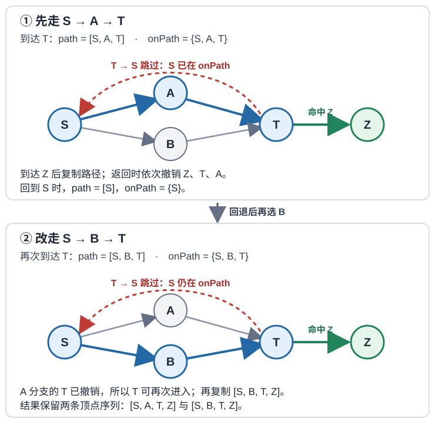

# 搜索状态图时，何时永久标记节点，何时必须回退？

以一张合成路网为例：站点 S 要把包裹送到 Z。路网是有向图：S 可到 A、B；A 与 B 都可到两路会合的 T；T 可回到 S，也可到 Z。回边让图有环，共享的会合节点让两条路线合流。我们先用它找一条最少跳数路线，再枚举简单路线；随后把部分边改作依赖，检查依赖环；最后给路段加入非负代价。

在 BFS 与 Dijkstra 的路网查询中，站点 ID 足以代表到达状态，前提是当前站点确定可走边及各边代价，且与先前路径无关。若钥匙、剩余预算等到达信息会改变后续转移，就要把这些条件并入状态键；否则仅按站点去重会合并实际上不同的状态。简单路径枚举另用 `onPath` 记录本分支到过的站点，因为它的合法性确实取决于这段历史。

无权图用 `Map<顶点 ID, 邻居数组>` 表示；ID 是字符串，每个顶点都作为键出现（没有出边时用空数组），邻居也必须是图中的键。邻居数组按给定顺序扫描；简单路径示例按顶点序列输出，所以数组中不放重复邻居。BFS 用 `null` 表示起点没有父节点，因此顶点 ID 不使用 `null`。

~~~mermaid
flowchart LR
    S --> A
    S --> B
    A --> T
    B --> T
    T --> S
    T --> Z
~~~

下文复杂度按图已用邻接表建好、不含建图成本计算；采用常见哈希字典模型，把一次 `Map`/`Set` 查询或更新、一次堆比较/交换视作平均 O(1)，并按固定成本处理这些短顶点 ID。这是分析模型；ECMAScript 规范只要求 `Map`/`Set` 平均访问时间次线性，并未保证 O(1)。若键很长或字典操作成本显著，须另计键处理时间。

这些操作都沿边扩展候选状态，但保留的状态不同：breadth-first search（BFS，广度优先搜索）在顶点首次入队时记录父节点，因队列按边数分层，之后可全局去重；枚举简单路径时，同一顶点可能属于不同合法路线，必须只在当前递归路径内标记并在返回时撤销；拓扑排序维护尚未满足的依赖数，要求图无环；Dijkstra 先保留暂定距离，只在当前最小距离项出堆时定型顶点，旧堆项可能过期，且边权必须非负。

## 无权图最短路：顶点第一次入队时记录父节点

breadth-first search（广度优先搜索，BFS）用先进先出队列按层扩展：先看距 S 一条边的顶点，再看两条边的顶点。队列中的顶点按发现距离非递减排列，所以第一次发现一个顶点时，已找到它的最少边数路径。用 parent 同时记录“已经发现”与首次父节点，之后的回边或另一条同层路线不再入队。

| 处理的顶点 | 刚发现的邻居 | 队列（从前到后） | parent 新增 |
|---|---|---|---|
| S | A、B | A、B | A←S，B←S |
| A | T | B、T | T←A |
| B | T 已发现 | T | 无 |
| T | S 已发现、Z | Z | Z←T |
| Z | 已到目标 | 空 | — |

按首次父节点从 Z 回溯得到 S→A→T→Z，共 3 条边。若邻接表把 B 放在 A 前，BFS 可能返回 S→B→T→Z；两条都是最少边数路径。起点或目标不存在、或目标不可达时返回 `null`；起点等于目标时返回仅含起点的路径。

~~~javascript
const routes = new Map([
  ['S', ['A', 'B']],
  ['A', ['T']],
  ['B', ['T']],
  ['T', ['S', 'Z']],
  ['Z', []]
]);

function shortestUnweightedPath(graph, start, target) {
  if (!graph.has(start) || !graph.has(target)) return null;
  const parent = new Map([[start, null]]); // 同时是全局 visited 集合
  const queue = [start];

  for (let head = 0; head < queue.length; head++) {
    const vertex = queue[head];
    if (vertex === target) break;
    for (const next of graph.get(vertex) ?? []) {
      if (parent.has(next)) continue;
      parent.set(next, vertex); // 入队时标记，避免重复排队
      queue.push(next);
    }
  }

  if (!parent.has(target)) return null;
  const path = [];
  for (let vertex = target; vertex !== null; vertex = parent.get(vertex)) {
    path.push(vertex);
  }
  return path.reverse();
}

console.log(shortestUnweightedPath(routes, 'S', 'Z')); // ['S', 'A', 'T', 'Z']
console.log(shortestUnweightedPath(routes, 'S', 'missing')); // null
~~~

邻接表下 BFS 为 O(V + E) 时间、O(V) 额外空间，V 为顶点数、E 为边数。这里用数组递增 head 取代反复 shift，队列头前进时不搬移剩余元素。全局 visited 合适的理由是此处只保留每个顶点的一条最短距离与父节点；它并不表示顶点只能出现在一条合法简单路径中。

## 枚举简单路径：visited 只属于当前路径，并在回退时撤销

若要列出所有不重复经过同一站点的路线，S→A→T→Z 与 S→B→T→Z 都是有效候选。BFS 的 parent 只保留 T 的第一个父节点 A；若把全局 visited 直接拿来做路径枚举，T 经 A 加入 visited 后，经 B 到达 T 的分支会被误删。这里的输出身份是顶点序列；若邻接数组允许重复邻居，同一路线会重复输出。若平行边本身代表不同路线，则须把边身份也纳入结果。

backtracking（回溯）沿候选边选下一站，递归扩展；回到上一层时撤销刚才加入的站点和路径项。onPath 只表示“这个顶点正在当前候选路径上”。它会拒绝 T→S，因为 S 已在这条路径里；回到起点的另一条分支时，T 的标记已撤销，因此 T 可以再次进入另一条路线。

下图跟踪同一张路网的两个分支。走完 A 分支并返回 S 后，`onPath` 恢复为 `{S}`；因此 B 分支可以再次进入 T。到 T 时仍会跳过回到 S 的边，因为 S 还在当前路径上。

~~~javascript
function allSimplePaths(graph, start, target) {
  const results = [];
  if (!graph.has(start) || !graph.has(target)) return results;
  const path = [start];
  const onPath = new Set([start]);

  function visit(vertex) {
    if (vertex === target) {
      results.push(path.slice());
      return;
    }
    for (const next of graph.get(vertex) ?? []) {
      if (onPath.has(next)) continue; // 本路径内重复才构成环
      onPath.add(next);
      path.push(next);
      visit(next);
      path.pop();
      onPath.delete(next); // 回退后允许别的分支复用 next
    }
  }

  visit(start);
  return results;
}

const routeGraphForPaths = new Map([
  ['S', ['A', 'B']],
  ['A', ['T']],
  ['B', ['T']],
  ['T', ['S', 'Z']],
  ['Z', []]
]);
console.log(allSimplePaths(routeGraphForPaths, 'S', 'Z'));
// [['S', 'A', 'T', 'Z'], ['S', 'B', 'T', 'Z']]
~~~

调用 `visit` 时，`path` 和 `onPath` 都已含起点；到达目标时先复制路径，再逐层返回并撤销各自加入的顶点。起点等于目标时只返回零边路径 `[[start]]`；起点或目标不存在、或目标不可达时返回 `[]`。

如果本次问题只需一条路线，不应枚举所有路线。在起终点不同的完全有向图中，恰好经过全部 V−2 个中间顶点的简单路径就有 (V−2)! 条，未计只经过其中一部分的路径；数量至少可达阶乘级，本例代码没有候选数上限。令 C 为实际检查的候选边数、L 为复制到结果中的路径总长度，运行时间按 O(C + L) 计；即使结果少，搜索也可能访问许多最终无法到达目标的前缀。递归栈、path 与 onPath 的辅助空间为 O(V)，返回结果另占与所有输出路径总长度相称的空间。深图也可能超过 JavaScript 调用栈深度，此时应把递归状态改成显式栈，但仍须在回退时撤销 onPath。

## 依赖排序：每条有向边都必须满足先后顺序

topological sort（拓扑排序）回答的是依赖能否排成执行顺序。此处暂把 S→A、S→B、A→T、B→T、T→Z 解释为“前站必须先完成”的依赖；若每条边 u→v 表示 u 必须先于 v，拓扑序才是可执行顺序。把 T→S 也解释为依赖时，S→A→T→S 已成环，要求 S 先于 T 又要求 T 先于 S，因此不存在合法顺序。若 T→S 只是回程路线、不是依赖，就从依赖图删去这条边；其余边形成 DAG（directed acyclic graph，有向无环图），可排成 S、A、B、T、Z。

下面的 Kahn 算法维护每个顶点尚未满足的入边数。入度为 0 表示当前可执行；取出它后，逐条解除后继的一项依赖。依赖图移去了作为回程路线的 T→S 后，队列和入度按下表变化：

| 操作 | ready 队列（队首→队尾） | 输出 order | 入度变化 |
|---|---|---|---|
| 初始化 | S | — | S=0，A=1，B=1，T=2，Z=1 |
| 取出 S | A、B | S | A、B：1→0 |
| 取出 A | B | S、A | T：2→1 |
| 取出 B | T | S、A、B | T：1→0 |
| 取出 T | Z | S、A、B、T | Z：1→0 |
| 取出 Z | 空 | S、A、B、T、Z | 无 |

若取出的顶点数少于图中顶点数，返回 `null` 表示不存在完整拓扑序；剩下的顶点可能在环内，也可能只被环阻塞，因此该返回值不是环路径。

~~~javascript
function topologicalOrder(graph) {
  const vertices = new Set(graph.keys());
  for (const neighbors of graph.values()) {
    for (const next of neighbors) vertices.add(next);
  }

  const indegree = new Map(Array.from(vertices, vertex => [vertex, 0]));
  for (const neighbors of graph.values()) {
    for (const next of neighbors) indegree.set(next, indegree.get(next) + 1);
  }

  const ready = Array.from(vertices).filter(vertex => indegree.get(vertex) === 0);
  const order = [];
  for (let head = 0; head < ready.length; head++) {
    const vertex = ready[head];
    order.push(vertex);
    for (const next of graph.get(vertex) ?? []) {
      const remaining = indegree.get(next) - 1;
      indegree.set(next, remaining);
      if (remaining === 0) ready.push(next);
    }
  }
  return order.length === vertices.size ? order : null;
}

const dependencies = new Map([
  ['S', ['A', 'B']],
  ['A', ['T']],
  ['B', ['T']],
  ['T', ['Z']],
  ['Z', []]
]);
const cyclicDependencies = new Map([
  ['S', ['A', 'B']],
  ['A', ['T']],
  ['B', ['T']],
  ['T', ['S', 'Z']],
  ['Z', []]
]);
console.log(topologicalOrder(dependencies)); // ['S', 'A', 'B', 'T', 'Z']
console.log(topologicalOrder(cyclicDependencies)); // null：T → S 使依赖成环
~~~

在本例的原路网中，S、A、B、T、Z 的初始入度分别为 1、1、1、2、1，ready 为空；边 S→A→T→S 已成环，Z 又依赖 T，所以没有节点可取。剩余集合含真正成环的节点，也含被环阻塞的 Z。每个顶点和边各处理常数次，邻接表下时间 O(V + E)、额外空间 O(V)。入度为 0 的顶点可能不止一个，因此不同合法拓扑序都可能成立。初始 ready 队列按顶点首次出现顺序排列；后续变为 ready 的顶点则按当前出队顶点的邻接表扫描顺序入队，并由 FIFO 队列处理，不保证沿用它们在原 Map 中首次出现的顺序。若业务要求特定顺序，应明确再加优先级规则，而不能把任意拓扑序当成唯一答案。

## 非负权最短路：松弛距离，并跳过过期堆项

现在切回路网而非依赖图，为每条路线边加上非负安全整数耗时：S→A 为 1，S→B 为 4，A→T 为 6，B→T 为 1，T→S 为 2，T→Z 为 1。加权邻接表的每个键仍代表一个顶点，每条边是 `{to, weight}`，且 `to` 必须是图中的键。BFS 仍找到 3 条边的 S→A→T→Z，但总代价是 8；代价较小的 S→B→T→Z 为 6。边数最少和代价最低是两个问题。

Dijkstra 算法用最小堆优先处理当前距离最小且尚未定型的顶点。relaxation（松弛）一条边 v→w 时，若 dist[v]+weight 小于已知 dist[w]，就更新距离与前驱并把新距离推入堆。此实现不原地修改旧堆项；某顶点改善时会留下旧项，弹出时若其距离已不等于当前 dist，就跳过。堆还可含同一个顶点的多条距离记录，settled（已定型）集合保证顶点只处理一次。本函数计算 source 到全图的距离，不因找到 Z 就提前结束；Z=6 先作为暂定距离入堆，等 Z:6 作为最小的未定型项出堆时才定型。

| 弹出的堆项 | 更新 | 堆中待处理项（可能含过期项） | 说明 |
|---|---|---|---|
| S:0 | A=1，B=4 | A:1、B:4 | 从源点展开 |
| A:1 | T=7 | B:4、T:7 | 暂时走 A |
| B:4 | T 从 7 改为 5 | T:5、T:7 | 新项入堆，T:7 成为过期项 |
| T:5 | 暂定 Z=6；S 已定型，跳过 T→S（若计算，和为 7） | Z:6、T:7 | Z:6 尚未定型 |
| Z:6 | 无 | T:7 | Z 此时定型，距离 6 才可确认 |
| T:7 | 无 | 空 | 因 7 不等于 dist[T]=5，跳过 |

跳过旧项并处理完全部可达点后，最终距离表为 `S=0, A=1, B=4, T=5, Z=6`。

可定型的理由：若到刚弹出的 v 仍有更短路线，取路线上的第一条 u→x，其中 u 已定型、x 尚未定型。u 的定型距离不大于路线到 u 的前缀；出队时扫描 u→x 后，堆中 x 的有效距离不大于路线到 x 的前缀（若新候选没有改善，原有效项不大于新候选）。非负边使此前缀不超过全路线，因此 x 的有效项应小于 dist[v]，与 v 是最小未定型项矛盾。

负权会破坏这个前缀关系。作为反证，假设不执行下方的负权校验而直接运行核心循环，再加 B→A、权重 −5，则 A 在距离 1 时已定型；处理 B:4 时，经 B 到 A 的候选代价为 −1，但核心循环会跳过已定型的 A，错误保留 1。本文实现会先扫描整张图；任何负权或非安全整数权重、以及指向非图顶点的边都会抛出 `RangeError`，即使该边从 source 不可达。搜索中若形成超出安全整数范围的候选和，也会抛出 `RangeError`。负权图应改用能处理负边的算法（例如无负环前提下的 Bellman–Ford），不能因为某个负权样例恰好算对就使用 Dijkstra。

下面的最小堆仅按 `distance` 排序；它只服务此完整示例，与[优先队列的上浮和下沉](heaps-and-priority-queues.md)共享数组堆机制。`weightedPath` 必须接收运行 Dijkstra 时使用的同一 source；不在图中的 target 或从 source 不可达的 target 返回 `null`，source 等于 target 时返回 `[source]`。通过整图预检后，若 source 不在图中，Dijkstra 返回空的距离表和前驱表；在图中但从 source 不可达的顶点距离为 `Infinity`。代码把权重和距离限制为安全整数，并拒绝负权或超出安全范围的路径和。

> [!example]- 可运行：Dijkstra 最小堆实现
> ~~~javascript
> class MinHeap {
>   constructor() { this.items = []; }
>   get size() { return this.items.length; }
>
>   push(item) {
>     this.items.push(item);
>     let i = this.items.length - 1;
>     while (i > 0) {
>       const parent = Math.floor((i - 1) / 2);
>       if (this.items[parent].distance <= this.items[i].distance) break;
>       [this.items[i], this.items[parent]] = [this.items[parent], this.items[i]];
>       i = parent;
>     }
>   }
>
>   pop() {
>     if (this.items.length === 0) return null;
>     const root = this.items[0];
>     const last = this.items.pop();
>     if (this.items.length > 0) {
>       this.items[0] = last;
>       let i = 0;
>       while (true) {
>         const left = 2 * i + 1;
>         const right = left + 1;
>         let smallest = i;
>         if (left < this.items.length &&
>             this.items[left].distance < this.items[smallest].distance) smallest = left;
>         if (right < this.items.length &&
>             this.items[right].distance < this.items[smallest].distance) smallest = right;
>         if (smallest === i) break;
>         [this.items[i], this.items[smallest]] = [this.items[smallest], this.items[i]];
>         i = smallest;
>       }
>     }
>     return root;
>   }
> }
>
> function dijkstra(graph, source) {
>   for (const [from, edges] of graph) {
>     for (const edge of edges) {
>       if (!Number.isSafeInteger(edge.weight) || edge.weight < 0) {
>         throw new RangeError('Dijkstra requires non-negative safe-integer weights');
>       }
>       if (!graph.has(edge.to)) throw new RangeError('every destination must be a graph vertex');
>     }
>   }
>   if (!graph.has(source)) return { distances: new Map(), previous: new Map() };
>
>   const distances = new Map(Array.from(graph.keys(), vertex => [vertex, Infinity]));
>   const previous = new Map();
>   const settled = new Set();
>   const heap = new MinHeap();
>   distances.set(source, 0);
>   heap.push({ vertex: source, distance: 0 });
>
>   while (heap.size > 0) {
>     const current = heap.pop();
>     const vertex = current.vertex;
>     if (current.distance !== distances.get(vertex) || settled.has(vertex)) continue;
>     settled.add(vertex);
>
>     for (const edge of graph.get(vertex)) {
>       if (settled.has(edge.to)) continue;
>       const candidate = current.distance + edge.weight;
>       if (!Number.isSafeInteger(candidate)) throw new RangeError('path distance exceeds the safe integer range');
>       if (candidate < distances.get(edge.to)) {
>         distances.set(edge.to, candidate);
>         previous.set(edge.to, vertex);
>         heap.push({ vertex: edge.to, distance: candidate });
>       }
>     }
>   }
>   return { distances, previous };
> }
>
> function weightedPath(result, source, target) {
>   if (!result.distances.has(target) || result.distances.get(target) === Infinity) return null;
>   const path = [];
>   let vertex = target;
>   while (vertex !== source) {
>     path.push(vertex);
>     if (!result.previous.has(vertex)) return null;
>     vertex = result.previous.get(vertex);
>   }
>   path.push(source);
>   return path.reverse();
> }
>
> const weightedRoutes = new Map([
>   ['S', [{ to: 'A', weight: 1 }, { to: 'B', weight: 4 }]],
>   ['A', [{ to: 'T', weight: 6 }]],
>   ['B', [{ to: 'T', weight: 1 }]],
>   ['T', [{ to: 'S', weight: 2 }, { to: 'Z', weight: 1 }]],
>   ['Z', []]
> ]);
> const result = dijkstra(weightedRoutes, 'S');
> console.log(result.distances.get('Z'));                    // 6
> console.log(weightedPath(result, 'S', 'Z'));                // ['S', 'B', 'T', 'Z']
> console.log(weightedPath(result, 'S', 'unreachable'));      // null
> ~~~

实现先用一个独立循环预校验全图的 E 条边；在随后的松弛循环中，每个已定型顶点只扫描一次出边，因此该阶段总计至多扫描 E 条边，至多成功松弛并压入 E 个新项。加上起点初始项后，惰性堆最多处理 E+1 个项，故 `dijkstra` 时间 O(V + (E + 1) log(E + 1))、空间 O(V + E)。若用带 decrease-key 的索引优先队列，通常可把堆空间降到 O(V)，时间写作 O((V + E) log V)。`weightedPath` 沿前驱回溯一条长度为 P 的路径，另需 O(P) 时间并返回 O(P) 个顶点。无论用哪一种实现，距离表、前驱表、堆项和 visited/settled 状态都要对应同一个图与同一组边权。

> [!info]- 来源
> - 邻接表遍历、BFS 按边数找最短路、首次发现时记录父边：[Robert Sedgewick 与 Kevin Wayne, Algorithms, 4th ed., §4.1 “Undirected Graphs”](https://algs4.cs.princeton.edu/41graph/)，作者实现 [BreadthFirstPaths.java](https://algs4.cs.princeton.edu/code/edu/princeton/cs/algs4/BreadthFirstPaths.java.html)。BFS 原理同样适用于本页的有向邻接表。
> - DAG 才有拓扑序，以及顶点/边线性量级的 DFS 版本：[Algorithms, 4th ed., §4.2 “Directed Graphs”](https://algs4.cs.princeton.edu/42digraph/)，作者的队列版本 [TopologicalX.java](https://algs4.cs.princeton.edu/code/edu/princeton/cs/algs4/TopologicalX.java.html)。本页采用 Kahn 入度实现，示例输出由 Node.js 运行复算。
> - Dijkstra 的非负权前提、松弛与索引优先队列复杂度：[Algorithms, 4th ed., §4.4 “Shortest Paths”](https://algs4.cs.princeton.edu/44sp/)，作者实现 [DijkstraSP.java](https://algs4.cs.princeton.edu/code/edu/princeton/cs/algs4/DijkstraSP.java.html)。惰性重复入堆会让优先队列最多保留与边数同阶的项：[LazyDijkstraSP.java](https://algs4.cs.princeton.edu/44sp/LazyDijkstraSP.java.html)。本页用这类堆显示过期项，复杂度按本页实现计。
> - 本页图算法的哈希字典成本模型：[ECMAScript 2026, §24.1 “Map Objects” 与 §24.2 “Set Objects”](https://tc39.es/ecma262/2026/multipage/keyed-collections.html)。规范要求平均访问时间次线性，不规定具体的数据结构或 O(1) 上界。
