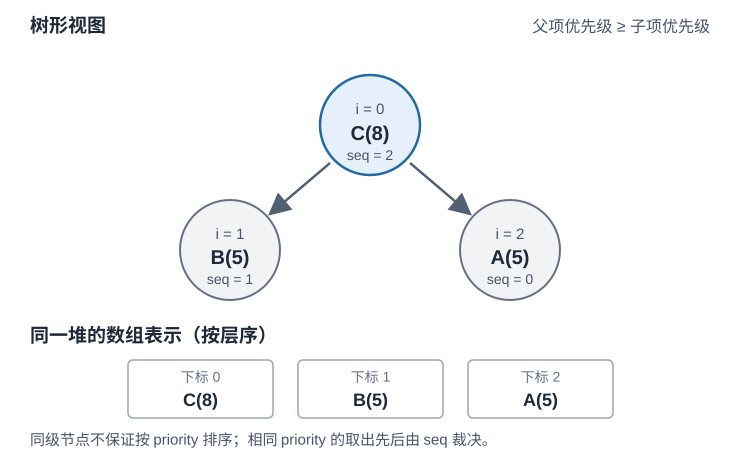

# 怎样在不断加入任务时持续取出最高优先级？

案例背景：合成报表 42 的后台调度器不断收到待处理任务；每当有执行资源空出来，就取出当前最紧急的一项。如果每次都把整个集合重新排序，大部分工作都花在重复整理旧任务上。其实只需要两项操作：快速插入新任务、快速取出当前优先级最高的任务，这正是 priority queue（优先队列）的接口。binary heap（二叉堆）只维护一条父子之间的顺序约束，就能高效支持这两项操作。

## 堆序只规定父子关系，不会把数组排好序

本章用最大堆：优先级数值越大，任务越紧急；优先级相同时先到先出。为此入堆时给每项附上一个从 0 开始递增的 `sequence`，只在优先级相同时比较它，序号小的先出。

二叉堆是一棵完全二叉树（除最后一层外都填满，最后一层从左向右填），按层从左到右存进数组。用 0 起始下标时，`i > 0` 的位置才有父节点，父节点下标为 `floor((i - 1) / 2)`，两个孩子是 `2i + 1` 与 `2i + 2`。堆序只要求每个父项不低于它的孩子；由于比较关系可传递，沿任何一条路径往上都不会变低，所以根不低于任何节点。除此之外没有别的顺序：兄弟之间、不同子树之间都没有约定，数组整体也不是排好序的。

任务 A 和 B 的优先级均为 5，A 先到；C 的优先级为 8。插入 C 后的树形与数组层序表示如下。箭头只表示父子堆序，不表示数组整体排名。

| 操作 | 堆数组（按层序） | 发生的修复 |
|---|---|---|
| 插入 A(5) | [A(5)] | 根无需调整 |
| 插入 B(5) | [A(5), B(5)] | 同优先级时 A 序号较早，不交换 |
| 插入 C(8) | [C(8), B(5), A(5)] | C 从下标 2 上浮到根 |
| 插入 D(2) | [C(8), B(5), A(5), D(2)] | D 低于父项 B，留在数组末尾 |
| 取出 | [A(5), B(5), D(2)] | 返回 C；D 补到根后，B、A 都优于 D；两者同分，较早的右孩子 A 优先，与 D 交换 |

表中的两种修复规则：插入时把新项放在数组末尾，然后沿父节点逐层上浮，直到父项不低于它；取出根时，先用末项填到根，再与优先级更高的那个孩子比较，若孩子更高就交换并继续下沉，直到不低于两个孩子或到达叶子。最后一行中，B 与 A 同为 5，`sequence` 较小的 A 胜出，所以 D 与右孩子 A 交换。每次修复只走一条根到叶的路径，不需要扫描整个堆。

堆有 `n` 个节点时，最大高度 `H = floor(log₂ n)`。因此上浮或下沉至多走 O(log n) 层：以元素比较和交换次数计，push、pop 各为 O(log n)，peek 只读根是 O(1)，堆项占 O(n) 个槽位。

如果所有元素一开始就都已知，可以自底向上建堆（heapify）：从最后一个非叶节点开始，逐个向根方向对每个节点做下沉，总共 O(n) 次比较和交换；如果元素逐个到达，只能逐项 push，累计 O(n log n)。heapify 之所以是线性的，是因为大多数节点靠近叶子，只能下沉很少几层：高度为 `h` 的节点至多有 `ceil(n / 2^(h+1))` 个，h 每增加 1 数量约减半，而每个节点最多下沉 `h` 层。对 `1 ≤ h ≤ H` 求和，总工作量上界为 `Σ h·ceil(n / 2^(h+1)) = O(n)`。代价是必须一开始就拿到整批元素。

> [!info]- 实现成本口径
> 上述堆操作复杂度把单次优先级比较视为 O(1)，计的是元素比较和交换。一次 `items.push` 若触发动态数组扩容，可能额外复制 O(n) 个槽位；在常见几何扩容模型下，扩容成本摊还为每次追加 O(1)。稳定队列用 BigInt `sequence` 作次级键：若序号有 `b` 位，比较或递增最多需 O(b) 位操作；累计 `m` 次入队时，序号位数随 `log m` 增长。这里的 O(n) 空间计堆槽位，不计 BigInt 字段的位数。

下面的可运行代码分两层：`BinaryHeap` 只负责堆结构，比较规则由调用者传入；`StableMaxPriorityQueue` 在其上实现本章的“优先级优先、同级先到先出”规则。只比较 `priority` 的普通堆不保证并列项的先后，稳定性完全来自 `sequence` 这个次级键。实现细节：序号用 BigInt，避免长期运行后超出安全整数；优先级必须是有限的 JavaScript Number；项入队后优先级和序号不再改变。非空时 `peek()`/`pop()` 返回含 `priority`、`sequence`、`value` 的冻结记录，空堆时两者都返回 `null`。由于任务被包装在记录对象里，即使任务的 `value` 本身是 `null`，也不会与空队列的返回值混淆。

`BinaryHeap(higher)` 的参数 `higher(a, b)` 判断 a 是否比 b 优先，不是函数时抛 `TypeError`。它必须构成严格弱序：没有元素比自身优先；优先关系可传递；两项互不优先时视为同档，且“同档”关系也可传递。元素留在堆中期间，比较结果也不能变；如果可变字段改变了元素的相对顺序，就要重建或重新调整堆，否则根不一定是全体中最优先的项。`toArray()` 返回内部数组的浅拷贝，仍是堆布局，不是排序结果；后文的 Top K 会再对这份拷贝排序。

> [!example]- 可运行：稳定最大优先队列
> ~~~javascript
> class BinaryHeap {
>   constructor(higher) {
>     if (typeof higher !== 'function') throw new TypeError('higher must be a function');
>     this.higher = higher;
>     this.items = [];
>   }
>
>   get size() { return this.items.length; }
>   peek() { return this.items.length === 0 ? null : this.items[0]; }
>
>   push(value) {
>     const items = this.items;
>     items.push(value);
>     let i = items.length - 1;
>     while (i > 0) {
>       const parent = Math.floor((i - 1) / 2);
>       if (!this.higher(items[i], items[parent])) break;
>       [items[i], items[parent]] = [items[parent], items[i]];
>       i = parent;
>     }
>   }
>
>   pop() {
>     const items = this.items;
>     if (items.length === 0) return null;
>     const root = items[0];
>     const last = items.pop();
>     if (items.length > 0) {
>       items[0] = last;
>       let i = 0;
>       while (true) {
>         const left = 2 * i + 1;
>         const right = left + 1;
>         let best = i;
>         if (left < items.length && this.higher(items[left], items[best])) best = left;
>         if (right < items.length && this.higher(items[right], items[best])) best = right;
>         if (best === i) break;
>         [items[i], items[best]] = [items[best], items[i]];
>         i = best;
>       }
>     }
>     return root;
>   }
>
>   toArray() { return this.items.slice(); }
> }
>
> class StableMaxPriorityQueue {
>   constructor() {
>     this.sequence = 0n;
>     this.heap = new BinaryHeap((a, b) =>
>       a.priority > b.priority ||
>       (a.priority === b.priority && a.sequence < b.sequence)
>     );
>   }
>   get size() { return this.heap.size; }
>   peek() { return this.heap.peek(); }
>   push(priority, value) {
>     if (!Number.isFinite(priority)) throw new TypeError('priority must be finite');
>     this.heap.push(Object.freeze({ priority, sequence: this.sequence, value }));
>     this.sequence += 1n;
>   }
>   pop() { return this.heap.pop(); }
> }
>
> const tasks = new StableMaxPriorityQueue();
> tasks.push(5, 'A');
> tasks.push(5, 'B');
> tasks.push(8, 'C');
> tasks.push(2, 'D');
> console.log(tasks.pop().value); // C
> console.log(tasks.pop().value); // A
> console.log(tasks.pop().value); // B
> console.log(tasks.pop().value); // D
> console.log(tasks.pop());       // null
> ~~~

如果元素一开始就已知、最终要完整排序，直接排序往往更简单。堆的优势在于：元素不断插入、每次只需要当前极值，或者只需保留少量 Top K 项。下一节就是最后这种情况。

## 只保留 Top K 时，根节点代表淘汰线

这里换一组合成输入：一次收到一批带分数的候选，只返回分数最高的 K 项，同分时先到者优先。思路是反过来用最小堆，最多保留 K 项，让根始终是保留集合里“最差”的一项（分数最低；同分时到得最晚）：

- 堆未满 K 项时，直接插入候选；
- 堆满后，只有候选分数严格高于根时，才删除根并插入候选；与根同分的新候选直接丢弃，因为根比它先到。

下方代码复用前面折叠示例中的 `BinaryHeap`。`topK` 接收数组 `values` 和非负安全整数 `k`，要求每项都有有限数值 `score`，先校验整批输入再开始筛选。返回值按分数降序排列，同分按输入先后；返回的是 `values` 中原对象的引用，筛选和排序都不会改写输入数组。

依次读入 A(8)、B(5)、C(5)、D(7)、E(1)，K=3：

| 已读分数 | 保留集合 | 根（当前淘汰线） | 动作 |
|---|---|---|---|
| A(8) | A(8) | A(8) | 堆未满 3 项，直接插入 |
| A(8)、B(5) | A(8)、B(5) | B(5) | 堆未满 3 项，直接插入 |
| A(8)、B(5)、C(5) | A(8)、B(5)、C(5) | C(5) | 插入后堆已满；同分时较晚的 C 是淘汰线 |
| 再读 D(7) | A(8)、D(7)、B(5) | B(5) | D 高于根，替换同分中较晚的 C |
| 再读 E(1) | 不变 | B(5) | E 不高于根，丢弃 |

复杂度：令 `k' = min(K, n)`。K 为正且 n 非零时，代码先花 O(n) 校验输入，再扫描 n 项；每个候选至多引起一次 O(log(k' + 1)) 的堆调整，所以扫描最多 O(n log(k' + 1)) 次比较。最后只对保留的 `k'` 项排序，按比较排序模型另需 O(k' log(k' + 1)) 次比较；同分项由 `sequence` 明确定序，所以不依赖内置排序是否稳定，但 ECMAScript 并不保证内置 `sort` 的具体比较次数。堆、中间副本和返回数组共占 O(k') 额外空间，不计调用方传入的 `values`。几个特例：K=1 时扫描为 O(n)；K>n 时保留全部 n 项，按分数和输入先后排序后返回；K=0 时仍先用 O(n) 校验全部输入，再返回空数组；n=0 时返回空数组。

~~~javascript
function topK(values, k) {
  if (!Array.isArray(values)) throw new TypeError('values must be an array');
  if (!Number.isSafeInteger(k) || k < 0) throw new RangeError('k must be a non-negative safe integer');
  for (const item of values) {
    if (!item || !Number.isFinite(item.score)) {
      throw new TypeError('values must contain items with finite scores');
    }
  }
  if (k === 0 || values.length === 0) return [];

  const worstFirst = (a, b) =>
    a.score < b.score ||
    (a.score === b.score && a.sequence > b.sequence);
  const heap = new BinaryHeap(worstFirst);

  for (let i = 0; i < values.length; i++) {
    const candidate = { score: values[i].score, sequence: BigInt(i), value: values[i] };
    if (heap.size < k) {
      heap.push(candidate);
    } else if (candidate.score > heap.peek().score) {
      heap.pop();
      heap.push(candidate);
    }
  }

  return heap.toArray()
    .sort((a, b) => {
      if (a.score > b.score) return -1;
      if (a.score < b.score) return 1;
      if (a.sequence < b.sequence) return -1;
      if (a.sequence > b.sequence) return 1;
      return 0;
    })
    .map(item => item.value);
}

const scoredTasks = [
  { id: 'A', score: 8 }, { id: 'B', score: 5 }, { id: 'C', score: 5 },
  { id: 'D', score: 7 }, { id: 'E', score: 1 }
];
console.log(topK(scoredTasks, 3).map(task => task.id)); // ['A', 'D', 'B']
console.log(topK(scoredTasks, 0));                     // []
~~~

如果所有项都已到达且最终要完整排序，排序一次通常更直接（见[分区如何改变快速排序的时间和空间代价](partitioning-and-sorting-costs.md)）。如果 n 很大而 K 很小，同样的更新规则也适用于逐项到达的流式输入，全程只需保留 O(K) 个候选。本页代码接收的是现成数组，所以这里的 O(K) 只是算法额外的堆空间，不包括调用方已持有的 O(n) 输入。总结两种用法：优先队列用于持续调度，固定大小的堆用于筛选少量高分候选；二者共用堆操作，但优化的目标不同。

> [!info]- 来源
> - 完全二叉树数组表示、上浮/下沉、插入/删除极值、线性 bottom-up heapify：[Robert Sedgewick 与 Kevin Wayne, Algorithms, 4th ed., §2.4 “Priority Queues”](https://algs4.cs.princeton.edu/24pq/)。该章按比较次数说明堆界，并说明动态数组扩容的界是摊还界。本页以 0 起始数组实现同一堆序；操作结果由 Node.js 运行复算。
> - 并列键稳定处理的作者实现样本：[Algorithms, 4th ed., §2.5 “Sorting Applications” 的 StableMinPQ.java](https://algs4.cs.princeton.edu/25applications/StableMinPQ.java.html)。本页显式把到达序号作为次级比较键，稳定性因此属于本页 API 合约。
> - `Array.prototype.sort` 的稳定比较规则及由运行时决定的比较调用序列：[ECMAScript 2026, §23.1.3.30](https://tc39.es/ecma262/2026/multipage/indexed-collections.html#sec-array.prototype.sort)。本页 Top K 的最终排序复杂度按比较排序模型计，不把某个引擎的具体算法写成语言保证。
