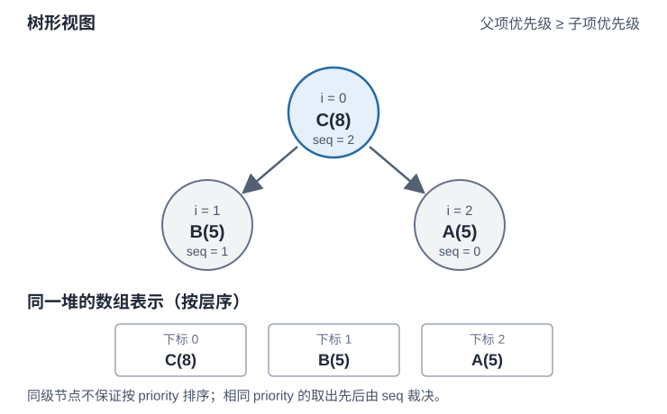

# 怎样在不断加入任务时持续取出最高优先级？

案例背景：合成报表 42 的调度器不断收到待处理任务；每当有执行资源空出来，就取当前最紧急的一项。若每次都重新排序整个集合，就会重复整理旧任务。priority queue（优先队列）只要求快速插入和取出当前最高优先级项；binary heap（二叉堆）用一条父子顺序约束支持这两项操作。

## 堆序只规定父子关系，不会把数组排好序

以下用最大堆，数值较大的优先级代表任务更紧急；相同优先级按先到先出。入堆时附上从 0 开始递增的 `sequence`，只有优先级相同时才比较它，较小序号先出。把完全二叉树（最后一层从左向右填充）按层从左到右放入数组，使用 0 起始下标时，只有 `i > 0` 的位置才有父节点，父节点下标是 `floor((i - 1) / 2)`，子节点是 `2i + 1` 与 `2i + 2`。在比较关系可传递时，堆序要求任一父项不低于它的孩子；根沿路径传递下来，便不低于任何节点。除根以外，兄弟节点之间没有整体次序，数组也不是排序结果。

任务 A 和 B 的优先级均为 5，A 先到；C 的优先级为 8。插入 C 后的树形与数组层序表示如下。箭头只表示父子堆序，不表示数组整体排名。

| 操作 | 堆数组（按层序） | 发生的修复 |
|---|---|---|
| 插入 A(5) | [A(5)] | 根无需调整 |
| 插入 B(5) | [A(5), B(5)] | 同优先级时 A 序号较早，不交换 |
| 插入 C(8) | [C(8), B(5), A(5)] | C 从下标 2 上浮到根 |
| 插入 D(2) | [C(8), B(5), A(5), D(2)] | D 低于父项 B，留在数组末尾 |
| 取出 | [A(5), B(5), D(2)] | 返回 C；D 补到根后，B、A 都优于 D；两者同分，较早的右孩子 A 优先，与 D 交换 |

插入先放数组末尾，再只沿父节点上浮；删除根时先用末项填根，再比较左右孩子，和优先级更高的孩子交换后继续下沉，直到当前项不低于两个孩子，或已到叶子。例子中 B 与 A 同为 5，`sequence` 较小的 A 胜出，所以 D 先与右孩子 A 交换。每次修复只走一条根到叶路径，不扫描整堆。

堆有 `n` 个节点时，最大高度 `H = floor(log₂ n)`。因此上浮或下沉至多走 O(log n) 层：以元素比较和交换次数计，push、pop 各为 O(log n)，peek 只读根是 O(1)，堆项占 O(n) 个槽位。

如果所有元素一开始都已知，可以从最后一个非叶节点向根逐个下沉来建堆，整体 heapify 为 O(n) 次比较/交换；若元素逐个到达，则逐项 push，累计为 O(n log n)。heapify 仍为线性，是因为大多数节点靠近叶子，只能下沉少数几层；可继续下沉至少 h 层的节点数，随 h 每增加 1 至多约减半。设完全树的最大高度 `H = floor(log₂ n)`；高度为 `h` 的节点至多有 `ceil(n / 2^(h+1))` 个，每个最多下沉 `h` 层，因此有限范围 `1 ≤ h ≤ H` 的工作量上界为 `Σ h·ceil(n / 2^(h+1)) = O(n)`。自底向上建堆要求能同时访问整批初始元素。

> [!info]- 实现成本口径
> 上述堆操作复杂度把单次优先级比较视为 O(1)，计的是元素比较和交换。一次 `items.push` 若触发动态数组扩容，可能额外复制 O(n) 个槽位；在常见几何扩容模型下，扩容成本摊还为每次追加 O(1)。稳定队列用 BigInt `sequence` 作次级键：若序号有 `b` 位，比较或递增最多需 O(b) 位操作；累计 `m` 次入队时，序号位数随 `log m` 增长。这里的 O(n) 空间计堆槽位，不计 BigInt 字段的位数。

普通堆若只比较优先级 `priority`，并不保证并列项稳定；稳定行为来自代码中的 `sequence` 次级键。此实现用 BigInt 序号，优先级必须是有限 JavaScript Number；进入队列的优先级与序号保持不变。非空 `peek()`/`pop()` 返回含 `priority`、`sequence`、`value` 的冻结记录；空堆的两者都返回 `null`。任务包装在对象中，所以任务 `value` 本身即使是 `null`，也不与空队列哨兵混淆。

`BinaryHeap(higher)` 要求 `higher` 是函数，否则抛 `TypeError`；它还必须形成严格弱序：没有元素高于自身，优先关系可传递；若两项互不高于对方，就把它们视为同一优先级档，而且“同档”关系也可传递。堆项留在堆中期间，比较结果也必须保持一致；若可变字段改变了项的相对顺序，就要重建或重新调整堆。否则父子堆序不一定能让根代表全体最高项。`toArray()` 返回内部堆数组的浅拷贝，仍按堆布局排列，不是排序结果；Top K 会再对这份拷贝排序。

> [!example]- 可运行：稳定最大优先队列
> ~~~javascript
> class BinaryHeap {
>   constructor(higher) {
>     if (typeof higher !== 'function') throw new TypeError('higher must be a function');
>     this.higher = higher;
>     this.items = [];
>   }
>
>   get size() { return this.items.length; }
>   peek() { return this.items.length === 0 ? null : this.items[0]; }
>
>   push(value) {
>     const items = this.items;
>     items.push(value);
>     let i = items.length - 1;
>     while (i > 0) {
>       const parent = Math.floor((i - 1) / 2);
>       if (!this.higher(items[i], items[parent])) break;
>       [items[i], items[parent]] = [items[parent], items[i]];
>       i = parent;
>     }
>   }
>
>   pop() {
>     const items = this.items;
>     if (items.length === 0) return null;
>     const root = items[0];
>     const last = items.pop();
>     if (items.length > 0) {
>       items[0] = last;
>       let i = 0;
>       while (true) {
>         const left = 2 * i + 1;
>         const right = left + 1;
>         let best = i;
>         if (left < items.length && this.higher(items[left], items[best])) best = left;
>         if (right < items.length && this.higher(items[right], items[best])) best = right;
>         if (best === i) break;
>         [items[i], items[best]] = [items[best], items[i]];
>         i = best;
>       }
>     }
>     return root;
>   }
>
>   toArray() { return this.items.slice(); }
> }
>
> class StableMaxPriorityQueue {
>   constructor() {
>     this.sequence = 0n;
>     this.heap = new BinaryHeap((a, b) =>
>       a.priority > b.priority ||
>       (a.priority === b.priority && a.sequence < b.sequence)
>     );
>   }
>   get size() { return this.heap.size; }
>   peek() { return this.heap.peek(); }
>   push(priority, value) {
>     if (!Number.isFinite(priority)) throw new TypeError('priority must be finite');
>     this.heap.push(Object.freeze({ priority, sequence: this.sequence, value }));
>     this.sequence += 1n;
>   }
>   pop() { return this.heap.pop(); }
> }
>
> const tasks = new StableMaxPriorityQueue();
> tasks.push(5, 'A');
> tasks.push(5, 'B');
> tasks.push(8, 'C');
> tasks.push(2, 'D');
> console.log(tasks.pop().value); // C
> console.log(tasks.pop().value); // A
> console.log(tasks.pop().value); // B
> console.log(tasks.pop().value); // D
> console.log(tasks.pop());       // null
> ~~~

若元素已知且要完整排序，直接排序可能更简单；堆的优势出现在不断插入、只需当前极值，或只保留少量 Top K 的时候。

## 只保留 Top K 时，根节点代表淘汰线

这里切换到另一组合成输入：一次收到一批带分数的候选，只返回最高的 K 项。维护最多 K 项的最小堆，根就是当前保留集合里最差的一项；同分时较晚到达者更差。堆未满 K 项时直接插入候选；堆满后，仅当候选分数严格高于根时才删除根并插入候选。与根同分的后来候选也应丢弃，因为根比新候选更早到达。下方代码复用前面折叠示例中的 `BinaryHeap`。依次读入 A(8)、B(5)、C(5)、D(7)、E(1)，K=3：

`topK` 接收 `values` 数组、非负安全整数 `k`，并要求每项都有有限数值 `score`；先校验整批输入，再开始筛选。返回值按分数降序排列，同分按输入先后。

返回数组沿用 `values` 中的原对象引用，筛选和最终排序不会改写输入数组。

| 已读分数 | 保留集合 | 根（当前淘汰线） | 动作 |
|---|---|---|---|
| A(8) | A(8) | A(8) | 堆未满 3 项，直接插入 |
| A(8)、B(5) | A(8)、B(5) | B(5) | 堆未满 3 项，直接插入 |
| A(8)、B(5)、C(5) | A(8)、B(5)、C(5) | C(5) | 插入后堆已满；同分时较晚的 C 是淘汰线 |
| 再读 D(7) | A(8)、D(7)、B(5) | B(5) | D 高于根，替换同分中较晚的 C |
| 再读 E(1) | 不变 | B(5) | E 不高于根，丢弃 |

令 `k' = min(K, n)`。K 为正且 n 非零时，代码先花 O(n) 校验输入，再扫描 n 项；堆满后，每个候选至多触发一次 O(log(k' + 1)) 的堆调整，所以扫描最多做 O(n log(k' + 1)) 次堆比较。最后只排序保留的 `k'` 项，按比较排序模型另需 O(k' log(k' + 1)) 次比较；分数并列时由 `sequence` 明确排序，因此不依赖内置排序的稳定性。ECMAScript 不保证内置 `sort` 的具体比较次数。堆、中间副本和返回数组共占 O(k') 额外空间；调用方传入的 `values` 不计入。K=1 时扫描为 O(n)，K>n 时保留并返回全部 n 项，再按分数与输入先后排序。K=0 仍先校验全部 n 项，再返回空数组，耗时 O(n)；n=0 时返回空数组。

~~~javascript
function topK(values, k) {
  if (!Array.isArray(values)) throw new TypeError('values must be an array');
  if (!Number.isSafeInteger(k) || k < 0) throw new RangeError('k must be a non-negative safe integer');
  for (const item of values) {
    if (!item || !Number.isFinite(item.score)) {
      throw new TypeError('values must contain items with finite scores');
    }
  }
  if (k === 0 || values.length === 0) return [];

  const worstFirst = (a, b) =>
    a.score < b.score ||
    (a.score === b.score && a.sequence > b.sequence);
  const heap = new BinaryHeap(worstFirst);

  for (let i = 0; i < values.length; i++) {
    const candidate = { score: values[i].score, sequence: BigInt(i), value: values[i] };
    if (heap.size < k) {
      heap.push(candidate);
    } else if (candidate.score > heap.peek().score) {
      heap.pop();
      heap.push(candidate);
    }
  }

  return heap.toArray()
    .sort((a, b) => {
      if (a.score > b.score) return -1;
      if (a.score < b.score) return 1;
      if (a.sequence < b.sequence) return -1;
      if (a.sequence > b.sequence) return 1;
      return 0;
    })
    .map(item => item.value);
}

const scoredTasks = [
  { id: 'A', score: 8 }, { id: 'B', score: 5 }, { id: 'C', score: 5 },
  { id: 'D', score: 7 }, { id: 'E', score: 1 }
];
console.log(topK(scoredTasks, 3).map(task => task.id)); // ['A', 'D', 'B']
console.log(topK(scoredTasks, 0));                     // []
~~~

若所有项都已到达且最终要完整排序，排序一次通常更直接（见[分区如何改变快速排序的时间和空间代价](partitioning-and-sorting-costs.md)）；若 n 很大而 K 很小，同一 Top K 更新规则可在输入逐项到达时只保留 O(K) 个候选。本页代码接收的是数组，所以其 O(K) 是算法额外堆空间，不包括调用方已持有的 O(n) 输入。优先队列可用于任务调度；固定大小堆适合筛选少量最高分候选，二者共享堆操作，但取舍目标不同。

> [!info]- 来源
> - 完全二叉树数组表示、上浮/下沉、插入/删除极值、线性 bottom-up heapify：[Robert Sedgewick 与 Kevin Wayne, Algorithms, 4th ed., §2.4 “Priority Queues”](https://algs4.cs.princeton.edu/24pq/)。该章按比较次数说明堆界，并说明动态数组扩容的界是摊还界。本页以 0 起始数组实现同一堆序；操作结果由 Node.js 运行复算。
> - 并列键稳定处理的作者实现样本：[Algorithms, 4th ed., §2.5 “Sorting Applications” 的 StableMinPQ.java](https://algs4.cs.princeton.edu/25applications/StableMinPQ.java.html)。本页显式把到达序号作为次级比较键，稳定性因此属于本页 API 合约。
> - `Array.prototype.sort` 的稳定比较规则及由运行时决定的比较调用序列：[ECMAScript 2026, §23.1.3.30](https://tc39.es/ecma262/2026/multipage/indexed-collections.html#sec-array.prototype.sort)。本页 Top K 的最终排序复杂度按比较排序模型计，不把某个引擎的具体算法写成语言保证。
