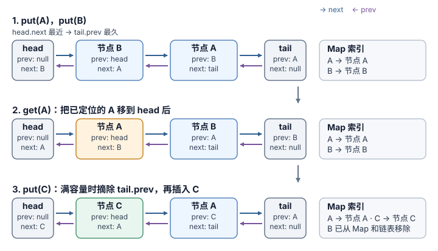

# 最近最少使用缓存怎样按键查找并更新最近使用顺序？

案例背景：一个合成报表界面在前端缓存最近看过的页面，用 Least Recently Used cache（LRU cache，最近最少使用缓存）实现：缓存满了就淘汰最久没被用过的那一项。为便于手算，容量设为 2，涉及三个页面：A 是账户 acct-17 的 report/42 某一游标页，B 是同一账户的 report/41 页面，C 是该账户首页。操作顺序是：先 `put(A)`、`put(B)` 放满缓存，再重新查看 A，然后打开 C；期望结果是保留 A、C，淘汰最久未使用的 B。

实现需要两种能力：按键快速找到缓存项，以及随时知道哪一项最久未用。本章先用 JavaScript `Map` 的插入顺序一并解决，再看它的复杂度为什么没有保证，最后用“双向链表 + Map”显式维护顺序。

> [!warning] 缓存键要包含权限和查询条件
> 如果页面内容取决于权限和查询条件，缓存键必须区分账户或授权范围、过滤器和游标，否则可能把别人的数据返回给当前用户；命中缓存也不能代替本次请求的授权检查。

## 用 Map 插入顺序表示新近程度

`Map` 按插入顺序迭代。这个实现就把它当作一条从最旧到最新的队列：命中时先删除键再重新设置，键就移到最新一端（只对已有键调用 `set` 会原位更新值，不改变位置）。本实现的约定是：命中的 `get` 和容量大于 0 时的 `put` 都算一次“使用”，会刷新顺序；未命中的 `get` 不改变顺序；`has` 只检查是否存在，不刷新。容量须为非负整数，容量为 0 时 `put` 什么也不保存。缓存最多容纳 c 项时，空间为 O(c)。

键和值可以是任何 `Map` 接受的类型。`get` 未命中时返回 `undefined`，所以要区分“存了 `undefined`”和“不存在”，应使用 `has`。键的相等规则沿用 `Map` 的 SameValueZero：`NaN` 与自身匹配，`+0` 与 `-0` 是同一个键；对象键按引用比较，内容相同但新建的数组是另一个键。实际场景中若用对象表示页面键，应先把它规范化成字符串。

~~~javascript
class LRUCache {
  constructor(capacity) {
    if (!Number.isInteger(capacity) || capacity < 0) throw new RangeError('capacity must be a non-negative integer');
    this.capacity = capacity;
    this.cache = new Map();
  }
  has(key) { return this.cache.has(key); }
  get(key) {
    if (!this.cache.has(key)) return undefined;
    const value = this.cache.get(key);
    this.cache.delete(key);
    this.cache.set(key, value);
    return value;
  }
  put(key, value) {
    if (this.capacity === 0) return;
    if (this.cache.has(key)) this.cache.delete(key);
    else if (this.cache.size === this.capacity) {
      const oldestKey = this.cache.keys().next().value;
      this.cache.delete(oldestKey);
    }
    this.cache.set(key, value);
  }
}
~~~

> [!example] 容量为 2 的淘汰过程
> `put(A, 页面42)`、`put(B, 页面41)` 后，A 最旧、B 最新。`get(A)` 命中后顺序变成 B、A；`has(B)` 返回 true，但不改变顺序。`put(C, 首页)` 淘汰 B，留下 A、C。对已有键调用 `put` 会更新值并把该键移到最新端。
>
> | 操作 | 最旧 → 最新 | 返回或淘汰 |
> |---|---|---|
> | put(A) | A | — |
> | put(B) | A, B | — |
> | get(A) | B, A | 页面 42 |
> | has(B) | B, A | true，顺序不变 |
> | put(C) | A, C | 淘汰 B |

这个版本代码很短，但复杂度没有规范保证。ECMAScript 只要求 `Map` 的平均键访问时间相对元素数量次线性，并不承诺 O(1)。插入新键的分支还会读取 `.size`：规范把这个 getter 描述为逐项统计未删除的条目，没有给出 O(1) 保证，不过引擎可以另外维护一个计数。

同样，规范也不能保证用 `keys().next()` 取最旧键是 O(1)。规范描述的迭代是沿插入顺序前进、跳过已删除的项；如果引擎用数组式结构存储，反复“删除再插入”可能留下许多要跳过的空位。但规范也明确说，这个逐项列表只是描述可观察行为的模型，并不要求引擎这样实现。结论是：只用 `Map` 的版本行为正确、代码短，但仅凭规范无法证明满容量时的淘汰是 O(1)；`.size` 和迭代器的实际代价取决于引擎。要得到能论证的 O(1)，需要自己维护顺序，这就是下一节的做法。

## 用双向链表加 Map 显式维护索引与顺序

这一版分工明确：`Map` 只负责把键映射到链表节点；双向链表用 `prev`/`next` 维护新近顺序，`tail.prev` 直接给出待淘汰的项。每次操作结束后，两种结构满足以下不变量：

- 非空时，`head.next` 是最近使用的节点，`tail.prev` 是最久未使用的节点；空链时 `head.next === tail` 且 `tail.prev === head`。
- 每个真实节点在链上恰好出现一次，`Map` 中每个键恰好指向它对应的节点。
- `head` 和 `tail` 是不进入 `Map` 的哨兵节点，因此在头部插入、摘除节点时都不必为空链或边界写特殊分支。

调用约定与上一节相同：命中的 `get` 或容量非零时的 `put` 刷新顺序；`has` 和未命中的 `get` 不刷新。

~~~javascript
class ListNode {
  constructor(key, value) { this.key = key; this.value = value; this.prev = null; this.next = null; }
}
class LinkedLRUCache {
  constructor(capacity) {
    if (!Number.isInteger(capacity) || capacity < 0) throw new RangeError('capacity must be a non-negative integer');
    this.capacity = capacity;
    this.nodes = new Map();
    this.head = new ListNode(null, null);
    this.tail = new ListNode(null, null);
    this.head.next = this.tail;
    this.tail.prev = this.head;
  }
  has(key) { return this.nodes.has(key); }
  get(key) {
    const node = this.nodes.get(key);
    if (!node) return undefined;
    this._remove(node);
    this._addToFront(node);
    return node.value;
  }
  put(key, value) {
    if (this.capacity === 0) return;
    const existing = this.nodes.get(key);
    if (existing) {
      existing.value = value;
      this._remove(existing);
      this._addToFront(existing);
      return;
    }
    if (this.nodes.size === this.capacity) {
      const oldest = this.tail.prev;
      this._remove(oldest);
      this.nodes.delete(oldest.key);
    }
    const node = new ListNode(key, value);
    this.nodes.set(key, node);
    this._addToFront(node);
  }
  _addToFront(node) {
    node.next = this.head.next;
    node.prev = this.head;
    this.head.next.prev = node;
    this.head.next = node;
  }
  _remove(node) {
    node.prev.next = node.next;
    node.next.prev = node.prev;
  }
}
~~~

下图用同一组 A/B/C 操作展示节点链接和 `Map` 索引。每行是一次操作完成后的状态，从 `head` 向右按“最近 → 最久”排列，方向与上一节表格（最旧 → 最新）相反；`has(B)` 不改变状态，没有单独画出。橙色标出被命中的 A，绿色标出新插入的 C；不看颜色时，节点文字和箭头也足以表明前后关系。

`get(A)` 先通过 `Map` 找到 A 的节点。`_remove(A)` 把 A 的前驱 B 与后继 `tail` 直接连起来；随后 `_addToFront(A)` 把 A 插到哨兵 `head` 之后。摘下后到插入前，A 自己的 `prev`/`next` 还保留着旧指针，紧接着的插入会覆盖它们。完成后 B 成为 `tail.prev`。接着满容量执行 `put(C)`：`tail.prev` 直接给出 B，从链上摘除 B 并从 `Map` 删除 B，再创建 C 的节点、登记到 `Map` 并插到表头。

复杂度：已知节点时，摘除或移到表头只改固定几个链接，从 `tail.prev` 取最旧项也是一次访问，所以这些链表步骤确定是 O(1)。在常见的可扩容哈希表模型下，`Map` 的查找、插入、删除按期望均摊 O(1) 计（扩容重排的成本摊到各次写入上），读取 `.size` 按 O(1) 计；在这些假设下，完整的 `get`/`put` 是期望均摊 O(1)。再次提醒，ECMAScript 对键访问的最低保证只是平均次线性，也没有规定 `.size` 的复杂度。空间上，每个缓存项多一个节点和两条链接，连同 `Map` 共 O(capacity)；节点分配与垃圾回收（GC）的时间不计入这个抽象的操作计数。

| 只用 Map | Map + 双向链表 |
|---|---|
| **刷新命中项 A：** 删除再重设；查找/更新由 Map 实现 | **刷新命中项 A：** Map 定位节点，再做固定次数的指针改写 |
| **满容量加入 C：** 先读 `.size`，再用 `keys().next()` 取最旧键；两者都没有规范 O(1) 界 | **满容量加入 C：** 先读 `.size` 判断是否已满；满时 `tail.prev` 即最旧节点，再删除 Map 项并把新节点插到头部 |
| 状态少、代码短；不能从标准推出淘汰 O(1) | 多一组指针和节点分配；在哈希 Map 插删查找期望均摊 O(1)、`.size` 读取 O(1) 的模型下，完整操作期望均摊 O(1) |

> [!example]- 可选：不使用 Map/Record 的数字键练习变体
> 这是常见算法练习题的写法，有几处限制：
>
> - 缓存值不能是 -1，因为 `get` 用 -1 表示未命中，而代码并不拒绝写入 -1。
> - 索引用 `Object.create(null)` 建的无原型对象，以数字键查节点。对象会把数字键转成属性名字符串，所以 +0 和 -0 共用 `"0"`，所有 NaN 共用 `"NaN"`，正负无穷各成一个属性名。超出安全整数范围的 ID 也会冲突：文本 ID `9007199254740992` 与 `9007199254740993` 转成 Number 后都舍入为 `9007199254740992`，无法区分。
> - 链表不用哨兵：空表时 `head` 和 `tail` 都是 null，只有一个节点时两者指向同一节点。
> - 容量须为非负整数；对象属性访问的复杂度由引擎决定，ECMAScript 不保证 O(1)。
>
> 淘汰策略与前面相同：命中移到头部，满容量插入时淘汰尾节点。
>
> 容量为 2 时，`get(1)` 后 1 成为最近项，下一次加入 3 淘汰 2：
>
> | 操作 | head → tail（最近 → 最久） | 返回或淘汰 |
> |---|---|---|
> | `put(1, 10)` | 1 | — |
> | `put(2, 20)` | 2 → 1 | — |
> | `get(1)` | 1 → 2 | 10 |
> | `put(3, 30)` | 3 → 1 | 淘汰 2 |
> | `get(2)` | 3 → 1 | -1，未命中 |
>
> ~~~typescript
> class ListNode {
>   prev: ListNode | null = null;
>   next: ListNode | null = null;
>   constructor(readonly key: number, public value: number) {}
> }
> class NumericLRUCache {
>   private readonly index: { [key: string]: ListNode } = Object.create(null);
>   private head: ListNode | null = null;
>   private tail: ListNode | null = null;
>   private size = 0;
>   constructor(private readonly capacity: number) {
>     if (!Number.isInteger(capacity) || capacity < 0) throw new RangeError('capacity must be a non-negative integer');
>   }
>   get(key: number): number {
>     const node = this.index[key];
>     if (!node) return -1;
>     this.moveToHead(node);
>     return node.value;
>   }
>   put(key: number, value: number): void {
>     if (this.capacity === 0) return;
>     const existing = this.index[key];
>     if (existing) {
>       existing.value = value;
>       this.moveToHead(existing);
>       return;
>     }
>     if (this.size >= this.capacity) this.removeTail();
>     const node = new ListNode(key, value);
>     this.index[key] = node;
>     this.addHead(node);
>     this.size++;
>   }
>   private addHead(node: ListNode): void {
>     node.prev = null;
>     node.next = this.head;
>     if (this.head) this.head.prev = node;
>     this.head = node;
>     if (!this.tail) this.tail = node;
>   }
>   private remove(node: ListNode): void {
>     if (node.prev) node.prev.next = node.next;
>     else this.head = node.next;
>     if (node.next) node.next.prev = node.prev;
>     else this.tail = node.prev;
>     node.prev = null;
>     node.next = null;
>   }
>   private moveToHead(node: ListNode): void {
>     if (this.head === node) return;
>     this.remove(node);
>     this.addHead(node);
>   }
>   private removeTail(): void {
>     if (!this.tail) return;
>     const oldest = this.tail;
>     this.remove(oldest);
>     delete this.index[oldest.key];
>     this.size--;
>   }
> }
> ~~~

> [!info]- 来源
> - Map 使用 SameValueZero 区分键；Map 迭代按插入顺序；已存在键的 `set` 原位更新，删除后重设会追加；实现须提供平均次线性键访问。规范的 `.size` 语义按列表统计，且其逐项列表是可观察语义模型，并非引擎实现要求：[ECMAScript 2026, §§24.1、24.1.3.3、24.1.3.11–24.1.3.12、24.1.5.1](https://tc39.es/ecma262/2026/multipage/keyed-collections.html)。
> - 无 Map 变体以数字作对象索引时按 ToPropertyKey 转换；Number 安全整数之外的不同整数可能得到同一 Number 值：[ECMAScript 2026, §7.1.19 `ToPropertyKey`](https://tc39.es/ecma262/2026/multipage/abstract-operations.html#sec-topropertykey)、[§21.1.2.6 `Number.MAX_SAFE_INTEGER`](https://tc39.es/ecma262/2026/multipage/numbers-and-dates.html#sec-number.max_safe_integer)。
> - 容量 2 的状态和链表指针更新按本页代码复算。Node.js v26.13.0 运行了两种 JavaScript 实现；数字键练习以 TypeScript 5.7.2 严格模式编译并运行。上述结果只验证这些输入下的代码行为。
